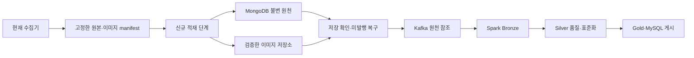

# 아키텍처 연계 계획과 현재 구현 경계

2026-10-16 기준 **계획 문서**다. MongoDB 적재·이미지 Object Storage 전송·Kafka·Spark·MySQL 통합을 구현한 결과가 아니다. 통합 구현은 사용자 요청으로 일시 중단했으며, 현재 문서 정리는 기존 수집기 설명을 보완하는 작업이다.

프로젝트의 [현행 데이터 파이프라인](../../docs/design/02-data-pipeline.md), [데이터 모델](../../docs/design/03-data-model.md), [Kafka 계약](../../docs/design/05-kafka-jobs.md), [직접 추천](../../docs/design/12-direct-recommendation.md)을 후속 구현 시 함께 대조한다. 역사 설계의 생성·템플릿 경로를 신규 처리로 다시 도입하지 않는다.

## 연결할 경계

| 현재 결과 | 통합에서의 역할·추가 필요 |
|---|---|
| product_raw | 관측 버전별 불변 원천 입력. MongoDB 컬렉션 계약으로 변환 필요 |
| products | 추출·정규화 중간 결과. 완성된 Silver나 서비스 상품 원장이 아님 |
| products_with_local_images | 상품·URL·해시·파일 연결 입력. 객체 키·저장 확인 정보 추가 관리 필요 |
| images 캐시 | 검증한 바이트 전송·재사용. 하드링크에 의존하지 않는 저장소 추상화 필요 |
| 수집 checkpoint | 계속 기존 수집 재개만 담당 |
| 신규 적재 checkpoint | DB·이미지 전송·이벤트 발행의 별도 상태·재개 책임 |

## 후속 구현 전에 확정할 것

- 상품 키(source/product_id)와 관측별 raw_document_id를 분리하고 같은 관측 재적재의 ID·중복 키를 고정한다. 현재 payload_hash 하나를 관측 버전 ID로 그대로 대체하지 않는다.
- 수집 중 바뀌는 개별 JSON 대신 완료된 이력 시점의 스냅샷을 입력으로 고정한다. 원문 payload는 발행 상태 변경으로 수정하지 않는다.
- 원천 ID·상품 ID·원천 이미지 URL·객체 키·checksum·관측 시각을 연결한다. 이미지 실패와 추천 승인 상태는 분리한다.
- Replica Set의 majority·journal 저장 확인 후 Kafka 발행을 진행한다. timeout을 저장 실패로 단정하지 않고 같은 ID로 보존 여부를 재대조한다.
- 발행 상태는 별도 관리하고 저장 후 발행 실패는 재수집하지 않는다. 같은 원천·이벤트 ID로 발행만 복구한다. DB·Object Storage·Kafka 전체를 단일 트랜잭션으로 간주하지 않는다.
- 카테고리 매핑·단위·축·옵션·이용 검수·추천 가능 판정은 후속 Silver/Gold 책임이다. 누락 값을 추정해 원천 실측 값으로 덮어쓰지 않는다.
- Retry-After·CAPTCHA·반복 오류 운영 정책과 감사·보관·삭제·자동 실행 계약을 연결한다. 해당 항목이 현재 모두 구현됐다고 표시하지 않는다.

## VM·EC2 배포

Python 의존성은 서버의 새 가상환경에 설치하고 MongoDB URI·입력 루트·이미지 저장 루트·체크포인트 루트를 외부 설정으로 분리한다. Windows .venv나 C:/Z: 경로를 Linux에 그대로 복제하지 않는다.

2026-10-16 개발 PC에서는 MongoDB 8.3.7·mongosh 2.9.2·Python 3.13.14를 확인했고 프로젝트 .venv에 PyMongo 4.18.3을 설치했다. 읽기 전용 연결과 로컬 300개 원본/가공/이미지 manifest의 BSON 변환을 검사했으며 오류는 없었다. 원본 최대 BSON 크기는 221,201바이트였다. 실제 DB 적재·권한·장애 전환·성능은 검증하지 않았다.

확인한 DB는 standalone이므로 문서의 과반수 복제 보존 계약을 충족한 배포가 아니다. requirements-collector.txt에는 수집기 의존성만 있으며 PyMongo 설치가 자동 재현되지는 않는다. 적재 모듈 구현 시 별도 의존성 계약에 명시하고 서버 버전도 배포 설정에서 맞춘다.

## 구현 순서 제안

1. 고정한 소량 배치로 입력 검증·불변 ID·멱등 적재·재실행 테스트.
2. 이미지 객체 저장·checksum·상품별 연결과 부분 실패 복구.
3. 저장 확인 후 Kafka 발행·미발행 재대조·이벤트 재전달 검증.
4. NiFi 실행 연계·Spark Bronze 읽기·독립 checkpoint·단일 Delta 작성자 계약.
5. Silver·Gold·MySQL의 고정 버전 게시와 서비스 추천 승인 연계.

정확한 컬렉션명·이벤트 필드·토픽·인프라 배치는 위 프로젝트 계약을 읽고 확정하며, 이 문서의 역할 표를 새 스키마 확정으로 취급하지 않는다.
