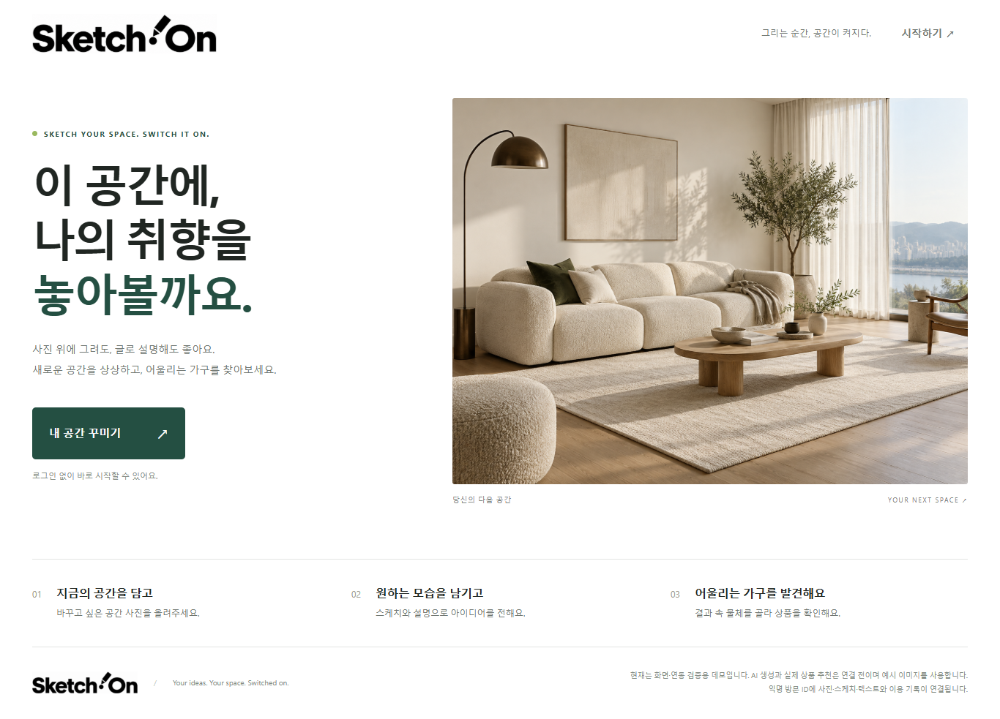
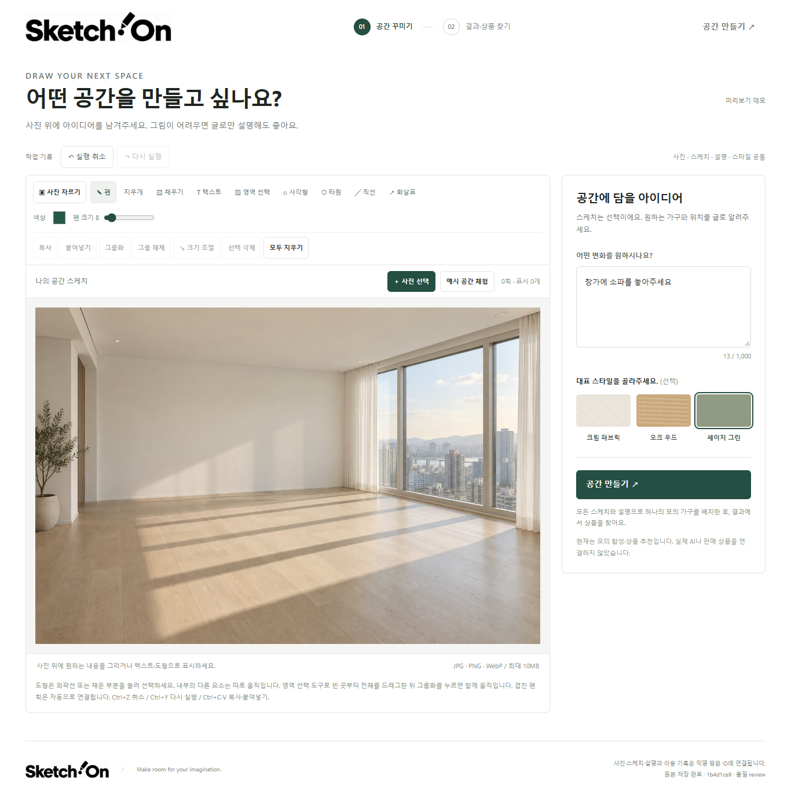
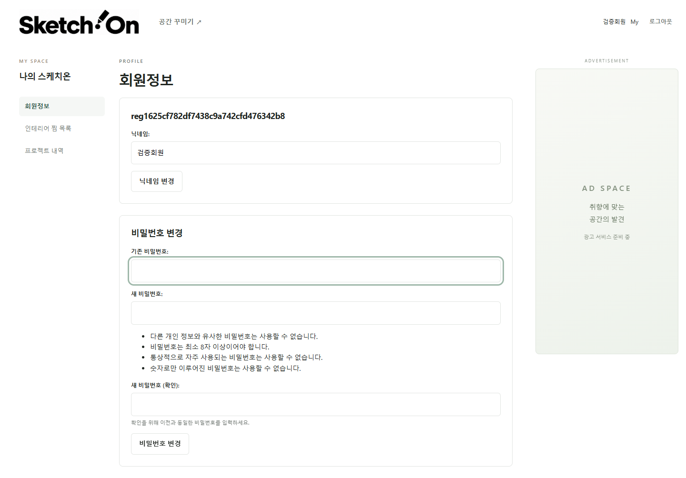
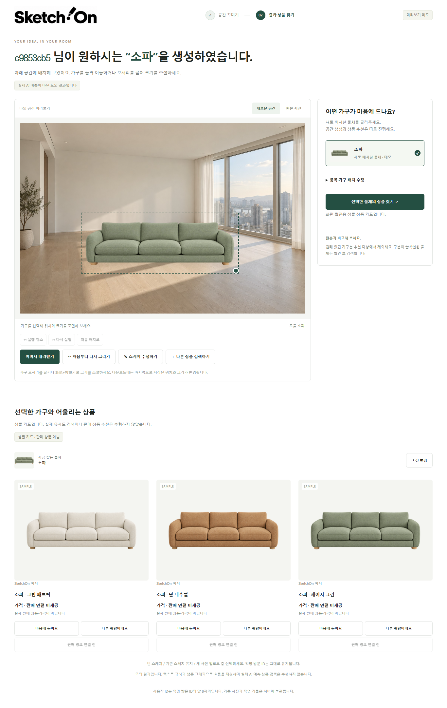
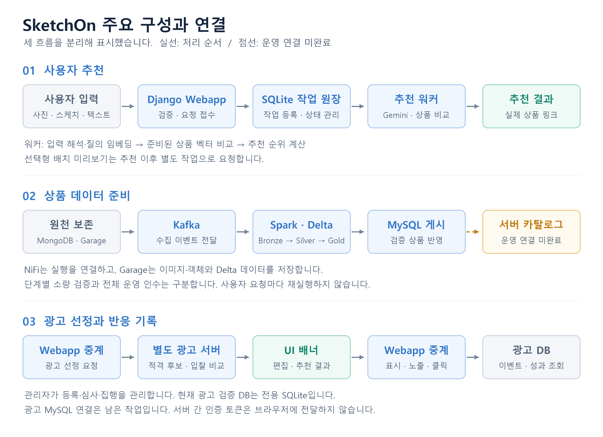
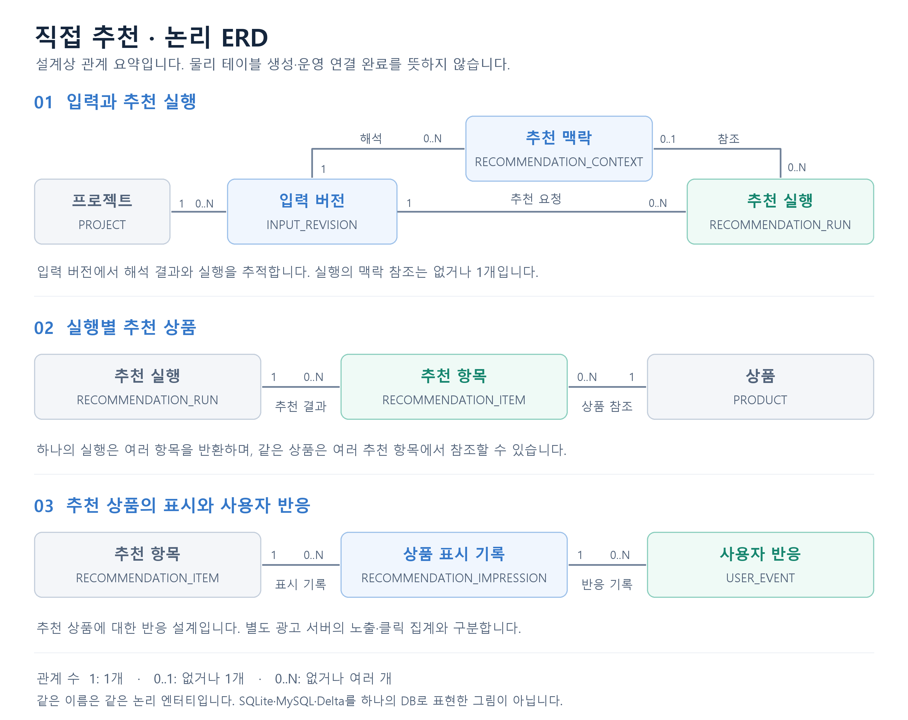

#  SketchOn · 스케치온

<p align="center"><strong>사진 위에 아이디어를 남기고, 내 공간에 어울리는 가구를 찾다.</strong></p>
<p align="center">prAXolve Encore MLOps 1기 · 3차 프로젝트 · Team 3</p>

<p align="center">
  
</p>

## 1. 프로젝트 소개

**SketchOn은 방 사진·스케치·설명에서 사용자의 의도와 공간 특징을 해석하여 실제 가구 상품을 추천하는 서비스입니다.**

검색어만으로 설명하기 어려운 위치·형태·분위기를 사진 위에 표현하고, 조건에 맞는 상품을 비교할 수 있도록 기획했습니다. 수집한 상품의 원천과 가공 과정을 추적하는 데이터 파이프라인, 추천과 구분되는 광고 운영 기능을 함께 구성했습니다.

```text
방 사진 + 스케치·설명 → 요청·공간 해석 → 상품 추천 → 상품 선택
선택한 상품 → 다나와 상품 페이지 이동 / 요청 시 배치 미리보기
```

상품을 먼저 추천하고, 사용자가 요청할 때 선택 상품의 배치 미리보기를 별도 작업으로 생성합니다.

시연은 원본 서비스와 분리한 앱에서 **미리 준비한 상품·이미지·벡터 파일**로 진행합니다. 실제 서비스 연결 상태는 6절에 정리했습니다.

### 시연 동영상

[로컬 MVP 시연 영상 보기·다운로드 (MP4, 약 3MB)](assets/videos/local-mvp-full-flow-fast-sketch.mp4)

저장소에 포함한 영상 파일입니다. GitHub에서 링크를 열어 확인하거나 다운로드해 재생할 수 있습니다. 로컬 시연 녹화이며 운영 환경의 전체 연동 완료를 의미하지 않습니다.

### 브랜드 캐릭터 · 카피사우루스

<p align="center">
  
</p>

**카피사우루스**는 연한 초록색 공룡 옷을 입은, 공룡이 되고 싶은 카피바라입니다. 홈에서 사용자를 맞이하고 사진 업로드·요청 작성·추천 진행을 안내합니다.

> **나만의 공간에 취향을 하나씩 넣어볼까요? 제가 도와줄게요!**

## 2. 팀 소개

**`mlo-01-p3-team3` · 5인 팀**

| 이름 | 역할 | 주요 담당 범위 | GitHub |
| --- | --- | --- | --- |
| **신성민** | PO·인프라 | 서비스·데이터 인프라 | [gururr-lab](https://github.com/gururr-lab) |
| **김영주** | PM · 설계 검토·검수 | 전체 기획·사용자 설계 검토·검수 | [escapedaily99](https://github.com/escapedaily99) |
| **이여찬** | AI 추천 · 설계 | 입력 해석·임베딩 검색·조건 검증·CPU 순위 계산 | [Ducks-Lee](https://github.com/Ducks-Lee) |
| **김세진** | 수집 · 데이터 파이프라인 | 상품·이미지 수집, Bronze → Silver → Gold, MySQL 게시 | [BSSM17](https://github.com/BSSM17) |
| **이형인** | UI 기획 · 운영 화면 | 사진·스케치 편집, 회원·이력·운영 콘솔 | [LEEHYUNGIN](https://github.com/LEEHYUNGIN) |

## 3. 주요 기능과 서비스 화면

- **공간 편집:** 사진 업로드·자르기, 펜·텍스트·도형·채우기·사진 스티커, 실행 취소·다시 실행
- **맞춤 추천:** 사용자가 명시한 요청 조건과 AI가 관찰한 방의 색조·재질·형태·스타일을 구분해 참고하고, 상품을 정렬해 판매 페이지로 연결
- **프로젝트 관리:** 회원가입·로그인, 프로젝트 저장·재편집, 찜 목록
- **운영 화면:** 이용자·작업·행동데이터·원천 수집·권한·감사 기록 조회
- **별도 광고 서버:** 광고주·캠페인 등록, 심사·집행, 테스트 입찰, 배너 선정과 반응 기록

아래는 **초기 UI 데모**의 홈·편집기·회원정보 화면입니다.

| 홈 · 서비스 진입 | 공간 편집기 · 사진과 아이디어 입력 |
| --- | --- |
|  |  |

<details>
<summary><strong>회원정보·초기 결과 화면 보기</strong></summary>

**My페이지:** 회원정보 변경과 찜 목록·프로젝트 내역 메뉴입니다. 오른쪽은 광고 준비 영역입니다.



**초기 결과 화면:** 모의 합성과 샘플 상품을 사용한 버전입니다. 현재 직접 추천의 실제 검색 결과나 외부 AI 생성 실적을 보여주는 캡처가 아닙니다.



</details>

## 4. 아키텍처와 기술 스택

인프라 배치 설계는 **내부망 VMware의 5대 Windows 호스트·모니터링 VM 포함 20대 VM**을 기준으로 합니다. AWS에는 배포하지 않았습니다. VM별 역할과 수량은 [인프라 설계](docs/design/01-infrastructure.md#기반-사양과-증설-상태)에 정리했습니다.



- **사용자 추천:** Webapp이 요청을 등록하고 별도 워커가 해석·임베딩·상품 비교를 수행합니다. Webapp이 상태와 결과를 조회합니다.
- **상품 데이터 준비(설계 흐름):** MongoDB·Garage 원천을 Kafka·Spark·Delta로 처리하고 NiFi가 실행을 조정하는 구조입니다. 시험 기록은 NiFi 2.12.0의 `timer → 제한 SSH → Master 검증 큐 tick`까지입니다. 업무 입력으로 7단계 FLOW를 운영하는 연결은 미완료이며, 전체 파이프라인 통합 기술 시험은 수행하지 않았습니다.
- **광고:** 별도 관리자가 등록·심사·집행을 관리하고, Webapp이 광고 선정 요청과 노출·클릭 반응을 중계합니다.

그림은 설계상 처리 순서와 연결 지점을 나타내며, 실선·점선 모두 실제 연결이나 시험 완료를 뜻하지 않습니다.

현재 로컬 구현은 Webapp 측 워커가 질의 임베딩·상품 비교·순위 계산·링크 처리를 수행합니다. 추후 [전체 설계](docs/design/00-architecture.md)에 따라 질의 임베딩·현재 상품 검증·추천 순위·링크 결정을 광고 서버 책임으로 옮기고, Application은 입력 해석·권한·요청 중계·이력 저장을 담당하도록 변경할 예정입니다. 사용자 입력의 Kafka·Bronze 보존 확인 연동도 후속 작업입니다.

| 영역 | 주요 기술 | 역할 |
| --- | --- | --- |
| 저장소 앱 구현·검수 | Python 3.11+, Django 5.2.x (고정 환경 5.2.18) | 회원·프로젝트·추천 요청·운영 화면 |
| 공간 편집 | JavaScript, HTML Canvas, Pillow | 사진 입력·스케치·이미지 검사와 가공 |
| 해석·임베딩 | Gemini API, Gemini Embedding API | 요청·공간 해석과 비교용 벡터 준비 |
| 상품 추천 | NumPy, scikit-learn | 코사인 유사도·조건 검사·수동 가중치 정렬 |
| 선택형 미리보기 | Gemini / Cloudflare FLUX 이미지 API | 설정에 따라 선택 상품의 배치 시안 생성 |
| 요청 처리·광고 | SQLite, Django 관리 명령, HTTP Gateway | 앱별 작업 원장·워커 처리·별도 광고 서버 중계 |
| 원천·파이프라인 설계 스택 | MongoDB, Kafka, Spark, Delta Lake, NiFi | 원천 보존·전달·계층 처리·실행 조정 목표. 제한 tick만 확인했고, 업무 FLOW·서비스 연계와 전체 파이프라인 통합 시험은 미완료 |
| 상품·객체 저장 | MySQL, Garage | 상품 게시·조회, 이미지 저장 |
| 인프라 모니터링 | Prometheus 3.15.0, Grafana 13.2.4, node_exporter 1.12.1 | 모니터링 VM 1대, node_exporter는 20대 서버 공통 |
| 검수·협업 | pytest, Django Test, Git·GitHub | 기능·권한·계약·브라우저 검수와 이슈·PR 관리 |

서버 소프트웨어 인벤토리는 아래의 운영 소프트웨어 스택에서 확인할 수 있습니다. 대시보드는 WebApp VM의 Django 6.1.2와 별도 venv의 Django 5.2.18이 각각 표시되고 있으며, 실제 구현 및 테스트에는 Django 5.2.18를 사용하였습니다. WebApp VM의 PyMySQL 1.2.3과 저장소 서버 잠금의 1.1.2도 별도 환경 버전입니다.

<details>
<summary><strong>온프레미스 인프라 아키텍처 보기</strong></summary>


이 그림은 서버 역할 배치와 목표 연결을 나타냅니다. 하단의 “검증된 주요 흐름” 표시는 실제 검증 범위보다 넓게 읽힐 수 있습니다. NiFi 원격 tick과 일부 구성요소 시험은 기록되어 있지만, 전체 7단계 업무 FLOW와 NiFi→Kafka→Spark→MySQL→WebApp 종단 통합 시험은 수행하지 않았습니다.

</details>

<details>
<summary><strong>운영 소프트웨어 스택 보기</strong></summary>


</details>


<details>
<summary><strong>보조 라이브러리와 처리 방식</strong></summary>

- **화면:** HTML·CSS와 Pointer Events로 편집기 표시와 입력을 처리합니다.
- **API·검증:** google-genai로 AI API를 연결하고, Pydantic으로 입력·응답 구조를 검증하며, HTTPX로 외부 통신을 처리합니다.
- **저장소 접근:** boto3와 S3 호환 API로 Garage의 객체를 읽고 저장합니다.
- **워커:** lease(작업 점유)·heartbeat(생존 확인)·재시도로 중단된 작업의 복구를 관리합니다.

</details>

추천 정책은 `interior-content-v3`이며 **콘텐츠 유사도와 수동 가중치**를 사용합니다. 추천 점수를 구매 확률로 해석하지 않습니다.

## 5. 데이터 흐름과 ERD

### 상품 데이터 준비

```text
상품·이미지 원천 보존 → Kafka 전달 → Spark·Delta Bronze
  → Silver 정제·품질 검사 → Gold 카탈로그 준비 → MySQL 게시·대조
```

처리 단계는 `INGEST → BRONZE → SILVER → GOLD → PREPARE → PUBLISH → RECONCILE`입니다. 출처·시각·체크섬과 원천 관계를 보존하고, 결측·실패·검토 대기를 구분합니다. 매핑·이용 검수·승인·등록 입력이 부족하면 다음 단계로 임의 진행하지 않습니다.

- **Bronze — 원천 보존:** 수집한 데이터와 출처·수집 시각을 보존하고 재처리할 수 있도록 연결합니다.
- **Silver — 정제·품질 검사:** 상품 속성·품목·단위·치수·옵션을 정리하고 결측·오류·검토 대기를 구분합니다.
- **Gold — 서비스용 데이터 준비:** 상품 카탈로그·이미지·벡터·링크의 준비 상태를 관리하고 검증된 결과의 MySQL 게시를 준비합니다.

### 상품 추천과 선택형 미리보기

상품 이미지는 미리 임베딩하여 **특징을 나타내는 숫자 배열(벡터)**로 준비합니다. 추천 요청 때는 사용자의 요청을 검색용 벡터로 만들고, 준비된 상품 벡터와 비교합니다. 상품 전체를 매번 다시 임베딩하는 방식은 아닙니다.

1. 사진·스케치·설명과 작업 소유권을 확인하고 SQLite 작업 원장에 요청을 등록합니다.
2. 별도 워커가 요청 의도와 공간 특징을 해석하고 검색용 벡터를 만듭니다.
3. 상품 조건과 벡터 호환성을 검사하고, 유사도와 방 특징에 수동 가중치를 적용해 후보를 정렬합니다.
4. 상품과 추천 근거를 표시하고 입력 수정·재추천·상품 페이지 이동을 제공합니다.
5. 사용자가 미리보기를 요청하면 선택 상품·방·스케치 입력을 고정해 별도 이미지 작업을 실행합니다. 기존 추천 결과는 유지합니다.

### 광고 선정과 반응 기록

1. 광고의 심사·기간·활성 상태를 확인하고 적격 후보를 선정합니다.
2. Webapp이 광고 서버의 선정 결과를 받아 화면 배너에 표시합니다.
3. 이미지 로드·실제 가시 노출·클릭을 구분하고 재전송을 중복 제거해 성과를 조회합니다.

광고 클릭은 구매·매출로 집계하지 않습니다. 광고 서버 장애나 후보 없음은 일반 서비스 기능과 분리해 처리합니다.

### 논리 ERD



설계는 **입력 버전·추천 실행 → 추천 상품 → 표시·사용자 반응**을 연결합니다. 같은 상품은 여러 추천 실행에 포함될 수 있으며, 상품 반응과 별도 광고 서버의 노출·클릭은 구분합니다. 이 그림은 논리 설계이며 실제 구현·시연 대체·남은 연결 범위는 다음 절에서 설명합니다.

## 6. 구현 현황과 남은 작업

**기능 구현완료와 내부망 VM 배포·전체 통합 검증 완료는 구분합니다.** 로컬 시연, 별도 광고 서버 검증, 파이프라인 단계별 시험을 하나의 통합 운영 결과로 표시하지 않습니다.

### 구현과 확인 범위

| 영역 | 상태 | 확인한 범위 |
| --- | --- | --- |
| 공간 편집·회원·프로젝트 | 구현완료 | 편집·저장·찜 목록과 접근 권한 검수 |
| 직접 추천·워커 | 구현완료 | 요청 해석·질의 임베딩·조건 검사·수동 가중치 정렬·상품 링크, 작업 원장·복구·재시도 시험 |
| 선택형 미리보기 | 구현완료 | 선택 상품·입력 고정과 외부 API 연계·입력 검증 경로 |
| 운영 콘솔·브랜딩 | 구현완료 | 권한별 이용자·작업·행동·수집·감사 조회, 캐릭터·안내 화면 반영 |
| 별도 시연 MVP | 시연용 구현완료 | 원본과 분리된 앱·화면·워커·테스트, 고정 파일 카탈로그 무결성·회귀 검증 |
| 광고 서버·UI | 코드 구현·시연 앱 미연결 | **격리 SQLite 환경**의 광고주·모의 계약·캠페인·심사·집행·테스트 입찰·배너·노출·클릭 시험. 현재 시연 앱에는 광고 서버가 연결되지 않으며, 서버 인벤토리에도 PJ3 전용 서비스 실행은 확인되지 않음 |
| 상품 데이터 파이프라인 | 미완료·일부 단계 소량 검증 | 수집-적재 자동 연계 미완료. Bronze 적재·중복 억제와 Silver·Gold 소량 실행 확인. 10/21 기준 전체 원천 상품 65,498건 중 646건(약 0.99%)이 업무 DB에 게시 완료. |
| 서버 추천 카탈로그 | 어댑터 구현·일부 기술 검증, 운영 데이터 연결 미완료 | MySQL·Garage·Delta 어댑터, 벡터 적재·재사용·내보내기·등록안 생성 코드와 기술 시험. 활성 인덱스·앱 연결은 미완료 |
| 광고 MySQL 전환 | 연결 준비 | MySQL 설정·드라이버 목록·Django 마이그레이션·설정 점검 명령 |

현재 시연 앱에는 광고 서버가 연결되지 않았습니다. 광고 중계 코드는 있으나 기본 설정은 꺼짐입니다. 연결 시 UI는 빈 맥락 신호를 전달해 일반 광고 후보를 사용합니다. **이미지 기반 맞춤 광고·학습형 개인화·실제 광고 과금은 구현 범위에 포함하지 않습니다.**

### 주요 검증 결과

기존 개발·시험 기록에서 확인한 결과입니다. 수치와 시험 대상은 다음과 같이 구분합니다.

| 검증 대상 | 기록된 수치·시험 내용 | 확인 범위 |
| --- | --- | --- |
| 원본·시연 앱 분리 | Django 테스트: 원본 159개·시연 163개. Node 테스트: 원본 30개·시연 32개. 격리 브라우저 검수 | 앱 분리와 로컬 회귀 검증 |
| 시연 카탈로그 | 상품 **1,421개**, 상품-이미지 관계 **1,457개**, 고유 이미지 **1,278개**, 벡터 **768차원** | 고정 카탈로그의 파일·벡터 무결성 검사 |
| 상품 MySQL 게시 | v2 스키마·TLS·권한 검사, 합성 상품 게시·재게시·감사 기록 시험 | 별도 검증 DB의 계약 시험. 업무 DB에 승인 데이터가 없고 활성 인덱스도 준비되지 않아 구현 앱의 업무 카탈로그 조회·추천을 확인한 것은 아님 |
| Spark 실행·NiFi 원격 tick | Spark Worker 3대의 barrier/Delta 작업, NiFi 2.12.0 `timer → 제한 SSH → Master 검증 큐 tick` 확인 | 구성요소·원격 실행 경로의 제한 시험. timer는 빈 큐 tick을 수행했으며 전체 파이프라인 통합 기술 시험, 업무 입력의 7단계 FLOW, 운영 일정 연계는 수행하지 않음 |
| 서버 임베딩 | 신규 이미지 **1개**의 768차원 벡터 적재·재조회, Delta v43 완료 벡터 **994개**의 대응·재사용 | 벡터 저장·조회와 시연용 추출 자료 재사용 |

이 결과가 전체 데이터 처리·업무 승인·추천 카탈로그 활성화·통합 운영 인수 완료를 뜻하지는 않습니다.

**상품 파이프라인 완료 기준:** 업무 입력으로 전체 흐름을 실행해 승인·품질 확인된 상품·이미지·벡터를 실제 상품 DB에 게시하고, 게시 데이터가 설계된 추천 경로에 연결되어 구현 앱에서 상품 추천까지 확인되어야 합니다. 합성 시험 데이터 게시나 고정 파일 카탈로그 검증만으로는 완료로 보지 않습니다.

### 시연 구성과 대체 범위

운영 MySQL의 게시 상품·이용 승인·활성 인덱스 연계 대신, 상품·이미지·벡터를 묶은 **고정 파일 카탈로그와 별도 시연 SQLite**를 사용했습니다.

원본 서비스와 시연 앱은 별도 프로세스로 실행하며 DB·파일 저장 위치·로그인 정보·브라우저 저장소를 구분합니다. 추천 엔진은 공유하므로 공통 엔진 수정은 두 앱에 영향을 줄 수 있습니다.

### 미완료·미검증 항목

**미완료**는 남은 구현·설정·연결 작업을, **미검증**은 구현 후 해당 환경에서 확인하지 못한 동작을 뜻합니다. **연결 준비**는 설정·어댑터가 있어도 실제 연결 완료를 의미하지 않습니다.

| 영역 | 현재 상태 | 남은 작업·확인 기준 |
| --- | --- | --- |
| 운영 상품 준비 | 업무 입력 확정 미완료 | 카테고리 매핑·이미지 이용 검수·링크·승인·등록 입력 확정 |
| 데이터 파이프라인 자동화 | 현재 운영 실행 없음·자동화 미구현 | NiFi 업무 FLOW와 수집 일정을 구성하고 Kafka 전달·Spark 가공·상품 DB 게시를 자동 연계하며, 실패 재시도·중단 후 복구·알림까지 검증 |
| 전체 파이프라인 | 일부 단계 소량 시험만 있음·데이터 수집과 적재 간 연동 미구현·NiFi 업무 FLOW 미구현 | 승인된 업무 입력으로 NiFi FLOW·운영 일정을 구성하여 데이터 수집과 적재를 연동하고, Kafka·Spark·상품 DB를 원천부터 게시·대조·중단·재개까지 연결해 시험한 뒤 운영 인수 |
| 상품 MySQL·추천 연결 | 검증 DB 게시 시험만 확인, 업무 상품 DB와 구현 앱의 추천 카탈로그 연결 미완료·시연 앱은 고정 파일 카탈로그 사용 | 실제 상품·승인 이미지·호환 벡터·활성 인덱스를 준비하고, 게시 DB 데이터가 설계된 추천 경로에 공급되어 구현 앱에서 추천되는지 확인 |
| 광고 MySQL | 설정 준비·실제 DB 연결 미완료 | 전용 DB·계정·테이블 생성, 필요한 데이터 이관, 저장·조회·동시 요청·중복 억제 검증 |
| 내부망 광고 집행 | 중계 코드 구현·시연 앱 미연결·VM 환경 미검증 | 별도 광고 서버 실행·광고 활성화·인증·주소·정적 이미지·승인 캠페인 설정 후 배너 표시·클릭·집계·재시작 후 상태 유지 확인 |
| 캠페인 자동 동기화 | UI 운영 콘솔과 광고 서버 간 미완료 | 양쪽 캠페인을 자동 동기화하는 연결 구현 |
| 시연 재현·화면 자료 | 로컬 분리 검증·서버 실행 미확인·자료 보완 필요 | Git 제외 PNG·스냅샷·미디어·벡터·보호 설정 전달, 웹·워커 실행과 최신 화면 확인 |
| 통합 운영 검수 | 미검증 | 처리량·노드 장애·백업 복원·최종 접근·배포 설정 시험과 인수 기록 확보 |


## 7. 실행과 문서 안내

| 구성 | 경로 | 역할 |
| --- | --- | --- |
| 원본 서비스 | `src/demo_sketchon/` | UI·회원·프로젝트·관리자·추천 접수와 워커 |
| 시연 전용 앱 | `src/local_demo/` | 고정 카탈로그 기반 시연 화면·워커·테스트 |
| 공유 추천 엔진 | `src/interior_recommender/` | AI 해석·추천·선택형 미리보기·운영 카탈로그 어댑터 |
| 데이터 파이프라인 | `src/data_pipeline/` | 원천·Bronze/Silver/Gold·품질·게시·복구 |
| 광고 서버 | `src/ad_server/` | 광고 심사·선정·배너·실적 |
| 문서·자산·실행기 | `docs/`, `assets/`, `scripts/` | 요구사항·설계·화면 자산·시연 실행기 |

| 찾는 내용 | 안내 |
| --- | --- |
| 요구사항 | [BRD](docs/BRD_3차.md) · [PRD](docs/PRD_3차_초안.md) |
| 전체 설계 | [문서 안내](docs/README.md) · [설계 목록](docs/design/index.md) · [아키텍처](docs/design/00-architecture.md) |
| 데이터·ERD | [파이프라인](docs/design/02-data-pipeline.md) · [핵심 ERD](docs/design/03-erd-summary.md) · [상세 ERD](docs/design/03-erd-full.md) · [데이터 모델](docs/design/03-data-model.md) · [MySQL 게시 계약](docs/design/13-gold-mysql-publication.md) |
| 추천·UI | [직접 추천 계약](docs/design/12-direct-recommendation.md) · [상품 미리보기](docs/interior-recommender/product-preview.md) · [UI·관리자](docs/UI/README.md) |
| 협업 | [GitHub 가이드](docs/guides/GITHUB_GUIDE.md) |

### 실행·연결 안내

- **앱:** [원본 서비스](src/demo_sketchon/README.md) · [시연 MVP](src/local_demo/README.md) · [분리·검증 기록](docs/interior-recommender/local-demo.md) · [시연 실행기](scripts/Start-LocalDemo.ps1)
- **추천:** [워커·복구·실행 계약](docs/interior-recommender/execution.md) · [서버 카탈로그](docs/interior-recommender/server-catalog.md)
- **파이프라인:** [실행·실서버 검증 안내](src/data_pipeline/README.md)
- **광고:** [실행·운영](src/ad_server/README.md) · [MySQL 연결 준비](src/ad_server/examples/MYSQL_SETUP.md)

시연 실행기는 `src/local_demo/manage.py`만 실행합니다. 웹과 워커는 같은 고정 카탈로그·시연 SQLite·출력 경로를 사용해야 하며, 시연 앱 기본 포트는 **8005**, 광고 서버 실행 안내의 포트는 **8004**입니다. 시연 앱은 `http://127.0.0.1:8005/`에서 엽니다. 광고는 별도 서버 실행·활성화·인증 설정이 필요하며 시연 실행기가 자동 연결하지 않습니다.

Git에 없는 스냅샷·이미지·미디어·보호 설정은 별도로 준비합니다. 비밀정보·실행 DB·업로드 이미지·벡터 원본은 Git에 포함하지 않습니다.

협업은 `Issue → 기능 브랜치 → Commit → Push → PR → Review → Merge` 순서로 진행합니다. 기능 PR은 `dev`를 대상으로 하고 `main` 직접 Push와 다른 담당자의 코드·원천·실행 DB 임의 덮어쓰기를 금지합니다.

## 8. 발표자료와 회고

### 발표자료

<p align="center">
  <a href="https://docs.google.com/presentation/d/1EGxW8LRRRNirPjwKGkzKC2xqh5kTVJSMM-jx2ODynQY/edit?slide=id.p1#slide=id.p1">
    
  </a>
</p>

<p align="center">SketchOn 프로젝트 발표자료 · Google Slides</p>

### 한 줄 회고

**신성민**

> 인프라를 구축하며, 서버를 띄우는 것만큼 서비스 간 연결과 안정적인 운영 환경을 만드는 일이 중요하다는 것을 배웠습니다.

**김영주**

> git 규칙을 통해 프로젝트를 진행함으로써 git 관리의 중요성을 배우게되었습니다.

**이여찬**

> AI 해석을 실제 상품 추천으로 연결하면서, 모델의 성능만큼 데이터의 준비 상태와 서비스 간 연결 기준을 명확히 설계하는 일이 중요하다는 것을 배웠습니다.

**김세진**

> 테스크의 우선순위 선정 및 수행이 프로젝트에 얼마나 큰 영향을 미치는지 알았으며, 파이프라인 구축에 실 서버에서 실행했을때 생기는 예기치 못한 문제와 지엽적인 문제가 얼마나 많이 발생하는지 배울 수 있었습니다.

**이형인**

> 화면에 보이는 기능뿐 아니라 사용자의 흐름과 서비스가 운영되는 방식까지 함께 설계해야 한다는 것을 배웠다.
