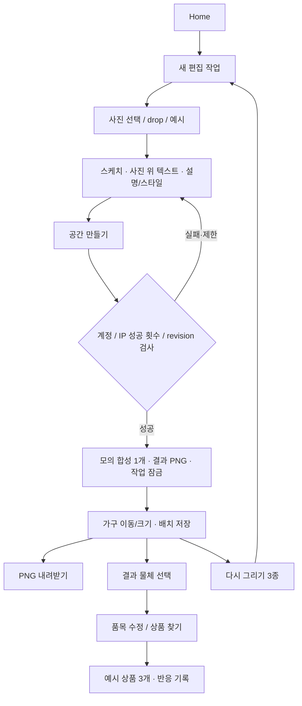

# 이용 및 서버 처리 Flow

기준일 2026-10-18 · 현재 코드의 실행 흐름. 비동기 AI 작업·실제 광고 서버·Kafka는 아직 이 흐름에 없다.

## 1. 기본 이용

Home와 새 editor는 흐름 ID로 이어진다. 사진 업로드·자르기는 새 Project를 만들면서 같은 흐름 ID를 전파한다. 완전히 새 작업과 저장 버전 복원은 새 flow_id를 사용한다. flow가 없는 이전 기록을 임의로 연결하지 않는다.

## 2. 사진·편집·생성 처리

1. 사진 업로드는 파일 크기·포맷·픽셀을 검사한다. 원본 바이트/체크섬과 편집용 JPEG를 따로 저장한다.
2. 사진 교체·crop·스케치·설명·스타일은 브라우저의 통합 이력으로 취소/다시 실행한다. 서버의 모든 옛 Project가 삭제되는 것은 아니다.
3. 편집 문서는 상대 좌표의 최종 상태이고, Raw는 점별 시간과 작업 재생 이력을 따로 수집한다.
4. 생성 요청은 request_id·revision·문서·설명을 보낸다. 같은 완료 요청의 재전송은 결과를 반환한다.
5. 모의 합성을 계산하고 write transaction에서 작업을 다시 읽어 충돌·재전송을 확인한다. 비회원 성공 횟수와 결과 저장/잠금을 함께 반영한다.
6. 성공한 Composition은 생성 입력 스냅샷·최초/현재 배치·PNG를 보관한다. GenerationAttempt는 요청별 최종 상태를 추적하며 늦은 실패가 성공을 덮지 않는다.
7. 결과 배치 저장은 Composition.version을 검사한다. 생성 당시 input_document와 현재 placements는 서로 다른 상태다.

사진 전처리에서 축소될 수 있으므로 원본 파일 해상도와 결과 PNG 해상도는 구분한다. 상세 근거: [views.py](../../../sketch/views.py), [quota.py](../../../sketch/quota.py), [tracking.py](../../../operations/tracking.py).

## 3. 가입·개인 이력

비회원 편집/결과 → 가입 또는 로그인 → 같은 브라우저의 미귀속 Project.account 연결 → 기존 작업으로 복귀한다. owner/writer_id와 Raw 원문은 바꾸지 않는다. 가입은 완료 안내 후 자동 로그인한다.

회원은 결과를 개인 프로젝트에 저장한다. 같은 결과 버전/요청 재전송은 중복 버전을 만들지 않는다. 저장 버전에는 별도 PNG와 문서·사진 참조·설명·배치 snapshot이 있다. 편집 복원은 새 작업을 만들고 재생성 결과를 저장할 때 같은 개인 프로젝트의 새 버전으로 추가한다. 두 버전 비교는 이미지 두 장을 나란히 제공한다. 예시 상품 찜은 본인 계정의 안정 상품 키로 중복을 방지한다.

근거: [access.py](../../../sketch/access.py), [accounts.py](../../../sketch/accounts.py), [library.py](../../../sketch/library.py).

## 4. 추천 실행과 오류

결과 선택 → scene object ID·결과 버전 확인 → 추천 request_id/입력 해시/lease 확보 → 로컬 provider 실행 → 서버 검증된 추천 항목 저장 → 3개 카드 표시 순서다. 같은 요청의 상태 조회와 만료 후 재시도가 있으며 오래된 결과/물체 버전은 충돌로 처리한다. 이 lease와 job 조회는 현재 프로세스에서 실행되는 추천 요청을 보호하기 위한 계약이지 외부 영속 작업 큐가 아니다.

상품 카드가 화면에 보일 때 PRODUCT_IMPRESSION, 사용자가 선택/비선호를 누를 때 해당 이벤트를 서버에 보낸다. 기본 provider에는 실판매 링크가 없어 링크 이동은 완료되지 않는다. 상품 반응을 광고 성과로 합산하지 않는다.

## 5. 수집과 운영 검수

행동 → 이벤트별 브라우저 큐 → 서버 검증/UUID 중복 검사 → SketchEvent다. Raw는 별도 IndexedDB 보관 → samples API → 엄격 JSON·재생 일치 검증 → 불변 파일 저장 → RawReceipt 메타데이터/경고 → 사람의 승인/반려/보류다. 서버에 도착하지 않은 브라우저 데이터는 운영자가 조회할 수 없다.

운영자는 권한이 있는 메뉴만 열 수 있다. 사진/Raw 다운로드와 민감 정보 조회에는 추가 권한과 감사가 적용된다. 광고 흐름은 **로컬 초안→심사→활성 요청/중지**까지만 존재한다. 광고 서버에 송출하거나 실제 성과를 생성하는 다음 단계는 미구현이다.
