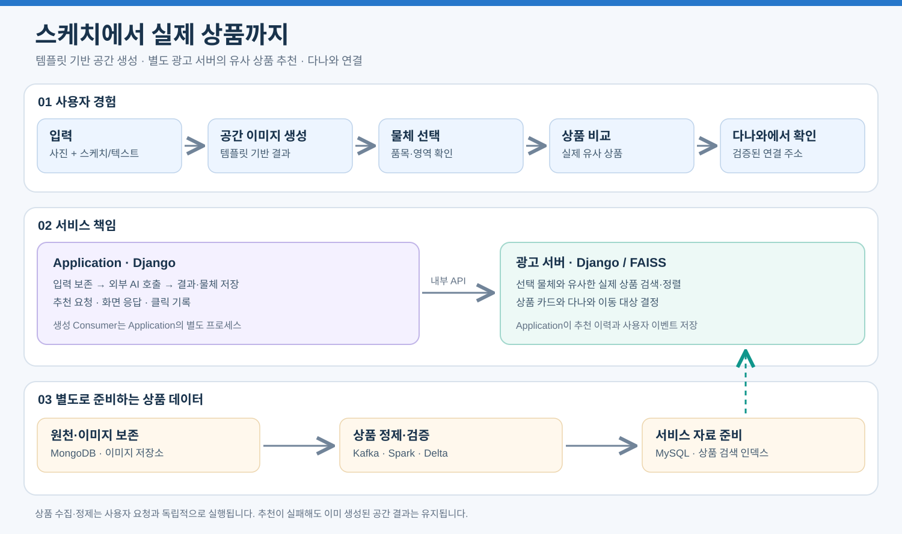

# 전체 아키텍처

Application은 템플릿 기반 공간 이미지를 만들고, 별도 광고 서버는 생성 결과와 유사한 실제 상품 추천 및 다나와 연결을 담당한다.

[안내](index.md) · [BRD](../BRD_3차.md) · [PRD](../PRD_3차_초안.md)

## 전체 구성 한눈에 보기

그림은 사용자 이용 순서, Application과 광고 서버의 역할, 별도 상품 준비 경로를 구분해 보여준다. [PNG로 보기](assets/architecture-overview.png). 설치 완료 상태를 의미하지 않는다.

## 서비스 책임

| 구성 | 책임 |
|---|---|
| 사용자 웹·Application | 인증·입력 보존, 스케치/텍스트 편집, 템플릿 선택·생성 요청, 결과와 물체 관리, 추천 화면과 이력 저장 |
| 생성 Consumer·외부 API | Cloudflare FLUX.2 klein 4B로 공간 생성, Gemini로 입력 해석·결과 물체 분석 |
| 광고 서버 | 선택 물체의 유사 상품 검색·순위 결정, 상품 카드 정보 구성, 다나와 및 검증된 상품 페이지 연결 결정, 반응 집계 조회 |
| 데이터 파이프라인 | 확보한 상품정보·이미지 정제, 출처·상품 연결 보존, 서비스 카탈로그와 검색 인덱스 준비 |
| MongoDB·이미지 저장소 | 원천 관측과 이미지 파일·참조 보존 |
| Spark·Delta | Bronze/Silver/Gold 처리, 품질 검증, 행동 집계 |
| MySQL | 서비스 상품·판매 정보, 입력·생성·추천 이력, 작업 상태와 사용자 이벤트 |
| Kafka | 비동기 준비 작업·처리 결과·행동 이벤트 전달 |

기존 인프라의 Application과 광고 서버 배치를 유지하며 실제 설치 상태는 별도 확인한다. 서비스 분리는 프로세스·API·판단 책임을 기준으로 하고 초기에는 기존 MySQL을 제한된 권한으로 공유한다.

## 작업 내부 실행 방식

의미를 관찰·해석하는 외부 AI와 해석 이후 계산하는 자체 코드를 구분한다. 의미 해석·임베딩 생성·공간 생성·시각 비교는 외부 API, 검색 문장 조립·벡터 검색/정렬·좌표 변환·프롬프트 작성·수치 검증·추천 대상의 최종 선택 조건은 Application/광고 서버 코드가 수행한다. 사용자에게 추가 절차를 요구하지 않는다. 로컬 웹 MVP의 구현 범위와 서비스 통합 경계는 [AI와 코드 책임](04-application-ai.md#ai와-해석-이후-코드의-책임)을 따른다.

접수된 작업은 별도 작업 프로세스의 비동기 I/O로 외부 AI·저장소·내부 HTTP 응답을 기다린다. 이미지·로컬 파일·동기 전용 SDK는 제한된 스레드풀, 업무 변경은 짧은 동기 DB 트랜잭션으로 처리한다. 작은 검증·결과 조립은 즉시 실행한다. 단계 의존 순서는 유지하고 독립 실행·파일 준비만 제한적으로 겹친다. 이번 범위는 HTTP 트래픽 분산·웹 워커 증설·서버 추가를 다루지 않는다. [Application 실행 계약](04-application-ai.md#비동기-io스레드풀동기-트랜잭션-처리-경계)과 [직접 발행·복구](05-kafka-jobs.md#발행과-복구)를 기준으로 구현한다.

## DB 다중화 결정

사용자 지정으로 MySQL은 Primary 1대·Replica 2대, MongoDB는 데이터 보관·투표 멤버 3대의 Replica Set을 구성한다. MySQL 초기안은 GTID 기반 비동기 복제와 수동 장애 전환, MongoDB는 과반수 유지 시 자동 Primary 선출이다. MySQL 읽기·쓰기는 현재 Primary, MongoDB 원천 저장은 majority 확인 후 이벤트 발행을 기준으로 한다.

이 구성의 로컬 VM은 19대이며 이미지·Delta 저장 VM만 S3로 대체하면 같은 역할 배치의 EC2는 17대다. 상세 대수·사양·접속 계약은 [인프라](01-infrastructure.md#db-다중화와-접속-계약), 장애 전환·복원 검증은 [운영](06-operations-migration.md#db-복제와-장애-복구)에 둔다. 현재 문서는 구축·성능·복구 시험 완료를 뜻하지 않는다.

## 사용자 흐름

사진과 스케치 또는 텍스트 입력 → 템플릿 기반 공간 생성 → 결과 물체 선택·수정 → 실제 유사 상품 비교 → 확인된 다나와 상품 페이지 이동 순서다.

결과 물체 분석은 원본 사진과 생성 결과를 비교해 기존 유지·추가·교체·구분 불확실로 나눈다. 이번 요청으로 추가·교체된 물체를 기본 추천 대상으로 삼으며 기존 유지 물체는 제외한다. 불확실 물체는 사용자 확인 전 검색하지 않는다. 이는 현재 설계 방향이며 구현·판정 정확도 검증 완료를 뜻하지 않는다. 상세 기준은 [원본·결과 비교 계약](08-template-generation.md#원본결과-비교와-추천-대상-구분)에 둔다.

이 그림은 사용자의 이용 순서다. 공간 생성에는 Application의 Consumer와 외부 생성 API가, 상품 추천에는 광고 서버가 참여한다. 모든 웹 요청은 Application을 거친다.

| 구분 | 책임과 경계 |
|---|---|
| 생성 | 입력 Bronze 보존 확인 → 해석 → 템플릿 선택 → 생성 → 결과 물체 분석 |
| 추천 | Application Consumer → 광고 서버 내부 API → 검색 결과 저장 |
| 링크 클릭 | 웹 → Application → 광고 서버 검증 → Application의 클릭 기록·이동 응답 |
| 외부 이동 | 기본은 다나와 비교 페이지. 검증된 직접 판매 링크는 선택 기능 |

서버 호출 순서는 [추천과 링크 시퀀스](07-ad-server.md#사용자-요청-흐름), 생성 선행 조건은 [입력 보존 계약](05-kafka-jobs.md#입력-bronze와-생성-단계-계약)을 따른다.

## 상품 준비 흐름

BRD의 대상 카테고리에서 다나와 상품정보·이미지를 확보한다. 원천은 MongoDB, 검증한 이미지 바이트는 이미지용 저장소에 보존하고 Spark·Delta에서 정제한다. Gold 카탈로그와 저장 이미지의 임베딩·검색 인덱스를 준비하면 광고 서버가 이를 조회한다.

상품 준비는 사용자 요청과 독립된 경로다. 다나와 상품의 원천 식별자·저장 이미지·개별 상품 URL을 연결하고 카탈로그 반영과 인덱스 구축을 각각 검증한다. 기존 도매꾹 이미지는 템플릿 제작 자료로만 분리한다. 메시지·저장소 상세는 [파이프라인](02-data-pipeline.md)을 따른다.

생성은 Cloudflare Workers AI의 @cf/black-forest-labs/flux-2-klein-4b를 사용하며 테스트 출력은 512×512다. 설정으로 1024×1024를 선택하면 새 실행부터 적용한다. 해석·물체 분석은 Gemini, 임베딩은 gemini-embedding-2를 사용한다. [생성 API와 해상도 계약](08-template-generation.md#생성-api와-해상도-계약)을 따른다.

## 생성과 추천의 독립성

템플릿은 공간 표현 자료이며 내부 저장한 다나와 상품 이미지는 임베딩·검색·비교 자료다. 상품 추천·재추천·클릭은 공간 생성 작업을 다시 만들지 않는다. 생성 입력 변경이나 명시적 다시 생성만 새 생성 실행으로 처리한다.

광고 서버 장애 시 완료된 생성 결과를 유지하고 추천·연결만 실패 상태로 표시한다. 링크가 없거나 대상 상품을 확인할 수 없으면 연결 불가로 안내한다. 유사도를 동일 제품 보증으로 표현하지 않는다.

## 저장과 API 경계

광고 서버가 검색 결과·순위·이동 대상을 결정하고 Application은 소유자 검증·결과 저장·화면 응답을 담당한다. 광고 서버와 Application이 같은 추천 이력을 각각 쓰지 않는다. 사용자 이벤트는 Application의 user_events에 저장한 뒤 커밋 확인 후 Kafka에 발행하고 Spark가 반응을 집계한다.

상품과 판매 조건은 products·offers로 구분한다. 서비스 products의 출처는 다나와이며 source_product_id와 검증된 개별 상품 주소 comparison_url은 각각 식별자와 URL로 관리한다. 확인된 판매 조건이 없으면 가격·재고는 미제공으로 표시한다.

## 요구사항 대응

| BRD | 담당 |
|---|---|
| BR-01 | 원천 보존·상품 정제·출처 추적 |
| BR-02 / BR-03 | Application 입력·템플릿 생성·물체 분석 |
| BR-04 / BR-05 | 광고 서버 추천·링크 결정, Application 화면·이력 |
| BR-06 / BR-07 | 재탐색·실제 노출·선택·거절·클릭 |
| BR-08 / BR-09 | 작업 복구·품질 검사·반응 집계·운영 조회 |

## 상세 설계

[인프라](01-infrastructure.md) · [파이프라인](02-data-pipeline.md) · [모델](03-data-model.md) · [AI](04-application-ai.md) · [Kafka](05-kafka-jobs.md) · [운영](06-operations-migration.md) · [광고 서버](07-ad-server.md) · [템플릿](08-template-generation.md) · [상품 연결](09-product-links.md) · [템플릿 자료](10-domeggook-reuse.md)
