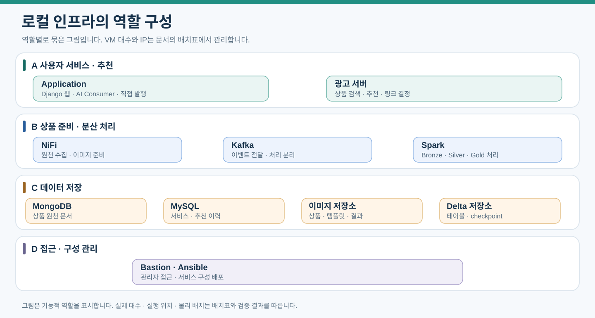

# 인프라 구성과 저장 서버

VMware 기반 로컬 VM에 서비스를 배치하고 검증 후 AWS로 이전한다. 이미지 저장과 Delta 파일 저장은 별도 VM으로 분리하는 안을 기준으로 한다.

[문서 안내](index.md) · [전체 아키텍처](00-architecture.md) · [AWS 이전](06-operations-migration.md)

## 기반 사양과 증설 상태

현재 설계는 로컬 VM 19대이며 실제 설치·자원 검증 완료를 뜻하지 않는다. Application과 광고 서버는 분리하고 이미지·Delta 저장소도 각각 둔다. 이 문서의 서버명은 역할을 구분하기 위한 논리 이름이다. 실제 IP·서브넷·서버명과 주소의 대응표는 저장소 밖의 환경별 배포 설정에서 관리한다.

| 영역 | 현재 역할 | VM 수 | 논리 서버명 |
|---|---|---|---|
| 접근 관리 | Bastion·Ansible | 1 | bastion-01 |
| 사용자 서비스 | Django 웹·AI Consumer·작업 복구 | 1 | app-01 |
| 추천 | 광고 API·상품 임베딩·FAISS | 1 | ad-01 |
| 메시지 | Kafka Broker·KRaft Controller | 3 | kafka-01~kafka-03 |
| 분산 처리 | Spark Master/Driver·Workers | 4 | spark-master-01, spark-worker-01~spark-worker-03 |
| 상품 준비 | NiFi | 1 | nifi-01 |
| MySQL | Primary 1대·Replica 2대 | 3 | mysql-01, mysql-02, mysql-03 |
| MongoDB | 3노드 Replica Set | 3 | mongo-01, mongo-02, mongo-03 |
| 파일 | 이미지용·Delta용 Object Storage | 2 | media-storage-01, lake-storage-01 |



[PNG로 보기](assets/vm-role-map.png). 그림은 역할 개요이며 발행은 DB 커밋 후 직접 수행하고 누락은 업무 기록에서 복구한다. 현행 VM 대수·DB 복제 구성과 실행 방식은 본문 표·DB 다중화 계약 및 [Kafka 발행·복구 계약](05-kafka-jobs.md#발행과-복구)을 기준으로 한다.

물리 노트북과 관리 담당자는 별도 확정한다. Kafka 3대는 서로 다른 노트북에 분산하며 아래 과거 배치표를 현재 설치 지시로 사용하지 않는다.

초기 공통 후보는 2 vCPU·OS 30GB다. Bastion은 RAM 2GB, 나머지는 4GB부터 검토하고 Spark Master/Driver와 인덱스·저장소는 작업량에 맞춰 증설한다. OS·Python·Java·DB·저장소 호환과 데이터 디스크 용량은 설치 전 검증한다. 과거 28 vCPU·50GB·420GB 합계는 현재 자원 합계가 아니다.

<details>
<summary>이전 배치와 역할 변경 이력</summary>

광고 서버와 Delta용 저장소를 포함한 현재 구성은 역할별 표를 기준으로 한다. 과거 노트북 번호는 현행 장애 분산 배치와 구분한다.

| 원래 노트북 | 논리 서버명 | 원래 역할 | 현재 설계 역할 | RAM 제안 |
|---|---|---|---|---|
| 1 | bastion-01 | Bastion | Bastion, Ansible 관리 | 2GB |
| 2 | kafka-01 | Kafka 01 | Kafka Broker와 KRaft Controller | 4GB |
| 2 | kafka-02 | Kafka 02 | Kafka Broker와 KRaft Controller | 4GB |
| 2 | kafka-03 | Kafka 03 | Kafka Broker와 KRaft Controller | 4GB |
| 1 | app-01 | Ad server | Django 웹·AI API Consumer·작업 복구 | 4GB부터 |
| 4 | spark-worker-01 | Spark Worker 01 | Spark Worker | 4GB부터 |
| 4 | spark-worker-02 | Spark Worker 02 | Spark Worker | 4GB부터 |
| 4 | spark-worker-03 | Spark Worker 03 | Spark Worker | 4GB부터 |
| 3 | nifi-01 | NiFi | 원천과 이미지 수집 | 4GB부터 |
| 5 | mysql-01 | Main DB | MySQL 초기 Primary | 4GB부터 |
| 5 | mongo-01 | Standby DB | MongoDB Replica Set 멤버 1 | 4GB부터 |
| 3 | media-storage-01 | Object Storage | Object Storage (이미지용) | 4GB부터 |
| 3 | spark-master-01 | Spark Master | Master와 작업 제출, 필요 시 Driver | 4GB 이상 검토 |
| 1, 재배정 검토 | ad-01 후보 | 미배정 | 광고 서버: Django API·상품 추천·링크 결정·FAISS 인덱스 관리 | 4GB부터 |
| 미배정 | lake-storage-01 후보 | 추가 | Object Storage (Delta용) | 4GB부터 |


</details>

## AI API 방식과 19대 초기 구성

- 광고 서버의 논리 이름은 ad-01이다. MySQL 3대·MongoDB 3대와 이미지·Delta 저장 VM을 포함해 초기 운영은 19대로 계획한다.
- 작업 상태와 오류는 MySQL 및 Django 운영 화면으로 확인하고 상세 로그는 서비스별 파일 또는 systemd·컨테이너 로그로 관리한다.
- spark-worker-01~spark-worker-03의 Spark Worker 세 대는 유지한다. AI 전용 VM을 추가하거나 Spark VM을 AI 서버로 전환하지 않는다.
- app-01에서 Django 웹, AI API Consumer, 작업 복구를 별도 프로세스 또는 컨테이너로 실행한다. 웹 서버 시작 훅에 Consumer를 포함하지 않는다.
- 모델 추론은 외부 API가 수행한다. app-01에는 모델 가중치나 GPU를 배치하지 않는다. 이미지 읽기·변환에 사용하는 RAM과 동시 요청 수를 제한하고 웹 응답 지연을 측정한다.
- Application 서버는 이미지 저장소·Kafka·MySQL과 통신하며 외부 모델 API로 나가는 HTTPS 연결이 필요하다. 웹과 Consumer는 별도로 재시작할 수 있지만 서버 장애는 공유한다.
- AWS에서 이미지용과 Delta용 저장 VM을 S3로 대체하면 EC2는 17대다. AI API Consumer는 Django EC2 안에서 실행한다.

### 작업 프로세스의 자원 경계

접수된 작업의 비동기 I/O와 제한된 이미지·파일 스레드풀은 app-01의 별도 작업 프로세스 안에서 실행한다. DB 연결은 스레드별 수명과 상한을 관리하고 외부 호출 중 트랜잭션을 유지하지 않는다. 작업 동시 실행 수·스레드풀 수·이미지 메모리·API 한도는 측정 후 정하며, 이 실행 방식 결정으로 웹 트래픽 분산·웹 워커 증설·서버 추가를 계획하지 않는다. 실행 분류는 [Application](04-application-ai.md#비동기-io스레드풀동기-트랜잭션-처리-경계)을 따른다.

## DB 다중화와 접속 계약

MySQL 3대와 MongoDB 3대를 각각 별도 VM으로 배치한다. 기존 DB 2대에 MySQL 2대·MongoDB 2대를 추가한다. DB의 논리 스키마·원천 식별자·쓰기 담당은 유지하며 복제본별 테이블이나 컬렉션을 새로 설계하지 않는다. 설치·복제·장애 전환 검증 완료를 뜻하지 않는다.

| 노드 | 역할 | 초기 사양 후보 |
|---|---|---|
| mysql-01 | 초기 Primary, 서비스 읽기·쓰기 | 2 vCPU·RAM 4GB부터 |
| mysql-02 | 읽기 전용 Replica, 수동 승격 대상 | 2 vCPU·RAM 4GB부터 |
| mysql-03 | 읽기 전용 Replica, 수동 승격 대상 | 2 vCPU·RAM 4GB부터 |
| mongo-01 | 데이터·투표 멤버, 초기 Primary 후보 | 2 vCPU·RAM 4GB부터 |
| mongo-02 | 데이터·투표 멤버, 초기 Secondary 후보 | 2 vCPU·RAM 4GB부터 |
| mongo-03 | 데이터·투표 멤버, 초기 Secondary 후보 | 2 vCPU·RAM 4GB부터 |

실제 주소는 저장소 밖의 환경별 배포 설정에서 사용 여부·DHCP 충돌을 확인한 뒤 배정하고 논리 서버명의 DNS/호스트 매핑도 함께 확정한다. MySQL 세 VM은 각각 서로 다른 노트북, MongoDB 세 VM은 각각 다른 노트북에 배치한다. 장애 후 승격될 노드도 정상 쓰기 부하를 감당하도록 사양을 정한다. 데이터 디스크는 DB 전체 데이터·인덱스·MySQL binlog·MongoDB oplog·초기 동기화 여유로 산정한다. 추가 VM 4대의 초기 자원 후보는 8 vCPU·RAM 16GB·OS 디스크 120GB이며 데이터 디스크·호스트 여유는 별도다.

### MySQL Primary와 Replica

초기안은 InnoDB의 GTID 기반 비동기 복제다. 서로 다른 server_id·server_uuid, binlog 활성화·ROW 형식, GTID 설정과 복제 전용 계정을 사용한다. Replica는 read_only·super_read_only로 애플리케이션 쓰기를 차단한다. Primary 1대와 Replica 2대의 비동기 복제 구성은 기존 수동 장애 전환 방식을 유지한다. 대수 증가를 자동 선출·무중단·데이터 손실 0 보장으로 표시하지 않는다. 복제 방식의 제품 버전별 설정과 승격 절차는 구축 시 검증한다. [MySQL GTID 복제](https://dev.mysql.com/doc/refman/8.4/en/replication-gtids.html)

Django·AI Consumer·작업 복구·광고 서버·Spark 검수 조회 및 MySQL 반영은 초기에는 현재 Primary에서 읽고 쓴다. Replica 읽기 분산은 복제 지연에 따른 상태 불일치를 검증한 후 별도 결정한다. 공통 MySQL 쓰기 접속 주소를 환경 설정으로 관리하고 수동 승격 후 각 프로세스의 설정·연결 풀을 새 Primary로 전환한다. 초기 구성에 별도 Router·VIP 서버는 추가하지 않는다.

장애 전환은 기존 Primary의 쓰기 차단·격리 → Replica 두 대의 GTID·적용 상태 대조 및 승격 후보 선정 → 허용 손실 판단과 수동 승격 → 접속 설정 갱신·재연결 → 쓰기 검증·작업 복구 순서다. 기존 Primary가 복귀하면 그대로 쓰기 서버로 재개하지 않고 새 Primary 기준으로 재동기화해 Replica로 합류시킨다. 승격되지 않은 기존 Replica도 새 Primary를 복제하도록 연결·동기화 상태를 확인한다. 상세 검증은 [DB 복제와 장애 복구](06-operations-migration.md#db-복제와-장애-복구)를 따른다.

### MongoDB 3노드 Replica Set

세 노드 모두 데이터를 보관하고 투표하는 Primary-Secondary-Secondary 구성으로 같은 Replica Set에 등록한다. Arbiter는 두지 않는다. 초기 Primary 후보는 고정 Primary가 아니며 선출 후 역할이 바뀔 수 있다. 세 노드 중 두 노드가 통신하고 선출 조건을 충족하면 한 노드 장애 시 새 Primary를 선출할 수 있다. 두 노드가 중단돼 과반수를 잃으면 쓰기를 대기시키며 단독 노드를 강제 Primary로 만들어 진행하지 않는다. [MongoDB 3노드 구성](https://www.mongodb.com/docs/manual/core/replica-set-architecture-three-members/)

연결 설정은 mongo-01·mongo-02·mongo-03 멤버와 replicaSet=rs-products, readPreference=primary, w=majority, journal=true를 포함한다. 실제 접속 URI는 저장소 밖의 환경별 배포 설정으로 주입한다. DB 이름과 Replica Set 이름은 배포 설정에서 고정하고 인증정보는 비밀 설정으로 주입한다. advertised 멤버 이름은 NiFi/Python·Spark와 모든 MongoDB 멤버에서 해석·접근 가능해야 한다. 멤버 간 인증과 접근 제어를 적용하고 TLS 인증서·클라이언트 호환을 검증한다.

원천 저장은 writeConcern={w: majority, j: true} 확인 후 성공으로 집계하고 Kafka 발행을 허용한다. 초기 Spark 원천 조회는 readPreference=primary·readConcern=majority로 통일한다. 복제 지연이 있는 Secondary를 임의로 읽지 않는다. 쓰기 확인·서버 선택·네트워크 timeout은 운영 설정으로 제한한다. 확인 실패는 실제 미저장을 뜻하지 않으므로 동일 원천 ID·중복 키로 상태를 대조하고 과반수 보존을 다시 확인한 뒤 재발행한다. [MongoDB 쓰기 확인](https://www.mongodb.com/docs/manual/reference/write-concern/)

## 광고 서버 배치

광고 서버(ad-01)는 Application(app-01)과 별도 Django API 서비스로 운영한다. 템플릿 생성은 Application(app-01), 상품 추천과 다나와 연결 판단은 광고 서버(ad-01)의 책임이다. 외부 링크 요청은 Application의 인증 경로를 거쳐 내부 API로 전달한다. 초기 2 vCPU·4GB RAM·OS 디스크 30GB를 후보로 두고 인덱스 용량에 따라 데이터 디스크를 추가한다. 기존 MySQL·이미지용 Object Storage를 사용하며 벡터 생성은 외부 임베딩 API에 요청한다. 인덱스 원본은 Delta에서 발행하고 광고 서버는 로컬 디스크·메모리에서 검색한다. 모델 가중치나 GPU는 배치하지 않는다.

Application → 광고 서버 내부 HTTP, 광고 서버 → MySQL·이미지 저장소·외부 임베딩 API, 인덱스 관리 프로세스 → Kafka·Delta용 저장소의 연결을 허용한다. Application(app-01)과 광고 서버(ad-01)는 가능하면 다른 노트북에 배치하고 인덱스 재구축이 웹·DB 자원을 독점하지 않게 제한한다. 담당자는 기존 인원 1 또는 재배정한 담당자로 확정한다. 상세 경계는 [광고 서버](07-ad-server.md)를 따른다.

## 템플릿과 외부 API 실행

Application(app-01)에서 템플릿 제작·임베딩 준비·해석·공간 생성·물체 분석을 별도 Consumer로 실행한다. 템플릿 인덱스는 Application 로컬에, 상품 인덱스는 광고 서버에 둔다. 생성은 Cloudflare Workers AI의 @cf/black-forest-labs/flux-2-klein-4b(테스트 512×512, 새 실행부터 설정으로 1024×1024 선택 가능), 해석·물체 분석과 임베딩은 Google API를 사용한다. 임베딩은 gemini-embedding-2다. Cloudflare account_id·API token과 Google API key를 비밀 설정으로 분리하고 HTTPS 통신을 허용한다. 준비 작업과 사용자 생성의 동시 호출 할당량을 분리하고 모델 가중치·GPU·새 VM은 추가하지 않는다. 실행 정책은 [템플릿과 생성](08-template-generation.md)을 따른다.

## 물리 배치와 네트워크

Kafka 세 대와 MongoDB 세 멤버는 각각 서로 다른 노트북에 분산하고, MySQL Primary·Replica 세 VM도 각각 서로 다른 노트북에 둔다. 이미지용과 Delta용 Object Storage도 가능하면 다른 노트북과 물리 디스크를 사용한다. 같은 노트북의 VM 분리는 프로세스와 설정을 분리하지만 물리 장애와 디스크 부하는 공유한다.

실제 IP 대역은 환경별 배포 설정에서 정한다. 대역폭은 유선 또는 무선 링크 속도로 따로 기록한다. 여러 노트북의 VM은 Bridged 네트워크 또는 라우팅된 네트워크로 연결한다. 노트북마다 같은 NAT 대역을 만드는 것만으로 VM들이 연결되지는 않는다.

| 서비스 | 접근 범위 |
|---|---|
| SSH | 관리자와 Bastion |
| 사용자 웹 접속 | 사용자. 실제 배포 접속 구성은 별도 확정 |
| Django 내부 접속 | 허용된 내부 호출자, 외부 직접 공개 여부는 별도 확정 |
| 광고 서버 API | Application과 운영 조회 프록시 |
| MySQL | Application, 광고 서버의 제한 계정, AI, 반영 작업, DB 간 복제·관리 |
| MongoDB | NiFi/Python, Spark, 관리자, Replica Set 멤버 간 통신 |
| Kafka | 내부 클라이언트와 Kafka |
| Spark | 내부 처리와 관리자 |
| SeaweedFS S3 | Spark와 관리자 |

실제 서비스 접속 주소·포트·인증정보는 저장소 밖의 환경별 배포 설정에서 관리한다. 서비스 이름을 DNS 또는 공통 호스트 설정으로 관리한다. Kafka advertised.listeners와 MongoDB 및 Spark 접속 주소가 클라이언트에서 실제로 접근 가능해야 한다.

## Object Storage (Delta용) VM 구축안

Object Storage (Delta용) VM은 Delta 파일 저장 역할만 맡고 Spark Executor나 DB를 함께 설치하지 않는다. SeaweedFS 단일 노드는 S3 호환 후보이며 Delta 호환 검증을 통과한 뒤 채택한다. 제품 이미지 버전이나 digest를 고정하고 latest를 운영 기준으로 사용하지 않는다.

1. 별도 데이터 디스크를 초기 100GB 후보로 추가한다. 실제 크기는 원천·중간 결과·이력·체크포인트 보관량으로 산정한다.
2. 데이터 디스크를 /srv/lake-storage에 마운트하고 재부팅 후 마운트를 확인한다.
3. Docker Compose로 SeaweedFS를 실행하고 전체 영속 데이터와 메타데이터 경로를 데이터 디스크에 연결한다.
4. 인증 계정을 설정하고 내부 클라이언트로 접근을 제한한다. 내부 연결 시험 후 TLS를 적용한다.
5. 아래 버킷을 만들고 Spark의 S3A 연결을 설정한다.

```text
project-lake/
  bronze/raw_products/
  silver/normalized_offers/
  silver/quality_issues/
  silver/product_image_analysis/
  gold/product_catalog/
  gold/current_offers/
  gold/offer_history/
  gold/category_daily_stats/
project-checkpoints/
  raw-ingestion/
  normalization/
  gold-building/
  mysql-publishing/
```

접속 endpoint는 환경별 배포 설정에서 주입하며 테이블 경로 예시는 s3a://project-lake/silver/normalized_offers/다. S3 경로와 서버 파일시스템 경로는 다르며 실제 내부 파일 배치는 저장소가 관리한다.

Spark Driver와 Workers 모두 저장소에 접근할 수 있어야 한다. Spark와 Delta 호환 버전, Hadoop에 맞는 hadoop-aws 및 의존성, endpoint, path-style, 인증과 TLS를 설정한다. 초기에는 테이블마다 쓰기 담당 Driver를 하나로 제한한다. Worker 여러 대가 같은 Driver의 실행에 참여하는 것은 가능하다.

## 구축 검증

파일 업로드와 조회, 목록 일관성, 재부팅 후 데이터 보존을 먼저 확인한다. 다음으로 Delta 생성·추가·MERGE·이전 버전 조회, 작업 중단 후 재시작, 같은 배치 재실행을 검증한다. 단일 VM은 Delta용 Object Storage 자체의 고가용성 구성이 아니며 별도 백업이 필요하다.

Kafka와 NiFi의 저장소, Spark Shuffle, MySQL 및 MongoDB, 서비스 로그에도 용량 한도와 보관 정책을 둔다. 30GB OS 디스크에 모든 데이터를 누적하지 않는다. 서버 자원은 top, free, df 등 기본 명령으로 확인한다.

## 참고 자료

- [SeaweedFS 공식 저장소](https://github.com/seaweedfs/seaweedfs)
- [Delta 저장소 요구사항](https://docs.delta.io/delta-storage/)
- [Spark와 Delta 호환표](https://docs.delta.io/releases/)
- [Kafka KRaft 구성](https://kafka.apache.org/40/operations/kraft/)

Kafka Broker와 Controller 겸용은 로컬 실습 후보다. 중요한 운영 환경에서의 역할 분리는 AWS 설계 시 재검토한다.

모델 존재·계정 호출·임베딩 model_id 확인 상태는 [AI 모델 확인](04-application-ai.md#모델환경-확인-상태)을 따른다.
