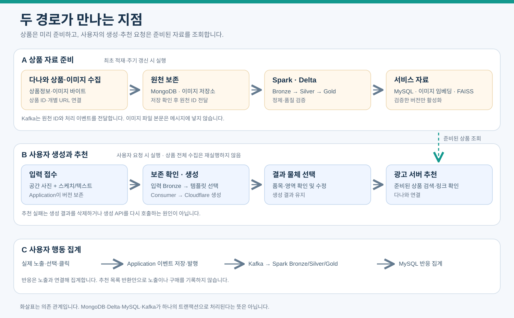
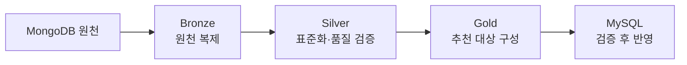
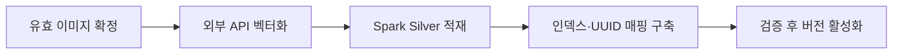
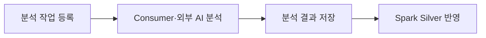
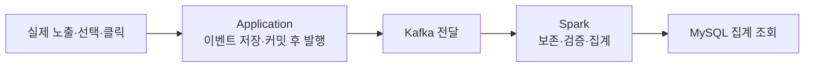
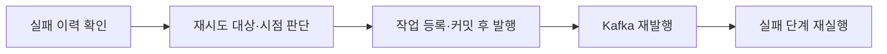

# 데이터 파이프라인: 직접 추천과 사전 상품 벡터

## 2026-10-23 새 실행기 전환 작업

로컬 `develop/src/data_pipeline_v2`에 [독립 실행기](../../src/data_pipeline_v2/README.md)를 구현했다. 새 경로는 범위 고정 → 테이블별 묶음 정제 → Gold 완료 증거 → 영속 게시 인계 → MySQL 직접 게시다. 별도 승인·이미지 활성화·이를 위한 Silver/Gold 재실행을 제거한다. 원천/관련 변환 정책 변경만 새 작업을 만든다. 기존 단일 writer·해시·출처·UUID·최신값/NULL 보호를 유지한다.

이 절이 새 실행기의 우선 계약이다. 아래 담당 guard·승인 이미지·활성화 설명은 기존 구현과 이력의 계약이며 v2의 실행 전제에 다시 넣지 않는다. 벡터/판매 조건은 근거 검증 전 준비 완료로 만들지 않는다. 물리 저장 스키마와 게시 참조 v3는 [새 처리 계약](../../src/data_pipeline_v2/docs/architecture.md)을 따른다. 현재 로컬 대역 검증 단계이며 서버 배포·실제 처리량 검증·추천 소비자 전환은 [서버 인수](../../src/data_pipeline_v2/docs/server-migration.md)로 분리한다.

## Gold→MySQL 전체 필드 게시 계약

2026-10-18: [게시 필드 계약](13-gold-mysql-publication.md)은 서비스 DDL 작성의 필수 입력이다. 상품 속성·제조사·준비 상태·필드 상태/출처·대표 이미지·임베딩 참조·링크 관측을 포함한다. 현재 참조 DDL과 게시 코드는 일부 필드만 투영하므로 해당 SQL만 실행해도 필요한 컬럼이 모두 준비된다고 설명하지 않는다.

고정 Gold export → 담당 guard·스키마 검사 → 불변 staging → 서비스 필드·관계의 트랜잭션 게시 → MySQL/호환 벡터를 추천 카탈로그로 변환하는 어댑터 순서다. 각 Gold 컬럼의 저장/참조/미게시 사유를 대조하며 미분류 0개를 요구한다. staging 원문 보존만으로 서비스 조회 연결이 완성되지는 않는다. 어댑터는 동일 게시 범위와 옵션·상태·원천·이미지 checksum·모델/차원/전처리를 검증하고 현재 서비스 검수/인덱스 상태를 추가 확인한다.

준비 상태는 Gold 평가와 서비스 현재 활성 상태를 구분한다. 기존 관측 시각·NULL 보호·UUID 재사용·운영자 검수 소유권을 유지한다. MySQL 확장 컬럼·게시 코드·추천 어댑터 구현과 운영 적용은 후속 작업이며 이 문서 변경으로 실행하지 않는다.

[직접 추천 계약](12-direct-recommendation.md) · [속성](data-dictionary/09-direct-recommendation.md)

| 경로 | 처리 |
|---|---|
| 상품 | 원천 MongoDB/이미지→Bronze→Silver 품목/규격/상품 이미지 대응·이용 조건·링크 정제→Gold/서비스 MySQL |
| 벡터 | 상품 이미지 임베딩 사전 계산→모델/차원/전처리·상품/행 대응·checksum 고정→CPU 카탈로그 준비 |
| 사용자 | 입력 버전/Bronze 확인→멀티모달 해석→코드 검사→질의 임베딩→scikit-learn 유사도·수동 가중합→추천 저장 |
| 반응 | 실제 노출·선택·명시적 거절·클릭→Bronze→연결/중복/지연 검증 Silver→Gold. 초기 추천 학습의 선행 조건 아님 |
| 후속 실험 | 축적된 실제 반응·소규모 요청별 평가로 초기 가중치/지도학습 비교. 미노출·미클릭 일괄 부적합 처리 금지 |

초기 추천은 라벨 없이 scikit-learn `cosine_similarity`와 수동 초기 가중치로 수행한다. `weighted-content-v1`은 선호 색상이 있으면 `0.85 × 유사도 + 0.15 × 색상 일치`, 없으면 유사도만 사용한다. 필수 조건 불일치는 제외하고 결측·미지원 필수 조건은 UNKNOWN 목록으로 분리한다. 가중치는 학습값이 아니며 점수는 확률이 아니다. 사람의 6만 이미지 전수 적합/부적합 라벨링·LogisticRegression 학습·직렬화 모델 파일은 초기 실행 조건이 아니다. 반응 자료를 충분히 확보한 뒤 지도학습을 별도 평가한다.

원천 ID·상품·이미지·옵션·규격·시점을 보존하고 AI 추정치를 상품 원장에 쓰지 않는다. 원천 보존·단일 Delta Driver·checkpoint·멱등 적재·Gold 게시 검증의 공통 계약은 유지한다.

로컬 `python -m interior_recommender.product_catalog`는 기존 embed-directory 인덱스를 다시 API 호출하지 않고 NPY+상품 manifest로 export한다. 메타데이터는 수집/정제 원장의 image_id→product_id 대응·품목/속성/규격/출처로 보강한다. 연결되지 않은 행은 미확인으로 남긴다. 일회성 export와 시작 검증은 온라인 요청 밖에서 수행하며 기존 로더의 메모리도 측정한다.

로컬 구현은 `src/interior_recommender/recommendation.py`와 `src/interior_recommender/web/direct.py`다. `python -m interior_recommender.web` 기본 경로가 직접 추천이며 기존 Canvas의 `POST /api/runs`를 재사용한다. 해석 1회와 질의 임베딩 1회를 기본으로 하며 성공 receipt를 재사용한다. 별도 입력 절차·템플릿 선택·이미지 생성은 없다. 실제 DB·Kafka·Delta Bronze·광고 서버 HTTP·FAISS·상품 링크 검증 API 통합 및 운영 배포는 아직 미구현이다. 논리 서비스 계약을 로컬 파일 구현 완료와 혼동하지 않는다.

## 실버·골드 필드 적용

2026-10-16 반영한 논리 계약이다. Silver는 관측별 정제·출처·확인 상태를, Gold는 추천 카탈로그·링크·현재 판매 조건·이력·품질 집계를 관리한다. 실제 Delta 테이블 생성·데이터 적재 완료를 뜻하지 않는다. 상세 입력 경로와 필드는 [실버·골드 데이터 사전](data-dictionary/01-raw-delta.md#실버골드-필드-계약-적용-범위)을 기준으로 한다.

1. API 원본·수집 관리·상세 추출·다운로드 결과를 원천 참조로 구분한다. 수집 출력의 `product_id`는 `source_product_id`로 받아 내부 UUID와 분리한다.
2. 상품 관측·옵션 속성·가격 관측·이미지 연결·링크 관측·품질 문제를 각각 정제한다. 가격과 이미지를 펼쳐 조인해 상품 행이 곱해지지 않도록 각 테이블의 행 기준과 안정 키를 유지한다.
3. 필드별 관측 시각·확인 상태·출처 우선순위로 Gold 현재 값을 선택한다. 최신 상세 수집 실패만으로 이전 확인 규격을 NULL로 지우지 않고 유지값의 시각과 최신 실패를 함께 기록한다. 명시적 철회·비활성화는 별도로 적용한다.
4. 승인 이미지의 호환 벡터·행 대응을 확인해 추천 준비 상태를 만들고, 비교 링크와 직접 구매 링크는 각각 검증한다. 가격·규격 결측은 일괄 추천 제외가 아니라 요청별 MATCH/DIFFERENT/UNKNOWN 판단에 사용한다.
5. 고정 Delta 버전 → staging 건수/중복/참조 검증 → 안정 키로 기존 UUID 재사용 → MySQL 반영 순서를 지킨다. 사용자·추천 실행·검수 원장은 상품 ETL이 변경하지 않는다. 이번 배치에 없는 것만으로 삭제하지 않는다.

| Silver 논리 테이블 | 행 기준 |
|---|---|
| `silver_product_observations` | 상품 수집 관측 1건 |
| `silver_product_attributes` | 상품/옵션의 속성 관측 1건 |
| `silver_price_observations` | 상품/옵션·가격 종류의 관측 1건 |
| `silver_product_images` | 상품과 이미지의 연결 관측 1건 |
| `silver_link_observations` | 상품/판매 항목 링크의 관측 1건 |
| `silver_quality_issues` | 대상·필드·원천·처리 버전에 연결한 품질 문제 1건 |

| Gold 논리 테이블 | 결과 |
|---|---|
| `gold_product_catalog` | 옵션·원천 대응을 유지한 현재 추천 상품 |
| `gold_recommendation_images` | 승인 이미지·상품·호환 벡터/행·인덱스 버전 대응 |
| `gold_product_links` | 상품별 비교 URL·검증 상태·확인 시각 |
| `gold_offers_current` | 안정 판매 항목별 현재 판매처·옵션·가격 조건·구매 링크 |
| `gold_offer_snapshots` | 해당 판매 항목의 관측 시점별 조건 이력 |
| `gold_catalog_quality_daily` | 기준일·품목별 상품/이미지/속성 확보·준비·보류 집계 |

이 이름은 논리 테이블명이다. 기존 `silver/normalized_offers`, `gold/product_catalog`, `gold/current_offers`, `gold/offer_history`, `quality_issues` 등의 저장 경로를 이번 문서 작업으로 생성·이름 변경하지 않는다. 실제 경로·변환 대응·중복 키는 구현 전에 명시한다.

`catalog_ready`는 식별·이름·품목 매핑, `recommendation_ready`는 카탈로그와 활성·이용 승인 이미지·호환 벡터, `comparison_link_ready`는 비교 주소, `purchase_link_ready`는 판매처·옵션·판매 조건·직접 구매 주소를 각각 확인한다. 사유·평가 버전도 보존하며 다운로드 성공으로 모두 true를 만들지 않는다.

초기 추천은 `weighted-content-v1` 수동 가중치다. 선호 색상이 있으면 0.85×유사도+0.15×색상 일치, 없으면 유사도만 사용하며 색상 결측 상품만 가중치를 다시 정규화하지 않는다. 요청별 점수·기여분은 추천 run/item에 저장하고 상품 Gold 고정 속성에 넣지 않는다. 학습·라벨·모델 배포는 후속 평가이며 현재 추천의 선행 조건이 아니다.

대표가격 종류·조건·유효 기간, 필드별 출처 우선순위·동일 시각 충돌, 속성 사전·옵션 식별, 복합 키/hash 규칙은 구현 전에 팀이 확정한다. 품목별 속성 확보율·추천 준비율 임계값은 실제 표본 측정 후 정한다. 미확정값을 이미 검증한 사실로 기록하지 않는다.

이전 상세 설계 — 공통 계약은 유지, 생성 중심 단계/관계는 신규 사용 안 함

# 상품 수집과 Delta 데이터 파이프라인

MongoDB 원천을 보존하면서 Spark로 Bronze·Silver·Gold를 생성하고 MySQL에 서비스용 상품 데이터를 반영한다. 사용자 추천 요청과 상품 ETL은 독립적으로 실행한다. 광고 서버는 준비된 검색 인덱스와 MySQL을 조회하고 Spark는 노출·반응을 Gold로 집계한다.

[문서 안내](index.md) · [데이터 모델](03-data-model.md) · [Kafka 계약](05-kafka-jobs.md)

## 전체 파이프라인 흐름도

첫째 줄은 상품 자료를 미리 준비하는 경로, 둘째 줄은 사용자 요청에 따라 생성·추천하는 경로, 셋째 줄은 실제 노출과 행동을 집계하는 경로다. [PNG로 보기](assets/data-pipeline-overview.png). 화살표는 처리 의존 관계이며 하나의 트랜잭션을 의미하지 않는다. 서비스 책임은 [아키텍처](00-architecture.md), 메시지 계약은 [Kafka](05-kafka-jobs.md)에 둔다.

| 경로 | 실행 시점 | 결과 |
|---|---|---|
| 상품 자료 준비 | 최초 적재·주기 갱신 | 원천, 카탈로그, 검색 인덱스 |
| 사용자 생성·추천 | 사용자 요청 | 생성 이미지, 추천 결과 |
| 행동 집계 | 이벤트 수신·재집계 | 기간·상품·품목별 반응 |
| 실패 복구·보관 | 실패 또는 보관 주기 | 재처리 이력, 검증된 보관본 |

## 경로별 상세

### 상품 수집과 Delta 가공

| 구간 | 실행·저장 계약 |
|---|---|
| 자료 확보·보존 | NiFi 주기 관리와 Python 어댑터가 BRD 대상 카테고리의 다나와 상품정보·이미지를 수집. 원천은 MongoDB, 검증한 이미지 바이트는 이미지용 저장소 |
| 원천 → Bronze | 저장 확인 후 Kafka로 원천 ID 전달. Spark가 MongoDB를 조회해 복제 |
| Bronze → Silver | Spark가 카테고리 매핑·검수 원장을 읽고 단위·형식·품질 검증 |
| Silver → Gold | 상품·판매 조건을 구분하고 추천 대상 구성 |
| Gold → MySQL | Delta 버전 고정 → staging 적재 → 검증 → 상품·판매 영역 반영 |

Bronze·Silver·Gold는 Delta용 저장소의 파일 테이블이며 Spark가 연산한다. Kafka에는 이미지 본문을 넣지 않는다. 사용자·작업·검수 원장은 상품 반영으로 덮어쓰지 않는다. 이미지 실패는 품질 상태로 남기고 추천 가능 여부를 판단한다. 작업별 checkpoint는 독립 경로에 보존한다.

### 템플릿 구성과 광고 상품 추천

사용자 입력 Bronze 보존 확인 후 해석·템플릿 선택·공간 생성·물체 분석을 수행한다. 이후 물체별 광고 서버 추천을 요청한다. 생성과 추천은 별도 작업이므로 추천 실패로 생성 API를 다시 호출하지 않는다.

- 호출 책임과 결과 저장: [Application](04-application-ai.md#사용자-추천-흐름)
- 추천 조회와 링크 클릭: [광고 서버](07-ad-server.md#사용자-요청-흐름)
- 입력 보존 완료 조건: [Kafka 계약](05-kafka-jobs.md#입력-bronze와-생성-단계-계약)

### 상품 벡터와 검색 인덱스 준비

내부 저장한 다나와 상품 이미지의 임베딩은 사용자 추천 요청 전에 준비한다. 상품 임베딩 준비 Consumer가 외부 API 결과를 버퍼 파일과 작업 결과 참조에 보존하고 DB 커밋 확인 후 완료 이벤트를 발행한다. 발행 누락은 같은 작업 결과·이벤트 ID에서 복구한다. Spark가 Delta Silver 적재를 확인한 뒤 메타데이터를 갱신한다. 인덱스 구축은 고정 Gold·Silver 버전을 사용하며 파일·매핑·차원·모델·품목·현재 이미지 연결을 검증한다. 검증 실패 시 이전 버전을 유지한다.

공간 생성은 Cloudflare FLUX.2 klein 4B, 해석·물체 분석은 Gemini, 상품·템플릿·물체 임베딩은 gemini-embedding-2를 사용한다. 생성 크기·전처리·실행별 설정은 [생성 계약](08-template-generation.md#생성-api와-해상도-계약)을 따른다.

사용자 요청 때 전체 상품을 벡터화하지 않는다. 상품 이미지와 검색 물체는 같은 모델·전처리를 사용하며 checksum·모델·전처리·차원으로 재사용한다. ABO 평가·템플릿 검색·서비스 상품 검색은 scope를 분리한다. 복원 파일은 Delta용 저장소 exports/search의 일반 파일이며 Delta 테이블이 아니다.

### 상품 이미지 분석 보조 경로

작업 등록과 결과 저장은 각각 MySQL 커밋 확인 후 Kafka에 요청·완료 이벤트를 직접 발행한다. 전달 누락은 저장된 작업·결과 참조에서 같은 이벤트 ID로 복구한다. Consumer는 저장소 이미지를 읽고 응답을 검증한다. Spark는 완료 이벤트의 결과 참조를 조회한다. 요청·완료 토픽은 [Kafka 표](05-kafka-jobs.md#토픽-초안)를 따른다.

상품 이미지 분석은 핵심 기능 이후의 보조 경로다. 스케치 추천의 선행 조건으로 두지 않고 AI 추정값으로 원천 가격·규격을 덮어쓰지 않는다. 이미지·모델·프롬프트 버전이 같은 분석 결과는 재사용할 수 있다.

### 사용자 행동 분석

| Spark 단계 | 처리 |
|---|---|
| Bronze | 행동 원천 보존 |
| Silver | event_id 중복 제거, 노출·반응 연결 검증 |
| Gold | 노출 발생일·상품·품목별 반응 집계 |

Gold 결과는 ad_metrics_daily에 반영하고 광고 서버가 조회한다. 늦은 반응은 해당 날짜를 재계산한다. 상품·행동 경로의 토픽·스키마·테이블·checkpoint는 분리한다. 상품 선택 시 관심 카테고리는 Application이 MySQL에서 갱신한다. 집계 정의는 [광고 서버](07-ad-server.md#집계와-조회)를 따른다.

### 실패 복구

운영자가 선택하거나 재시도 프로세스가 대상·시점을 판단한다. 작업·이벤트 식별자로 중복을 막고 완료 결과를 유지한다. 수집 원천 저장·미발행 복구는 수집 실행 기록에서 별도로 대조하며 위 경로를 모든 실패에 적용하지 않는다.

### 운영 기록 보관

보관 대상 확정 → 내보내기 → 건수·checksum·읽기 검증 → archive_manifests 완료 기록 순서다. 재시도와 별도 주기로 실행한다. PRD AC-12의 운영 로그 S3 보관을 검증하며 새 전용 서버를 필수로 추가하지 않는다. [운영 정책](06-operations-migration.md)을 따른다.

### 실행 주기와 배포 경계

NiFi는 상품 수집 주기, Spark는 가공·집계 실행, 작업 관리 프로세스는 비동기 재시도를 각각 담당한다. 이는 목표 역할이며 업무 입력으로 7단계 FLOW를 운영하는 연결은 미완료다. 2026-10-18에는 NiFi 2.12.0 `timer → 제한 SSH → Master 검증 큐 tick`까지만 확인했고, 전체 파이프라인 통합 기술 시험은 수행하지 않았다. 사용자 추천이 전체 ETL을 시작하지 않는다. AWS 저장소·실행 서버 대응은 [인프라](01-infrastructure.md)와 [운영](06-operations-migration.md)을 따른다. 시험 범위는 [실서버 검증 기록](../../src/data_pipeline/docs/service_validation_20261018.md)을 따른다.

## 템플릿 준비와 입력 Bronze

템플릿 준비는 제작 → 검수 → 파일·버전 등록 → 벡터 준비 → 검색 인덱스 등록 순서다. 상품·템플릿 벡터와 인덱스는 분리한다. 상세 제작 정책은 [템플릿 문서](08-template-generation.md#템플릿-제작과-등록)를 따른다.

사용자 파일은 이미지용 저장소, 입력 스냅샷은 MySQL에 먼저 보존한다. Spark의 입력 Bronze 보존 완료를 Application이 검증한 뒤 AI 작업을 시작한다. 사용자 입력은 MongoDB raw_products에 저장하지 않는다.

이벤트 필드·checksum 대조·commit 후 확인 복구·중복 AI 시작 방지는 [입력 Bronze와 생성 단계 계약](05-kafka-jobs.md#입력-bronze와-생성-단계-계약)을 기준으로 한다. Silver는 실패 입력과 정상 분석을 구분하며 원문을 정규화 결과로 덮어쓰지 않는다.

## 수집과 원천 보존

NiFi는 상품 준비 실행 주기를 관리하고 Python 어댑터가 BRD 대상 카테고리에서 확보한 다나와 상품·판매 정보·이미지를 입력 계약에 맞춰 전달한다. MongoDB에 원천 문서를 저장하고 검증한 이미지 바이트를 Object Storage (이미지용)에 저장한다. 상품 ID·원천 이미지 URL·객체 키·checksum·수집 시각을 연결한다. MongoDB Replica Set의 majority·journal 쓰기 확인 후 Kafka에 수집 완료 이벤트를 발행한다.

수집 성공은 과반수 원천 보존이 확인된 건으로 집계한다. 쓰기 timeout·Primary 선출 중 오류는 저장 실패로 단정하지 않고 동일 원천 ID와 중복 키로 대조해 과반수 보존을 다시 확인한다. Spark는 Replica Set 연결에서 현재 Primary의 majority 보존 원천을 조회한다. 원천 저장 이후 이벤트 발행이 실패하면 미발행 기록이나 수집 manifest에서 복구한다. 원천 문서 payload는 수정하지 않고 발행 상태는 별도 관리 메타데이터로 기록한다.

상품명·품목·이용 가능한 이미지가 부족한 상품은 추천에서 제외하되 허용된 원천은 유지한다. 연결 주소 미확정 후보는 연결 준비 중으로 표시하고 이동 버튼을 비활성화한다. 가격·쇼핑몰 구매 링크 미확인은 비교 상품 탐색으로 구분하고 구매 가능으로 표시하지 않는다. 규격은 제공되는 경우에만 정규화하며 없는 정보는 미제공으로 표시한다.

MySQL 검수 조회·Gold/staging 반영은 현재 Primary를 사용한다. 수동 장애 전환 중 MySQL 반영을 중지하고 같은 publishing_run·고정 Delta 버전·업무 키로 반영 상태를 대조한 후 실패 범위만 재개한다. DB 접속 설정·연결 풀 갱신과 복구 검증은 [운영](06-operations-migration.md#db-복제와-장애-복구)을 따른다.

### 다나와 수집기 검수

수집기는 BRD의 포함·제외 품목을 다나와 세부 카테고리와 대조하고, 부속품·소품 혼입을 표본으로 확인한다. 실제 응답 표본으로 상품 식별자, 개별 상품 URL, 상품명·분류, 확인 가능한 규격·옵션·판매 조건, 대표·추가 이미지 URL과 수집 시각의 추출 경로를 확정한다. 제공되지 않은 값은 추정해 채우지 않는다.

| 확인 영역 | 완료 기준 |
|---|---|
| 원천·이미지 연결 | 원천 응답·수집 실행·hash를 보존하고 상품 ID·이미지 URL·객체 키·checksum을 연결한다. 같은 파일은 재사용해도 상품별 연결은 유지한다. |
| 요청·재개 | 요청 간격과 동시성을 설정 가능하게 두고, 429는 Retry-After를 따른다. 403·CAPTCHA·반복 오류에서는 해당 수집을 중단해 원인을 확인한다. 동일 실행의 중복 원천과 이미 저장한 파일은 다시 저장하거나 다운로드하지 않는다. |
| 표본 검증 | 저장된 표본 응답으로 파서·중복 방지·중단 후 재개를 검증한다. 품목별 상품 수, 이미지 저장 성공 수, 고유 파일 수, Gold 추천 가능 수를 구분해 대조한다. |

수집 성공은 추천 승인과 다르다. 개별 상품 URL과 이미지 URL을 구분하고, 검증되지 않은 목록·검색 주소는 이동 링크로 발행하지 않는다.

## 계층별 처리

| 계층 | 처리와 출력 | 검증 |
|---|---|---|
| Bronze | 원천 내용 복제, MongoDB ID와 수집 메타데이터 추가 | 원천 건수, 원천 ID, 중복 이벤트 |
| Silver | 가격·통화·단위·카테고리 변환, 판매 ID 정리 | 필수 정보, 파싱 실패, 카테고리 매핑, 이미지 존재 |
| Silver 품질 영역 | quality_issues와 상품 이미지 분석 | 오류 사유, 분석 버전, 검수 필요 여부 |
| Gold | 동일 상품과 옵션 통합, 현재 Offer와 이력, 추천 가능 카탈로그 | 상품 식별 안정성, 구매 주소, 최신성 |
| MySQL | 검증된 Gold 상품 데이터의 서비스용 사본 | 참조 무결성, 반영 건수, 반영 버전 |

MongoDB와 Bronze 중복은 의도적이다. Bronze는 raw_document_id로 원천까지 추적하고 필요 시 MongoDB에서 재생성한다. Silver와 Gold는 처리 코드 버전을 기록한다.

가격 문자열을 숫자와 통화로 분리한다. 길이는 mm로 통일하되 축 의미를 확인할 수 없으면 임의로 width와 depth에 배정하지 않는다. 원문 규격도 추적 가능하게 보존한다.

## 동일 상품과 검수

offer_key는 제공처·상품 ID·옵션 ID에서 생성한다. product_key는 같은 모델과 옵션을 묶는 안정적인 식별자다. 비슷한 이름이나 이미지라는 이유만으로 같은 상품으로 합치지 않는다. 식별자와 브랜드·모델·옵션을 우선하고 애매한 후보는 검수한다.

수집기 대상·이용 검토와 감사 event_id는 Bronze·Silver에 보존하고 서비스 검토 입력으로 인계한다. 수집기 운영 판정은 최종 추천 가능 여부와 구분한다. 서비스 검수 결과와 카테고리 매핑은 MySQL의 운영자 관리 테이블 및 product_images.usage_review_json에 저장한다. Spark는 이를 처리 입력으로 읽고 검수 버전을 기록한다. Gold 반영 작업이 검수 원장을 덮어쓰지 않는다.

이미지 AI 분석은 원천과 별도의 파생 데이터다. 모델 결과는 MySQL에서 추적하고 결과 파일은 Object Storage (이미지용)의 derived 영역에 저장할 수 있다. 완료 이벤트가 결과 참조를 전달하면 Spark가 Silver 분석 테이블에 반영한다. 제공처의 가격·규격을 AI 추정값으로 덮어쓰지 않는다.

## 배치와 스트리밍

초기 상품 파이프라인은 수분 단위 마이크로배치 후보로 시작한다. 주기는 수집량과 최신성 목표를 측정해 정한다. 사용자 스케치 인식은 Application 서버의 별도 API Consumer 프로세스가 외부 모델 API를 호출해 수행한다. AI 전용 서버는 사용하지 않는다.

신규 처리와 재처리는 같은 변환 로직을 사용한다. 재처리는 입력 원천 범위와 normalizer_version을 지정한다. Kafka에는 원천 ID와 파일 참조를 전달하고 대용량 이미지 본문을 넣지 않는다.

각 스트리밍 작업은 독립된 영속 checkpoint 경로를 사용한다. checkpoint를 공유하거나 임의로 지우지 않는다. 같은 Delta 테이블의 독립 Driver 동시 쓰기는 초기안에서 허용하지 않는다. foreachBatch 사용 자체가 외부 저장소 중복 반영을 방지하지는 않는다.

## Gold에서 MySQL로 반영

1. 각 입력 Gold 테이블의 Delta 버전을 고정하고 반영 실행을 생성한다.
2. MySQL staging 테이블에 execution_id와 함께 데이터를 적재한다.
3. 건수·필수 필드·상품과 Offer 연결·중복 키를 검증한다.
4. product_key·offer_key·snapshot_key와 해당 복합 고유키로 기존 행을 조회하고 신규 행에만 UUID4를 발급한다. 기존 id는 Upsert에서 갱신하지 않고 자식 FK에는 실제 저장된 부모 UUID를 사용한다. UUID 충돌 및 동시 삽입은 고유 제약으로 처리하고 중복 업무 키라면 기존 행을 다시 조회한다. 작은 초기 데이터 규모에서는 하나의 MySQL 트랜잭션으로 서비스 테이블에 Upsert한다. 규모가 커지면 배포 generation 단위 전환을 설계한다.
5. 반영 실행에 테이블별 Delta 버전, 건수, 완료 시점을 기록한다.

실패 시 staging과 입력 버전으로 재실행한다. source timestamp와 안정적인 키를 기준으로 오래된 가격이 최신 가격을 덮어쓰지 않게 한다. 동일 시점 값의 충돌 처리 기준도 고정한다. 상품 비활성화와 판매 종료를 명시적으로 반영하며 이번 배치에 없다는 이유만으로 삭제하지 않는다.

사용자·스케치·추천·작업·검수 데이터는 Django와 워커 소유다. Gold 발행 작업은 상품·판매·이력 영역만 수정한다. 여러 Delta 테이블과 MySQL 및 Kafka를 하나의 분산 트랜잭션으로 간주하지 않는다.

## 행동 데이터 분석

Django는 MySQL에 사용자 행동을 기록하고 커밋 확인 후 Kafka로 직접 발행한다. 전달 누락은 user_events에서 기존 event_id로 재구성한다. Spark는 user.action.recorded를 Bronze 행동 테이블로 적재하고 필요한 Silver 정제와 Gold 집계를 수행한다. 관심 카테고리는 상품 선택으로 기록하고 광고 서버는 Gold 반응 집계를 활용한다.

## 광고 집계 반영

Bronze 행동은 수신 원천을 보존하고 Silver는 event_id 중복·노출 및 상품 연결을 검증한다. Gold는 UTC 노출일·상품·노출 당시 카테고리별로 유효 노출 수와 반응이 연결된 서로 다른 노출 수를 계산한다. 같은 노출의 반복 클릭은 원본 행동에는 남기고 노출 단위 비율의 분자에서는 한 번 센다. 뒤늦은 이벤트는 영향 받은 날짜를 재계산하고 ad_metrics_daily의 복합 키로 Upsert한다. 동일 이벤트 재전달 때 합계를 누적하지 않는다.

집계 결과와 source_versions_json·computed_at을 함께 반영한다. 기간 비율은 분자·분모 합으로 계산하고 노출 0건은 미산출로 반환한다. 정의와 화면 노출 규칙은 [광고 서버](07-ad-server.md#실제-노출과-반응)를 따른다. 사용자 입력은 [입력 보존 계약](05-kafka-jobs.md#입력-bronze와-생성-단계-계약)을 따르고 실패 입력을 정상 분석으로 정제하지 않는다.

## 참고 자료

- [Delta 테이블과 저장 형식](https://docs.delta.io/delta-faq/)
- [Delta 스트리밍과 재실행](https://docs.delta.io/delta-streaming/)

보관과 삭제 및 전체 흐름 검증은 [운영 문서](06-operations-migration.md)를 따른다.

## 상품 정규화와 추천 연결

다나와에서 확보한 상품정보·이미지 참조는 출처와 불변 원천 ID를 유지해 Bronze에 보존한다. Silver에서 품목·모델·규격·옵션·가격·저장 이미지 관계를 검증하고 Gold에서 추천 가능한 다나와 상품과 확인된 개별 주소를 발행한다. 미확정 식별자·규격·가격은 품질 대기로 남긴다.

다나와 상품 식별자와 개별 상품 URL은 각각 원천 키와 연결 주소로 관리한다. 같은 이미지 파일은 재사용하되 상품별 출처·이용 범위·연결 상태를 확인한다. 기존 도매꾹 이미지는 템플릿 제작 경로로 분리한다. 상세 계약은 [상품 연결](09-product-links.md)과 [템플릿 자료](10-domeggook-reuse.md)를 따른다.

광고 서버가 상품 추천과 이동 대상을 결정한다. Application은 광고 서버의 결과를 같은 recommendation_run에 한 번 저장하고, 링크 클릭 때 사용자 권한 확인과 이벤트 기록을 담당한다. 광고 서버의 장애는 기존 생성 결과와 상품 ETL을 중단시키지 않는다.

