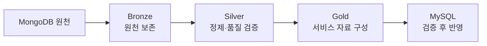
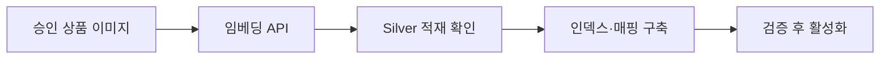

# 데이터 파이프라인: 직접 추천과 오프라인 평가

상품 수집·원천 보존부터 서비스 카탈로그, 사용자 직접 추천, 행동 집계와 오프라인 학습까지의 데이터 흐름을 설명한다. 2026-10-16 기준으로 기존 공통 계약과 직접 추천 v2 설계를 통합했으며, 실제 구현·설치·마이그레이션 완료를 뜻하지 않는다.

[문서 안내](index.md) · [직접 추천 계약](12-direct-recommendation.md) · [데이터 모델](03-data-model.md) · [Kafka 계약](05-kafka-jobs.md) · [직접 추천 속성](data-dictionary/09-direct-recommendation.md)

## 전체 데이터 경로

사진·텍스트·스케치에서 요구사항과 공간 맥락을 해석해 실제 상품을 직접 추천한다. 이미지 생성·템플릿 선택·생성물 분석은 신규 처리에 포함하지 않는다. 기존 생성 데이터와 파일은 보존 정책에 따라 관리하며 이 문서 정리로 삭제하지 않는다.

| 경로 | 실행 시점 | 처리 순서 | 결과 |
|---|---|---|---|
| 상품 자료 준비 | 최초 적재·주기 갱신 | 수집 → MongoDB·이미지 보존 → Bronze → Silver → Gold → MySQL | 서비스 상품·가격·링크·이미지 연결 |
| 상품 검색 준비 | 승인 이미지·카탈로그 변경 | 사전 임베딩 → Silver 적재 확인 → 인덱스·매핑 구축 → 검증·활성화 | Ad 서버의 검색 인덱스 |
| 사용자 직접 추천 | 사용자 요청 | Webapp 입력 보존 → 입력 Bronze 확인 → 해석·코드 검증 → Ad 검색·모델 순위 → Webapp 결과 저장 | 입력 버전에 연결된 추천 결과 |
| 사용자 반응 | 실제 노출·선택·거절·클릭 | Webapp 이벤트 저장 → Kafka → Bronze → Silver → Gold → MySQL | 노출·반응 집계 |
| 오프라인 학습·평가 | 승인 데이터 확보·모델 변경 | 후보·특징과 별도 라벨 → 버전 export → 학습·평가 → 검증·배포 | 운영에 사용할 추천 모델 |

상품 ETL은 사용자 요청과 독립적으로 실행한다. 사용자가 추천을 요청할 때 전체 상품을 다시 수집하거나 임베딩·학습하지 않는다. 운영 추천은 사전에 준비하고 활성화한 인덱스와 모델을 사용한다.

## 실행 주체와 저장소

| 구성 | 책임 |
|---|---|
| Webapp 서버 / `pj3-webapp` | Django 사용자 서비스, 입력·권한 검증, 해석 API Consumer, 추천 이력·행동 저장, 재시도·응답 전달 |
| Ad 서버 / `pj3-ad-server` | 상품·질의 임베딩, CPU 벡터 검색, 현재 상품 검증, 특징 계산·scikit-learn 모델 순위, 링크 결정 |
| NiFi·Python 수집기 | 수집 주기 관리, 대상 상품·이미지 확보, 원천 저장 및 발행 누락 복구 |
| Kafka | 원천 ID·파일 참조·작업·완료·행동 이벤트 전달. 대용량 이미지 본문은 넣지 않음 |
| Spark | Bronze 복제, Silver 정제·품질 검증, Gold 구성·집계, MySQL 반영 |
| MongoDB | `raw_products` 원천 관측 보존. 사용자 입력은 이 컬렉션에 저장하지 않음 |
| 이미지용 Object Storage | 상품 이미지·사용자 입력 파일·파생 결과 파일 보존 |
| Delta용 Object Storage | Bronze·Silver·Gold 파일 테이블, checkpoint 및 복원·평가용 export 파일 보존 |
| MySQL | 상품 서비스 사본, 사용자·입력·추천·작업·검수 원장, 검색 버전·집계 메타데이터 |

Bronze·Silver·Gold는 Spark가 처리하는 Delta 테이블이다. 일반 export 파일과 검색 인덱스 복원 파일은 Delta 테이블과 구분한다. Object Storage 두 VM의 이미지용·Delta용 개별 대응은 [인프라 문서](01-infrastructure.md)의 확정 범위를 따른다.

## 상품 수집과 원천 보존

1. NiFi가 주기를 관리하고 Python 수집기가 BRD 포함·제외 품목에 맞는 다나와 상품정보·확인 가능한 판매 정보·이미지를 확보한다.
2. 원천 문서를 MongoDB에 보존하고, 검증한 이미지 바이트는 이미지용 저장소에 저장한다. 원천 상품 ID·이미지 URL·객체 키·checksum·수집 시각을 연결한다.
3. MongoDB Replica Set의 majority·journal 쓰기 확인 후 Kafka에 원천 ID·수집 실행·hash 참조를 발행한다. 원천 `payload`는 수정하지 않고 발행 상태는 별도 관리 메타데이터에 기록한다.
4. Spark는 현재 Primary에서 majority 보존이 확인된 원천을 조회해 Bronze로 복제한다. 원천 저장 후 발행이 누락되면 동일 원천 ID와 수집 실행 기록으로 복구한다.

수집 성공은 원천 보존 확인 기준이며 추천 승인과 다르다. 쓰기 timeout이나 Primary 선출 중 오류만으로 미저장으로 단정하지 않고 원천 ID·중복 키로 상태를 대조한다. 같은 실행의 재전달은 중복을 막고 다른 시점의 관측은 이력으로 보존한다.

### 수집기 검수

| 확인 영역 | 완료 기준 |
|---|---|
| 추출 경로 | 실제 표본에서 상품 식별자·상품명·품목·규격·옵션·가격 조건·개별 URL·이미지 URL·관측 시각의 경로를 확인. 미제공 값은 추정하지 않음 |
| 수집 범위 | 포함·제외 품목을 원천 세부 카테고리와 대조하고 부속품·소품 혼입을 표본 확인 |
| 이미지 관계 | 같은 파일을 재사용해도 상품별 출처·원천 버전·이미지 연결 유지. 상품 수·연결 수·고유 파일 수를 구분 |
| 요청·재개 | 요청 간격·동시성 설정, 429의 Retry-After 준수, 403·CAPTCHA·반복 오류에서 해당 수집 중단. 재시작 시 중복 적재·불필요한 재다운로드 방지 |
| 파서 검증 | 저장 표본으로 추출 실패·중복 방지·중단 후 재개를 검증하고 카테고리별 적재·이미지 성공·추천 가능 건수 대조 |

## Bronze·Silver·Gold 처리

| 계층 | 저장·처리 내용 | 검증 기준 |
|---|---|---|
| Bronze | 원천 내용을 보존하고 `raw_document_id`·수집 메타데이터·적재 시각으로 추적 | 원천 ID·건수·hash·중복 이벤트, 원문 보존 |
| Silver | 가격·통화·카테고리·규격·옵션·판매 식별자·상품–이미지 관계 정제 | 파싱 실패·분류 매핑·축/단위/측정 대상·이미지 존재·검수 상태 |
| Silver 품질 영역 | `quality_issues`, 벡터 및 선택적 상품 이미지 분석의 검증 결과 | 실패 사유·분석/정제 버전·원천 참조 |
| Gold | 추천용 상품 카탈로그, 확인된 현재 판매 정보와 이력, 행동 집계 | 안정 키·옵션 일치·최신성·상품/링크/이미지 관계 |
| MySQL | 검증된 Gold의 서비스용 사본 및 집계 | 참조 무결성·반영 건수·입력 Delta 버전 |

MongoDB와 Bronze의 보존 중복은 의도적이다. Bronze는 원천까지 재조회할 수 있어야 하며 Silver·Gold는 처리 코드와 입력 버전을 기록한다. 원천과 실패 기록을 정제 결과로 덮어쓰지 않는다.

### 상품 식별과 품질 검수

상품 업무 키는 출처와 안정 상품 식별자를 기준으로 한다. 판매 항목 키는 확인된 판매처·판매 항목·옵션 식별자를 사용하고 배열 순서나 현재 가격을 키로 쓰지 않는다. 비슷한 이름·이미지만으로 다른 상품을 합치지 않으며 이번 서비스에 출처 간 동일 상품 매칭을 추가하지 않는다. 상세 기준은 [상품 원천과 서비스 경계](09-product-links.md#원천과-서비스-데이터-경계)를 따른다.

가격은 숫자·통화·조건·관측 시각을 구분한다. 규격은 상품·옵션·측정 대상과 축 의미를 확인한 값만 mm로 정규화하며, 축을 알 수 없으면 임의로 width·depth·height를 배정하지 않는다. AI 추정값은 별도 파생 정보이며 상품 실측·가격 원장을 덮어쓰지 않는다.

서비스 카테고리 매핑과 운영 검수는 MySQL의 관리 원장 및 `product_images.usage_review_json`을 처리 입력으로 읽는다. 수집기 판정·이용 검토·감사 이벤트를 추적하고 검수 버전을 남긴다. Gold 발행이 운영 검수 원장을 덮어쓰지 않는다.

상품명·품목·이용 가능한 이미지가 부족하면 추천을 보류하고 원천은 유지한다. 규격·가격이 없으면 미제공으로 표시하며 확인된 조건처럼 사용하지 않는다. 미확인 링크는 이동 버튼을 비활성화하고, 판매 조건 미확인을 구매 가능으로 표시하지 않는다.

## Gold에서 MySQL로 반영

1. 입력 Gold 테이블별 Delta 버전을 고정하고 반영 실행을 생성한다.
2. MySQL staging에 `execution_id`와 함께 적재한다.
3. 건수·필수 필드·상품/판매 연결·중복 업무 키를 검증한다.
4. `product_key`·`offer_key`·`snapshot_key`와 복합 고유키로 기존 행을 찾는다. 신규 행에만 UUID4를 발급하고 기존 ID는 유지하며, 자식 FK에는 실제 저장된 부모 UUID를 사용한다. 동시 삽입은 고유 제약으로 처리하고 기존 업무 키라면 저장된 행을 다시 조회한다.
5. 초기 규모에서는 하나의 MySQL 트랜잭션으로 상품·판매·이력 영역을 Upsert하고 테이블별 Delta 버전·건수·완료 시각을 기록한다. 규모가 커지면 별도 게시 단위 전환을 검토한다.

실패는 staging·고정 입력 버전으로 재실행한다. 오래된 가격이 최신 가격을 덮어쓰지 않도록 원천 시각과 안정 키를 대조하고 동일 시점 충돌 기준도 고정한다. 명시적인 상품 비활성화·판매 종료와 이번 배치에 없는 경우를 구분하며 단순 누락으로 삭제하지 않는다.

서비스 조회·검수·반영은 현재 MySQL Primary를 사용한다. 수동 장애 전환 중에는 반영을 멈추고 같은 반영 실행·Delta 버전·업무 키로 완료 범위를 대조한 뒤 재개한다. 사용자·입력·추천·작업·검수 원장은 Django와 해당 워커 소유이며 상품 ETL이 덮어쓰지 않는다. 여러 Delta 테이블·MySQL·Kafka를 하나의 분산 트랜잭션으로 간주하지 않는다.

## 상품 벡터와 검색 인덱스 준비

Ad 서버의 상품 임베딩 준비 Consumer는 승인된 이미지의 외부 API 결과를 버퍼 파일·작업 결과 참조에 보존하고 DB 커밋 확인 후 완료 이벤트를 발행한다. Spark가 Delta Silver 적재를 확인한 뒤 `product_embeddings` 메타데이터를 반영한다. 전달 누락은 같은 작업 결과·이벤트 ID로 복구한다.

| 구분 | 유지할 계약 |
|---|---|
| 벡터 재사용 | 이미지 checksum·모델·전처리·차원으로 중복 생성 방지. 저장 승인을 분석·외부 전송 승인으로 간주하지 않음 |
| 상품 연결 | 파일·벡터는 공유할 수 있으나 `product_images`의 상품별 활성 상태·품목·원천 버전·이용 범위를 각각 검증 |
| 인덱스 구축 | 고정 Gold·Silver 버전으로 FAISS 파일과 검색 ID → embedding UUID·asset UUID·checksum 매핑을 함께 생성 |
| 버전 검증 | 모델·차원·전처리·정규화·품목·상품 연결·파일 checksum 대조 후 활성화. 요청별 사용 버전 기록 |
| 실패·교체 | 검증 실패 시 기존 버전 유지. 메모리 여유가 없으면 검색 중단 상태를 알리고 교체 |
| 파일 보관 | 활성 인덱스는 Ad 서버 로컬 디스크·메모리, 복원 파일·매핑은 Delta용 저장소의 `exports/search` 일반 파일 영역. `_delta_log` 수정 금지 |

검색된 이미지가 여러 상품에 연결되면 현재 유효한 상품 연결을 확장한 뒤 상품 UUID별 중복을 정리한다. 같은 파일이라는 이유로 상품번호를 합치지 않는다. ABO 시험 인덱스는 서비스 상품 검색과 분리한다. 임베딩 모델과 인덱스 세부 계약은 [Ad 서버](07-ad-server.md#벡터와-인덱스)를 따른다.

### 선택적 상품 이미지 분석

상품 이미지의 보조 분석은 핵심 추천 이후의 선택 경로이며 사용자 추천의 필수 선행 단계가 아니다. 작업 등록·분석 결과 저장 후 각각 DB 커밋을 확인해 요청·완료 이벤트를 발행한다. Consumer가 저장소 이미지와 응답을 검증하고 Spark가 결과 참조를 Silver에 반영한다. 결과는 MySQL에서 추적하고 파일은 이미지용 저장소의 derived 영역에 둘 수 있다. 같은 이미지·모델·프롬프트 버전의 결과는 재사용하되 원천 가격·규격을 대체하지 않는다.

## 입력 Bronze와 사용자 직접 추천

| 단계 | 담당 | 처리·저장 기준 |
|---|---|---|
| 1. 요청 접수 | Webapp / Django | 권한 확인 후 입력 파일은 이미지용 저장소, 입력 버전·추천 run·보존 job은 MySQL에 저장. 커밋 후 입력 이벤트 발행 |
| 2. 입력 보존 확인 | Spark → Webapp | 입력 Bronze commit·checksum 대조 후 완료 이벤트 발행. Webapp이 같은 입력 hash·파일 참조·run과 대응을 확인하고 해석 작업 등록 |
| 3. 해석·맥락 확정 | Webapp의 별도 Consumer | 멀티모달 API로 요구·공간·배치·크기 근거 해석. 코드가 형식·참조·단위·크기 사용 정책을 검증하고 `recommendation_contexts`에 불변 맥락 보존 |
| 4. 검색·순위 | 별도 Ad 서버 | 해석된 요구로 질의 조립 → 질의 임베딩 → 사전 상품 인덱스 검색 → 현재 상품·명시 조건 검증 → 특징 계산·scikit-learn CPU 모델 순위 |
| 5. 결과 저장·표시 | Webapp / Django | 같은 추천 run에 후보/특징·모델/인덱스/정책 버전과 결과를 저장. 최신 입력·완료 상태를 대조해 최신 추천 갱신 |
| 6. 링크 클릭 | Webapp → Ad → Webapp | Webapp이 사용자·추천 항목 권한 확인, Ad가 상품·링크 대응과 현재 상태 검증, Webapp이 클릭 기록과 이동 응답 처리 |

입력 버전 → 추천 맥락 → 추천 실행 → 추천 상품으로 연결한다. 신규 추천에 `generation_run_id`·`scene_object_id`·`template_id`·생성 크롭을 필수로 요구하지 않는다. 사용자 입력은 MongoDB 상품 원천과 분리하며 Bronze 보존 미확인 상태에서는 해석을 시작하지 않는다.

신규 입력·보존·해석 메시지는 `input_revision_id`·`recommendation_run_id`·`input_hash`·고정 참조·`schema_version`으로 기존 생성 계약과 구분한다. v2 스키마·Consumer 전환은 구현 작업이며 기존 토픽에 비호환 본문을 혼합하지 않는다. [입력 Bronze와 직접 추천 단계 계약](05-kafka-jobs.md#입력-bronze와-직접-추천-단계-계약)을 따른다.

해석의 정상 형식이 실제 공간의 정답을 보장하지는 않는다. 방 맥락과 사용자 필수 조건을 분리하고 규격 결측은 UNKNOWN으로 남긴다. 낮은 근거의 크기 추정만으로 상품을 강제 제외하거나 추정값을 실측으로 표시하지 않는다. 상세 스케치 직접 임베딩은 호환·품질 확인 전 기본 필수 경로로 두지 않는다.

추천 검색·링크 판단은 Ad 서버, 추천 이력·사용자 이벤트 쓰기는 Webapp 책임이다. Ad 장애로 원본 입력·확정 맥락·기존 추천·상품 ETL을 중단하거나 삭제하지 않는다. 유효 후보 없음과 시스템 오류를 구분한다.

## 사용자 행동과 광고 집계

Webapp이 실제 노출·선택·명시적 거절·비교/구매 링크 클릭을 MySQL에 저장하고 커밋 확인 후 `user.action.recorded`를 발행한다. 누락은 `user_events`에서 같은 `event_id`로 복구한다. 목록 응답이나 후보 생성만으로 실제 노출을 기록하지 않는다.

| 단계 | 처리 |
|---|---|
| Bronze | 수신 행동 원문 보존 |
| Silver | `event_id` 중복 제거, 추천 항목·실제 노출·상품·노출 당시 품목·이벤트 시각 연결 검증 |
| Gold | UTC 노출일·상품·노출 당시 카테고리별 유효 노출 및 반응 노출 수 집계 |
| MySQL·Ad | `ad_metrics_daily`의 복합 키로 Upsert하고 Ad 서버에서 집계 조회 |

같은 추천 항목의 반복 노출은 고유 제약으로 중복 집계를 막는다. 반응은 `impression_id`로 실제 노출과 연결하고 소유자·상품·Offer 대응이 확인되지 않은 반응은 품질 오류로 분리한다. 같은 노출의 반복 클릭은 원본 행동에 남기되 노출 단위 반응 지표의 분자에는 한 번 센다.

늦은 반응·재전달은 영향 날짜를 재계산하며 기존 합계에 무조건 더하지 않는다. `source_versions_json`·`computed_at`을 함께 반영한다. 기간 비율은 분자·분모를 합쳐 계산하고 노출 0건은 미산출로 반환한다. 클릭은 구매·매출이 아니다. 상품 선택에 따른 관심 카테고리 갱신은 Webapp이 담당한다. [실제 노출과 반응](07-ad-server.md#실제-노출과-반응) 및 [집계 정의](07-ad-server.md#집계와-조회)를 따른다.

## 오프라인 학습·평가와 모델 배포

현재 직접 추천 계약의 scikit-learn 학습·배포 정책을 유지한다. 학습은 사용자 요청과 분리된 CPU 배치이며, 운영 순위는 사전에 검증·활성화한 모델을 Ad 서버 CPU에서 실행해 결정한다.

1. 추천 당시 후보·특징·입력/상품/정책/인덱스 버전을 고정한다. 이후 실제 행동과 사람 평가는 별도 라벨로 연결한다.
2. 승인된 자료만 고정 Delta 버전에서 export하고 행 수·원천 참조·checksum·접근·보관·삭제 범위를 manifest에 기록한다. export 파일은 Delta 테이블 자체와 구분한다.
3. 미노출·미클릭을 일괄 부적합으로 만들지 않는다. 시간·그룹 분리와 위치 편향을 검토하고 미래 상품·반응 정보가 특징에 섞이지 않게 한다.
4. 학습·추론의 특징 이름·순서·타입·전처리를 일치시킨다. 후보 Recall@K, 순위 NDCG@K, 명시 조건 위반·미확인, 사람 평가와 CPU 시간·RAM을 분리해 평가한다.
5. 모델·전처리·특징·실행 버전·checksum·평가 결과를 검증하고 명시적으로 활성화한다. run별 모델/특징/인덱스/정책 버전을 고정하고 요청마다 학습·다운로드·재로딩하지 않는다.

모델 교체 검증 실패 시 기존 활성 모델을 유지한다. 모델 부재·손상·비호환은 `MODEL_NOT_READY`, 추론 오류는 `RANKING_FAILED`로 구분하고 규칙 결과를 모델 추천으로 표시하지 않는다. 준비가 끝나지 않은 모델을 구현 완료로 설명하지 않는다. 상세 모델 선택·배포 계약은 [직접 추천 계약](12-direct-recommendation.md#이번-scikit-learn과-후속-내재화)을 따른다.

## 실행 주기와 실패 복구

NiFi는 상품 수집 주기, Spark는 가공·집계, Webapp·Ad의 작업 프로세스는 담당 단계의 실행·재시도를 관리한다. 초기 상품 처리는 수분 단위 마이크로배치 후보이며 주기는 수집량·최신성 목표를 측정해 정한다. Webapp Consumer는 Django 웹과 별도 프로세스로 실행하며 AI 전용 VM을 추가하지 않는다.

| 상황 | 복구 기준 |
|---|---|
| 원천 저장·발행 확인 실패 | 원천 ID·수집 실행·hash로 보존 여부를 대조하고 같은 ID로 미발행 이벤트 복구 |
| 입력·작업·결과 전달 누락 | DB 커밋된 업무 기록·고정 파일 참조에서 같은 이벤트 ID로 재구성 |
| 중복·입력 충돌 | 같은 ID·같은 본문은 기존 결과 재사용, 같은 ID·다른 본문은 거절 |
| 해석 이후 검증·저장 실패 | 저장된 원응답·맥락·완료 벡터를 재사용하고 성공한 외부 API를 무조건 재호출하지 않음 |
| 요청 변경·실패 재시도 | 입력 변경은 새 input_revision, 명시적 재추천은 새 run, 같은 실패 재시도는 기존 run·입력·버전 유지 |
| 상품 정제·게시 실패 | 원천 범위·`normalizer_version`·입력 Delta 버전·안정 키로 실패 구간 재실행 |
| 인덱스·모델 교체 실패 | 이전 검증 버전 유지. 실제 시스템 오류를 후보 없음으로 숨기지 않음 |

상품·입력·행동 경로의 토픽·스키마·테이블·checkpoint는 분리한다. checkpoint를 공유하거나 임의로 지우지 않고 같은 Delta 테이블에는 초기안에서 단일 쓰기 Driver를 둔다. Worker 여러 대는 같은 Driver의 실행에 참여할 수 있다. `foreachBatch`만으로 외부 저장소 중복 반영이 방지되지는 않으므로 안정 키·고유 제약·반영 실행을 함께 사용한다.

API·파일·검색 대기 중 DB 잠금을 유지하지 않는다. 단계 고유 키·lease·offset 완료 확인은 [발행과 복구 계약](05-kafka-jobs.md#발행과-복구)을 따른다. 늦은 이전 run이 최신 결과를 덮어쓰지 않게 하며, 상품 원천 복구와 사용자 작업 재시도를 한 경로로 취급하지 않는다.

운영 기록 보관은 보관 대상 확정 → 내보내기 → 건수·checksum·읽기 검증 → `archive_manifests` 완료 기록 순서다. 재시도와 별도 주기로 수행하고 PRD AC-12의 운영 로그 보관은 [운영 정책](06-operations-migration.md)을 따른다. 이를 위해 전용 서버를 새로 추가하지 않는다.

## 파이프라인 검수 기준

| 범위 | 확인 사항 |
|---|---|
| 원천 보존 | MongoDB 확인·Bronze 원문/원천 ID 대조, 같은 실행 중복 방지, 다른 시점 관측 보존 |
| 정제·게시 | 규격 축/단위/옵션·결측 처리, 검수 원장 보존, UUID 유지, 고정 Delta 버전 재실행과 MySQL 건수·참조 관계 |
| 이미지·벡터 | 파일·checksum 검증, 다중 상품 연결, 중복 벡터 방지, 차원·모델·전처리·매핑·교체 실패 복구 |
| 직접 추천 | 입력 Bronze 확인 전 해석 차단, Webapp/Ad 책임 분리, 고정 맥락·모델/인덱스/정책 버전, 링크 대응·최신 run 보호 |
| 행동·학습 | 실제 노출 기준, 중복·지연 재집계, 특징/라벨 분리, 학습 누수·미노출 라벨 오인 방지 |
| 운영·보존 | 중단 후 재개·미발행 복구·checkpoint·DB 장애 전환·백업 읽기 검증. 처리량·지연·자원은 실측 후 확정 |

상세 검증과 보관·삭제 범위는 [운영 문서](06-operations-migration.md)를 따른다. 이 문서는 파이프라인 흐름과 공통 계약을 통합한 것이며 수집기의 실제 응답 경로, ORM/DDL, 설치된 서비스 상태를 확정하는 자료가 아니다.
