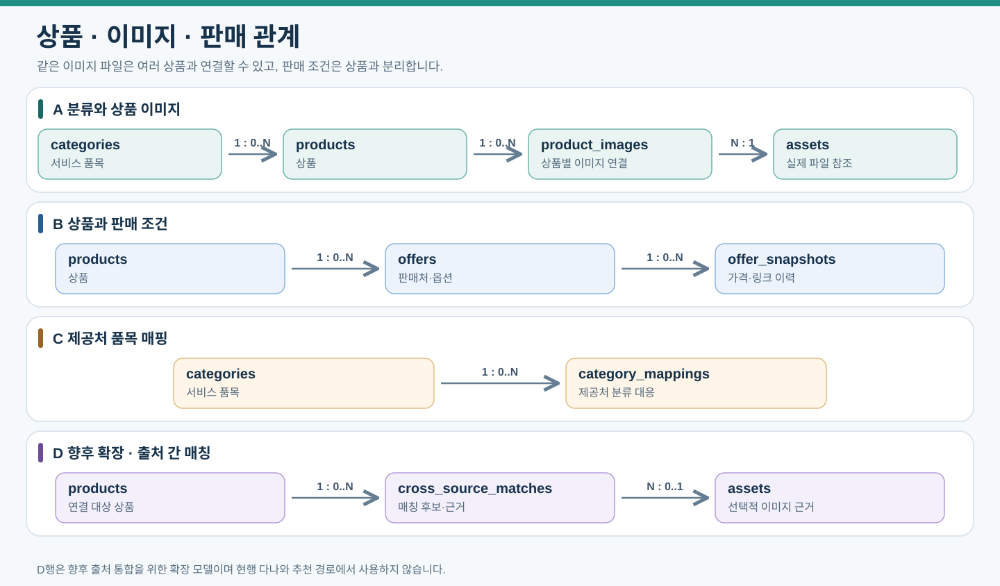

# 데이터 모델: 직접 추천 변경안과 기존 원장

2026-10-18 로컬 구현 추가: SketchOn은 SQLite `recommendations` 작업 원장과 별도 워커·native async Gemini·제한된 공유 풀을 사용한다. [실행/상태/복구/스키마와 후속 연결](../interior-recommender/execution.md)을 따른다. 아래 MySQL·Kafka·Bronze·광고 서버의 운영 계약은 후속 통합 범위이며 이번 migration이 해당 구축 완료를 뜻하지 않는다.

2026-10-15 현행 변경안은 [직접 추천 속성](data-dictionary/09-direct-recommendation.md)과 [논리 ERD](12-direct-recommendation.md#논리-데이터와-erd-변경안)다. 구현/DDL 반영 완료가 아니다.

신규 입력 버전→추천 맥락→추천 run→항목→노출/행동으로 연결한다. run 접수 시 context_id는 비어 있을 수 있으나 검색 전에는 같은 입력의 확정 맥락을 요구한다. generation_run/scene_object/template FK는 신규 추천 선행 조건이 아니다. 프로젝트 최신 추천 FK는 입력 순번과 완료 상태를 대조해 갱신한다.

기존 상품/Offer/이미지/원천/링크/인덱스·입력 버전·AI 호출·작업·이벤트의 UUID·시점·보존/권한 원칙은 유지한다. 요청 조건/공간 관찰/배치/크기 근거/코드 검증·정책과 요청 당시 후보/특징을 별도 보존한다. 실험 라벨은 요청 당시 특징과 분리한다. AI 추정 치수를 상품 규격 원장에 쓰지 않는다.

아래 상세 목록은 기존 컬럼의 출처를 보존한 자료다. 특히 recommendation_runs의 생성물 필수 연결·projects.latest_generation_run_id·생성 엔터티는 신규 직접 추천 명세로 사용하지 않는다. 실제 마이그레이션과 구버전 이력 조회/제약 전환은 별도 구현한다.


운영 추천은 run별 ranking_policy_json(수동 가중치·결측/미선호 정책·MANUAL_INITIAL)·ranking_version·인덱스/임베딩 버전을 고정한다. item별 ranking_score·score_components_json과 조건별 상태를 보존한다. 초기에는 학습 모델 artifact가 필요 없으며 후속 학습 모델 참조는 선택 사항이다. 상세 필드는 [직접 추천 속성](data-dictionary/09-direct-recommendation.md)을 따른다. 실제 DB/DDL 반영은 별도 작업이다.

## 실버·골드와 서비스 원장 대응

2026-10-16 반영. Delta 관측 테이블과 MySQL 서비스 테이블은 별도다. [실버·골드 필드 사전](data-dictionary/01-raw-delta.md#실버골드-필드-계약-적용-범위)의 행 기준·원문 경로·확인 상태를 적용하며 물리 스키마와 마이그레이션 완료를 뜻하지 않는다.

Silver 공통 추적은 `source_code`·`source_product_id`·`product_key`·`raw_document_id`·원문/추출 hash·`collection_run_id`·`observed_at`·`normalizer_version`·`processing_run_id`다. 속성/가격/이미지/링크는 옵션과 자식 항목의 안정 키로 관측에 연결한다. 같은 입력 재전달은 같은 관측을 재사용하고 다른 시점 관측은 새 이력이다. 정확한 복합 키·hash 계산은 구현 전에 확정한다. 다른 저장소 사이에 물리 FK를 추가하지 않는다.

| Gold 논리 출력 | 행 기준·키 | 서비스 원장 또는 사용처 |
|---|---|---|
| `gold_product_catalog` | 안정 `product_key`의 현재 상품, 옵션 연결 유지 | `products`의 UUID·상품명·품목·브랜드/모델·확인 규격 및 확장 속성 |
| `gold_recommendation_images` | 상품–이미지 연결과 벡터/인덱스 버전 | `product_images`, `assets`, `product_embeddings`, `search_index_versions` 대응 검증 |
| `gold_product_links` | 상품별 검증한 비교 링크 | `products.comparison_url`, 추천 시 `link_snapshot_json` |
| `gold_offers_current` | 안정 `offer_key`별 현재 판매 항목 | `offers`; 확인된 판매처·옵션이 없으면 행을 만들지 않음 |
| `gold_offer_snapshots` | 판매 항목·관측 시점·원천의 안정 이력 키 | `offer_snapshots`, 당시 가격·조건·URL·원천 참조 |
| `gold_catalog_quality_daily` | 기준일·품목·고정 입력 버전의 집계 | 운영 품질 조회. 사용자 반응 `ad_metrics_daily`나 광고 예산 원장과 별도 |

| 논리 필드 묶음 | 대응·확장 규칙 |
|---|---|
| `display_name`, `normalized_name`, `manufacturer`, `brand`, `model` | 확인 표시명은 기존 `products.name`, 모델은 `products.model_name`에 대응한다. 정규 이름·제조사·필드별 provenance는 확장 저장 계약을 DDL 전에 정한다. 제조사를 브랜드에 대입하지 않는다. |
| `source_category_path`, `collection_category_context`, `category_code`, `mapping_status`, `mapping_version` | API 분류와 수집 설정 분류를 별개로 보존한다. 기존 `category_mappings`·`categories`와 버전 대응하며 미매핑·제외를 구분한다. |
| 색상·재질·형태 및 `dimension_raw`·`dimension_status`·`measurement_target`·`option_key` | 코드 목록과 원문·부위·옵션·확인 상태를 보존한다. 기존 단일 `color`에 복수 옵션을 손실 저장하지 않는다. 서비스 확장 컬럼/JSON·직렬화는 별도 확정하며 이미 존재하는 컬럼으로 가정하지 않는다. |
| `price_krw`, `price_kind`, 가격 조건·시각·확인 상태 | 상품 목록 가격 관측은 판매처 Offer 가격과 별도다. 목록 가격을 기존 `offers.price_amount`로 복제해 가상 판매처를 만들지 않는다. |
| 네 가지 준비 상태·`readiness_reasons_json` | 상품 카탈로그·검색 벡터·비교 주소·구매 주소별 준비를 나눈다. 기존 `products.status`, 이미지 `active`, `offers.eligible`은 각 원장의 상태로 유지하고 서로 자동 치환하지 않는다. |

Gold 현재 값은 필드별 출처·관측 시각·확인 상태·선택 정책 버전으로 결정한다. 수집 실패로 이전 확인값을 NULL로 덮어쓰지 않으며 값 철회·상품 비활성화는 별개다. 값의 관측 시각과 최신 수집 실패를 함께 남긴다. 옵션별 가격·색상·규격을 다른 옵션에서 조합하지 않는다.

Gold 내부 상품 UUID는 안정 업무 키의 기존 매핑을 사용한다. `image_id`는 `assets.id`, 상품–이미지 연결 ID는 `product_images.id`로 분리한다. 벡터는 이미지 asset 단위로 공유하고 상품별 유효 연결은 조회 시 확장한다. 요청별 `ranking_score`·`score_components_json`·조건 판정은 추천 run/item의 이력이며 Gold 상품 속성이 아니다.

현재 컬럼을 유지하는 서비스 게시와 새 논리 필드의 저장 확장은 구분한다. 추가 필드의 NULL·타입·enum·원장 소유자·API 계약을 정한 뒤 ORM/DDL을 검증한다. 현행 상세 ERD의 MySQL 엔터티 수에 위 Delta 논리 테이블을 더해 표시하지 않는다.

<details>
<summary>이전 상세 설계 — 공통 계약은 유지, 생성 중심 단계/관계는 신규 사용 안 함</summary>

# 원천과 서비스 데이터 모델

MongoDB는 불변 원천과 수집기 보조 운영 데이터를, MySQL은 최종 서비스 원장과 업무 상태를 관리한다. 이미지와 Delta 파일은 각각 별도 저장소에 두고 DB에는 참조와 메타데이터를 저장한다. 아래 스키마는 DDL 작성 전의 논리 설계 초안이다.

[문서 안내](index.md) · [파이프라인](02-data-pipeline.md) · [Django와 AI](04-application-ai.md) · [데이터 속성 사전](data-dictionary/index.md)

업무별 관계도와 전체 컬럼 표는 [전체 ERD](03-erd-full.md), 핵심 이용 흐름은 [간략 ERD](03-erd-summary.md)에서 확인한다. 아래 상품 ERD는 상품·판매·이미지 영역의 관계만 표시한다.

## DB 복제와 데이터 접근

MySQL Primary 1대·Replica 2대는 같은 서비스 스키마와 UUID PK·FK를 복제한다. MongoDB 세 멤버도 같은 원천 컬렉션과 ObjectId를 복제한다. 복제본별 엔터티를 ERD에 추가하지 않고 기존 테이블·컬럼·쓰기 담당을 유지한다.

초기 MySQL 업무 읽기·쓰기는 현재 Primary에 연결한다. MongoDB 원천 저장은 writeConcern={w: majority, j: true}, Spark 원천 조회는 readPreference=primary·readConcern=majority를 사용한다. DB 장애 전환과 결과 미확인 재시도에서도 원천 ID·업무 키·event_id를 유지한다. 물리 구성·연결 설정은 [DB 다중화 계약](01-infrastructure.md#db-다중화와-접속-계약), 복구·손실 대조는 [운영](06-operations-migration.md#db-복제와-장애-복구)을 따른다.

## 공통 데이터 규칙

프로젝트에서 직접 설계한 MySQL 34개 엔터티(이전안 placements 1개 포함)의 id는 UUID4 기본키로 통일한다. 신규 행을 생성하는 Django 또는 반영 작업이 UUID를 한 번 발급하고, 해당 id를 참조하는 FK도 UUID 타입으로 저장한다. API와 Kafka에도 같은 id를 사용하므로 assets·projects·jobs의 별도 public_id는 제거한다. Django 자체의 그룹·권한 등 내부 테이블까지 UUID로 바꾸지는 않는다. MongoDB ID는 MySQL의 [raw_document_id](data-dictionary/index.md#common-raw_document_id)에 24자리 문자열로 저장한다. 서로 다른 DB 사이에는 외래키를 걸지 않는다.

시간은 UTC로 저장하고 한국 시간은 화면에서 변환한다. 초기 원화 가격은 정수와 currency로 표현하며 다중 통화가 필요하면 DECIMAL과 소수 자릿수 정책을 정한다. 규격은 mm로 정규화하고 원문을 보존한다. 미제공은 NULL이며 0으로 대신하지 않는다.

로그에 남기는 모든 작업은 [공통 소요시간 기록 계약](06-operations-migration.md#모든-작업-로그의-소요시간-기록-계약)에 따라 실행 시도별 duration_ms를 구조화 로그에 기록한다. DB 이력이 없는 작업도 포함한다. jobs의 finished_at−started_at은 최초 실행부터 최종 종료까지로 재시도·예산 대기를 포함할 수 있으며, 개별 시도는 job_attempts로 구분한다. pipeline_runs·publishing_runs도 시작·종료 시각을 보존하고, 실제 실행 소요시간은 단조 증가 시계로 측정한 로그 값과 구분한다. ai_analysis_runs.latency_ms는 외부 요청 전송 직전부터 응답 본문 수신 완료 또는 오류·시간 초과 확정까지로 고정하며 호출 로그의 duration_ms와 같은 값을 사용한다. 공통 로그 필드는 서비스 로그의 스키마이며 모든 업무 테이블에 같은 이름의 컬럼을 추가한다는 뜻은 아니다.

아래 표의 각 속성명을 클릭하면 저장 의미와 예시를 확인할 수 있다. 각 업무 테이블에는 필요한 [created_at](data-dictionary/index.md#common-created_at)과 [updated_at](data-dictionary/index.md#common-updated_at)을 추가한다. 외래키의 삭제 동작과 UUID의 직렬화는 DDL에서 명시한다. 감사 이력을 무분별한 CASCADE 삭제로 잃지 않도록 보관 정책을 반영한다.

## UUID 생성과 보존 규칙

```python
import uuid
from django.db import models


class Project(models.Model):
    id = models.UUIDField(primary_key=True, default=uuid.uuid4, editable=False)
```

기본값에는 uuid.uuid4()의 실행 결과가 아니라 uuid.uuid4 함수를 전달한다. Django가 ORM으로 신규 객체를 만들 때 발급하며, Spark나 직접 SQL로 삽입하는 반영 작업은 UUID를 별도로 생성해야 한다. DB가 자동으로 발급한다고 가정하지 않는다.

Django UUIDField의 MySQL 저장 형식은 CHAR(32)로 정한다. 참조 FK도 같은 형식으로 맞춘다. API·Kafka·Delta의 MySQL 참조 필드는 하이픈을 포함한 36자리 UUID 문자열로 직렬화하고, DB 경계에서 UUIDField 또는 반영 코드가 32자리 저장 형식으로 변환한다. UUID4는 생성 시각이나 순서를 나타내지 않으므로 정렬은 created_at·collected_at과 별도 순번을 사용한다.

UUID는 행 식별자이며 동일 상품 판단을 대신하지 않는다. product_key·offer_key·snapshot_key와 기존 복합 고유키는 유지한다. Gold 재반영에서는 안정적인 업무 키로 기존 행을 찾고, 신규 행에만 UUID를 발급한다. 동시 삽입으로 업무 키가 충돌하면 고유 제약으로 중복을 막고 기존 id를 다시 조회한다. 다른 업무 키의 행과 UUID PK가 충돌하면 새 UUID를 발급해 삽입을 재시도한다. Upsert의 갱신 대상에서 id를 제외하며 자식 FK에는 실제 저장된 부모 UUID를 사용한다. assets도 bucket·object_key로 기존 행을 확인한다.

재시도와 AWS 이전에서는 기존 PK·FK 및 JSON·Delta·Kafka의 UUID 참조를 함께 보존한다. 매번 새 UUID로 바꾸거나 Spark 변환을 재실행할 때 임시 UUID를 최종 ID로 사용하지 않는다. 이미 BIGINT 기반 데이터를 구현했다면 부모·자식·외부 참조를 포함한 별도 변환 계획이 필요하며 이 문서 변경만으로 기존 DB를 변환하지 않는다.

사용자는 첫 마이그레이션 전에 UUID PK를 가진 커스텀 사용자 모델과 AUTH_USER_MODEL을 설정한다. Django 기본 사용자 모델을 그대로 사용하면 이 문서의 users UUID PK와 일치하지 않는다. UUID로 조회해도 소유자와 접근 권한 검증은 수행한다.

user_events의 event_id는 재전송된 동일 이벤트를 판별하는 식별자이므로 행 PK와 별도로 유지한다. event_id는 동일 이벤트 재발행에서 보존하고, 새 이벤트에는 새 값을 발급한다. lease_token·session_id·수집 실행 식별자도 PK와 용도가 달라 일괄 변경하지 않는다.

UUID4는 환경별 데이터를 합칠 때 충돌 가능성이 매우 낮지만 고유 제약을 유지한다. MySQL에서 BIGINT보다 긴 PK는 보조 인덱스 공간을 늘리므로 데이터 증가 시 실제 삽입·조회 성능을 확인한다. AWS로 동일 DB를 옮기는 것 자체는 UUID를 요구하지 않으며 이번 선택은 여러 처리 경로에서 식별자를 유지하기 위한 설계다.

[Django UUIDField](https://docs.djangoproject.com/en/5.2/ref/models/fields/#uuidfield) · [Django 커스텀 사용자 모델](https://docs.djangoproject.com/en/5.2/topics/auth/customizing/#substituting-a-custom-user-model) · [MySQL PK와 보조 인덱스](https://dev.mysql.com/doc/refman/8.4/en/innodb-index-types.html)

## MongoDB 원천

raw_products는 상품·판매 정보의 불변 원천 관측이다. 이번 서비스 카탈로그의 수집 원천은 다나와이며 source_code=danawa와 확인된 source_product_id를 보존하고 record_type=PRODUCT/OFFER로 구분한다. 원천 식별자와 개별 상품 URL은 별도 의미이며 payload를 정규화 결과로 수정하지 않는다.

| 필드 | 형식 후보 | 의미 |
|---|---|---|
| [_id](data-dictionary/01-raw-delta.md#raw_products-_id) | ObjectId | 원천 ID |
| [source_code](data-dictionary/01-raw-delta.md#raw_products-source_code) | 문자열 | 제공처 |
| [source_product_id](data-dictionary/01-raw-delta.md#raw_products-source_product_id) | 문자열 또는 null | 제공처 상품 ID |
| [collection_run_id](data-dictionary/01-raw-delta.md#raw_products-collection_run_id) | 문자열 | 수집 실행 |
| [collected_at](data-dictionary/01-raw-delta.md#raw_products-collected_at) | 날짜 | 수집 시점 |
| [source_url](data-dictionary/01-raw-delta.md#raw_products-source_url) | 문자열 | 원천 주소 |
| [payload](data-dictionary/01-raw-delta.md#raw_products-payload) | 문서 또는 문자열 | 원본 표현을 유지한 본문 |
| [raw_object_key](data-dictionary/01-raw-delta.md#raw_products-raw_object_key) | 문자열 또는 null | 정확한 원본 응답 파일이 필요한 경우 |
| [image_refs](data-dictionary/01-raw-delta.md#raw_products-image_refs) | 배열 | 원본 URL, 확보한 asset 식별자와 객체 키 |
| [payload_hash](data-dictionary/01-raw-delta.md#raw_products-payload_hash) | 문자열 | 정해진 해시 계산 방식의 결과 |
| [collector_version](data-dictionary/01-raw-delta.md#raw_products-collector_version) | 문자열 | 수집 코드 버전 |
| [schema_version](data-dictionary/01-raw-delta.md#raw_products-schema_version) | 문자열 | 원천 포장 형식 버전 |
| [record_type](data-dictionary/01-raw-delta.md#raw_products-record_type) | 문자열 | PRODUCT 또는 OFFER |
| [source_record_key](data-dictionary/01-raw-delta.md#raw_products-source_record_key) | 문자열 | 제공처 안의 상품 또는 판매 항목 안정 키 |
| [parser_version](data-dictionary/01-raw-delta.md#raw_products-parser_version) | 문자열 | 추출 코드 버전 |
| [response_body_hash](data-dictionary/01-raw-delta.md#raw_products-response_body_hash) | 문자열 | 원본 응답 바이트 SHA256, 추출 payload_hash와 구분 |

정확한 응답 바이트가 필요하거나 문서가 너무 크면 원본 응답을 별도 파일로 보존하고 참조한다. 계정 토큰과 비밀 헤더는 수집 payload에 저장하지 않는다. 인덱스 후보는 collection_run_id, collected_at, source_code와 source_product_id 조합이다. 반복 수집 이력을 보존하므로 source_product_id 자체에 고유 인덱스를 걸지 않는다.

MongoDB는 원천·처리 상태를 관리하고 MySQL의 products·product_images는 서비스 상품·이미지 관계를 관리한다. 두 저장소의 동명 데이터는 역할을 구분한다. [상품 연결 계약](09-product-links.md#원천과-서비스-데이터-경계)을 따른다.

## MySQL 상품과 판매



[PNG로 보기](assets/erd-catalog.png). 상세 카디널리티와 생략한 관계는 [업무별 ERD](03-erd-full.md#전체-관계-목록)를 따른다.

그림의 테이블명은 실제 식별자를 유지하고 역할은 한국어로 설명한다.

엔터티 속성·타입·PK·FK·고유키 표시는 전체 ERD에서 확인한다. MongoDB 원천 ID는 DB 간 추적용 참조이며 MySQL FK가 아니다. 사용자와의 관계는 전체 ERD에서 확인한다.

상세 타입과 길이·소수 자릿수·NULL 허용·삭제 동작은 실제 DDL 작성 시 확정한다. 금액은 초기 원화 기준 정수다. 수집 snapshot은 당시 정보를 보존하며 현재 판매 정보는 offers에서 갱신한다.

| 테이블 | 주요 컬럼 |
|---|---|
| categories | [id](data-dictionary/02-products.md#categories-id), [code](data-dictionary/02-products.md#categories-code), [name](data-dictionary/02-products.md#categories-name), [recognition_enabled](data-dictionary/02-products.md#categories-recognition_enabled), [active](data-dictionary/02-products.md#categories-active) |
| products | [id](data-dictionary/02-products.md#products-id), [product_key](data-dictionary/02-products.md#products-product_key), [name](data-dictionary/02-products.md#products-name), [category_id](data-dictionary/02-products.md#products-category_id), [brand](data-dictionary/02-products.md#products-brand), [model_name](data-dictionary/02-products.md#products-model_name), [color](data-dictionary/02-products.md#products-color), [size_label](data-dictionary/02-products.md#products-size_label), [width_mm](data-dictionary/02-products.md#products-width_mm), [depth_mm](data-dictionary/02-products.md#products-depth_mm), [height_mm](data-dictionary/02-products.md#products-height_mm), [dimensions_original](data-dictionary/02-products.md#products-dimensions_original), [status](data-dictionary/02-products.md#products-status), [dedup_status](data-dictionary/02-products.md#products-dedup_status), [source_code](data-dictionary/08-product-links.md#products-source_code), [source_product_id](data-dictionary/08-product-links.md#products-source_product_id), [comparison_url](data-dictionary/08-product-links.md#products-comparison_url) |
| offers | [id](data-dictionary/02-products.md#offers-id), [offer_key](data-dictionary/02-products.md#offers-offer_key), [product_id](data-dictionary/02-products.md#offers-product_id), [source_code](data-dictionary/02-products.md#offers-source_code), [source_product_id](data-dictionary/02-products.md#offers-source_product_id), [source_variant_id](data-dictionary/02-products.md#offers-source_variant_id), [title](data-dictionary/02-products.md#offers-title), [price_amount](data-dictionary/02-products.md#offers-price_amount), [currency](data-dictionary/02-products.md#offers-currency), [purchase_url](data-dictionary/02-products.md#offers-purchase_url), [availability](data-dictionary/02-products.md#offers-availability), [collected_at](data-dictionary/02-products.md#offers-collected_at), [latest_raw_document_id](data-dictionary/02-products.md#offers-latest_raw_document_id), [eligible](data-dictionary/02-products.md#offers-eligible), [source_seller_id](data-dictionary/08-product-links.md#offers-source_seller_id), [price_basis](data-dictionary/08-product-links.md#offers-price_basis), [option_attributes_json](data-dictionary/08-product-links.md#offers-option_attributes_json), [delivery_terms_json](data-dictionary/08-product-links.md#offers-delivery_terms_json), [source_offer_id](data-dictionary/08-product-links.md#offers-source_offer_id), [merchant_name](data-dictionary/08-product-links.md#offers-merchant_name), [price_conditions_json](data-dictionary/08-product-links.md#offers-price_conditions_json), [url_kind](data-dictionary/08-product-links.md#offers-url_kind), [url_status](data-dictionary/08-product-links.md#offers-url_status), [url_verified_at](data-dictionary/08-product-links.md#offers-url_verified_at) |
| offer_snapshots | [id](data-dictionary/02-products.md#offer_snapshots-id), [snapshot_key](data-dictionary/02-products.md#offer_snapshots-snapshot_key), [offer_id](data-dictionary/02-products.md#offer_snapshots-offer_id), [raw_document_id](data-dictionary/02-products.md#offer_snapshots-raw_document_id), [price_amount](data-dictionary/02-products.md#offer_snapshots-price_amount), [currency](data-dictionary/02-products.md#offer_snapshots-currency), [purchase_url](data-dictionary/02-products.md#offer_snapshots-purchase_url), [availability](data-dictionary/02-products.md#offer_snapshots-availability), [collected_at](data-dictionary/02-products.md#offer_snapshots-collected_at), [pricing_terms_json](data-dictionary/08-product-links.md#offer_snapshots-pricing_terms_json) |
| assets | [id](data-dictionary/02-products.md#assets-id), [owner_id](data-dictionary/02-products.md#assets-owner_id), [kind](data-dictionary/02-products.md#assets-kind), [bucket](data-dictionary/02-products.md#assets-bucket), [object_key](data-dictionary/02-products.md#assets-object_key), [content_type](data-dictionary/02-products.md#assets-content_type), [size_bytes](data-dictionary/02-products.md#assets-size_bytes), [width_px](data-dictionary/02-products.md#assets-width_px), [height_px](data-dictionary/02-products.md#assets-height_px), [checksum](data-dictionary/02-products.md#assets-checksum), [status](data-dictionary/02-products.md#assets-status), [expires_at](data-dictionary/02-products.md#assets-expires_at), [usage_policy_json](data-dictionary/08-product-links.md#assets-usage_policy_json) |
| product_images | [id](data-dictionary/02-products.md#product_images-id), [product_id](data-dictionary/02-products.md#product_images-product_id), [asset_id](data-dictionary/02-products.md#product_images-asset_id), [display_order](data-dictionary/02-products.md#product_images-display_order), [source_code](data-dictionary/08-product-links.md#product_images-source_code), [source_product_id](data-dictionary/08-product-links.md#product_images-source_product_id), [image_variant](data-dictionary/08-product-links.md#product_images-image_variant), [source_url](data-dictionary/08-product-links.md#product_images-source_url), [source_version](data-dictionary/08-product-links.md#product_images-source_version), [raw_document_id](data-dictionary/08-product-links.md#product_images-raw_document_id), [raw_payload_hash](data-dictionary/08-product-links.md#product_images-raw_payload_hash), [raw_collected_at](data-dictionary/08-product-links.md#product_images-raw_collected_at), [linked_at](data-dictionary/08-product-links.md#product_images-linked_at), [active](data-dictionary/08-product-links.md#product_images-active), [usage_review_json](data-dictionary/08-product-links.md#product_images-usage_review_json) |
| category_mappings | [id](data-dictionary/02-products.md#category_mappings-id), [source_code](data-dictionary/02-products.md#category_mappings-source_code), [source_category](data-dictionary/02-products.md#category_mappings-source_category), [category_id](data-dictionary/02-products.md#category_mappings-category_id), [mapping_version](data-dictionary/02-products.md#category_mappings-mapping_version), [active](data-dictionary/02-products.md#category_mappings-active) |
| product_identity_reviews | [id](data-dictionary/02-products.md#product_identity_reviews-id), [candidate_key](data-dictionary/02-products.md#product_identity_reviews-candidate_key), [raw_document_id](data-dictionary/02-products.md#product_identity_reviews-raw_document_id), [product_key](data-dictionary/02-products.md#product_identity_reviews-product_key), [decision](data-dictionary/02-products.md#product_identity_reviews-decision), [reviewer_id](data-dictionary/02-products.md#product_identity_reviews-reviewer_id), [review_version](data-dictionary/02-products.md#product_identity_reviews-review_version), [reviewed_at](data-dictionary/02-products.md#product_identity_reviews-reviewed_at) |

products는 다나와 출처와 안정 상품 키로 식별하는 서비스 카탈로그다. product_key는 {source_code}:{source_product_id}를 기본으로 하고 이번 서비스의 source_code는 danawa다. comparison_url은 동일 원천 상품의 확인된 개별 페이지 주소다. offers는 확인된 판매처·판매 상품/옵션 항목이며 안정 업무 키를 사용한다. offer_snapshots는 당시 가격·조건·URL을 보존한다. 추천 시 다나와 연결 주소는 recommendation_items.link_snapshot_json에 고정한다.

다나와 상품 수집기는 검증한 상품 이미지 바이트를 Object Storage (이미지용)에 저장한다. 상품 영역에서 같은 checksum은 안정적인 객체 키와 assets를 공유하고 사용자 이미지 행을 수정하지 않는다. product_images는 상품·원천 버전별 연결을 보존하며 새 버전은 새 UUID, 같은 입력 재처리는 기존 UUID를 사용한다. 원천·파일 참조는 불변이고 active 전환과 이용 검토 갱신은 감사 이력을 남긴다. 상품별 이용 검토는 usage_review_json에 두고 assets.usage_policy_json만으로 승인하지 않는다.

## MySQL 사용자 흐름

| 테이블 | 주요 컬럼 |
|---|---|
| users | [id](data-dictionary/03-user-flow.md#users-id), [username](data-dictionary/03-user-flow.md#users-username), [email](data-dictionary/03-user-flow.md#users-email), [password](data-dictionary/03-user-flow.md#users-password), [is_active](data-dictionary/03-user-flow.md#users-is_active), [date_joined](data-dictionary/03-user-flow.md#users-date_joined) (Django 대표 필드) |
| projects | [id](data-dictionary/03-user-flow.md#projects-id), [latest_generation_run_id](data-dictionary/07-template-generation.md#projects-latest_generation_run_id), [user_id](data-dictionary/03-user-flow.md#projects-user_id), [session_id](data-dictionary/03-user-flow.md#projects-session_id), [room_asset_id](data-dictionary/03-user-flow.md#projects-room_asset_id), [title](data-dictionary/03-user-flow.md#projects-title), [status](data-dictionary/03-user-flow.md#projects-status) |
| sketch_revisions | [id](data-dictionary/03-user-flow.md#sketch_revisions-id), [project_id](data-dictionary/03-user-flow.md#sketch_revisions-project_id), [revision_no](data-dictionary/03-user-flow.md#sketch_revisions-revision_no), [sketch_asset_id](data-dictionary/03-user-flow.md#sketch_revisions-sketch_asset_id), [strokes_json](data-dictionary/03-user-flow.md#sketch_revisions-strokes_json), [bounding_box_json](data-dictionary/03-user-flow.md#sketch_revisions-bounding_box_json), [canvas_width](data-dictionary/03-user-flow.md#sketch_revisions-canvas_width), [canvas_height](data-dictionary/03-user-flow.md#sketch_revisions-canvas_height) |
| recommendation_runs | [id](data-dictionary/03-user-flow.md#recommendation_runs-id), [project_id](data-dictionary/03-user-flow.md#recommendation_runs-project_id), [sketch_revision_id](data-dictionary/03-user-flow.md#recommendation_runs-sketch_revision_id), [scene_object_id](data-dictionary/06-ad-serving.md#recommendation_runs-scene_object_id), [index_version_id](data-dictionary/06-ad-serving.md#recommendation_runs-index_version_id), [job_id](data-dictionary/03-user-flow.md#recommendation_runs-job_id), [category_id](data-dictionary/03-user-flow.md#recommendation_runs-category_id), [recognition_status](data-dictionary/03-user-flow.md#recommendation_runs-recognition_status), [model_version](data-dictionary/03-user-flow.md#recommendation_runs-model_version), [ranking_version](data-dictionary/03-user-flow.md#recommendation_runs-ranking_version), [status](data-dictionary/03-user-flow.md#recommendation_runs-status), [failure_reason](data-dictionary/03-user-flow.md#recommendation_runs-failure_reason) |
| recommendation_items | [link_snapshot_json](data-dictionary/03-user-flow.md#recommendation_items-link_snapshot_json), [id](data-dictionary/03-user-flow.md#recommendation_items-id), [run_id](data-dictionary/03-user-flow.md#recommendation_items-run_id), [product_id](data-dictionary/03-user-flow.md#recommendation_items-product_id), [offer_snapshot_id](data-dictionary/03-user-flow.md#recommendation_items-offer_snapshot_id), [rank](data-dictionary/03-user-flow.md#recommendation_items-rank), [score](data-dictionary/03-user-flow.md#recommendation_items-score) |
| placements | [id](data-dictionary/03-user-flow.md#placements-id), [project_id](data-dictionary/03-user-flow.md#placements-project_id), [recommendation_item_id](data-dictionary/03-user-flow.md#placements-recommendation_item_id), [selected_offer_snapshot_id](data-dictionary/03-user-flow.md#placements-selected_offer_snapshot_id), [product_asset_id](data-dictionary/03-user-flow.md#placements-product_asset_id), [bounding_box_json](data-dictionary/03-user-flow.md#placements-bounding_box_json), [result_asset_id](data-dictionary/03-user-flow.md#placements-result_asset_id), [status](data-dictionary/03-user-flow.md#placements-status) |
| user_interests | [id](data-dictionary/03-user-flow.md#user_interests-id), [user_id](data-dictionary/03-user-flow.md#user_interests-user_id), [category_id](data-dictionary/03-user-flow.md#user_interests-category_id), [selection_count](data-dictionary/03-user-flow.md#user_interests-selection_count), [last_selected_at](data-dictionary/03-user-flow.md#user_interests-last_selected_at) |

스케치는 사진 기준 0~1 정규화 좌표로 저장한다. 재그리기는 새 revision, 재추천은 새 run을 생성한다. 큰 좌표 배열은 Object Storage (이미지용) 파일 참조로 전환할 수 있다. 추천 이후 판매처를 바꾸면 선택된 offer_snapshot을 행동 기록과 연결해 확정한다. 신규 흐름은 실제 상품 이미지 배치를 수행하지 않는다.

## AI와 작업 상태

| 테이블 | 주요 컬럼 |
|---|---|
| ai_analysis_runs | [id](data-dictionary/04-ai-jobs.md#ai_analysis_runs-id), [job_attempt_id](data-dictionary/07-template-generation.md#ai_analysis_runs-job_attempt_id), [usage_json](data-dictionary/07-template-generation.md#ai_analysis_runs-usage_json), [estimated_cost_usd](data-dictionary/07-template-generation.md#ai_analysis_runs-estimated_cost_usd), [job_id](data-dictionary/04-ai-jobs.md#ai_analysis_runs-job_id), [analysis_type](data-dictionary/04-ai-jobs.md#ai_analysis_runs-analysis_type), [input_asset_id](data-dictionary/04-ai-jobs.md#ai_analysis_runs-input_asset_id), [input_hash](data-dictionary/04-ai-jobs.md#ai_analysis_runs-input_hash), [source_revision](data-dictionary/04-ai-jobs.md#ai_analysis_runs-source_revision), [provider](data-dictionary/04-ai-jobs.md#ai_analysis_runs-provider), [model_version](data-dictionary/04-ai-jobs.md#ai_analysis_runs-model_version), [prompt_version](data-dictionary/04-ai-jobs.md#ai_analysis_runs-prompt_version), [schema_version](data-dictionary/04-ai-jobs.md#ai_analysis_runs-schema_version), [output_json](data-dictionary/04-ai-jobs.md#ai_analysis_runs-output_json), [result_asset_id](data-dictionary/04-ai-jobs.md#ai_analysis_runs-result_asset_id), [status](data-dictionary/04-ai-jobs.md#ai_analysis_runs-status), [latency_ms](data-dictionary/04-ai-jobs.md#ai_analysis_runs-latency_ms), [error_code](data-dictionary/04-ai-jobs.md#ai_analysis_runs-error_code) |
| jobs | [id](data-dictionary/04-ai-jobs.md#jobs-id), [type](data-dictionary/04-ai-jobs.md#jobs-type), [input_refs_json](data-dictionary/04-ai-jobs.md#jobs-input_refs_json), [status](data-dictionary/04-ai-jobs.md#jobs-status), [attempt_count](data-dictionary/04-ai-jobs.md#jobs-attempt_count), [max_attempts](data-dictionary/04-ai-jobs.md#jobs-max_attempts), [next_retry_at](data-dictionary/04-ai-jobs.md#jobs-next_retry_at), [lease_owner](data-dictionary/04-ai-jobs.md#jobs-lease_owner), [lease_token](data-dictionary/04-ai-jobs.md#jobs-lease_token), [lease_expires_at](data-dictionary/04-ai-jobs.md#jobs-lease_expires_at), [started_at](data-dictionary/04-ai-jobs.md#jobs-started_at), [finished_at](data-dictionary/04-ai-jobs.md#jobs-finished_at), [result_ref_json](data-dictionary/04-ai-jobs.md#jobs-result_ref_json), [last_error_json](data-dictionary/04-ai-jobs.md#jobs-last_error_json) |
| job_attempts | [id](data-dictionary/04-ai-jobs.md#job_attempts-id), [job_id](data-dictionary/04-ai-jobs.md#job_attempts-job_id), [attempt_no](data-dictionary/04-ai-jobs.md#job_attempts-attempt_no), [worker_id](data-dictionary/04-ai-jobs.md#job_attempts-worker_id), [started_at](data-dictionary/04-ai-jobs.md#job_attempts-started_at), [finished_at](data-dictionary/04-ai-jobs.md#job_attempts-finished_at), [status](data-dictionary/04-ai-jobs.md#job_attempts-status), [error_code](data-dictionary/04-ai-jobs.md#job_attempts-error_code), [error_message](data-dictionary/04-ai-jobs.md#job_attempts-error_message) |
| pipeline_runs | [id](data-dictionary/04-ai-jobs.md#pipeline_runs-id), [type](data-dictionary/04-ai-jobs.md#pipeline_runs-type), [input_range_json](data-dictionary/04-ai-jobs.md#pipeline_runs-input_range_json), [code_version](data-dictionary/04-ai-jobs.md#pipeline_runs-code_version), [status](data-dictionary/04-ai-jobs.md#pipeline_runs-status), [started_at](data-dictionary/04-ai-jobs.md#pipeline_runs-started_at), [finished_at](data-dictionary/04-ai-jobs.md#pipeline_runs-finished_at) |
| pipeline_items | [id](data-dictionary/04-ai-jobs.md#pipeline_items-id), [run_id](data-dictionary/04-ai-jobs.md#pipeline_items-run_id), [raw_document_id](data-dictionary/04-ai-jobs.md#pipeline_items-raw_document_id), [product_key](data-dictionary/04-ai-jobs.md#pipeline_items-product_key), [offer_key](data-dictionary/04-ai-jobs.md#pipeline_items-offer_key), [status](data-dictionary/04-ai-jobs.md#pipeline_items-status), [error_code](data-dictionary/04-ai-jobs.md#pipeline_items-error_code), [error_message](data-dictionary/04-ai-jobs.md#pipeline_items-error_message) |
| publishing_runs | [id](data-dictionary/04-ai-jobs.md#publishing_runs-id), [execution_id](data-dictionary/04-ai-jobs.md#publishing_runs-execution_id), [delta_versions_json](data-dictionary/04-ai-jobs.md#publishing_runs-delta_versions_json), [record_counts_json](data-dictionary/04-ai-jobs.md#publishing_runs-record_counts_json), [status](data-dictionary/04-ai-jobs.md#publishing_runs-status), [started_at](data-dictionary/04-ai-jobs.md#publishing_runs-started_at), [finished_at](data-dictionary/04-ai-jobs.md#publishing_runs-finished_at) |

AI 신뢰도 값을 저장하면 score_type도 기록한다. LLM 자기보고 점수를 보정된 확률로 취급하지 않는다. 큰 모델 응답은 파생 파일로 보관하고 MongoDB 수집 원천과 구분한다.

## 행동과 발행 및 보관

| 테이블 | 주요 컬럼 |
|---|---|
| user_events | [id](data-dictionary/05-events-archive.md#user_events-id), [event_id](data-dictionary/05-events-archive.md#user_events-event_id), [user_id](data-dictionary/05-events-archive.md#user_events-user_id), [session_id](data-dictionary/05-events-archive.md#user_events-session_id), [event_type](data-dictionary/05-events-archive.md#user_events-event_type), [project_id](data-dictionary/05-events-archive.md#user_events-project_id), [sketch_revision_id](data-dictionary/05-events-archive.md#user_events-sketch_revision_id), [recommendation_run_id](data-dictionary/05-events-archive.md#user_events-recommendation_run_id), [product_id](data-dictionary/05-events-archive.md#user_events-product_id), [offer_id](data-dictionary/05-events-archive.md#user_events-offer_id), [impression_id](data-dictionary/06-ad-serving.md#user_events-impression_id), [occurred_at](data-dictionary/05-events-archive.md#user_events-occurred_at), [received_at](data-dictionary/05-events-archive.md#user_events-received_at), [metadata_json](data-dictionary/05-events-archive.md#user_events-metadata_json) |
| archive_manifests | [id](data-dictionary/05-events-archive.md#archive_manifests-id), [archive_type](data-dictionary/05-events-archive.md#archive_manifests-archive_type), [period_start](data-dictionary/05-events-archive.md#archive_manifests-period_start), [period_end](data-dictionary/05-events-archive.md#archive_manifests-period_end), [object_keys_json](data-dictionary/05-events-archive.md#archive_manifests-object_keys_json), [record_count](data-dictionary/05-events-archive.md#archive_manifests-record_count), [checksum](data-dictionary/05-events-archive.md#archive_manifests-checksum), [status](data-dictionary/05-events-archive.md#archive_manifests-status), [verified_at](data-dictionary/05-events-archive.md#archive_manifests-verified_at) |

## 템플릿과 입력 및 생성

[템플릿과 생성 계약](08-template-generation.md)에 따라 입력 버전 → 사용 템플릿 → 생성 실행 → 결과 물체를 연결한다. 아래 속성은 [새 속성 사전](data-dictionary/07-template-generation.md)에서 의미와 예시를 확인한다.

| 테이블 | 주요 컬럼 |
|---|---|
| templates | [id](data-dictionary/07-template-generation.md#templates-id), [template_key](data-dictionary/07-template-generation.md#templates-template_key), [version_no](data-dictionary/07-template-generation.md#templates-version_no), [category_id](data-dictionary/07-template-generation.md#templates-category_id), [asset_id](data-dictionary/07-template-generation.md#templates-asset_id), [attributes_json](data-dictionary/07-template-generation.md#templates-attributes_json), [provenance_json](data-dictionary/07-template-generation.md#templates-provenance_json), [review_status](data-dictionary/07-template-generation.md#templates-review_status), [active](data-dictionary/07-template-generation.md#templates-active), [created_at](data-dictionary/07-template-generation.md#templates-created_at) |
| template_embeddings | [id](data-dictionary/07-template-generation.md#template_embeddings-id), [template_id](data-dictionary/07-template-generation.md#template_embeddings-template_id), [image_checksum](data-dictionary/07-template-generation.md#template_embeddings-image_checksum), [model_version](data-dictionary/07-template-generation.md#template_embeddings-model_version), [preprocessing_version](data-dictionary/07-template-generation.md#template_embeddings-preprocessing_version), [dimension](data-dictionary/07-template-generation.md#template_embeddings-dimension), [vector_ref_json](data-dictionary/07-template-generation.md#template_embeddings-vector_ref_json), [status](data-dictionary/07-template-generation.md#template_embeddings-status), [created_at](data-dictionary/07-template-generation.md#template_embeddings-created_at) |
| input_revisions | [id](data-dictionary/07-template-generation.md#input_revisions-id), [project_id](data-dictionary/07-template-generation.md#input_revisions-project_id), [revision_no](data-dictionary/07-template-generation.md#input_revisions-revision_no), [event_id](data-dictionary/07-template-generation.md#input_revisions-event_id), [room_asset_id](data-dictionary/07-template-generation.md#input_revisions-room_asset_id), [sketch_revision_id](data-dictionary/07-template-generation.md#input_revisions-sketch_revision_id), [text_requirements](data-dictionary/07-template-generation.md#input_revisions-text_requirements), [event_payload_json](data-dictionary/07-template-generation.md#input_revisions-event_payload_json), [requested_regions_json](data-dictionary/07-template-generation.md#input_revisions-requested_regions_json), [payload_checksum](data-dictionary/07-template-generation.md#input_revisions-payload_checksum), [bronze_manifest_json](data-dictionary/07-template-generation.md#input_revisions-bronze_manifest_json), [status](data-dictionary/07-template-generation.md#input_revisions-status), [created_at](data-dictionary/07-template-generation.md#input_revisions-created_at) |
| scene_generation_runs | [id](data-dictionary/07-template-generation.md#scene_generation_runs-id), [input_revision_id](data-dictionary/07-template-generation.md#scene_generation_runs-input_revision_id), [job_id](data-dictionary/07-template-generation.md#scene_generation_runs-job_id), [result_asset_id](data-dictionary/07-template-generation.md#scene_generation_runs-result_asset_id), [trigger_type](data-dictionary/07-template-generation.md#scene_generation_runs-trigger_type), [selection_json](data-dictionary/07-template-generation.md#scene_generation_runs-selection_json), [models_json](data-dictionary/07-template-generation.md#scene_generation_runs-models_json), [status](data-dictionary/07-template-generation.md#scene_generation_runs-status), [created_at](data-dictionary/07-template-generation.md#scene_generation_runs-created_at), [finished_at](data-dictionary/07-template-generation.md#scene_generation_runs-finished_at) |
| scene_generation_templates | [id](data-dictionary/07-template-generation.md#scene_generation_templates-id), [generation_run_id](data-dictionary/07-template-generation.md#scene_generation_templates-generation_run_id), [template_id](data-dictionary/07-template-generation.md#scene_generation_templates-template_id), [slot_key](data-dictionary/07-template-generation.md#scene_generation_templates-slot_key), [requested_region_json](data-dictionary/07-template-generation.md#scene_generation_templates-requested_region_json) |

같은 입력 이벤트의 재전송은 input_revisions.event_id로 막는다. 사진·스케치·텍스트 또는 생성 조건 수정과 명시적 다시 생성은 새 입력 버전을 만들며 입력 버전당 생성 실행은 하나다. 상품 노출·선택·거절·링크 클릭은 user_events에만 기록하고 자동 재생성을 유발하지 않는다. 단계별 실패 재시도는 기존 실행·job을 사용한다. templates는 버전별 불변 행이며 사용 템플릿을 scene_generation_templates에 고정한다. 생성 전 requested_regions_json과 결과 물체 bounding_box_json은 기준 이미지가 다르므로 분리한다.

이미지 생성은 Cloudflare Workers AI의 FLUX.2 klein 4B로 수행한다. 테스트 결과는 512×512이며 이후 1024×1024 선택은 새 실행의 models_json과 jobs.input_refs_json에 고정한다. 제공처·모델·출력 크기·지시·전처리 버전과 실제 API 입력 참조를 기존 JSON에 기록하고 결과 크기는 assets.width_px·height_px에 저장한다. ai_analysis_runs.provider는 생성에서 cloudflare, Gemini 해석·임베딩에서 google로 구분한다. 기존 테이블·컬럼 추가 없이 기록하며 [생성 계약](08-template-generation.md#생성-api와-해상도-계약)을 따른다.


## 광고 추천과 노출

광고 서버는 상품 검색·순서 결정·연결 대상 검증과 집계 조회를 담당한다. Application은 선택 물체·추천 이력·노출·행동의 쓰기를 담당하고, Spark는 Gold 반응 집계를 MySQL에 반영한다. [광고 서버](07-ad-server.md)의 API·집계 규칙을 따른다.

| 테이블 | 주요 컬럼 |
|---|---|
| scene_objects | [id](data-dictionary/06-ad-serving.md#scene_objects-id), [generation_run_id](data-dictionary/07-template-generation.md#scene_objects-generation_run_id), [project_id](data-dictionary/06-ad-serving.md#scene_objects-project_id), [result_asset_id](data-dictionary/06-ad-serving.md#scene_objects-result_asset_id), [crop_asset_id](data-dictionary/06-ad-serving.md#scene_objects-crop_asset_id), [category_id](data-dictionary/06-ad-serving.md#scene_objects-category_id), [bounding_box_json](data-dictionary/06-ad-serving.md#scene_objects-bounding_box_json), [status](data-dictionary/06-ad-serving.md#scene_objects-status), [created_at](data-dictionary/06-ad-serving.md#scene_objects-created_at) |
| product_embeddings | [id](data-dictionary/06-ad-serving.md#product_embeddings-id), [asset_id](data-dictionary/06-ad-serving.md#product_embeddings-asset_id), [image_checksum](data-dictionary/06-ad-serving.md#product_embeddings-image_checksum), [model_version](data-dictionary/06-ad-serving.md#product_embeddings-model_version), [preprocessing_version](data-dictionary/06-ad-serving.md#product_embeddings-preprocessing_version), [dimension](data-dictionary/06-ad-serving.md#product_embeddings-dimension), [vector_ref_json](data-dictionary/06-ad-serving.md#product_embeddings-vector_ref_json), [status](data-dictionary/06-ad-serving.md#product_embeddings-status), [created_at](data-dictionary/06-ad-serving.md#product_embeddings-created_at) |
| search_index_versions | [id](data-dictionary/06-ad-serving.md#search_index_versions-id), [scope](data-dictionary/06-ad-serving.md#search_index_versions-scope), [model_version](data-dictionary/06-ad-serving.md#search_index_versions-model_version), [preprocessing_version](data-dictionary/06-ad-serving.md#search_index_versions-preprocessing_version), [dimension](data-dictionary/06-ad-serving.md#search_index_versions-dimension), [manifest_json](data-dictionary/06-ad-serving.md#search_index_versions-manifest_json), [status](data-dictionary/06-ad-serving.md#search_index_versions-status), [activated_at](data-dictionary/06-ad-serving.md#search_index_versions-activated_at), [created_at](data-dictionary/06-ad-serving.md#search_index_versions-created_at) |
| recommendation_impressions | [id](data-dictionary/06-ad-serving.md#recommendation_impressions-id), [recommendation_item_id](data-dictionary/06-ad-serving.md#recommendation_impressions-recommendation_item_id), [category_id](data-dictionary/06-ad-serving.md#recommendation_impressions-category_id), [event_id](data-dictionary/06-ad-serving.md#recommendation_impressions-event_id), [occurred_at](data-dictionary/06-ad-serving.md#recommendation_impressions-occurred_at), [created_at](data-dictionary/06-ad-serving.md#recommendation_impressions-created_at) |
| ad_metrics_daily | [id](data-dictionary/06-ad-serving.md#ad_metrics_daily-id), [metric_date](data-dictionary/06-ad-serving.md#ad_metrics_daily-metric_date), [product_id](data-dictionary/06-ad-serving.md#ad_metrics_daily-product_id), [category_id](data-dictionary/06-ad-serving.md#ad_metrics_daily-category_id), [impression_count](data-dictionary/06-ad-serving.md#ad_metrics_daily-impression_count), [selection_count](data-dictionary/06-ad-serving.md#ad_metrics_daily-selection_count), [rejection_count](data-dictionary/06-ad-serving.md#ad_metrics_daily-rejection_count), [link_click_count](data-dictionary/06-ad-serving.md#ad_metrics_daily-link_click_count), [comparison_link_click_count](data-dictionary/06-ad-serving.md#ad_metrics_daily-comparison_link_click_count), [source_versions_json](data-dictionary/06-ad-serving.md#ad_metrics_daily-source_versions_json), [computed_at](data-dictionary/06-ad-serving.md#ad_metrics_daily-computed_at) |

recommendation_runs.scene_object_id는 신규 추천의 필수 입력이며 index_version_id는 검색 성공 시 사용한 인덱스 버전이다. sketch_revision_id는 원천 추적용 선택 FK로 두어 스케치 없는 요청도 지원한다. recommendation_runs.job_id는 추천 검색 작업을 추적한다. user_events.impression_id는 노출과 반응을 연결하며 비상품 행동에서는 NULL이다.

기존 placements는 실제 상품 이미지를 공간에 배치하던 이전안의 참조용 스키마다. 신규 3차 흐름에서 생성하지 않으며 기존 이력 삭제나 데이터 변환은 이번 설계 변경에 포함하지 않는다. 템플릿·입력·생성 실행은 위 스키마로 연결하고 광고 검색은 결과 물체부터 이어진다. 상세 DDL의 길이·NULL·삭제 정책은 이 계약을 바탕으로 작성한다.

## 출처 간 상품 매칭

| 테이블 | 주요 컬럼 |
|---|---|
| cross_source_matches | [id](data-dictionary/08-product-links.md#cross_source_matches-id), [source_code](data-dictionary/08-product-links.md#cross_source_matches-source_code), [source_product_id](data-dictionary/08-product-links.md#cross_source_matches-source_product_id), [source_raw_document_id](data-dictionary/08-product-links.md#cross_source_matches-source_raw_document_id), [source_asset_id](data-dictionary/08-product-links.md#cross_source_matches-source_asset_id), [target_product_id](data-dictionary/08-product-links.md#cross_source_matches-target_product_id), [match_type](data-dictionary/08-product-links.md#cross_source_matches-match_type), [match_version](data-dictionary/08-product-links.md#cross_source_matches-match_version), [match_score](data-dictionary/08-product-links.md#cross_source_matches-match_score), [evidence_json](data-dictionary/08-product-links.md#cross_source_matches-evidence_json), [review_status](data-dictionary/08-product-links.md#cross_source_matches-review_status), [reviewer_id](data-dictionary/08-product-links.md#cross_source_matches-reviewer_id), [reviewed_at](data-dictionary/08-product-links.md#cross_source_matches-reviewed_at) |

cross_source_matches는 향후 여러 판매 원천을 통합할 때 사용할 수 있는 확장 모델이다. 현재 다나와 단일 원천의 서비스 추천·상품 URL 연결에는 사용하지 않는다. 사용을 시작할 때 (source_code, source_product_id, target_product_id, match_version) UNIQUE와 검수 근거·승인 상태를 적용한다.

## 키와 인덱스

| 대상 | 제약과 조회 후보 |
|---|---|
| categories | [code](data-dictionary/02-products.md#categories-code) UNIQUE |
| products | [product_key](data-dictionary/02-products.md#products-product_key) UNIQUE, category_id와 [status](data-dictionary/02-products.md#products-status) |
| offers | [offer_key](data-dictionary/02-products.md#offers-offer_key) UNIQUE, product_id와 [eligible](data-dictionary/02-products.md#offers-eligible) 및 [price_amount](data-dictionary/02-products.md#offers-price_amount) |
| offer_snapshots | [snapshot_key](data-dictionary/02-products.md#offer_snapshots-snapshot_key) UNIQUE, offer_id와 [collected_at](data-dictionary/02-products.md#offer_snapshots-collected_at) |
| assets | bucket과 [object_key](data-dictionary/02-products.md#assets-object_key) UNIQUE |
| sketch_revisions | project_id와 [revision_no](data-dictionary/03-user-flow.md#sketch_revisions-revision_no) UNIQUE |
| recommendation_items | run_id와 [rank](data-dictionary/03-user-flow.md#recommendation_items-rank) UNIQUE |
| user_interests | user_id와 [category_id](data-dictionary/03-user-flow.md#user_interests-category_id) UNIQUE |
| jobs | [id](data-dictionary/04-ai-jobs.md#jobs-id) PRIMARY KEY, status와 [next_retry_at](data-dictionary/04-ai-jobs.md#jobs-next_retry_at), status와 [lease_expires_at](data-dictionary/04-ai-jobs.md#jobs-lease_expires_at) |
| job_attempts | job_id와 [attempt_no](data-dictionary/04-ai-jobs.md#job_attempts-attempt_no) UNIQUE |
| user_events | [user_events.event_id](data-dictionary/05-events-archive.md#user_events-event_id) UNIQUE |

NULL을 허용하는 판매처 ID의 복합 UNIQUE만으로 중복을 막지 않고, 누락 표현을 통일한 안정적인 offer_key를 사용한다. 추가 인덱스는 실제 조회와 EXPLAIN으로 결정한다.

상품 이미지 연결의 (product_id, source_code, source_product_id, image_variant, raw_document_id, source_version)는 UNIQUE다. 상품 준비 경로는 해당 원천 필드를 필수로 확인하며 추적 미확정 자료는 추천 연결로 활성화하지 않는다. 같은 (product_id, source_code, source_product_id, image_variant)의 active 연결은 트랜잭션·잠금으로 하나만 유지한다.

product_embeddings에는 product_id를 두지 않는다. 상품별 연결은 product_images로 확장하며 같은 파일의 상품을 합치지 않는다. 광고 추가 제약은 product_embeddings의 (asset_id, image_checksum, model_version, preprocessing_version, dimension) UNIQUE, recommendation_impressions의 recommendation_item_id UNIQUE와 event_id UNIQUE, ad_metrics_daily의 (metric_date, product_id, category_id) UNIQUE다. index_version_id는 search_index_versions를 참조하며 활성 버전 변경은 scope별로 하나만 유지하도록 관리한다.

추가 제약은 templates의 (template_key, version_no), template_embeddings의 (template_id, image_checksum, model_version, preprocessing_version, dimension), input_revisions의 (project_id, revision_no), scene_generation_templates의 (generation_run_id, slot_key) UNIQUE다. input_revisions.event_id와 scene_generation_runs.input_revision_id는 각각 단일 UNIQUE다.

확인된 일반 판매가격·혜택가격·배송비·옵션 조건을 분리한다. 미확인 금액은 NULL이다. offer_snapshots.pricing_terms_json에 당시 조건을 보존한다. 현재 다나와 상품의 확인된 소비자 판매 조건만 서비스 가격 필드에 적재한다. 다른 출처의 가격은 이번 서비스 상품 가격으로 옮기지 않는다.

recommendation_items.offer_snapshot_id는 확인된 Offer가 없는 비교 상품 추천에서 NULL을 허용한다. 이 경우 추천 당시 comparison_url을 link_snapshot_json에 고정하고 직접 구매 버튼은 제공하지 않는다. 검증된 목록 가격 관측이 있으면 가격 종류·조건·관측 시각과 함께 별도 표시하고 없으면 미제공으로 표시한다. 구매 클릭은 Offer·옵션·현재 링크 검증 성공 사례에만 기록한다.

## 쓰기 책임

Application이 입력·템플릿 검수·생성 실행·최신 실행 연결을 관리하고 템플릿 준비 Consumer가 벡터·호출 결과를 기록한다. ai_analysis_runs는 분석·생성·임베딩의 외부 호출마다 한 행을 남기며 usage_json·estimated_cost_usd로 추정 비용을 추적한다. 상품·판매·가격 이력은 Gold 반영 작업이 관리한다. 사용자·프로젝트·검수 설정은 Django, AI 분석과 작업 결과는 Consumer가 관리한다. Spark는 검수 원장을 입력으로 읽고 가공 결과를 Delta에 저장한다. 업무 변경·작업·사용자 이벤트는 짧은 MySQL 트랜잭션으로 저장하고 커밋 확인 후 Kafka로 직접 발행한다. 재전달은 고정 업무 참조에서 기존 이벤트 ID로 재구성한다. 입력·단계 고유 키·lease 및 복구 계약은 [Kafka](05-kafka-jobs.md#발행과-복구)를 따른다. 광고 서버의 인덱스 관리 프로세스는 search_index_versions를 갱신하고, 상품 임베딩 처리 작업은 product_embeddings를 등록한다. 사용자 이벤트는 Application만 쓰고 Spark가 반응 집계를 반영한다. 이관과 삭제는 전용 관리 작업이 수행한다.

## Delta 테이블 필드

Bronze는 [raw_document_id](data-dictionary/01-raw-delta.md#bronze-raw_document_id), [payload_json](data-dictionary/01-raw-delta.md#bronze-payload_json), [collected_at](data-dictionary/01-raw-delta.md#bronze-collected_at), [ingested_at](data-dictionary/01-raw-delta.md#bronze-ingested_at)을 갖는다. Silver는 [offer_key](data-dictionary/01-raw-delta.md#silver-offer_key), 표준 필드, [normalizer_version](data-dictionary/01-raw-delta.md#silver-normalizer_version), [processing_run_id](data-dictionary/01-raw-delta.md#silver-processing_run_id)를 갖는다. Gold는 [product_key](data-dictionary/01-raw-delta.md#gold-product_key), [offer_key](data-dictionary/01-raw-delta.md#gold-offer_key), [eligible](data-dictionary/01-raw-delta.md#gold-eligible), 최신성과 검수 상태를 갖는다. 각 결과에서 원천과 처리 실행까지 추적 가능한 필드를 남긴다. 실제 DDL과 Delta 스키마는 이 논리 설계를 바탕으로 작성한다.


## 시각적 크기 계획과 상품 규격의 분리

[공간 크기 정책](11-scale-policy.md)의 통상 mm 범위·투영 비율·판단 근거는 생성 실행에 연결한 AI 분석 출력과 기존 jobs.input_refs_json의 불변 참조/checksum으로 보존한다. 이번 정책은 DB 컬럼·관계를 추가하지 않으며 ERD의 상품 규격 필드를 변경하지 않는다. 상품의 width_mm·depth_mm·height_mm에는 확인된 상품/옵션 규격만 저장한다. 서비스 분석 유형과 JSON 출력 저장 배치는 통합 시 확정한다.

</details>
