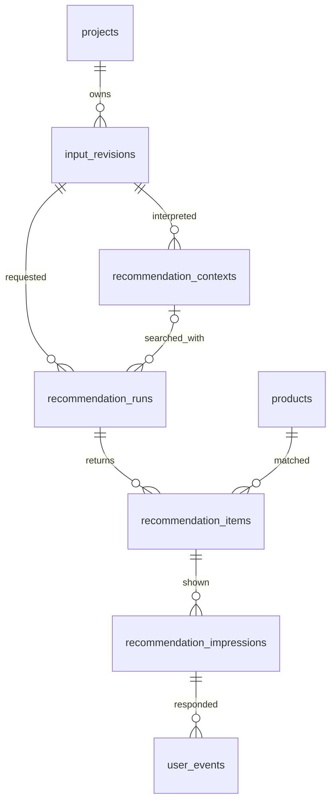
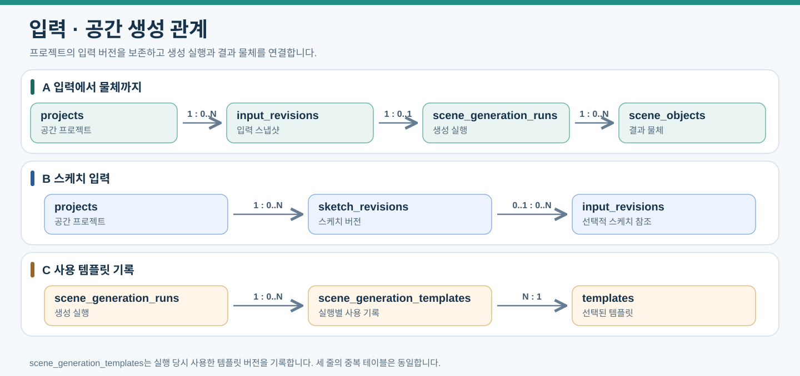
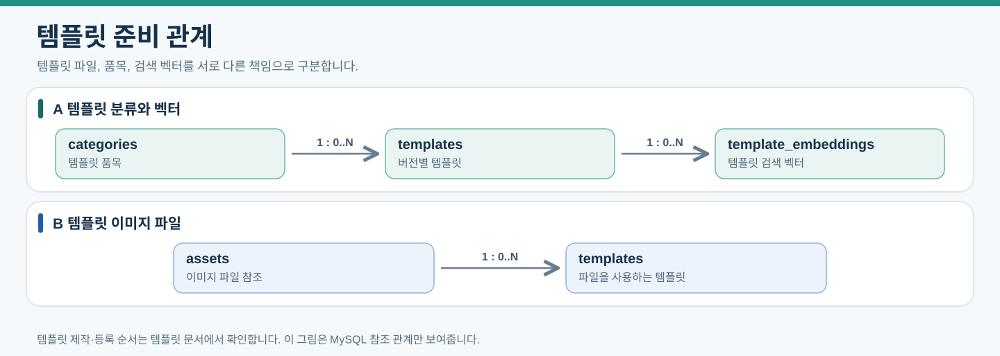
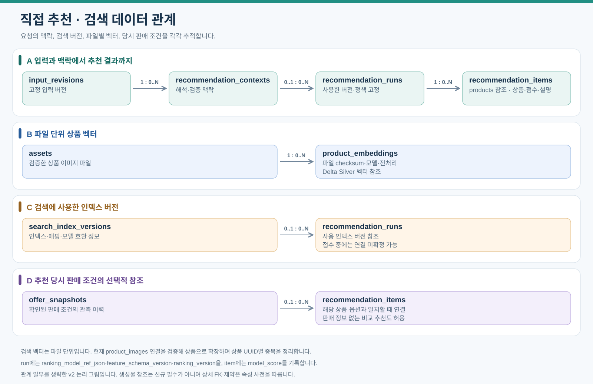
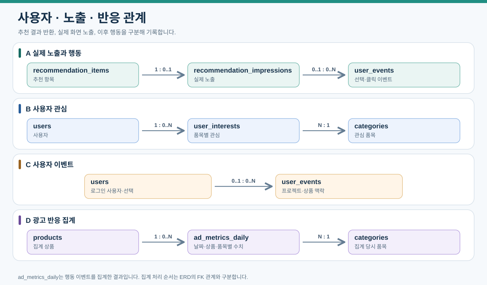
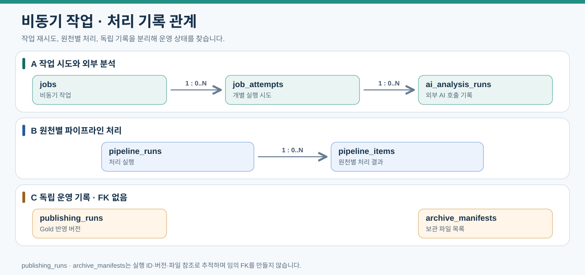

# 전체 ERD: 직접 추천

2026-10-15 신규 관계는 아래와 같다. 생성 중심 기존 그림/필드는 접힘 영역에 보존하며 공통 상품/이벤트 관계 외 신규 필수 계약으로 사용하지 않는다. [현행 속성](data-dictionary/09-direct-recommendation.md)과 [논리 변경안](12-direct-recommendation.md#논리-데이터와-erd-변경안)을 함께 읽는다. 실제 ORM/DDL 변경은 별도다.

접수 중에는 context_id가 NULL일 수 있고 검색 전에는 확정 맥락이 필요하다. 후보 전체/특징/버전은 run의 manifest로, 반환 항목 설명은 item 스냅샷으로 연결하며 반응 라벨은 실제 impression에 연결한다. 원천/벡터/작업의 나머지 공통 관계는 기존 목록을 유지한다.

운영 scikit-learn 추천은 run별 ranking_model_ref_json·feature_schema_version·ranking_version·인덱스 버전을 고정하고 item별 model_score를 보존한다. 모델 artifact/전처리/특징·실행 환경의 호환성과 checksum을 배포 전 확인한다. 기존 원장을 덮어쓰지 않고 새 run이 활성 모델을 사용하며 미준비/추론 오류는 별도 상태다. 상세 필드와 학습/배포 계약은 [직접 추천 속성](data-dictionary/09-direct-recommendation.md)을 따른다. 실제 코드/DDL 도입은 별도 작업이다.

이전 상세 설계 — 공통 계약은 유지, 생성 중심 단계/관계는 신규 사용 안 함

# 업무별 데이터 관계와 전체 필드

현행 설계를 업무별 관계도로 나누고 전체 필드를 표로 제공한다. 현행 34개 엔터티의 필드를 제공하며, 신규 흐름에 사용하지 않는 placements는 이전 배치안으로 구분한다. 구현 완료나 DDL 확정을 뜻하지 않는다.

[문서 안내](index.md) · [핵심 관계](03-erd-summary.md) · [데이터 모델](03-data-model.md) · [필드 의미](data-dictionary/index.md)

## 읽는 방법

관계도에는 해당 업무의 테이블과 필요한 참조 테이블만 표시한다. 같은 이름은 모든 그림에서 같은 테이블이다. 그림의 화살표는 관계를 읽는 방향이며 데이터 처리 순서가 아니다. `1 : 0..N`은 왼쪽 한 건에 오른쪽 0건 이상, `N : 1`은 왼쪽 여러 건이 오른쪽 한 건을 참조한다는 뜻이다. 전체 컬럼·타입·키 표시는 각 그림 아래 접힌 표에서 확인한다. 그림에서 생략한 공통 참조와 업무 간 연결은 마지막 관계 목록에 보존한다.

아래 기호는 이 문서의 [전체 관계 목록](#전체-관계-목록)에 사용한다.

| 기호 | 의미 |
|---|---|
| `\|\|` | 정확히 한 건 |
| `o\|` | 없거나 한 건 |
| `o{` | 없거나 여러 건 |
| PK / FK / UK | 기본키 / MySQL 참조 후보 / 단일 컬럼 고유키 |

UUID는 논리 타입이며 MySQL PK·FK는 CHAR(32), API·Kafka에서는 하이픈 포함 문자열로 전달한다. MongoDB 참조는 DB 간 FK가 아니다. NULL·삭제 정책은 DDL에서 확정한다. Django 인증 내부 테이블은 별도이며 users.password는 해시다.

추천 노출은 recommendation_item_id의 UNIQUE로 한 추천 항목당 최대 한 건이다. 신규 추천의 scene_object_id는 필수이고 index_version_id는 완료 전 NULL일 수 있다. 가격 미제공은 NULL이며 Offer 없는 비교용 추천도 허용한다.

## 상품·이미지

이번 서비스의 다나와 상품·이미지·판매 관계를 읽는다. 이미지가 같아도 상품은 합쳐지지 않는다. 출처 간 매칭은 향후 확장 모델이며 현재 추천 경로에서 사용하지 않는다.

[PNG로 보기](assets/erd-catalog.png). A행의 `product_images`는 상품과 파일을 연결하므로, 같은 `assets` 한 건을 여러 상품 이미지 연결이 참조할 수 있다. D행은 향후 출처 통합에 사용할 수 있는 확장 관계이며 이번 서비스 경로에서 사용하지 않는다.

product_identity_reviews는 후보 업무 키와 검수자를 기록한다. 상품 후보 키를 확정 상품 FK로 표현하지 않는다. 검수자·파일 소유자 연결은 전체 관계 목록에서 확인한다.

상품·이미지 전체 필드 펼치기

### categories

| 컬럼 | 논리 타입 | 키·설명 |
|---|---|---|
| `id` | uuid | PK |
| `code` | string | UK |
| `name` | string | — |
| `recognition_enabled` | boolean | — |
| `active` | boolean | — |
| `created_at` | datetime | — |
| `updated_at` | datetime | — |

### products

| 컬럼 | 논리 타입 | 키·설명 |
|---|---|---|
| `id` | uuid | PK |
| `product_key` | string | UK |
| `name` | string | — |
| `category_id` | uuid | FK |
| `brand` | string | — |
| `model_name` | string | — |
| `color` | string | — |
| `size_label` | string | — |
| `width_mm` | decimal | — |
| `depth_mm` | decimal | — |
| `height_mm` | decimal | — |
| `dimensions_original` | text | — |
| `status` | string | — |
| `dedup_status` | string | — |
| `created_at` | datetime | — |
| `updated_at` | datetime | — |
| `source_code` | string | — |
| `source_product_id` | string | — |
| `comparison_url` | string | — |

### assets

| 컬럼 | 논리 타입 | 키·설명 |
|---|---|---|
| `usage_policy_json` | json | — |
| `id` | uuid | PK |
| `owner_id` | uuid | FK |
| `kind` | string | — |
| `bucket` | string | — |
| `object_key` | string | — |
| `content_type` | string | — |
| `size_bytes` | bigint | — |
| `width_px` | int | — |
| `height_px` | int | — |
| `checksum` | string | — |
| `status` | string | — |
| `expires_at` | datetime | — |
| `created_at` | datetime | — |
| `updated_at` | datetime | — |

### product_images

| 컬럼 | 논리 타입 | 키·설명 |
|---|---|---|
| `id` | uuid | PK |
| `product_id` | uuid | FK |
| `asset_id` | uuid | FK |
| `display_order` | int | — |
| `source_code` | string | — |
| `source_product_id` | string | — |
| `image_variant` | string | — |
| `source_url` | text | — |
| `source_version` | string | — |
| `raw_document_id` | string | "MongoDB 불변 원천 참조, FK 아님" |
| `raw_payload_hash` | string | — |
| `raw_collected_at` | datetime | — |
| `linked_at` | datetime | — |
| `active` | boolean | — |
| `usage_review_json` | json | — |
| `created_at` | datetime | — |
| `updated_at` | datetime | — |

### category_mappings

| 컬럼 | 논리 타입 | 키·설명 |
|---|---|---|
| `id` | uuid | PK |
| `source_code` | string | — |
| `source_category` | string | — |
| `category_id` | uuid | FK |
| `mapping_version` | string | — |
| `active` | boolean | — |
| `created_at` | datetime | — |
| `updated_at` | datetime | — |

### product_identity_reviews

| 컬럼 | 논리 타입 | 키·설명 |
|---|---|---|
| `id` | uuid | PK |
| `candidate_key` | string | — |
| `raw_document_id` | string | "MongoDB 원천 참조, FK 아님" |
| `product_key` | string | — |
| `decision` | string | — |
| `reviewer_id` | uuid | FK |
| `review_version` | string | — |
| `reviewed_at` | datetime | — |
| `created_at` | datetime | — |
| `updated_at` | datetime | — |

### cross_source_matches

| 컬럼 | 논리 타입 | 키·설명 |
|---|---|---|
| `id` | uuid | PK |
| `source_code` | string | — |
| `source_product_id` | string | — |
| `source_raw_document_id` | string | — |
| `source_asset_id` | uuid | FK |
| `target_product_id` | uuid | FK |
| `match_type` | string | — |
| `match_version` | string | — |
| `match_score` | float | — |
| `evidence_json` | json | — |
| `review_status` | string | — |
| `reviewer_id` | uuid | FK |
| `reviewed_at` | datetime | — |

## 판매 정보

판매 관계는 [상품·이미지 그림](assets/erd-catalog.svg)의 B행에서 확인한다. `offers`는 현재 판매처·옵션 정보, `offer_snapshots`는 수집 당시 조건이다.

다른 업무의 참조 테이블: `products`. 상세 필드는 해당 업무 표를 따른다.

판매 정보 전체 필드 펼치기

### offers

| 컬럼 | 논리 타입 | 키·설명 |
|---|---|---|
| `source_seller_id` | string | — |
| `price_basis` | string | — |
| `option_attributes_json` | json | — |
| `delivery_terms_json` | json | — |
| `id` | uuid | PK |
| `offer_key` | string | UK |
| `product_id` | uuid | FK |
| `source_code` | string | — |
| `source_product_id` | string | — |
| `source_variant_id` | string | — |
| `title` | string | — |
| `price_amount` | bigint | — |
| `currency` | string | — |
| `purchase_url` | text | — |
| `availability` | string | — |
| `collected_at` | datetime | — |
| `latest_raw_document_id` | string | "MongoDB 원천 참조, FK 아님" |
| `eligible` | boolean | — |
| `created_at` | datetime | — |
| `updated_at` | datetime | — |
| `source_offer_id` | string | — |
| `merchant_name` | string | — |
| `price_conditions_json` | json | — |
| `url_kind` | string | — |
| `url_status` | string | — |
| `url_verified_at` | datetime | — |

### offer_snapshots

| 컬럼 | 논리 타입 | 키·설명 |
|---|---|---|
| `pricing_terms_json` | json | — |
| `id` | uuid | PK |
| `snapshot_key` | string | UK |
| `offer_id` | uuid | FK |
| `raw_document_id` | string | "MongoDB 원천 참조, FK 아님" |
| `price_amount` | bigint | — |
| `currency` | string | — |
| `purchase_url` | text | — |
| `availability` | string | — |
| `collected_at` | datetime | — |
| `created_at` | datetime | — |

## 입력·공간 생성

입력·생성 경로와 사용 템플릿 연결을 분리한다. 최신 실행 포인터와 파일 참조는 전체 관계 목록에서 확인한다.

[PNG로 보기](assets/erd-generation.png). A행은 핵심 관계, B행은 스케치 버전, C행은 생성 때 사용한 템플릿 기록이다.

다른 업무의 참조 테이블: `templates`. 상세 필드는 해당 업무 표를 따른다.

입력·공간 생성 전체 필드 펼치기

### projects

| 컬럼 | 논리 타입 | 키·설명 |
|---|---|---|
| `id` | uuid | PK |
| `latest_generation_run_id` | uuid | FK |
| `user_id` | uuid | FK |
| `session_id` | string | — |
| `room_asset_id` | uuid | FK |
| `title` | string | — |
| `status` | string | — |
| `created_at` | datetime | — |
| `updated_at` | datetime | — |

### sketch_revisions

| 컬럼 | 논리 타입 | 키·설명 |
|---|---|---|
| `id` | uuid | PK |
| `project_id` | uuid | FK |
| `revision_no` | int | — |
| `sketch_asset_id` | uuid | FK |
| `strokes_json` | json | — |
| `bounding_box_json` | json | — |
| `canvas_width` | int | — |
| `canvas_height` | int | — |
| `created_at` | datetime | — |
| `updated_at` | datetime | — |

### input_revisions

| 컬럼 | 논리 타입 | 키·설명 |
|---|---|---|
| `id` | uuid | PK |
| `project_id` | uuid | FK |
| `revision_no` | int | — |
| `event_id` | string | UK |
| `room_asset_id` | uuid | FK |
| `sketch_revision_id` | uuid | FK |
| `text_requirements` | text | — |
| `event_payload_json` | json | — |
| `requested_regions_json` | json | — |
| `payload_checksum` | string | — |
| `bronze_manifest_json` | json | — |
| `status` | string | — |
| `created_at` | datetime | — |

### scene_generation_runs

| 컬럼 | 논리 타입 | 키·설명 |
|---|---|---|
| `id` | uuid | PK |
| `input_revision_id` | uuid | FK |
| `job_id` | uuid | FK |
| `result_asset_id` | uuid | FK |
| `trigger_type` | string | — |
| `selection_json` | json | — |
| `models_json` | json | — |
| `status` | string | — |
| `created_at` | datetime | — |
| `finished_at` | datetime | — |

### scene_generation_templates

| 컬럼 | 논리 타입 | 키·설명 |
|---|---|---|
| `id` | uuid | PK |
| `generation_run_id` | uuid | FK |
| `template_id` | uuid | FK |
| `slot_key` | string | — |
| `requested_region_json` | json | — |

### scene_objects

| 컬럼 | 논리 타입 | 키·설명 |
|---|---|---|
| `id` | uuid | PK |
| `generation_run_id` | uuid | FK |
| `project_id` | uuid | FK |
| `result_asset_id` | uuid | FK |
| `crop_asset_id` | uuid | FK |
| `category_id` | uuid | FK |
| `bounding_box_json` | json | — |
| `status` | string | — |
| `created_at` | datetime | — |

## 템플릿 준비

[PNG로 보기](assets/erd-template.png).

다른 업무의 참조 테이블: `assets`, `categories`. 상세 필드는 해당 업무 표를 따른다.

템플릿 준비 전체 필드 펼치기

### templates

| 컬럼 | 논리 타입 | 키·설명 |
|---|---|---|
| `id` | uuid | PK |
| `template_key` | string | — |
| `version_no` | int | — |
| `category_id` | uuid | FK |
| `asset_id` | uuid | FK |
| `attributes_json` | json | — |
| `provenance_json` | json | — |
| `review_status` | string | — |
| `active` | boolean | — |
| `created_at` | datetime | — |

### template_embeddings

| 컬럼 | 논리 타입 | 키·설명 |
|---|---|---|
| `id` | uuid | PK |
| `template_id` | uuid | FK |
| `image_checksum` | string | — |
| `model_version` | string | — |
| `preprocessing_version` | string | — |
| `dimension` | int | — |
| `vector_ref_json` | json | — |
| `status` | string | — |
| `created_at` | datetime | — |

## 추천·검색

[PNG로 보기](assets/erd-recommendation.png). A행의 `recommendation_items`가 `products`를 참조하고, D행의 판매 snapshot 연결은 선택 사항이다.

다른 업무의 참조 테이블: `scene_objects`, `products`. 상세 필드는 해당 업무 표를 따른다.

상품 벡터는 파일 단위로 관리한다. 검색 결과에서 현재 product_images를 조회해 상품별로 확장하며 임베딩 행 자체를 상품으로 취급하지 않는다.

상품 이미지 벡터 관계는 위 그림의 C행에서 확인한다.

추천·검색 전체 필드 펼치기

### recommendation_runs

| 컬럼 | 논리 타입 | 키·설명 |
|---|---|---|
| `id` | uuid | PK |
| `scene_object_id` | uuid | FK |
| `index_version_id` | uuid | FK |
| `project_id` | uuid | FK |
| `sketch_revision_id` | uuid | FK |
| `job_id` | uuid | FK |
| `category_id` | uuid | FK |
| `recognition_status` | string | — |
| `model_version` | string | — |
| `ranking_version` | string | — |
| `status` | string | — |
| `failure_reason` | text | — |
| `created_at` | datetime | — |
| `updated_at` | datetime | — |

### recommendation_items

| 컬럼 | 논리 타입 | 키·설명 |
|---|---|---|
| `id` | uuid | PK |
| `link_snapshot_json` | json | "추천 시 연결 대상과 검증 근거" |
| `run_id` | uuid | FK |
| `product_id` | uuid | FK |
| `offer_snapshot_id` | uuid | FK |
| `rank` | int | — |
| `score` | decimal | — |
| `created_at` | datetime | — |
| `updated_at` | datetime | — |

### product_embeddings

| 컬럼 | 논리 타입 | 키·설명 |
|---|---|---|
| `id` | uuid | PK |
| `asset_id` | uuid | FK |
| `image_checksum` | string | — |
| `model_version` | string | — |
| `preprocessing_version` | string | — |
| `dimension` | int | — |
| `vector_ref_json` | json | — |
| `status` | string | — |
| `created_at` | datetime | — |

### search_index_versions

| 컬럼 | 논리 타입 | 키·설명 |
|---|---|---|
| `id` | uuid | PK |
| `scope` | string | — |
| `model_version` | string | — |
| `preprocessing_version` | string | — |
| `dimension` | int | — |
| `manifest_json` | json | — |
| `status` | string | — |
| `activated_at` | datetime | — |
| `created_at` | datetime | — |

## 사용자·반응

[PNG로 보기](assets/erd-engagement.png). 추천 항목이 반환되었다는 사실만으로 실제 노출을 기록하지 않는다.

다른 업무의 참조 테이블: `recommendation_items`. 상세 필드는 해당 업무 표를 따른다.

ad_metrics_daily는 Spark가 상품·품목별로 계산한 결과다. 사용자 이벤트에서 집계되는 처리 과정은 ERD의 FK 선과 구분한다. 집계의 product_id·category_id 관계는 전체 관계 목록에 있다.

사용자·반응 전체 필드 펼치기

### users

| 컬럼 | 논리 타입 | 키·설명 |
|---|---|---|
| `id` | uuid | PK |
| `username` | string | — |
| `email` | string | — |
| `password` | string | — |
| `is_active` | boolean | — |
| `date_joined` | datetime | — |

### user_interests

| 컬럼 | 논리 타입 | 키·설명 |
|---|---|---|
| `id` | uuid | PK |
| `user_id` | uuid | FK |
| `category_id` | uuid | FK |
| `selection_count` | int | — |
| `last_selected_at` | datetime | — |
| `created_at` | datetime | — |
| `updated_at` | datetime | — |

### user_events

| 컬럼 | 논리 타입 | 키·설명 |
|---|---|---|
| `id` | uuid | PK |
| `impression_id` | uuid | FK |
| `event_id` | string | UK |
| `user_id` | uuid | FK |
| `session_id` | string | — |
| `event_type` | string | — |
| `project_id` | uuid | FK |
| `sketch_revision_id` | uuid | FK |
| `recommendation_run_id` | uuid | FK |
| `product_id` | uuid | FK |
| `offer_id` | uuid | FK |
| `occurred_at` | datetime | — |
| `received_at` | datetime | — |
| `metadata_json` | json | — |
| `created_at` | datetime | — |

### recommendation_impressions

| 컬럼 | 논리 타입 | 키·설명 |
|---|---|---|
| `id` | uuid | PK |
| `recommendation_item_id` | uuid | FK |
| `category_id` | uuid | FK |
| `event_id` | string | UK |
| `occurred_at` | datetime | — |
| `created_at` | datetime | — |

### ad_metrics_daily

| 컬럼 | 논리 타입 | 키·설명 |
|---|---|---|
| `id` | uuid | PK |
| `metric_date` | date | — |
| `product_id` | uuid | FK |
| `category_id` | uuid | FK |
| `impression_count` | bigint | — |
| `selection_count` | bigint | — |
| `rejection_count` | bigint | — |
| `comparison_link_click_count` | bigint | 다나와 비교 클릭이 연결된 서로 다른 유효 노출 수 |
| `link_click_count` | bigint | 직접 구매 링크 클릭이 연결된 서로 다른 유효 노출 수 |
| `source_versions_json` | json | — |
| `computed_at` | datetime | — |

## 비동기 작업

[PNG로 보기](assets/erd-operations.png). `ai_analysis_runs`는 `job_attempts`와 함께 `jobs`도 참조한다.

비동기 작업 전체 필드 펼치기

### jobs

| 컬럼 | 논리 타입 | 키·설명 |
|---|---|---|
| `id` | uuid | PK |
| `type` | string | — |
| `input_refs_json` | json | — |
| `status` | string | — |
| `attempt_count` | int | — |
| `max_attempts` | int | — |
| `next_retry_at` | datetime | — |
| `lease_owner` | string | — |
| `lease_token` | string | — |
| `lease_expires_at` | datetime | — |
| `started_at` | datetime | — |
| `finished_at` | datetime | — |
| `result_ref_json` | json | — |
| `last_error_json` | json | — |
| `created_at` | datetime | — |
| `updated_at` | datetime | — |

### job_attempts

| 컬럼 | 논리 타입 | 키·설명 |
|---|---|---|
| `id` | uuid | PK |
| `job_id` | uuid | FK |
| `attempt_no` | int | — |
| `worker_id` | string | — |
| `started_at` | datetime | — |
| `finished_at` | datetime | — |
| `status` | string | — |
| `error_code` | string | — |
| `error_message` | text | — |
| `created_at` | datetime | — |

### ai_analysis_runs

| 컬럼 | 논리 타입 | 키·설명 |
|---|---|---|
| `id` | uuid | PK |
| `job_attempt_id` | uuid | FK |
| `usage_json` | json | — |
| `estimated_cost_usd` | decimal | — |
| `job_id` | uuid | FK |
| `analysis_type` | string | — |
| `input_asset_id` | uuid | FK |
| `input_hash` | string | — |
| `source_revision` | string | — |
| `provider` | string | — |
| `model_version` | string | — |
| `prompt_version` | string | — |
| `schema_version` | string | — |
| `output_json` | json | — |
| `result_asset_id` | uuid | FK |
| `status` | string | — |
| `latency_ms` | int | — |
| `error_code` | string | — |
| `created_at` | datetime | — |
| `updated_at` | datetime | — |

## 데이터 처리·보관

원천별 처리 관계는 [운영 기록 그림](assets/erd-operations.svg)의 B행에서 확인한다. C행의 두 기록은 서로 FK로 연결되지 않는다.

| 관계선 없는 기록 | 연결 방법 |
|---|---|
| publishing_runs | execution_id·Delta 버전 |
| archive_manifests | 보관 파일 목록·checksum |

발행 버전·보관 파일은 JSON·실행 식별자로 연결된다. 실제 FK가 없는 테이블을 임의의 관계선으로 연결하지 않는다.

데이터 처리·보관 전체 필드 펼치기

### pipeline_runs

| 컬럼 | 논리 타입 | 키·설명 |
|---|---|---|
| `id` | uuid | PK |
| `type` | string | — |
| `input_range_json` | json | — |
| `code_version` | string | — |
| `status` | string | — |
| `started_at` | datetime | — |
| `finished_at` | datetime | — |
| `created_at` | datetime | — |
| `updated_at` | datetime | — |

### pipeline_items

| 컬럼 | 논리 타입 | 키·설명 |
|---|---|---|
| `id` | uuid | PK |
| `run_id` | uuid | FK |
| `raw_document_id` | string | "MongoDB 원천 참조, FK 아님" |
| `product_key` | string | — |
| `offer_key` | string | — |
| `status` | string | — |
| `error_code` | string | — |
| `error_message` | text | — |
| `created_at` | datetime | — |
| `updated_at` | datetime | — |

### publishing_runs

| 컬럼 | 논리 타입 | 키·설명 |
|---|---|---|
| `id` | uuid | PK |
| `execution_id` | string | — |
| `delta_versions_json` | json | — |
| `record_counts_json` | json | — |
| `status` | string | — |
| `started_at` | datetime | — |
| `finished_at` | datetime | — |
| `created_at` | datetime | — |
| `updated_at` | datetime | — |

### archive_manifests

| 컬럼 | 논리 타입 | 키·설명 |
|---|---|---|
| `id` | uuid | PK |
| `archive_type` | string | — |
| `period_start` | datetime | — |
| `period_end` | datetime | — |
| `object_keys_json` | json | — |
| `record_count` | int | — |
| `checksum` | string | — |
| `status` | string | — |
| `verified_at` | datetime | — |
| `created_at` | datetime | — |
| `updated_at` | datetime | — |

## 이전 배치안

placements는 신규 생성·추천 경로에서 생성하지 않는다. 아래 필드와 관계는 이전 설계 추적용이며 신규 구현 목록에 자동으로 포함하지 않는다.

이전 배치안 전체 필드 펼치기

### placements

| 컬럼 | 논리 타입 | 키·설명 |
|---|---|---|
| `id` | uuid | PK |
| `project_id` | uuid | FK |
| `recommendation_item_id` | uuid | FK |
| `selected_offer_snapshot_id` | uuid | FK |
| `product_asset_id` | uuid | FK |
| `bounding_box_json` | json | — |
| `result_asset_id` | uuid | FK |
| `status` | string | — |
| `created_at` | datetime | — |
| `updated_at` | datetime | — |

## 전체 관계 목록

업무 간 연결을 포함한 기존 관계 66개를 보존한다. placements가 포함된 관계는 이전안이다. 논리 참조·복합키는 다음 절을 함께 확인한다.

전체 관계 펼치기

| 부모·참조 테이블 | 관계 | 자식·참조하는 테이블 | 의미 |
|---|---|---|---|
| users | `o\|--o{` | assets | 소유한다 |
| categories | `\|\|--o{` | products | 분류한다 |
| products | `\|\|--o{` | offers | 판매 정보를 가진다 |
| offers | `\|\|--o{` | offer_snapshots | 이력을 남긴다 |
| products | `\|\|--o{` | product_images | 이미지를 연결한다 |
| assets | `\|\|--o{` | product_images | 상품 이미지로 참조된다 |
| categories | `\|\|--o{` | category_mappings | 제공처 분류에 매핑된다 |
| users | `o\|--o{` | product_identity_reviews | 검수한다 |
| users | `o\|--o{` | projects | 탐색 공간을 만든다 |
| assets | `\|\|--o{` | projects | 공간 사진으로 사용된다 |
| projects | `\|\|--o{` | sketch_revisions | 스케치 버전을 가진다 |
| assets | `o\|--o{` | sketch_revisions | 스케치 이미지로 사용된다 |
| projects | `\|\|--o{` | recommendation_runs | 추천을 요청한다 |
| sketch_revisions | `o\|--o{` | recommendation_runs | 추천 입력으로 사용된다 |
| jobs | `\|\|--o{` | recommendation_runs | 추천 작업을 처리한다 |
| categories | `o\|--o{` | recommendation_runs | 인식 결과로 기록된다 |
| recommendation_runs | `\|\|--o{` | recommendation_items | 추천 항목을 가진다 |
| products | `\|\|--o{` | recommendation_items | 추천된다 |
| offer_snapshots | `o\|--o{` | recommendation_items | 추천 당시 판매 정보를 제공한다 |
| projects | `\|\|--o{` | placements | 배치 결과를 가진다 (이전안) |
| recommendation_items | `\|\|--o{` | placements | 선택되어 배치된다 (이전안) |
| offer_snapshots | `\|\|--o{` | placements | 선택 판매 정보로 기록된다 (이전안) |
| assets | `\|\|--o{` | placements | 배치 상품 이미지로 사용된다 (이전안) |
| assets | `o\|--o{` | placements | 배치 결과 이미지로 사용된다 (이전안) |
| users | `\|\|--o{` | user_interests | 관심을 기록한다 |
| categories | `\|\|--o{` | user_interests | 관심 대상으로 기록된다 |
| jobs | `\|\|--o{` | job_attempts | 실행 시도를 가진다 |
| jobs | `\|\|--o{` | ai_analysis_runs | AI 분석을 요청한다 |
| assets | `\|\|--o{` | ai_analysis_runs | 분석 입력으로 사용된다 |
| assets | `o\|--o{` | ai_analysis_runs | 분석 결과 파일로 사용된다 |
| pipeline_runs | `\|\|--o{` | pipeline_items | 원천별 처리를 기록한다 |
| users | `o\|--o{` | user_events | 행동을 남긴다 |
| projects | `o\|--o{` | user_events | 행동의 맥락이 된다 |
| sketch_revisions | `o\|--o{` | user_events | 스케치 행동에 연결된다 |
| recommendation_runs | `o\|--o{` | user_events | 추천 행동에 연결된다 |
| products | `o\|--o{` | user_events | 상품 행동에 연결된다 |
| offers | `o\|--o{` | user_events | 구매 행동에 연결된다 |
| projects | `\|\|--o{` | scene_objects | 구성 물체를 가진다 |
| assets | `\|\|--o{` | scene_objects | 구성 결과로 참조된다 |
| assets | `o\|--o{` | scene_objects | 검색 영역으로 참조된다 |
| categories | `o\|--o{` | scene_objects | 물체 품목으로 기록된다 |
| scene_objects | `\|\|--o{` | recommendation_runs | 상품 검색 입력이 된다 |
| search_index_versions | `o\|--o{` | recommendation_runs | 검색 버전을 기록한다 |
| assets | `\|\|--o{` | product_embeddings | 벡터 입력이 된다 |
| recommendation_items | `\|\|--o\|` | recommendation_impressions | 실제 노출된다 |
| categories | `\|\|--o{` | recommendation_impressions | 노출 품목으로 보존된다 |
| recommendation_impressions | `o\|--o{` | user_events | 노출과 반응을 연결한다 |
| products | `\|\|--o{` | ad_metrics_daily | 반응이 집계된다 |
| categories | `\|\|--o{` | ad_metrics_daily | 품목별 반응이 집계된다 |
| categories | `\|\|--o{` | templates | 템플릿을 분류한다 |
| assets | `\|\|--o{` | templates | 템플릿 이미지로 사용된다 |
| templates | `\|\|--o{` | template_embeddings | 검색 벡터를 가진다 |
| projects | `\|\|--o{` | input_revisions | 입력 버전을 보존한다 |
| assets | `\|\|--o{` | input_revisions | 원본 공간 사진이 된다 |
| sketch_revisions | `o\|--o{` | input_revisions | 입력 스케치로 연결된다 |
| input_revisions | `\|\|--o\|` | scene_generation_runs | 공간 생성을 요청한다 |
| jobs | `o\|--o{` | scene_generation_runs | 생성 단계를 처리한다 |
| assets | `o\|--o{` | scene_generation_runs | 공간 생성 결과가 된다 |
| scene_generation_runs | `o\|--o\|` | projects | 최신 실행으로 참조된다 |
| scene_generation_runs | `\|\|--o{` | scene_generation_templates | 사용 템플릿을 기록한다 |
| templates | `\|\|--o{` | scene_generation_templates | 생성에 참조된다 |
| scene_generation_runs | `\|\|--o{` | scene_objects | 결과 물체를 가진다 |
| job_attempts | `\|\|--o{` | ai_analysis_runs | 외부 호출을 기록한다 |
| products | `\|\|--o{` | cross_source_matches | 다른 출처의 매칭 대상이다 |
| assets | `o\|--o{` | cross_source_matches | 매칭 이미지 근거다 |
| users | `o\|--o{` | cross_source_matches | 매칭을 검수한다 |

## 복합 고유키와 논리 참조

| 엔터티 | 복합 고유키 후보 |
|---|---|
| assets | bucket, object_key |
| product_images | product_id, source_code, source_product_id, image_variant, raw_document_id, source_version |
| sketch_revisions | project_id, revision_no |
| recommendation_items | run_id, rank |
| user_interests | user_id, category_id |
| job_attempts | job_id, attempt_no |
| product_embeddings | asset_id, image_checksum, model_version, preprocessing_version, dimension |
| ad_metrics_daily | metric_date, product_id, category_id |
| cross_source_matches | source_code, source_product_id, target_product_id, match_version |
| templates | template_key, version_no |
| template_embeddings | template_id, image_checksum, model_version, preprocessing_version, dimension |
| input_revisions | project_id, revision_no |
| scene_generation_templates | generation_run_id, slot_key |

scene_generation_runs.input_revision_id는 단일 UNIQUE다. projects.latest_generation_run_id는 NULL 가능하며 한 실행을 다른 프로젝트의 최신 실행으로 연결하지 않는다. scene_objects의 project_id·result_asset_id는 generation_run_id의 입력·결과와 일치해야 하고 서비스에서 검증한다.

복합키의 각 컬럼에 개별 UK를 표시하지 않는다. jobs와 recommendation_runs는 현재 job_id 고유 제약이 없으므로 1 대 다로 표현했으며, 업무상 1 대 1로 제한할지는 구현 전에 확정한다.

product_identity_reviews와 pipeline_items의 product_key·offer_key는 원천 식별 또는 검수 후보 연결용이다. 실패·미매칭 시 값이 없을 수 있어 이 초안에서는 강제 FK로 표시하지 않는다. ai_analysis_runs.source_revision도 analysis_type에 따른 논리 입력 버전이며 특정 테이블 FK로 단정하지 않는다.

publishing_runs의 delta_versions_json, archive_manifests의 object_keys_json는 외부 작업이나 파일을 연결한다. 직접 FK 컬럼이 없어 업무별 그림에서 다른 테이블과 선으로 연결하지 않았다. 독립적으로 보여도 시스템과 무관한 테이블이라는 뜻은 아니다.

이전안의 placements.project_id와 recommendation_item_id, 추천 항목의 product_id와 offer_snapshot_id가 서로 일치하는지 서비스에서 검증한다. 개별 FK만으로 같은 프로젝트나 상품이라는 조건까지 보장하지 않는다.

## MongoDB 원천 속성

MongoDB 원천은 단일 문서 구조이므로 관계도 대신 [원천 필드 표](03-data-model.md#mongodb-원천)와 [속성 사전](data-dictionary/01-raw-delta.md)을 사용한다. record_type·source_record_key·parser_version·response_body_hash까지 같은 기준으로 확인한다.

원천은 반복 수집마다 새 문서로 보존한다. MongoDB의 _id와 MySQL raw_document_id는 문자열로 연결하는 추적 참조이며 서로 다른 DB 간 FK가 아니다.

## 저장소 간 추적

| 연결 | 추적 기준 |
|---|---|
| MongoDB 원천 → Delta Bronze | raw_document_id · 원천 hash |
| Bronze → Silver → Gold | 원천 ID · 변환 버전 · 처리 실행 |
| Gold → MySQL | 고정 Delta 버전 · 업무 키 · 반영 실행 |
| MySQL assets → 이미지 파일 | bucket · object_key · checksum |

이는 원천 추적 관계이며 서로 다른 저장소 간 FK가 아니다. 처리 순서는 [파이프라인](02-data-pipeline.md)을 따른다.

