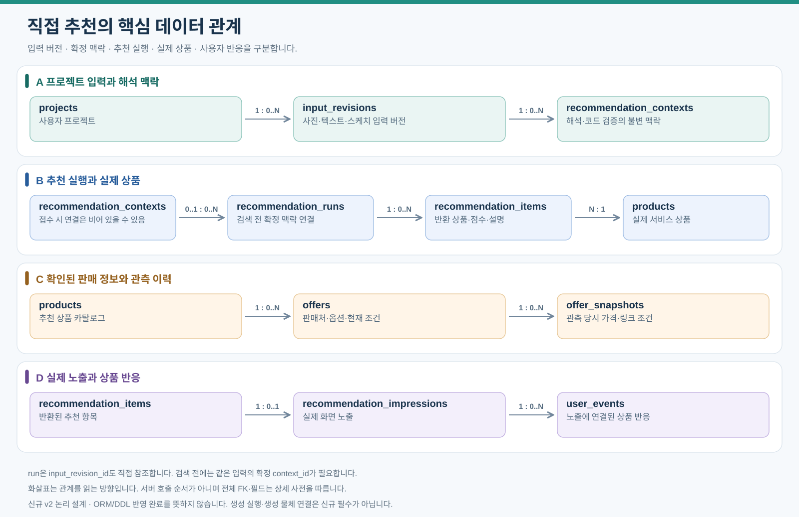

# 핵심 데이터 관계: 직접 추천

2026-10-15 신규 관계는 아래와 같다. 생성 중심 기존 필드는 접힘 영역에 보존하며 공통 상품/이벤트 관계 외 신규 필수 계약으로 사용하지 않는다. [현행 속성](data-dictionary/09-direct-recommendation.md)과 [논리 변경안](12-direct-recommendation.md#논리-데이터와-erd-변경안)을 함께 읽는다. 실제 ORM/DDL 변경은 별도다.

[PNG로 보기](assets/erd-core-overview.png). A행은 입력과 맥락, B행은 추천과 실제 상품, C행은 판매 이력, D행은 실제 노출과 상품 반응이다. 화살표는 관계를 읽는 방향이며 전체 FK·필드는 상세 사전을 따른다.

접수 중에는 context_id가 NULL일 수 있고 검색 전에는 확정 맥락이 필요하다. 후보 전체/특징/버전은 run의 manifest로, 반환 항목 설명은 item 스냅샷으로 연결하며 반응 라벨은 실제 impression에 연결한다. 원천/벡터/작업의 나머지 공통 관계는 기존 목록을 유지한다.

운영 scikit-learn 추천은 run별 ranking_model_ref_json·feature_schema_version·ranking_version·인덱스 버전을 고정하고 item별 model_score를 보존한다. 모델 artifact/전처리/특징·실행 환경의 호환성과 checksum을 배포 전 확인한다. 기존 원장을 덮어쓰지 않고 새 run이 활성 모델을 사용하며 미준비/추론 오류는 별도 상태다. 상세 필드와 학습/배포 계약은 [직접 추천 속성](data-dictionary/09-direct-recommendation.md)을 따른다. 실제 코드/DDL 도입은 별도 작업이다.

이전 상세 설계 — 공통 계약은 유지, 생성 중심 단계/관계는 신규 사용 안 함

# 핵심 데이터 관계

입력에서 생성 결과와 상품 추천까지 이어지는 핵심 관계만 표시한다. 전체 필드와 나머지 관계는 [업무별 ERD](03-erd-full.md), 용어는 [데이터 모델](03-data-model.md)을 따른다.

## 핵심 관계

아래는 이전 생성 중심 관계의 설명 이력이다. 현행 관계 그림은 문서 상단을 따른다.

사용자와 프로젝트의 소유 관계는 전체 관계 목록에서 확인한다.

## 업무별로 더 보기

| 알고 싶은 내용 | 상세 위치 |
|---|---|
| 스케치·사진·텍스트·사용 템플릿 | [입력·공간 생성](03-erd-full.md#입력공간-생성) |
| 같은 이미지의 여러 상품 연결 | [상품·이미지](03-erd-full.md#상품이미지) |
| 판매 정보와 당시 가격 | [판매 정보](03-erd-full.md#판매-정보) |
| 상품 검색과 추천 이력 | [추천·검색](03-erd-full.md#추천검색) |
| 실제 노출과 사용자 반응 | [사용자·반응](03-erd-full.md#사용자반응) |
| 재시도·외부 호출 | [비동기 작업](03-erd-full.md#비동기-작업) |

그림은 DB 관계이며 서버 호출 순서가 아니다. 비로그인 프로젝트는 user_id가 없을 수 있다. 사진은 필수이고 스케치 또는 텍스트를 입력 버전에 연결한다. 생성 후 물체별로 추천을 요청하며 재추천은 완료된 공간 이미지를 유지한다.

파일·템플릿 연결, 판매 snapshot, 노출, 작업·검수·공통 FK와 상세 속성은 생략했다. 관계를 생략한 것이므로 이 그림만으로 DDL을 작성하지 않는다. 신규 흐름에서 사용하지 않는 placements는 전체 문서의 이전 배치안에서만 확인한다.

