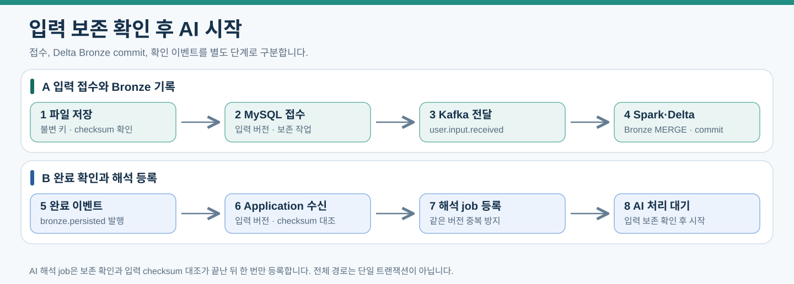

# Kafka와 작업 관리: 입력 기반 직접 추천

2026-10-15 현행. [직접 추천의 요청·실패 계약](12-direct-recommendation.md#요청작업실패-계약)을 따른다. 실제 v2 스키마/Consumer/마이그레이션 구현은 별도다.

## 입력 Bronze와 직접 추천 단계 계약

입력 파일/checksum·input_revision·recommendation_run·보존 job을 저장하고 DB 커밋 확인 후 user.input.received를 발행한다. Spark Bronze commit·checksum 대조 후 user.input.bronze.persisted를 발행하며 Application이 보존 확인과 해석 job을 원자적으로 등록한다. Bronze 미확인 상태에서 해석을 시작하지 않는다.

v2 입력/보존/해석 메시지는 input_revision_id·recommendation_run_id·input_hash·고정 파일/텍스트 참조·schema_version을 사용한다. generation_run_id는 신규 필수가 아니다. 기존 생성 스키마와 혼합하지 않도록 새 version/호환 Consumer 전환을 구현한다. 이미 저장된 v1 실행은 원래 참조로 복구하고 v2로 조용히 바꾸지 않는다.

## 신규 사용 토픽과 단계

- user.input.received / user.input.bronze.persisted / input.interpretation.requested: v2 스키마 정의 후 직접 추천에 사용.
- product.embedding.requested/completed, product.search-index.refresh.requested: 승인 상품 사전 임베딩·적재 확인·인덱스 교체 유지.
- user.action.recorded 및 기존 원천/실패 전달: 실제 노출·반응·링크/상품 공통 계약 유지.
- scene.generation.requested, scene.objects.analysis.requested, template.*: 신규 직접 추천에서 발행하지 않음.

해석→코드 검증/맥락 확정→Application Consumer의 광고 서버 내부 HTTP→결과 저장 순서다. 질의/상품 벡터 생성 책임은 광고 서버, 추천 이력과 사용자 이벤트 쓰기는 Application이다. 초기 scikit-learn 콘텐츠 추천은 학습 선행 단계가 없다. run별 수동 가중치/정책·인덱스를 고정하고 INDEX_NOT_READY/RANKING_FAILED를 해당 단계 오류로 보존한다. 로컬 계산/저장 실패로 성공한 해석/임베딩 API를 다시 호출하지 않는다.

## 발행과 복구

DB 커밋 후 직접 발행·업무 기록 기반 누락 복구·같은 ID 재발행·입력 hash 대조·단계 고유 키·lease_token·offset 완료 추적을 유지한다. API/검색/파일 처리 중 DB 잠금을 유지하지 않는다. 전달 미확인과 실제 미실행을 구분한다. 코드/저장 실패는 원응답·완료 벡터로 복구하며 요청 변경과 실패 재시도를 구분한다. 미노출 후보를 행동으로 만들지 않고 늦은 run이 최신 추천을 덮어쓰지 않게 한다.

아래의 ‘입력 Bronze와 생성 단계 계약’ 및 생성 토픽 표는 이전 이력이다. 그 안의 Bronze/중복/lease/offset 공통 복구 원칙은 새 ID 계약과 충돌하지 않는 범위에서 준용한다.

<details>
<summary>이전 상세 설계 — 공통 계약은 유지, 생성 중심 단계/관계는 신규 사용 안 함</summary>

# Kafka와 비동기 작업 관리

Kafka는 메시지를 보관하고 전달한다. 상품 데이터 처리는 Spark가 수행하고 AI 요청은 Application 서버의 Python Consumer가 외부 API로 전달한다. 전용 AI 서버 없이 웹과 별도 프로세스로 실행하며 업무 상태와 재시도는 MySQL로 관리한다. 초기 설계에 Celery와 작업 큐용 Redis는 포함하지 않는다.

[문서 안내](index.md) · [AI 연결](04-application-ai.md) · [파이프라인](02-data-pipeline.md)

## 토픽 초안

| 토픽 | 발행 주체 | Consumer |
|---|---|---|
| product.raw.collected | Python 수집 어댑터의 발행기·복구 작업 | Spark Bronze 입력 |
| input.interpretation.requested | Application: Bronze 확인·해석 job 커밋 후 발행 | Application 해석 Consumer |
| scene.generation.requested | Application: 템플릿 선택·생성 job 커밋 후 발행 | Application 생성 Consumer |
| scene.objects.analysis.requested | Application: 생성 결과·분석 job 커밋 후 발행 | Application 물체 분석 Consumer |
| user.input.received | Application의 입력 접수 커밋 후 발행 | Spark 입력 Bronze 작업 |
| user.input.bronze.persisted | Spark Bronze commit 확인 | Application 보존 확인 Consumer |
| template.embedding.requested | Application: 템플릿 검수·임베딩 job 커밋 후 발행 | Application 임베딩 준비 Consumer |
| template.embedding.completed | 템플릿 벡터 준비 작업의 결과 저장 후 발행 | Spark 템플릿 벡터 적재 |
| template.search-index.refresh.requested | 벡터 적재 확인·커밋 후 발행 | Application 템플릿 인덱스 관리 |
| product.image.analysis.requested | 상품 검증 요청 작업 | Application의 AI API Consumer |
| product.image.analysis.completed | AI 결과 저장·커밋 후 발행 | Spark Silver 분석 입력 |
| user.action.recorded | Django의 이벤트 저장·커밋 후 발행 | Spark 행동 집계 |
| product.embedding.requested | 상품 이미지 준비 작업의 커밋 후 발행 | 광고 서버의 임베딩 준비 Consumer |
| product.embedding.completed | 벡터 준비 작업의 결과 저장 후 발행 | Spark 벡터 입력 적재 |
| product.search-index.refresh.requested | Gold·벡터 반영 완료 확인 후 발행 | 광고 서버 인덱스 관리 Consumer |
| pipeline.failed | 작업 관리 프로세스 | 운영 알림과 실패 확인 |

이미지 배치 분석과 스케치 처리는 같은 Application 서버 안에서 Consumer Group과 동시 호출 할당량을 구분해 상품 배치가 사용자 요청을 막지 않게 한다. 여기서 Consumer 분리는 서버 추가를 뜻하지 않는다. partition 내부 동시 실행은 아래 완료 추적·재할당 계약을 충족할 때만 허용한다. 단순 순차 모드도 유지할 수 있으며 서로 다른 독립 실행·파일 준비의 비동기 I/O를 우선 적용한다.

## 메시지 계약

```json
{
  "event_id": "uuid",
  "event_type": "input.interpretation.requested",
  "schema_version": 1,
  "occurred_at": "2026-10-12T00:00:00Z",
  "correlation_id": "uuid",
  "job_id": "898b82f3-8bae-4f73-8413-321d84c297f0",
  "payload": {
    "input_revision_id": "a5e5dc70-0ee3-45ce-89cd-a8477c254df0",
    "asset_id": "ee47322f-d90a-466a-830b-51d482224f9d",
    "input_hash": "sha256-value"
  }
}
```

job_id·sketch_revision_id·asset_id는 해당 MySQL 행의 UUID PK를 하이픈 포함 문자열로 전달한다. 별도 공개 ID 변환은 없다. 같은 작업을 재전송할 때 job_id와 입력 참조는 보존한다. event_id는 동일 이벤트 재발행에서는 보존하되 새 이벤트에는 새 값을 사용한다.

상품 수집 이벤트는 raw_document_id, source_code, record_type, source_record_key, collection_run_id, payload_hash를 포함한다. PRODUCT와 OFFER 관측 및 실제 원천 출처를 구분한다. 이미지와 큰 원문은 참조로 전달한다. schema_version으로 호환성을 관리하고 불명확한 입력은 오류 사유와 함께 격리한다. 민감한 사용자 정보는 필요한 범위만 전달한다.

## 광고 이벤트와 작업

추천 검색은 Application의 Consumer가 광고 서버 내부 HTTP API를 호출한다. 사용자 요청마다 인덱스 준비 토픽을 기다리지 않는다. product.embedding.requested는 embedding_id·asset_id·image_checksum·모델·전처리·차원·job_id와 승인된 입력 근거 product_image_id·raw_document_id·source_version·검토 event_id를 전달한다. product_id를 벡터 소유 키로 사용하지 않는다. 준비 Consumer는 해당 현재 연결과 외부 임베딩 범위 승인을 다시 확인한다. 근거가 만료·변경되면 현재 승인된 동일 파일 연결을 확인해 새 근거로 작업을 등록하거나 검토 대기로 두며 과거 승인으로 호출하지 않는다. 같은 asset·checksum·모델·전처리·차원의 작업은 중복 호출하지 않는다. 완료 이벤트는 embedding_id·asset_id·입력 checksum·처리 버전·차원·벡터 파일 참조를 전달하고 Spark 적재 확인을 기다린다. 준비 Consumer가 외부 임베딩 API 결과를 버퍼 파일과 작업 결과 참조로 보존한 뒤 완료 이벤트를 발행하면 Spark가 Delta Silver에 적재한다. product_embeddings.vector_ref_json은 Silver 적재 확인 후 갱신한다. 단일 Delta Driver 쓰기 원칙을 유지한다.

product.search-index.refresh.requested는 job_id, scope, 고정 Gold·Silver 버전, 모델·전처리·차원을 전달한다. 인덱스 관리 Consumer는 같은 작업·입력 버전 재전달을 중복 구축하지 않고 manifest와 checksum을 검증해 활성화한다. 오류는 jobs·job_attempts와 인덱스 상태로 조회한다.

user.action.recorded는 PRODUCT_IMPRESSION·PRODUCT_SELECTED·PRODUCT_REJECTED·COMPARISON_LINK_CLICKED·PURCHASE_LINK_CLICKED를 포함한다. event_id, recommendation_run_id, recommendation_item_id, impression_id, product_id, category_id, 발생·수신 시각을 전달하고 직접 판매 링크 클릭에는 offer_id도 기록하고 비교 페이지 이동은 NULL을 허용한다. 상품 UUID·품목은 검증한 추천 항목과 노출에서 서버가 확정한다. 소비자는 순서가 보장되지 않은 노출·반응을 Silver에서 연결하고 늦은 이벤트를 재집계한다. 상세 계약은 [광고 서버](07-ad-server.md#실제-노출과-반응)를 따른다.

## 입력 Bronze와 생성 단계 계약

이 절이 입력 보존 완료와 AI 시작의 기준 계약이다. 파일은 불변 키에 저장하고 checksum·접근 가능성을 확인한 뒤 입력 버전·생성 실행·보존 작업을 같은 MySQL 트랜잭션으로 등록하고 커밋 확인 후 접수 이벤트를 발행한다. 파일 저장 실패는 접수 완료가 아니다. 객체 저장과 DB 등록은 분산 트랜잭션이 아니므로 DB 등록 실패로 남은 미참조 객체는 보관 정책에 따라 정리한다.



[PNG로 보기](assets/input-bronze-gate.png)

화살표는 입력 보존 확인까지의 진행 순서다. DB 커밋 확인 후 Kafka에 직접 발행하며 DB·Delta·Kafka 전체를 한 트랜잭션으로 처리하지 않는다.

| 이벤트 | 필수 입력 또는 결과 |
|---|---|
| user.input.received | input_revision_id, generation_run_id, source_event_id, project_id, payload_checksum, 불변 입력 참조·파일 checksum |
| user.input.bronze.persisted | input_revision_id, generation_run_id, source_event_id, payload_checksum, bronze_table, bronze_version, 파일 참조·checksum |
| input.interpretation.requested | job_id, generation_run_id, input_revision_id, 확인된 Bronze 참조, 입력 asset·텍스트 참조 |
| scene.generation.requested | job_id, generation_run_id, input_revision_id, 확정 template UUID 목록·slot·목표 영역, provider=cloudflare, model=@cf/black-forest-labs/flux-2-klein-4b, output_width·output_height(초기 512), preprocessing_version·prompt_version, 전처리 참조 순서 |
| scene.objects.analysis.requested | job_id, generation_run_id, input_revision_id, 원본 room_asset_id·checksum, result_asset_id·result_checksum, 고정 요청·사용 템플릿·slot·목표 영역 참조 |
| template.embedding.requested | job_id, embedding_id, template_id, asset_id, checksum, gemini-embedding-2, preprocessing_version, dimension |
| template.embedding.completed | embedding_id, template_id, 모델·전처리·차원, 버퍼 파일 참조·checksum |
| template.search-index.refresh.requested | job_id, scope=TEMPLATES, 고정 Silver 버전, 모델·전처리·차원 |

user.input.received의 원천은 MySQL input_revisions와 이미지용 저장소의 불변 파일이며 MongoDB에 사용자 원천을 추가하지 않는다. 큰 텍스트·스케치 원문은 버전별 참조로 전달할 수 있다. 입력 전용 checkpoint와 단일 쓰기 Driver를 사용한다. Spark가 Bronze의 input_revision_id로 MERGE하고 Delta commit 후 완료 이벤트를 발행한다. 재실행은 기존 행 checksum을 확인해 완료 이벤트를 복구한다. Structured Streaming에서는 완료 발행 성공 전에 해당 배치가 성공했다고 checkpoint를 확정하지 않는다. 늦은 확인은 입력 버전과 연결하며 최신 입력으로 바꿔 해석하지 않는다.

완료 이벤트의 event_id는 전달 이벤트 식별자, source_event_id는 원래 이용 이벤트 식별자다. 중복 확인 Consumer는 input_revision_id·payload_checksum·Bronze 위치·파일 checksum을 대조한다. bronze_manifest_json 갱신·해석 job 등록을 한 MySQL 트랜잭션으로 저장하고 커밋 후 해석 이벤트를 발행한다. 같은 버전의 기존 단계 job이 있으면 재사용한다. 확인이 없어도 AI를 시작하는 우회 경로는 두지 않는다. 보존 실패는 원천을 유지하고 보존 작업만 재시도한다.

생성 실행의 내부 단계 완료 이벤트는 새 이용 데이터나 재생성 원인이 아니다. 품목 후보 선택·조건 수정은 새 이용 이벤트와 input_revisions로 접수하며 기존 대기 실행을 이력으로 보존한다. 같은 event_id의 재전송은 기존 입력·실행을 반환하고 다른 본문은 오류로 처리한다. 새 이벤트의 같은 내용과 EXPLICIT_REGENERATE는 새 실행을 허용한다.

템플릿 임베딩 Consumer는 API 결과를 버퍼 파일에 보존하고 작업 결과 참조를 저장하고 커밋 후 완료 이벤트를 발행한다. Spark가 별도 템플릿 벡터 테이블에 적재한 확인 후 template_embeddings를 READY로 갱신하고 인덱스 준비를 요청한다. Application과 광고 서버가 같은 Delta 테이블을 직접 동시에 쓰지 않는다. 상품·템플릿·사용자 입력의 테이블과 checkpoint는 분리한다.

단계 job은 input_refs_json에 generation_run_id·stage·입력/템플릿 버전을 고정한다. 생성 결과가 이미 저장돼 있으면 물체 분석·상품 검색 오류로 생성 API를 다시 호출하지 않는다. 최신 결과 갱신은 projects.latest_generation_run_id와 입력 revision_no에 대한 조건부 갱신으로 수행한다. 계약 상세는 [템플릿과 생성](08-template-generation.md)를 따른다.

물체 비교 분석은 generation_run_id에 고정된 원본·결과·입력·템플릿 참조를 대조하고 최신 프로젝트 사진으로 바꿔 분석하지 않는다. 재전달·재시도에서도 같은 참조를 유지한다. 기존 유지·추가·교체·구분 불확실의 결과와 근거를 기록하며 비교 실패는 분석 단계 실패로 처리한다. 생성 결과는 유지하고 분석만 재시도한다. 사용자 확인 이벤트는 공간 재생성 원인이 아니며 Application은 검색 작업 생성 시 [추천 대상 구분 계약](08-template-generation.md#원본결과-비교와-추천-대상-구분)을 검증한다.

## 발행과 복구

Django와 Consumer는 업무 변경·작업·사용자 이벤트를 현재 MySQL Primary에 저장하고 커밋이 확인된 뒤 Kafka에 직접 발행한다. DB 커밋 확인 전에 해당 변경을 전제로 한 메시지를 발행하지 않는다. transaction.on_commit은 실행 순서를 정하는 도구이며 발행의 영속성이나 DB·Kafka 원자성을 보장하지 않는다. 발행 확인 timeout은 미확인 상태로 기록하고 같은 ID로 대조·재발행한다.

DB 커밋 직후 발행 전에 프로세스가 종료되거나, Kafka 성공 후 응답이 유실될 수 있다. 복구 작업은 다음 업무 기록으로 누락 가능 이벤트를 재구성하며 이미지 생성 API를 무조건 다시 호출하지 않는다.

| 복구 대상 | 재구성 근거·처리 |
|---|---|
| 입력 보존 요청 | 고정 input_revisions·generation_run 참조, source_event_id·checksum으로 user.input.received 재발행 |
| 시작되지 않은 단계 | 선행 단계·Bronze 조건을 만족한 오래된 PENDING jobs를 기존 job_id·이벤트 ID로 재발행 |
| 단계 완료 후 다음 요청 누락 | SUCCEEDED 단계의 결과 참조와 다음 단계 고유 키를 대조하고 누락 job 등록·요청 발행 |
| 임베딩·분석 결과 전달 누락 | 저장된 작업 결과·버퍼 파일 참조·checksum에서 완료 이벤트 재구성, 완료 확인이 없으면 재발행 |
| 사용자 행동 전달 누락 | user_events의 불변 원문·event_id·발생 시각으로 재발행. 기간 겹침 조회·소비자 중복 제거로 지연 기록 포함 |
| 재시도·예산 대기·만료 실행 | next_retry_at·예산 해소·lease 상태를 확인한 뒤 기존 작업 재개 |

업무 기록에는 해당 이벤트를 재구성할 불변 ID·발생 시각·버전·checksum·참조를 보존한다. 단계 이벤트 ID는 업무 기록에 고정하거나 job_id·이벤트 종류·단계 버전에서 결정적으로 생성한다. 재발행마다 새 이벤트 ID나 현재 설정·현재 입력으로 바꾸지 않는다. 복구 조회 범위·주기·기간 겹침 및 단계 고유 키는 구현 전에 확정하고 운영 화면에서 적체와 복구 결과를 확인한다. 재구성 가능한 원천이 없으면 자동 복구를 보장하지 않고 운영 오류로 남긴다. Kafka 보관 기간 이후에는 복구 범위 전체의 업무 기록과 Delta 반영을 대조한다.

입력 파일과 DB 등록이 완료된 요청은 job_id로 기존 접수 상태를 반환할 수 있다. Kafka 발행 미확인을 AI 실행·완료로 표시하지 않으며 상태 조회에 전달 대기·오류 원인을 제공한다. 사용자 재전송에서도 같은 event_id로 기존 실행을 반환한다. 행동 이벤트 역시 DB 접수와 집계 반영 완료를 구분한다.

NiFi/Python 원천 저장은 MongoDB Replica Set의 majority·journal 확인 후 Kafka에 발행한다. 확인 timeout·선출 중 응답 유실은 동일 원천 ID·checksum과 중복 키로 재확인하고 과반수 보존 확인 전 성공 이벤트를 발행하지 않는다. MongoDB 저장과 Kafka 발행 사이에도 실패 구간이 있다. 수집 실행 manifest와 미발행 원천 ID를 대조해 복구한다. MongoDB 저장과 Kafka 발행도 분산 트랜잭션이 아니다.

MySQL의 업무 변경·작업·이벤트 저장은 현재 Primary에서 수행한다. DB 저장 결과가 미확인이면 offset을 완료로 commit하지 않고 기존 job_id·event_id·업무 키로 재조회한다. 수동 승격에서는 비동기 복제에서 유실된 작업·이벤트가 있을 수 있으므로 Kafka·Delta·파일·외부 호출 기록과 대조한다. 동일 ID만으로 유실된 이력을 복원하거나 외부 호출 비용까지 exactly-once로 보장하지 않는다. [DB 복제와 장애 복구](06-operations-migration.md#db-복제와-장애-복구)를 따른다.

## 작업 상태와 재시도

Consumer·직접 발행·재시도 발행·중복 확인·lease 회수 등 로그에 남기는 모든 작업은 [공통 소요시간 기록 계약](06-operations-migration.md#모든-작업-로그의-소요시간-기록-계약)을 따른다. 실행마다 execution_id를 발급하고 job_id·job_attempt_id·event_id와 연결하며 시작·진행·종료 로그에 duration_ms를 기록한다. 성공·실패·시간 초과·취소·중복 건너뛰기와 재시도 전환에서 해당 시도를 마감한다. 재시도는 새 실행으로 측정하고 대기시간은 wait_ms로 구분한다. 워커 강제 종료로 종료 로그가 없으면 복구 시 추정 여부·측정 불가 사유를 기록한다.

```text
PENDING → RUNNING → SUCCEEDED
             ├─ RETRY_WAIT → PENDING
             ├─ BUDGET_WAIT → PENDING
             └─ FAILED
```

1. Consumer가 job_id와 입력 버전을 검증하고 완료된 작업이면 중복으로 처리한다.
2. 원자적인 조건부 갱신으로 실행 lease를 확보한다. lease_token으로 만료된 이전 워커의 결과 덮어쓰기를 막는다.
3. 실행 시도와 시작 시점을 기록하고 작업을 수행한다.
4. 성공 결과·상태·다음 단계 job을 MySQL에 저장한다. 후속 이벤트는 커밋 후 직접 발행하고, 누락은 업무 기록에서 복구한다. 완료로 확인된 연속 구간만 offset commit한다.
5. 일시 장애에서는 RETRY_WAIT와 next_retry_at 및 오류를 저장한 뒤 commit한다. 재시도 발행기가 시점 도래 후 다시 요청한다.
6. 상한 초과나 복구 불가능한 입력은 FAILED로 기록하고 운영자 재처리를 지원한다.

DB 저장에 실패하면 처리 완료로 commit하지 않는다. 실행 중 워커 장애는 lease 만료 후 회수한다. max_attempts는 최초 호출 포함 최대 3번의 초기 후보이며 일시 장애에서 지수 백오프·임의 지연을 사용하고 Retry-After가 있으면 우선한다. 입력·형식·권한 오류는 자동 반복하지 않는다. 예산 상한은 BUDGET_WAIT로 보존·대기하며 조건 해소 후 같은 실행을 재개한다. 재시도 대기 동안 Consumer를 긴 sleep으로 막지 않는다.

같은 입력을 재실행해도 결과가 중복 저장되지 않게 한다. 외부 API 호출 직후 장애가 나면 API 비용의 중복까지 완전히 방지할 수는 없다. MySQL·외부 API·Kafka 전체를 하나의 exactly-once 실행으로 간주하지 않는다.

## 작업 내부 동시 실행과 offset 관리

이번 범위의 병렬 처리는 접수된 작업의 I/O 대기와 이미지·파일 처리를 겹치는 것이다. HTTP 트래픽 처리 확장은 별도로 결정한다. 작업 프로세스의 이벤트 루프는 제한된 수의 독립 실행을 관리하며 동기 전용 처리는 공유 스레드풀에 전달한다. 상품 준비 배치와 사용자 작업의 실행·API 할당량을 분리한다.

| 관리 대상 | 규칙 |
|---|---|
| 진행 작업·대기열 | MAX_INFLIGHT_JOBS와 대기 작업 상한을 두고 수용 슬롯 확보 후 등록. create_task·submit을 무제한 호출하지 않음 |
| 스레드풀 | SYNC_POOL_WORKERS와 제출 대기 상한을 별도 설정. 4개는 측정 시작 후보이며 확정 성능값이 아님 |
| 외부 API | 제공처·모델별 동시 호출, 호출률, timeout, 이미지 메모리·예산 상한. Semaphore만으로 분당 호출 한도를 대신하지 않음 |
| 수신·commit | 사용 Kafka 클라이언트의 스레드 제약을 지키는 단일 담당 루프가 poll·assignment·pause/resume·commit 관리. 작업 스레드가 Consumer를 공유하지 않음 |
| partition 순서 | 단순 모드에서는 partition 내부 순차 실행. 독립 메시지 동시 실행은 완료 추적·재할당 복구를 구현한 경우에만 활성화 |
| offset 완료 | partition별 연속 완료 구간의 다음 offset만 commit. 앞 미완료 메시지를 건너뛰어 뒤 완료 offset을 commit하지 않음 |
| 수신량 조절 | 진행 상한 도달 시 해당 partition 수신 pause, 슬롯 확보 후 resume. poll/그룹 유지 호출은 클라이언트 계약에 맞춰 계속 수행 |
| 재할당·종료 | 새 제출을 멈추고 완료 저장된 연속 구간만 commit. 미완료 작업은 재전달·lease로 복구, 이전 작업의 늦은 쓰기는 토큰으로 차단 |

처리 순서가 필요한 메시지는 고정 project_id 또는 generation_run_id 등의 message key를 사용한다. 같은 key의 순서는 애플리케이션에서도 지키며 실행 단계 간 선행 결과 확인을 생략하지 않는다. Kafka 파티션 수나 Consumer 프로세스 증설은 이번 문서의 작업 분류만으로 확정하지 않는다.

Kafka 발행도 이벤트 루프를 막지 않게 처리한다. 비동기 API·전달 callback을 사용할 수 있으면 이를 활용하고, blocking send 확인·flush·poll은 전용 실행 영역으로 분리한다. 제출 성공과 Broker 전달 확인을 구분하며 사용 클라이언트의 스레드 안전성을 검증한다.

외부 호출·파일 저장·결과 DB 저장·후속 발행을 하나의 exactly-once 실행으로 간주하지 않는다. 다음 단계 job이 DB에 보존됐다면 후속 발행 실패는 해당 요청의 복구로 처리하고, 이미 완료된 단계 결과를 재사용한다. DB 저장 미확인은 offset 완료로 처리하지 않는다.

## Consumer 운영

자동 offset commit 대신 결과 또는 복구 가능한 상태를 저장한 후 명시 commit한다. 초기에는 작은 수신 묶음과 처리 시간 상한을 두고 max.poll.interval.ms와 맞춘다. 긴 처리에는 poll과 연산을 분리하고 partition 재할당 시 미완료 작업을 처리하는 규칙을 둔다.

Kafka 보관 기간 이후에도 원천과 jobs에서 재처리할 수 있게 한다. Consumer lag, 미진행 작업·전달 오류·후속 단계 누락, 만료 lease, 시도 횟수를 감시한다.

## Kafka 클러스터

로컬은 3대 Broker와 KRaft Controller 겸용 후보다. replication.factor=3, min.insync.replicas=2, producer acks=all을 초기 검증하며 내부 토픽도 확인한다. 같은 노트북의 3 VM은 물리 장애에서 함께 중단되므로 분산 배치한다.

[Kafka 처리 보장](https://kafka.apache.org/41/design/design/) · [Consumer 설정](https://kafka.apache.org/42/configuration/consumer-configs/) · [Broker 설정](https://kafka.apache.org/41/configuration/broker-configs/)

## 상품 원천 이벤트

product.raw.collected는 다나와 수집 원천의 source_code=danawa, 확인된 source_product_id, 불변 raw_document_id, collection_run_id, collected_at, payload_hash, schema_version을 전달한다. 재시작·재발행은 같은 원천 ID를 유지하며 원천 본문·이미지 바이트·인증정보를 메시지에 넣지 않는다. 개별 상품 URL은 상품 연결 계약에서 검증한다.

## 추천과 링크 호출

Application Consumer가 광고 서버의 추천 내부 API를 호출하고 결과를 같은 run에 저장한다. 링크 요청은 광고 서버의 resolve API에 추천 항목 ID·링크 종류를 전달한다. 링크 클릭은 user.action.recorded로 전달하며 scene.generation.requested를 발행하지 않는다. 내부 API의 역할은 [광고 서버](07-ad-server.md)를 따른다.

생성 단계의 provider·model·output_width·output_height·전처리·참조 목록은 접수 시 고정하고 재시도에서 운영 설정의 새 값으로 바꾸지 않는다. Cloudflare 일일 무료 한도 소진은 BUDGET_WAIT로 대기하며 한국 09:00의 할당 초기화 후 기존 실행을 재개한다. 계정 공통 한도·실제 사용 대조는 [생성 무료 한도](08-template-generation.md#생성-무료-한도와-용량-추정)를 따른다. 결과 저장·물체 분석·검색만 실패했을 때 생성 API를 다시 호출하지 않는 정책은 유지한다.


## 크기 계획·검사의 복구 경계

[공간 크기 정책](11-scale-policy.md)의 계획은 원본·입력·템플릿·정책 버전과 함께 생성 실행에 고정한다. 기존 jobs.input_refs_json과 AI 결과 참조/checksum을 사용하며 새 토픽·DB 컬럼을 이번 정책만으로 추가하지 않는다. 계획 준비 실패는 생성 전 단계 실패, 크기 부적정/불확실은 검토 상태로 구분한다. 비교 실패·재시도는 동일 생성 이미지·고정 계획으로 분석만 수행하며 생성 API를 재호출하지 않는다. 사용자 명시적 재생성은 새 입력/실행이다. 로컬 MVP의 scale/compare 파일 구현은 서비스 Kafka 통합 완료를 뜻하지 않는다.

</details>
