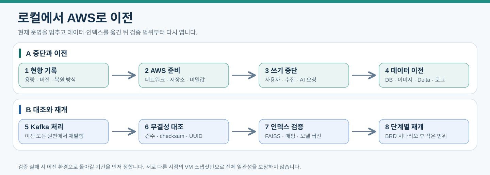

# 운영 검증과 AWS 이전

실패 작업을 재처리하고 데이터를 보호하면서 로컬 환경을 AWS로 이전한다. BRD 성공 기준을 서비스의 수용 조건으로 사용한다.

[문서 안내](index.md) · [BRD](<../BRD_3차.md>) · [인프라](01-infrastructure.md) · [작업 복구](05-kafka-jobs.md)

## 운영 상태 확인과 로그

BR-08은 MySQL 작업 이력, Django 운영 화면, 서비스 로그와 기록 이관으로 구현한다.

| 필요한 기능 | 초기 구현 |
|---|---|
| 시작·완료·실패와 시도 기록 | jobs, job_attempts, pipeline_runs, publishing_runs |
| 실패 작업과 원인 조회 | Django 운영 화면 또는 Admin 사용자 정의 기능 |
| 재처리 | 권한 확인 후 재시도 작업 저장·커밋 후 요청 발행, 실행 이력 보존 |
| 상세 오류 | Python·Django 파일 로그, systemd 또는 컨테이너 로그 |
| 서버 자원 확인 | top, free, df 등 기본 명령 |
| 로그 용량 관리 | 파일 로그 순환, journal 또는 컨테이너 로그 크기 제한 |
| 별도 보관소 이관 | 정기 내보내기 작업, archive_manifests, 건수와 checksum 검증 |

운영 화면은 상태·오류 코드·최근 실패·실행 시도를 조회하고 재처리 결과를 확인할 수 있어야 한다. 단순히 Admin에 테이블을 등록하는 것만으로 재처리 기능이 완성되지는 않는다. 재처리 동작은 [Kafka 작업 복구](05-kafka-jobs.md)의 중복 방지와 상태 규칙을 따른다.

| 대상 | 기본 명령과 서비스 상태 및 로그로 확인할 항목 |
|---|---|
| VM과 저장소 | RAM, CPU, 디스크 여유, I/O, 네트워크, 요청 실패 |
| NiFi와 원천 | 수집 실패, 원천 저장 건수, 적체, 미발행 건수 |
| Kafka | Broker 상태, 복제 이상, Consumer lag |
| Spark와 Delta | 실행 상태, 처리 지연, 품질 오류, checkpoint, 저장량 |
| MySQL 반영 | staging 건수, 실패, 반영 Delta 버전, 최신성 |
| DB 복제 | MySQL GTID·복제 스레드·Replica 읽기 전용 상태, MongoDB Primary·과반수·멤버 동기화 |
| Django와 AI | API 오류와 지연, 모델 timeout, 호출 제한, 비용, UNKNOWN 비율 |
| 작업 | 미진행 작업·전달 오류·후속 단계 누락, 만료 lease, 재시도, FAILED |
| 광고 서버 | 내부 API·임베딩 오류, 상품 검색 지연, 활성 인덱스·UUID 매핑, 집계 반영 시각 |

correlation_id, job_id, run_id, raw_document_id로 로그와 작업 상태를 연결한다. 로그에 이미지 본문이나 인증 정보를 불필요하게 출력하지 않는다. 작업 상태와 로그의 확인 주기 및 담당자를 정한다.

### 모든 작업 로그의 소요시간 기록 계약

로그에 남기는 모든 작업은 소요시간을 기록한다. DB 실행 이력이 있는 작업에 한정하지 않으며, 웹·내부 API 요청, 수집·다운로드, 파일·DB 저장, Spark 가공·반영, Kafka 발행·소비, AI 호출, 검색·인덱스 구축, 백업·이관·복구 등 각 서비스가 작업 로그로 남기는 단위에 공통 적용한다. 사용자 행동의 발생 이벤트 자체는 실행 작업과 구분하고, 해당 이벤트를 수신·저장·처리하는 작업에 이 계약을 적용한다.

| 공통 로그 필드 | 기록 규칙 |
|---|---|
| operation | 측정하는 작업·단계 이름. 시작·진행·종료에서 동일하게 유지 |
| execution_id, parent_execution_id | 실행 시도마다 고유한 execution_id를 발급하고 부모가 있으면 연결. 재시도는 새 실행 ID를 사용 |
| phase, status | START·PROGRESS·END와 실행 상태. 종료는 성공·실패·시간 초과·취소·중복 건너뛰기를 구분 |
| started_at, finished_at | 해당 실행의 UTC 시작·종료 시각. 실행 중 finished_at은 NULL |
| duration_ms | 해당 실행 시작부터 로그 기록 시점까지의 경과시간을 밀리초 단위의 0 이상 정수로 기록. END에서는 종료까지의 최종 소요시간 |
| duration_source | 정상 측정은 MONOTONIC, 장애 후 시각 차이 추정은 RECOVERED_WALL_CLOCK, 측정 불가는 UNAVAILABLE |
| correlation_id 및 업무 참조 | 해당 작업의 job_id·job_attempt_id·run_id·event_id·raw_document_id 등 존재하는 식별자로 DB 이력·다른 서비스 로그와 연결 |

시작 로그의 duration_ms는 0이며, 진행·오류 로그에도 같은 실행 시작 기준의 경과시간을 기록한다. 예외 경로와 조기 반환도 종료 로그를 남기고, 처리 가능한 오류는 finally 또는 동등한 공통 처리에서 마감한다. 각 재시도와 내부 단계·외부 호출은 독립적으로 측정하며 부모 작업의 소요시간에는 자식 처리와 실행 중 대기가 포함된다. 부모·자식 소요시간을 합산해 전체 시간으로 표시하지 않는다. 로그 자체를 쓰는 동작을 별도 작업으로 재귀 로깅하지 않는다.

경과시간은 실행 프로세스의 단조 증가 시계로 측정한다. UTC 시각은 조회·대조용이며 정상 실행의 duration_ms를 시스템 시계 차이로 계산하지 않는다. 측정 구간은 operation별로 고정한다. 웹·내부 API는 서버가 요청 처리를 시작한 때부터 응답 처리 완료 또는 오류 종료까지, 일반 작업·시도는 실행 시작부터 결과 저장 또는 실패 처리 종료까지를 측정한다. 대기열 체류·재시도 백오프·예산 대기는 실제 시도 시간과 구분하여 wait_ms와 대기 사유를 별도로 기록한다. 대기 자체를 작업 로그로 남길 때도 duration_ms를 기록한다.

외부 AI 호출의 duration_ms와 ai_analysis_runs.latency_ms는 요청 전송 직전부터 응답 본문 수신 완료 또는 오류·시간 초과 확정까지로 통일한다. 스트리밍 응답은 마지막 본문 수신까지 포함하며 전처리·입력 파일 준비·응답 검증·결과 저장·호출 간 재시도 대기는 제외한다. 이들은 별도 작업 로그와 상위 시도 시간에 기록한다. SDK 내부 자동 재시도는 비활성화하고 호출별 시도를 기록하여 실패 호출 시간이 숨겨지지 않게 한다.

강제 종료·프로세스 장애는 종료 로그 기록을 보장할 수 없으므로 시작·진행 로그와 lease/실행 이력으로 미종료 실행을 찾아 복구 로그를 남긴다. 시작 시각과 복구 마감 시각으로 추정한 duration_ms는 RECOVERED_WALL_CLOCK으로 표시하며 장애 감지 지연을 포함할 수 있다. 시각 근거가 없거나 차이가 음수면 duration_ms=NULL, duration_source=UNAVAILABLE과 사유를 기록한다. 측정 불가를 0으로 대체하거나 정상 측정 통계에 섞지 않는다. 복구 작업 자체는 별도 execution_id와 정상 측정 소요시간을 기록한다.

DB에서는 jobs·job_attempts·pipeline_runs·publishing_runs의 시작·종료 시각과 ai_analysis_runs.latency_ms를 유지한다. 모든 작업의 duration_ms는 구조화된 서비스 로그에 기록하며 DB 행이 없는 작업도 생략하지 않는다. 로그 순환·정기 이관에서도 공통 시간 필드와 실행 식별자를 보존한다.

검증 시 각 서비스의 작업 로그 목록을 대조하여 정상·실패·시간 초과·취소·중복 건너뛰기·재시도 경로의 시간 필드와 단위를 확인한다. 시작·진행·종료의 연결, 대기시간 분리, AI DB 값과 호출 로그 값의 일치, 강제 종료 후 복구 기록 및 이관 후 필드 보존을 확인한다. 실행 중이거나 장애 복구가 필요한 항목을 성공한 0ms 작업으로 집계하지 않는다.

## 보관과 삭제

사진·행동·관심 정보의 목적, 보관 기간, 삭제 범위를 사용자에게 안내한다. 기간의 실제 일수는 미정이다. 원천, 가격 이력, Delta 과거 버전, Kafka, AI 응답, 로그, 백업에도 각각 보관 정책을 정한다.

개인 데이터 삭제는 MySQL 행 삭제만으로 끝내지 않는다. 이미지용 Object Storage 파일, 분석 결과 파일, Delta 행동 데이터의 사본, 아카이브와 백업의 처리 기준을 정하고 실행 결과를 기록한다. Delta VACUUM 기간은 재처리·스트리밍 지연·복구 기간을 만족하도록 설정한다.

PRD AC-12의 운영 로그는 S3 이관·보존을 검증한다. 기타 보관 대상의 위치·주기는 별도로 정한다. 운영 기록은 archive_manifests에 건수와 checksum을 남겨 별도 보관 영역으로 이관하고 읽기 검증 후 완료로 표시한다. 같은 단일 VM의 별도 버킷은 논리 분리이며 물리 장애 백업이 아니다. 중요한 백업은 다른 노트북 또는 물리 매체에 복사하고 AWS에서는 별도 S3 저장 대상으로 보관한다.

MySQL과 MongoDB는 제품에 맞는 일관된 백업과 복원 시험을 수행한다. 이미지용과 Delta용 Object Storage는 파일과 저장소 메타데이터를 함께 보호한다. MySQL 3대·MongoDB 3대의 복제는 백업을 대체하지 않는다. 잘못된 수정·삭제도 복제되므로 별도 백업·복원 검증을 유지한다.

### 작업 내부 동시 처리 검증

검증 범위는 접수된 작업의 비동기 I/O·스레드풀·동기 DB 함수다. HTTP 트래픽 분산, 웹 워커 수 조정 및 서버 증설 시험은 이번 범위에서 제외한다. 동일 입력 묶음·모델·해상도·재시도 정책으로 작업 동시 실행 1·2·4를 비교한다. 스레드풀 4개는 초기 측정 후보이며 API 동시 호출 수와는 별도 설정이다. 팀 계정의 호출·예산 한도 안에서 작은 작업 묶음부터 시험한다.

| 측정·검증 | 확인 기준 |
|---|---|
| 처리 시간 | 묶음 전체 완료 시간과 작업별 완료 시간, queue wait·스레드풀 대기·단계 duration_ms·외부 latency_ms를 구분 |
| 자원·상한 | CPU·RAM·이미지 메모리·DB 연결 수·호출률·429·timeout·대기열 길이. 상한 초과 시 신규 실행 제한이 동작 |
| 이벤트 루프 | 동기 이미지·파일·SDK 처리를 직접 실행해 다른 독립 호출이 정체되지 않는지 확인 |
| 트랜잭션 | 외부 응답 대기 중 DB 잠금이 지속되지 않으며 결과·상태·lease_token 검증이 함께 확정 |
| 전달 복구 | DB 커밋 직후 발행 전 종료, Broker 확인 유실, 단계 완료 후 다음 요청 누락을 같은 ID·저장 결과로 복구 |
| Kafka 동시 완료 | 뒤 메시지가 먼저 끝나도 앞 미완료 offset을 건너뛰지 않음, 재할당 중 미완료 재전달·늦은 결과 차단 |
| 취소·재시도 | await 취소 후 실행 중인 동기 작업의 실제 종료 확인, RETRY_WAIT·BUDGET_WAIT에서 슬롯 반환 |
| 단계·이력 | 최신 실행만 현재 결과 갱신, 동일 작업 중복 없음, 분석·검색 실패로 생성 재호출 없음 |

API 제공처 한도·DB 잠금·CPU 처리·이미지 메모리 중 먼저 포화되는 구간을 기록하고 상한을 조정한다. 동시 실행을 늘려도 단일 AI 추론 자체가 빨라진다고 표시하지 않는다. 운영 설정에는 MAX_INFLIGHT_JOBS, SYNC_POOL_WORKERS, 대기열 상한, 제공처·모델별 동시 호출·호출률·timeout, 재시도/lease/복구 조회 주기를 명시한다. 다중 프로세스 도입 시 계정 공통 호출 한도를 프로세스별로 중복 배정하지 않는다.

## DB 복제와 장애 복구

MySQL은 GTID 기반 비동기 복제와 운영자 수동 전환, MongoDB는 데이터·투표 멤버 3대의 Replica Set을 검증한다. 장애 감지·확인은 DB 기본 명령·서비스 로그·운영 절차를 사용한다. RPO(허용 데이터 손실)와 RTO(복구 시간)는 실제 시험 후 확정하고 비동기 복제의 손실 가능성을 0으로 표시하지 않는다.

### MySQL 전환과 재합류

1. Primary 장애 또는 통신 단절을 확인하고 웹 쓰기·Consumer·작업 복구·Spark 반영을 중지한다. 기존 Primary를 중지·격리해 새 Primary와 동시에 쓰지 못하게 한다. 격리 확인이 안 되면 승격을 진행하지 않는다.
2. Replica 두 대의 복제 오류·GTID 수신/적용 상태·미적용 relay log를 대조해 승격 후보를 선정한다. 계획 전환은 쓰기 중단 후 모두 적용했는지 대조한다. 갑작스러운 장애로 원본 GTID를 확인할 수 없으면 가능한 손실 범위를 기록하고 정한 RPO와 승인된 운영 절차로 승격 여부를 판단한다.
3. Replica를 새 Primary로 수동 승격하고 공통 접속 설정·DNS/호스트 매핑을 갱신한다. Django·Consumer·작업 복구·광고 API·인덱스/임베딩 작업·Spark의 연결 풀을 닫고 재연결한다. 쓰기 노드가 하나인지 확인한 뒤 작은 작업부터 재개한다.
4. 기존 Primary 복귀 시 자동 원복하지 않는다. 분기된 데이터는 대조·보존하고 새 Primary 기준으로 재동기화한 뒤 읽기 전용 Replica로 재합류시킨다. 승격되지 않은 기존 Replica도 새 Primary를 복제하도록 연결하고, Replica 두 대의 복제 지연·오류·읽기 전용 상태를 검증한다.

GTID 수신·실행 집합과 복제 스레드 상태는 SHOW REPLICA STATUS 등 버전별 기본 명령으로 확인한다. 복제 유실이 의심되면 jobs·user_events·Kafka 이벤트·Delta 반영 이력·결과 파일·외부 제공처 요청 ID를 대조한다. 외부 호출/발행은 성공했으나 대응 DB 행이 사라진 경우를 별도 복구 대상으로 남기며 무조건 새 ID로 재호출하지 않는다. ID 보존만으로 데이터 손실과 중복 과금을 방지한다고 보장하지 않는다.

### MongoDB 선출과 저장 확인

rs.status()·rs.conf() 및 서비스 로그로 데이터 멤버 3대·과반수·Primary·복제 상태를 확인한다. 현재 Primary 중단 또는 정상 step-down 시험에서 남은 두 노드의 선출과 클라이언트 재연결을 검증한다. 한 Secondary 중단 시 majority 쓰기가 가능한지, 두 노드 중단 시 성공 이벤트 발행 없이 대기하는지 확인한다. 기존 Primary 복귀 후 Secondary 동기화와 원천 ID·checksum을 대조한다.

writeConcern timeout은 원천이 저장되지 않았다는 뜻이 아니다. 동일 raw_document_id와 안정 중복 키로 저장·majority 보존을 재확인한 뒤 수집 성공과 미발행 이벤트를 복구한다. Spark는 Primary의 majority 원천을 조회하고 조회 일시 실패를 원천 없음이나 정상 처리 완료로 바꾸지 않는다. 선출/재연결·쓰기 확인 timeout은 무한 대기 대신 운영 설정의 상한으로 제한한다.

### 구축 완료 검증

| 시험 | 확인 결과 |
|---|---|
| MySQL 계획 전환·Primary 중단·네트워크 단절 | 단일 쓰기 노드 유지, 수동 승격·전 프로세스 접속 전환, 손실·복구 시간 기록 |
| MySQL 복제 지연·Replica 중단·이전 Primary 복귀 | 복제 오류와 미적용 GTID 확인, 재동기화·읽기 전용 재합류 |
| MongoDB Primary/Secondary 각각 중단 | 과반수 유지·선출·majority 원천 보존·클라이언트 재연결 |
| MongoDB 두 노드 중단·쓰기 응답 유실 | 쓰기 대기, 성공 이벤트 차단, 같은 원천 ID의 보존 재확인 |
| DB 전환 중 원천·작업·이벤트·Gold 반영 | 기존 ID·고정 Delta 버전으로 재개, 건수·참조·중복 발행/적재 대조 |
| 백업 복원 | 새 격리 환경에서 UUID·ObjectId·원천 hash와 참조 대조, 복제 재구축 |

제품 설정의 기준은 [MySQL GTID 복제](https://dev.mysql.com/doc/refman/8.4/en/replication-gtids.html), [MongoDB 3노드 Replica Set](https://www.mongodb.com/docs/manual/core/replica-set-architecture-three-members/), [쓰기 확인](https://www.mongodb.com/docs/manual/reference/write-concern/)을 따른다. 복제 노드의 실제 사양·연결 설정은 [인프라](01-infrastructure.md#db-다중화와-접속-계약)에 둔다.

## 수용 기준

| BRD 성공 조건 | 확인 방법 |
|---|---|
| 원천 보존 100퍼센트 | 허용된 수집 성공 데이터와 접수 사용자 입력의 Bronze 참조·checksum 대조, 실패 입력 보존 확인 |
| 전체 이용 흐름 | 사진·선택적 스케치·텍스트 → 템플릿 구성 → 물체 선택 → 유사 상품 추천 → 저장·광고 서버의 다나와 연결 |
| 추천과 구성 검증 | 품목 일치·시각적 유사성·유효 링크 측정, 실제 상품 이미지가 공간 구성 재료로 사용되지 않는지 확인 |
| 재탐색 | 재그리기, 재추천, 인식 불가, 조회 실패에서 탐색 재개 |
| 상품 주소 일치 | 선택 추천 상품과 다나와 연결 대상 확인. 직접 구매 버튼은 Offer가 확인된 경우에 추가 검증 |
| 기록과 이관 | 행동, 성공·실패, 재시도, 복구, 아카이브 대조 |
| 광고 반응 | 실제 노출·선택·명시적 거절·판매 링크 클릭 및 기간·상품·카테고리별 집계 대조, 구매·매출과 구분 |

기술 검증은 Kafka 중복 전달, 응답 후 워커 중단, 외부 모델 시간 초과, 원천 저장 후 발행 실패, MySQL 반영 도중 중단, Delta용 Object Storage 재시작, Delta 재실행을 포함한다. 구현 시 필요한 시험을 작성하고 이후 변경이나 미해결 우려가 있을 때 다시 검증한다.

## 해석 이후 코드 처리 검증

2026-10-15: 로컬 웹 MVP의 semantic-results-v1 검증은 의미 구절의 부정 조건 보존·배치 주석 제외, 상위 후보의 유사도/ID 동점 순서, 속성 UNKNOWN과 DIFFERENT 구분, 좌표 변환과 원본 보존을 포함한다. 수치 이탈이 AI 통과보다 우선하고 시각 불확실·누락·낮은 신뢰도는 통과시키지 않아야 한다. 원응답 receipt와 가공 결과를 대조하고 완료 단계 재사용·비교 재시도에서 불필요한 생성/임베딩 호출이 없어야 한다. v4의 고정 계획을 사용하는 비교 재시도와 새 버전의 준비·생성 제한을 구분한다.

검색 출력의 ranking_duration_ms와 비교 출력 local_processing.duration_ms는 로컬 계산 구간만 측정한다. 벡터 읽기·정규화·외부 API·대기·파일 저장 및 요청 전체 시간은 별도로 측정한다. 코드 분리·모의 응답 회귀 통과를 실제 검색/시각 품질·수십~수백 명 처리량·전체 p95 15초 달성으로 기록하지 않는다. 실제 서비스 통합에서는 기존 공통 로그 계약과 부하 시험으로 p50/p95·최대 RAM·처리량·대기열을 확인한다.

## 광고 서버 복구와 검증

광고 서버 장애에서 Application은 입력·구성 결과를 유지하고 추천 작업만 실패·재시도 상태로 기록한다. 외부 임베딩 API의 timeout·호출 제한을 jobs와 job_attempts로 추적한다. 검색 인덱스가 없거나 질의 모델·차원이 다르면 NOT_READY로 처리하고 품목이 다른 임의 결과를 제공하지 않는다.

노출 검증은 목록 반환만으로 0건, 화면 표시로 1건, 동일 추천 항목의 스크롤 재진입·새로고침·중복 이벤트에서 1건 유지, 새 추천 run에서 새 노출을 확인한다. 빠른 클릭·뒤늦은 반응·중복 event_id·잘못된 소유자와 상품 참조·집계 재실행을 시험한다. 집계는 UTC 노출일 기준이며 원본 행동 건수와 반응한 서로 다른 노출 수를 구분한다. 분모 0에서 비율 미산출, 기간 비율에서 분자·분모 합, computed_at·입력 버전 조회를 확인한다.

인덱스 교체는 FAISS 파일과 embedding·asset UUID 매핑 checksum을 함께 검증한다. 교체 실패 시 이전 버전 유지, 디스크 손실 시 Delta 벡터와 manifest로 재구축, 상품 비활성화·ABO 시험 자료의 판매 추천 제외를 확인한다. 상세 계약은 [광고 서버](07-ad-server.md)를 따른다.

## 템플릿과 반복 생성 운영

원본·결과 비교는 기존 유지·추가·교체·구분 불확실 표본으로 검증한다. 기존 가구의 조명·원근·크기 변화, 기존 위치에 다른 가구 교체, 스케치 없는 텍스트 요청을 포함한다. 기존 유지와 사용자 확인 전 불확실 물체는 추천 작업 등록 및 광고 API 호출 단계에서 차단되는지 확인한다. 품목·영역 수정 후 구분 재검증, 사용자 확인 이력 보존, 고정 원본·결과 참조 유지, 비교 분석 실패 시 생성 없이 분석만 재시도하는지도 확인한다. 판정 정확도와 오류 사례는 측정 결과로 남기며 설계 반영을 검증 완료로 표시하지 않는다.

[템플릿과 생성](08-template-generation.md)의 제작·선택·좌표·임베딩·Bronze 계약을 적용한다. 기본 생성은 Cloudflare Workers AI의 @cf/black-forest-labs/flux-2-klein-4b(테스트 512×512, 설정으로 새 실행부터 1024×1024 선택 가능), 임베딩은 gemini-embedding-2이며 해석 gemini-3.5-flash-lite는 초기 추천 상태다. 생성 입력 변경의 정상 재생성과 실패 재시도 비용을 구분하고 ai_analysis_runs의 job_attempt_id·usage_json·estimated_cost_usd로 추적한다. 미확보 사용량은 0원으로 표시하지 않는다. 운영 설정으로 모델별 동시 호출·일일 또는 월간 예산 상한을 정하고 초과는 BUDGET_WAIT로 대기한다.

기술 계약 검증은 이미지별 임베딩 수·차원·유한 값, 묶음 응답 연결, 같은 체크섬 벡터 재사용, 품목 후보 선택과 후보 외 입력 수정, 같은 품목 템플릿 부족, 좌표 기준 이미지·범위 변환, 입력 버전과 사용 템플릿 고정, 새 이용 이벤트와 중복 전달 구분을 포함한다. 생성 품질 사전 시험을 신규 필수 완료 조건으로 추가하지 않는다.

복구는 Bronze commit 후 확인 발행 실패, 확인 중복과 해석 job 중복 방지, 생성 성공 후 파일 저장 실패, 물체 분석·검색 단계만 재시도, 늦게 완료된 이전 결과의 최신 화면 덮어쓰기 방지, 내부 완료 이벤트의 재생성 순환 방지를 확인한다. 입력 checksum 불일치는 격리하고 보존 오류와 AI 오류를 따로 조회한다. 파일·DB 저장 사이 미참조 객체는 보관 정책에 따라 정리한다.

AWS 이전 시 입력 event_id·revision_no·Bronze manifest, 템플릿 버전·임베딩·인덱스 UUID 매핑, 생성 실행·사용 슬롯·결과 물체 관계를 보존한다. Application의 템플릿 인덱스도 파일과 매핑을 함께 이전하거나 고정 Silver 버전으로 재구축한다. 이미지 자산 인터페이스의 원본 이미지 교체 확장성은 포트폴리오 설명이며 원본 사용을 운영에서 허용하는 권한으로 간주하지 않는다.

## VMware와 AWS

VMware 스냅샷은 로컬 복구 지점이다. 해당 스냅샷 파일을 EC2에서 직접 실행하지 않는다. 지원 형식으로 VM을 내보내고 VM Import/Export로 AMI를 만드는 경로는 가능하다. 기본 추천안은 Terraform으로 AWS를 구성하고 Ansible·Compose로 재배포한 뒤 DB와 파일을 옮기는 방식이다.

| 로컬 역할 | AWS 후보 |
|---|---|
| Object Storage (이미지용) VM | 이미지용 S3 버킷 |
| Object Storage (Delta용) VM | Delta용 S3 버킷 |
| Django와 AI API Consumer | 같은 Application EC2의 별도 프로세스, 모델 추론은 외부 API |
| 광고 서버 | 별도 EC2, FAISS 인덱스·매핑을 EBS에 배치하고 저장소 복원본 또는 Delta로 재구축 |
| Kafka와 Spark | EC2, 규모와 비용에 따라 재배치 |
| MySQL | 서로 다른 AZ에 배치하는 EC2 3대 후보, Primary 1대·Replica 2대 및 수동 전환 유지. 관리형 서비스는 별도 판단 |
| MongoDB | EC2 3대의 Replica Set, 세 멤버를 서로 다른 AZ에 배치하는 후보 |
| 로그와 백업 | 권한과 보관을 분리한 저장 대상 |

저장 VM 두 대를 반드시 EC2 두 대로 옮길 필요는 없다. 역할 분리를 S3 버킷과 권한으로 유지한다. 새 환경의 내부 주소, DNS, 보안 그룹, IAM, Kafka advertised.listeners, Spark Driver 도달성을 설정한다.

현재 로컬 19대안에서 저장 VM 두 대를 S3로 대체하면 같은 역할 배치의 EC2는 17대이며 AI API Consumer는 Application EC2에서 실행한다. Application과 광고 EC2에 각각 필요한 외부 API 통신 경로를 마련한다. S3 접속 경로가 외부 모델 API 접속까지 제공하는 것은 아니다. API 키와 제공처 정책을 새 환경에 맞춰 설정하고 호출 비용·실패·웹 자원 영향을 확인한다.

## 이전 절차

1. 저장량·실제 커널·부팅 방식·패키지 조합을 기록한다. 이미지 이전이면 대표 VM 한 대를 먼저 시험한다.
2. AWS 네트워크·실행 환경·저장소를 준비하고 환경별 비밀 정보를 배포한다.
3. 사용자 쓰기·수집·신규 AI 요청을 중단하고 실행 중 작업·재시도 대기·전달 미확인 이벤트를 대조하고 고정 업무 기록으로 재개할 범위를 정리한다.
4. MySQL GTID·복제 적용 상태와 MongoDB majority 보존 상태를 확인하고 일관된 백업을 확보한다. 대상 MySQL Primary 복원 후 Replica를 동기화하고 대상 MongoDB Replica Set에 원천을 복원·동기화한다. 이미지 및 Delta 파일, _delta_log, checkpoint도 이전한다. 기존 UUID·ObjectId를 유지하고 환경별 인증·멤버 주소를 다시 설정한다. 각 VM의 임의 시점 스냅샷을 섞어 복제 구성을 복원하지 않는다.
5. Kafka를 이전할지 원천·사용자 이벤트·작업에서 재발행할지 결정한다. checkpoint offset과 새 토픽 상태를 맞춘다. 새 Kafka에 기존 offset을 그대로 적용할 수 있다고 가정하지 않는다.
6. 건수·checksum·상품 참조·Delta 버전·checkpoint 연속성·중복 방지를 확인한다. MySQL UUID PK·FK와 JSON·Delta·Kafka에 기록된 UUID 참조를 그대로 이전했는지 확인한다. 기존 행에 새 UUID를 발급하지 않고 동일 업무 키 재반영 후 행 수와 id가 유지되는지도 검증한다.
7. 광고 서버의 FAISS 파일·UUID 매핑·모델/전처리 버전·checksum을 이전하거나 Delta의 고정 입력으로 재구축한다. 내부 API 주소·권한을 바꾸고 같은 질의의 상품 연결 및 집계 결과를 대조한다.
8. DB 복제·MySQL 수동 전환·MongoDB Primary 선출 및 BRD 대표 시나리오를 검증하고 작은 처리 범위부터 재개한다. 이전 환경으로 돌아갈 수 있는 기간을 정하고 롤백 시 두 환경이 동시에 쓰기를 받지 않도록 한다.

[PNG로 보기](assets/aws-migration-stages.png)

서로 다른 시점의 VM 스냅샷만 조합해 DB·Kafka·저장소 전체의 일관성을 보장하지 않는다.

## 미결정 사항

| 항목 | 필요한 정보 |
|---|---|
| 지원 품목과 데이터 출처 | 다나와 판매 연결·ABO 시험을 구분하고 이용 조건, 유효 이미지 수, 평가 자료 확정 |
| 19대 초기 구성의 물리 배치와 담당자 | 노트북별 RAM, SSD, 네트워크 여유, 추가 DB 4대와 저장 VM 배정, 운영 확인 담당 |
| DB 구축·중단 허용 | MySQL 3대·MongoDB 3대의 버전·디스크·복제 보관량, 허용 데이터 손실 RPO·복구 시간 RTO, 승격 담당자·접속 전환 수단 |
| 저장소 제품 | SeaweedFS와 Spark Delta 호환 시험 |
| AI 운영 설정 | 생성·임베딩 모델 선택을 유지하며 해석 모델 최종 채택·동시 호출·예산 상한·보관 기간 확정 |
| 광고 검색 | Gemini Embedding 2의 차원·전처리, FAISS 방식·메모리·데이터 디스크·후보 수, API 시간 상한 |
| 템플릿 운영 | 지원 유형·검수 담당·제작 출처·이용 조건·비활성화 및 삭제 기준 |
| 버전 고정 | Spark, Delta, Java, Python, DB, S3A 호환 |
| 보관과 삭제 | 이용 목적, 복구 기간, 저장 용량 |
| AWS 구성 | 리전, 예산, AZ, 실행 사양, 이전 시험 |

## 참고 자료

- [AWS VM 지원 형식과 OS](https://docs.aws.amazon.com/vm-import/latest/userguide/prerequisites.html)
- [AWS VM 가져오기 절차](https://docs.aws.amazon.com/vm-import/latest/userguide/import-vm-image.html)
- [Delta 저장소 설정](https://docs.delta.io/delta-storage/)

## 상품 추천과 연결 검증

원천 상품번호와 다나와 연결 대상이 구분되는지, 선택 상품·옵션과 링크가 맞는지 검증한다. 같은 파일을 공유하는 상품도 판매 조건·이용 범위·상품 관계는 각각 확인한다. 미확인 정보는 NULL/UNKNOWN으로 표시하고 추정 가격으로 채우지 않는다.

광고 서버 추천·링크 결정 API의 인증, timeout, 반복 요청, 인덱스 부재, 링크 만료를 검증한다. 광고 서버 장애 시 완료된 공간 이미지와 입력을 유지하고 추천만 재시도한다. 링크 실패를 다른 상품으로 이동시켜 감추지 않는다.

서비스 배포·백업·운영 로그 보관은 위의 운영 기준을 따른다. 이 문서의 논리 설계가 실제 설치·DDL 완료를 뜻하지 않는다.

Cloudflare 생성 운영은 계정별 하루 무료 Neurons와 템플릿·사용자 호출 공유량, 동시 예약·사용량 대조·한도 초기화 시각·BUDGET_WAIT 재개를 확인한다. 512 및 1024 실행의 설정·실제 결과 크기·전처리 참조와 변환을 검증하고 설정 변경이 기존 실행을 덮어쓰지 않는지 확인한다. 원본 파일은 보존하고 유료 자동 전환은 하지 않는다. AWS에서도 Application의 Cloudflare 생성과 Google 해석·임베딩 인증·HTTPS 접속을 별도로 설정한다. [해상도와 용량 추정](08-template-generation.md#생성-무료-한도와-용량-추정)

## 공간 크기 정책 검증

[크기 정책 인수 기준](11-scale-policy.md#인수-기준)에 따라 정상·과소·과대·폭/높이 혼합 이탈, 깊이 차이·원근, 명시적 미니어처/대형 요구, 기준 부재/충돌·가림·배경 변화·대상 없음/복수·검사 누락을 검증한다. 가로형·세로형 원본의 여백 변환과 불변 계획도 확인한다. 구조·주석 통과만으로 크기 실패를 정상 승격하지 않아야 한다. 결과 보존·계획 실패 복구·비교 재시도 중 생성 미호출을 확인한다. 모의 회귀 테스트와 실제 사진 시각 평가를 구분하고 실제 품목/유형/배치 깊이별 오탐·미탐·판단 보류율로 범위를 조정한다.
