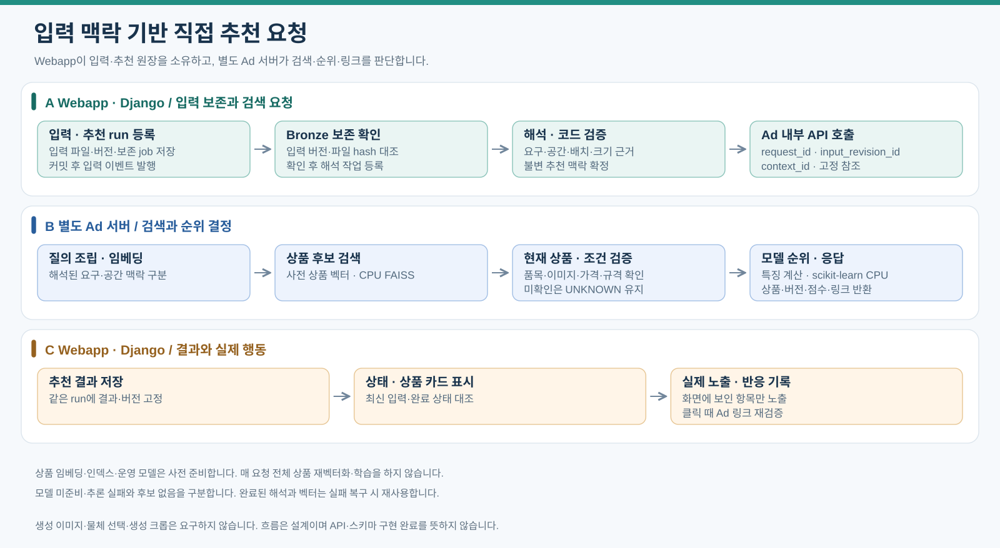
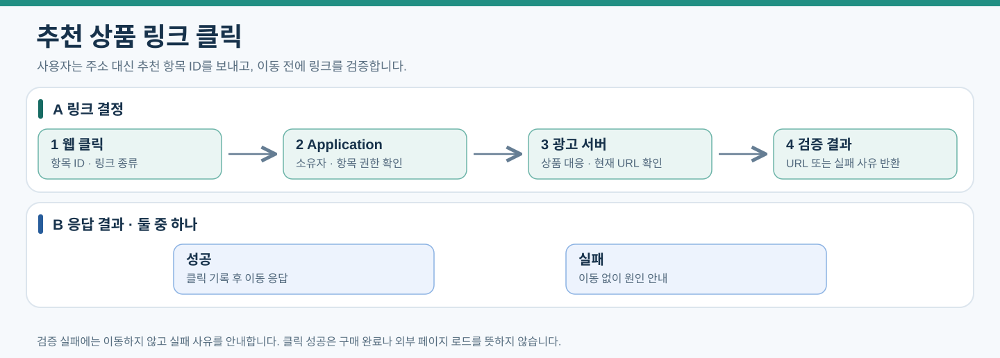

# 광고 서버: 공간 맥락 기반 상품 검색·규칙 추천

2026-10-15 현행 설계. 입력은 생성물 크롭이 아니라 고정 input_revision과 recommendation_context다. [직접 추천 계약](12-direct-recommendation.md#검색과-운영-순위)을 기준으로 신규 API/스키마를 별도 구현한다.

## 해석 결과의 검색과 정렬

광고 서버는 해석된 품목·명시 조건·추가 의미 구절과 분리된 공간 맥락으로 질의를 조립한다. 방 사진 전체를 요청 상품 형태로 취급하지 않는다. 임베딩 API→CPU 벡터 검색→현재 상품/이용 조건 검증→후보별 특징→규칙 순위 순서다. 상품 벡터는 사전 계산하고 모델·차원·전처리·정규화·인덱스 버전을 고정한다. 미확인 필수 조건은 충족으로 표시하지 않고 낮은 근거의 크기 추정은 강한 제외에 쓰지 않는다.

내부 검색 v2는 request_id·input_revision_id·context_id·입력 hash·고정 조건/맥락 참조·checksum을 받는다. 같은 request_id의 다른 입력은 거절하며 검색 캐시는 입력/정책/인덱스 버전에 묶는다. 상품 확장·UUID 중복 정리·링크/가격 시점 확인은 코드가 담당한다. 추천 원장과 사용자 이벤트는 Application이 쓴다.

## 이번 scikit-learn

운영 순위는 ranking_version으로 고정한 규칙이다. scikit-learn은 승인된 후보 전체/특징 스냅샷과 사람 평가·실제 반응을 오프라인에서 사용한다. 미노출/미클릭을 부적합으로 단정하지 않고 시점/그룹 분리·미래 정보 누수·위치 편향을 검토한다. 실험 순위·모델·CPU 성능을 기록해도 사용자 결과를 자동 변경하지 않는다. 후속 내재화 시에만 평가된 모델을 CPU 운영 경로에 배포한다.

## 링크·노출·장애 경계

기존 실제 노출·비교/구매 링크·상품/Offer/소유권·HTTPS/허용 호스트·집계 계약을 유지한다. 목록 반환과 오프라인 후보 평가는 노출이 아니다. 링크 실패는 구매 완료로 기록하지 않는다. 추천 장애에서도 원본 입력·해석·기존 추천을 보존하며 성공한 API를 무조건 반복하지 않는다. 내부 API·벡터/DB 오류를 후보 없음으로 숨기지 않는다.

이전 접힘 영역의 링크·노출·집계 공통 규칙은 충돌하지 않는 범위에서 유지하되 생성물/scene_object 필수 계약은 신규 v2에 적용하지 않는다.

이전 설계 이력 — 이미지 생성 중심 흐름과 당시 계약

# 광고 서버와 상품 추천 및 노출 효과

광고 서버는 템플릿 기반 생성 결과의 선택 물체와 유사한 실제 상품을 추천하고, 다나와 및 검증된 상품 페이지의 연결 대상을 결정하며 상품 노출에 대한 반응 집계를 조회한다. 2026년 10월 14일 기준 설계이며 서버와 검색 도구의 설치 완료를 뜻하지 않는다. BR-04·BR-05·BR-07·BR-09의 추천·노출·반응 활용을 담당하고 광고주 계약·입찰·과금·매출 집계는 초기 범위에 포함하지 않는다.

[문서 안내](index.md) · [BRD](<../BRD_3차.md>) · [인프라](01-infrastructure.md) · [데이터 모델](03-data-model.md) · [속성 사전](data-dictionary/06-ad-serving.md)

## 구성과 책임

| 구성 | 책임 |
|---|---|
| Application(app-01) | 입력 보존, 외부 AI를 통한 해석·템플릿 기반 공간 구성·물체 분석, 소유자 검증, 추천 요청, 추천 이력·사용자 이벤트 저장 |
| 광고 서버(ad-01) 후보 | 별도 Django API, 선택 물체의 Gemini Embedding 2 호출과 상품 검색, 추천 순서·카드 정보·상품 페이지 연결 결정, 반응 집계 조회 |
| 광고 서버의 상품 임베딩 준비 Consumer | 외부 API 벡터 생성, 임시 결과·작업 참조 보존 후 완료 이벤트 발행, Silver 적재 확인 후 product_embeddings 등록 |
| 광고 서버의 인덱스 관리 프로세스 | 준비된 상품 벡터로 FAISS 인덱스 구축·검증·교체, 버전 및 상태 등록 |
| MySQL Primary·Replica, 초기 Primary mysql-01 | 상품·판매·추천·노출·이벤트·집계와 검색 버전 메타데이터 |
| Object Storage 이미지용 | 상품 이미지, 템플릿, 구성 결과와 선택 물체의 잘라낸 이미지 |
| Spark와 Delta | 상품·행동 정제, 벡터 데이터 보존과 발행, 기간·상품·카테고리별 반응 집계 |

광고 서버는 기존 MySQL의 상품·추천 맥락·집계를 제한된 계정으로 조회한다. 인덱스 관리 프로세스는 검색 버전 메타데이터만 갱신하는 별도 권한을 사용한다. 상품 임베딩 준비 Consumer에는 product_embeddings·해당 jobs/job_attempts만 쓰는 별도 계정을 둔다. 상품 원장과 사용자·추천 이력은 광고 서버가 덮어쓰지 않는다. 광고 서버는 추천과 링크의 판단을 소유하고 Application은 인증·이력 저장·응답 전달을 담당한다. 이 저장 경계가 Application에서 추천이나 URL 선택을 다시 구현한다는 뜻은 아니다. 광고 서버 전용 DB나 GPU, Celery와 작업 큐용 Redis는 추가하지 않는다. 공통 서비스 MySQL 3대 구성은 [인프라](01-infrastructure.md#db-다중화와-접속-계약)를 따른다.

광고 서버의 실제 주소는 환경별 배포 설정에서 관리하고 미사용 여부·DHCP 충돌 확인 후 배정한다. 초기 사양 후보는 2 vCPU·4GB RAM·OS 디스크 30GB이며 인덱스와 임시 파일 용량에 따라 별도 데이터 디스크를 검토한다. 로컬 운영은 19대, 저장 VM 두 대를 S3로 대체하는 같은 역할 배치에서는 EC2 17대다. 물리 배치와 담당자는 [인프라 문서](01-infrastructure.md)에서 확정한다.

광고 서버의 상품·링크 상태 조회와 인덱스/임베딩 메타데이터 쓰기는 초기에는 현재 MySQL Primary를 사용한다. Replica 읽기 분산은 하지 않는다. 수동 장애 전환 후 광고 API·인덱스 관리·임베딩 Consumer의 접속 설정과 연결 풀을 모두 갱신한다. DB 접속 실패를 추천 없음으로 처리하지 않고 추천·링크 장애로 기록하며 생성 이미지는 유지한다.

## 사용자 요청 흐름

추천 조회와 상품 클릭은 서로 다른 요청이다. 웹은 Application을 통해서만 광고 서버 기능에 접근한다.

### 추천 조회

[PNG로 보기](assets/ad-recommendation-flow.png)

Consumer는 Application 측 별도 프로세스다. 상품 이미지와 선택 물체의 외부 임베딩·FAISS 검색·현재 상품 검증은 광고 서버가 수행한다. 결과 목록 반환만으로 노출을 집계하지 않는다.

### 링크 클릭

[PNG로 보기](assets/ad-link-click-flow.png)

실패 시 이동시키지 않고 원인을 안내한다. 클릭 성공은 외부 페이지 로드나 구매 완료를 뜻하지 않는다. 추천·클릭 오류로 공간 생성 API를 다시 호출하지 않는다.

### 검색 내부 처리

물체 크롭 → 임베딩 → FAISS 이미지 후보 → 현재 product_images의 상품 확장 → 품목·이용·상품 상태 검증 → 순위·카드·링크 응답 순서다. 상세 계약은 아래 벡터와 인덱스 절을 따른다.

scene_objects는 생성 결과의 물체를 나타낸다. 품목·영역 수정은 새 행으로 기록하고 이전 추천 입력은 보존한다. 텍스트 기반 생성도 물체가 확정되면 같은 추천 경로를 사용한다. 생성 입력 해석·템플릿 선택은 [Application](04-application-ai.md)의 책임이다.

기본 검색 대상은 이번 요청으로 추가·교체된 결과 물체다. 원본과 결과의 비교·구분·사용자 확인은 Application이 담당하고 [추천 대상 구분 계약](08-template-generation.md#원본결과-비교와-추천-대상-구분)을 따른다. Application Consumer는 내부 API 호출 직전에도 해당 물체 버전의 구분·확인 근거를 검증해 기존 유지 또는 확인 전 불확실 물체를 전달하지 않는다. 광고 서버는 크롭만 보고 추가·교체 여부를 추측하거나 대상 구분을 변경하지 않는다.

## 내부 API 계약

| API 후보 | 입력 | 출력 |
|---|---|---|
| POST /internal/recommendations/search | request_id, scene_object_id, crop_asset_id, category_id, 선택적 조건, 결과 수 상한 | 상품 UUID·이미지 UUID·선택적 Offer UUID·유사도·카드 정보·link_snapshot_json, index_version_id, ranking_version, 검색 상태 |
| POST /internal/recommendations/resolve-link | recommendation_item_id, link_kind, 요청 사용자 맥락 | 검증 URL·링크 종류·검증 시각 또는 연결 불가 사유 |
| GET /internal/ad-metrics | 기간, 선택적 상품·카테고리 필터 | 노출·반응 건수, 비율, computed_at, 집계 버전 |
| GET /internal/health | 내부 서비스 인증 | API 상태·로드된 인덱스 버전·집계 최신성 |

request_id는 Application이 먼저 생성한 recommendation_runs.id를 사용한다. 기존 jobs에 추천 검색 작업을 등록하고 job_id로 실행·재시도 상태를 추적한다. 내부 HTTP 요청에 시간 상한을 두고, Application Consumer는 광고 서버 호출을 웹 요청과 분리하고, 선택 물체 벡터화와 검색은 광고 서버가 수행한다. timeout 시 같은 request_id로 재시도하며 광고 서버는 실행 상태와 결과를 보존하여 외부 임베딩을 중복 호출하지 않는다. 사용자 웹에 즉시 완료를 약속하지 않고 기존 작업 조회 API로 상태를 제공한다. Kafka는 준비 작업과 행동 전달에 사용하며 추천 HTTP 응답을 대신 기다리는 통로로 사용하지 않는다.

검색 응답 자체는 노출이 아니다. Application이 같은 run에 응답을 중복 저장하지 않도록 트랜잭션과 run 상태를 확인하고 recommendation_items를 확정한다. 재시도는 같은 run과 입력을 유지하고, 사용자의 재추천은 새 run으로 생성한다. 선택한 상품과 Offer가 있는 경우 그 관계를 확인하고 offer_snapshots로 당시 가격·URL을 고정한다. 비교-only 추천의 offer_snapshot_id는 NULL이다. 기본 버튼은 확인된 다나와 연결 주소를 사용한다. 추천 당시 링크 종류·주소·확인 시각은 recommendation_items.link_snapshot_json에 고정한다. 직접 구매 버튼은 검증된 Offer가 있을 때만 추가한다. 연결 주소도 없으면 연결 준비 중으로 표시한다.

검색 실행 상태·응답 캐시는 광고 서버 전용 작업 저장 영역에 request_id와 입력 해시로 관리한다. 해당 작업 계정에만 상태 저장 권한을 주며 추천 이력과 user_events는 Application만 쓴다. 같은 request_id에 다른 입력은 거절하고 실행 중 재시도는 기존 상태를 반환한다.

Application만 내부 API를 호출하며 임의 외부 URL 대신 검증한 asset UUID를 전달한다. 광고 서버는 허용된 저장소 객체를 읽는다. 운영 집계는 운영자 권한을 검증한 Application을 거쳐 조회한다.

## 비동기 호출과 동기 검색 처리

실행 방식은 [Application 분류](04-application-ai.md#비동기-io스레드풀동기-트랜잭션-처리-경계)를 공통 기준으로 삼는다. 광고 서버의 검색 처리는 외부 응답 대기와 로컬 연산을 분리한다. 웹 트래픽 분산·웹 워커 증설·서버 추가는 이번 결정 범위에 포함하지 않는다.

| 작업 | 방식 | 경계 |
|---|---|---|
| 선택 물체·상품 이미지 저장소 읽기, 외부 임베딩 API | 비동기 I/O, 동기 전용 SDK는 제한된 스레드풀 | 사용자 추천과 상품 배치의 동시 호출·호출률·예산을 분리 |
| 크롭·방향/색상 보정·축소·인코딩·벡터 정규화 | 동기 함수, 무거운 구간은 스레드풀 | 작은 벡터 계산은 즉시 처리할 수 있으며 대량 연산은 측정 후 분리 |
| FAISS 검색·후보 정리 | 제한된 실행 영역의 동기 연산 | 활성 인덱스·매핑 버전을 요청에 고정. 검색과 인덱스 변경의 안전성을 구현·라이브러리별로 확인 |
| 현재 상품·이미지 연결·Offer·권한 조회 | 비동기 ORM 또는 짧은 동기 조회 | 후보별 반복 조회보다 묶음 조회를 우선 검토, 읽기 전체를 쓰기 트랜잭션으로 감싸지 않음 |
| request_id 실행권·임베딩 결과 참조·검색 응답 캐시 저장 | 짧은 동기 DB 트랜잭션 | 동일 요청 입력 해시·lease 검증. 외부 호출·검색·파일 처리 중 DB 잠금을 유지하지 않음 |
| 인덱스 구축·검증·교체 | 별도 관리 프로세스의 동기 작업 | 사용자 검색의 스레드풀과 구축 작업을 분리, 검증된 버전만 활성화 |
| Application의 추천 결과·노출·반응 확정 | Application의 짧은 동기 DB 트랜잭션 | 광고 서버가 사용자 추천 이력·이벤트를 중복 기록하지 않음 |

FAISS 검색은 비동기 함수 선언만으로 계산이 분산되지 않는다. 스레드 수와 라이브러리 내부 연산 스레드가 CPU를 과점유하지 않게 함께 제한한다. 인덱스 교체 중 사용 중인 이전 버전의 수명을 보장하거나 명시적으로 검색을 중단한다. CPU·메모리 병목은 별도 프로세스 분리를 검토하되 성능 향상을 미리 보장하지 않는다.

링크 클릭은 Application의 소유자 확인 → 광고 서버 비동기 검증 호출 → Application의 짧은 클릭 저장 트랜잭션 → 검증 URL 응답 순서다. 저장 직전에도 추천 항목·상품·Offer 관계를 확인하며 검증 호출 동안 DB 트랜잭션을 열어 두지 않는다.

## 상품 페이지 이동의 책임

사용자 웹의 링크 요청도 Application을 거쳐 광고 서버로 전달한다. Application은 추천 항목의 소유자를 확인하고 광고 서버는 저장된 상품 관계와 link_snapshot_json·현재 상태를 대조해 이동 대상을 결정한다. URL 대신 항목 UUID와 link_kind를 입력받고 허용 호스트·HTTPS·상품 대응을 검증한다.

Application은 성공 응답의 실제 링크 종류로 클릭을 기록하고 이동 응답을 제공한다. 이벤트 저장과 외부 이동은 하나의 트랜잭션이 아니므로 실제 페이지 로드나 구매 완료로 기록하지 않는다. 광고 서버 응답 실패·만료·대상 변경 시 생성 이미지를 유지하고 연결 실패를 안내한다. 사용자에게 보인 상품과 다른 대상으로 조용히 이동시키지 않는다.

## 해석 결과의 검색과 정렬

2026-10-15: 임베딩 생성은 외부 AI에 남기고 저장 벡터 검색·현재 상품 검증·추천 순위는 코드로 처리한다. 해석된 품목·속성·추가 의미 구절을 서버에서 검색 문장으로 조립하며 모델에게 최종 상품 목록·검색 점수·URL을 생성시키지 않는다. 부정 조건의 의미는 유지하고 배치 주석을 검색 문장에 포함하지 않는다. 코드의 단순 문자열 비교를 시각적 조건 충족 보증으로 쓰지 않는다.

서비스는 기존 품목·승인·현재 상품 상태 검증을 유지하고 유사도 내림차순·안정적인 식별자 동점 순서를 ranking_version에 고정한다. 스냅샷 모델·차원·전처리·정규화를 확인한 인덱스만 사용한다. 속성 미제공은 UNKNOWN이며 확인된 다른 값과 구분한다. 규칙 가중치 변경·학습 순위 모델·가격 필터는 이번 변경에 포함하지 않는다.

로컬 웹 MVP의 후보 검색은 서비스 광고 검색과 별도다. 코드가 정규화 벡터 내적을 계산하고 다나와 상위 6개는 heap top-k로 선택한다. `template_candidates.json`에 query_text·ranking·local_processing_version·ranking_duration_ms·attribute_policy를 저장한다. 시간은 순위 계산만 포함하고 임베딩 API·벡터 로딩·대기는 제외한다. 다나와 시험 카탈로그의 품목 미검증 상태를 자동 보정하거나 다른 상품 분류로 확정하지 않는다. FAISS/DB 서비스 구현·성능 보장을 뜻하지 않는다.

## 벡터와 인덱스

이미지 임베딩은 Gemini Embedding 2(gemini-embedding-2)를 사용한다. 기본 차원 768은 초기 제안이며 모델·차원·전처리를 인덱스 manifest에 고정한다. FAISS는 임베딩 생성기가 아니라 벡터 검색 라이브러리다. CPU 인덱스를 초기 후보로 두며 품목 일치·시각적 유사성·지연·메모리를 시험한 뒤 실제 인덱스 방식을 고정한다. [FAISS 공식 문서](https://github.com/facebookresearch/faiss)

내부 저장한 다나와 상품 이미지는 사용자 요청 전에 임베딩하고, 선택 물체는 추천 요청 때 같은 모델·차원·전처리·정규화 규칙으로 벡터화한다. product_embeddings는 product_id 없이 asset_id별로 관리하며 이미지 체크섬과 모델·전처리·차원으로 중복 생성을 막고 Delta Silver의 벡터 행을 참조한다. 외부 임베딩 범위가 승인된 현재 product_images 연결을 입력 근거로 확인한다. 같은 파일을 사용하는 상품의 승인 상태는 각각 확인하며 저장 승인을 외부 전송 승인으로 확대하지 않는다. 템플릿 검색과 상품 검색의 인덱스는 구분한다. 템플릿 제작·버전과 입력·공간 생성 이력은 [템플릿과 생성](08-template-generation.md) 및 데이터 모델을 따르고 광고 검색은 결과 물체부터 이어진다.

상품 추천 인덱스에는 현재 승인된 서비스 추천 상품 연결이 있는 이미지별 벡터를 넣는다. 같은 파일 벡터는 인덱스 scope 안에서 한 번 등록하며 품목별 분리 인덱스에서도 해당 scope의 유효 상품 연결을 검증한다. ABO 시험 인덱스는 분리하며 판매 추천에 섞지 않는다. 검색된 이미지에서 현재 활성 product_images를 조회해 연결된 모든 상품을 확장한다. MySQL에서 각 연결의 품목·원천 버전·표시/분석 이용·상품 활성 상태를 확인한다. 유효 Offer가 있으면 판매 정보와 eligible을 검증하며, 없으면 비교-only 결과를 명시한다. 같은 상품이 여러 이미지에 매칭되면 상품 UUID별로 최고 점수 등 ranking_version에 고정한 규칙으로 정리하며 다른 상품번호는 유지한다. 조건 적용으로 후보가 부족하면 검색 후보 수를 늘리거나 품목별 인덱스를 사용하고, 적합한 후보가 없으면 빈 결과를 반환한다. LLM이 상품 가격·규격·구매 URL을 만들어내게 하지 않는다.

인덱스 관리 프로세스는 발행 입력의 Delta 버전을 고정하고 새 FAISS 파일과 정수 검색 ID → embedding UUID·asset UUID·checksum 매핑 파일을 함께 만든다. search_index_versions.manifest_json에 파일 경로·checksum·모델·차원·전처리·입력 버전과 상품 연결 입력 버전을 기록한다. 고정 연결 입력과 현재 연결을 대조해 과거 이미지 연결이 현재 상품으로 오인되지 않게 한다. 매핑의 상품 후보는 검색 시 현재 연결과 이용 조건으로 다시 검증한다. FAISS 정수 ID는 검색 내부 값이며 MySQL UUID PK를 대체하지 않는다.

인덱스 파일은 광고 서버 로컬 디스크·메모리에서 사용한다. 복원용 파일과 매핑은 Delta용 Object Storage의 exports/search 영역에 일반 파일로 보관한다. 이 영역은 Delta 테이블이 아니며 _delta_log를 수정하지 않는다. 메모리에 구·신 인덱스를 함께 올릴 여유가 없으면 교체 시간의 검색 중단을 허용하고 작업 상태를 노출한다. 검증 실패 시 이전 버전을 유지하며 요청별 사용 버전을 기록한다.

## 실제 노출과 반응

상품 카드가 화면의 보이는 영역에 들어오면 PRODUCT_IMPRESSION 이벤트를 보낸다. 목록 반환만으로 노출을 기록하지 않는다. 초기 기준은 카드와 화면의 교차가 발생한 경우이며 최소 면적·시간 조건은 별도 확정한다. recommendation_items.id 한 건을 같은 추천 화면의 카드로 보고 recommendation_impressions.recommendation_item_id에 UNIQUE를 둔다. 스크롤 재진입·새로고침·이벤트 재전송은 같은 추천 항목이면 새 노출로 세지 않는다. 새 추천 run은 새 항목을 가지므로 새 노출을 기록한다.

Application은 최초 노출 행·user_events를 같은 MySQL 트랜잭션으로 저장하고 커밋 확인 후 행동 이벤트를 Kafka로 발행한다. 전달 누락은 저장된 user_events에서 같은 event_id로 재구성한다. 이벤트 재전송은 같은 event_id를 보존한다. 서로 다른 event_id로 같은 항목의 노출이 다시 접수돼도 항목 고유 제약으로 기존 노출을 반환하고 추가 노출 이벤트를 발행하지 않는다. 동일 event_id에 다른 본문이 오면 오류로 기록한다.

PRODUCT_SELECTED·PRODUCT_REJECTED·COMPARISON_LINK_CLICKED·PURCHASE_LINK_CLICKED는 impression_id로 노출에 연결한다. 보이지 않았던 상품은 거절로 추정하지 않으며 명시적 거절만 기록한다. 빠른 클릭으로 노출 접수와 반응 순서가 바뀌면 Application이 검증된 표시 정보를 바탕으로 노출을 먼저 확정하거나 재시도하게 한다. 소유자·추천 항목·상품·Offer 일치를 검증하며 연결이 확인되지 않은 반응은 품질 오류로 남기고 비율 계산에서 제외한다.

## 집계와 조회

Spark는 user.action.recorded를 Bronze에 보존하고 Silver에서 event_id 중복 제거, 추천·노출 연결, 상품·품목·이벤트 시각을 검증한다. Gold는 UTC 일자·노출 당시 상품·카테고리별 집계를 만들고 MySQL ad_metrics_daily에 반영한다. 카테고리 변경 후에도 노출 당시 분류를 유지한다.

| 지표 | 계산 기준 |
|---|---|
| impression_count | 해당 기간에 발생한 유효 노출 수 |
| selection_count·rejection_count·comparison_link_click_count·link_click_count | 해당 반응이 한 번 이상 연결된 서로 다른 노출 수. 같은 노출의 반복 클릭은 각 지표에서 1건 |
| 선택률·거절률·비교 링크 클릭률·구매 링크 클릭률 | 해당 반응 노출 수 / 전체 노출 수. 분모 0이면 미산출 |

원본 이벤트 건수는 user_events/Silver에 별도로 남기고 위 노출 단위 지표와 구분한다. 기간 지표는 노출 발생일 기준으로 연결된 반응을 집계한다. 뒤늦은 반응·재전달은 영향 받은 날짜를 다시 계산해 Upsert하며 기존 합계에 무조건 더하지 않는다. 여러 날짜의 비율은 비율의 평균 대신 분자·분모를 합쳐 계산한다. source_versions_json과 computed_at으로 집계 입력 및 최신성을 조회한다. 클릭을 구매·매출로 표시하지 않는다.

## 장애와 검증

광고 서버나 임베딩 API 장애 시 생성된 공간 결과와 사용자 입력을 유지하고 추천 작업만 재시도한다. 인덱스가 없거나 모델 버전이 맞지 않으면 NOT_READY로 처리한다. 유사 검색 실패를 다른 품목의 임의 추천으로 감추지 않는다. 로그에는 request_id·job_id·scene_object_id·index_version_id를 기록하고 작업 이력과 연결한다.

검증은 실제 화면 노출, 스크롤 재진입, 새로고침, 새 run, 중복 event_id, 빠른 클릭, 뒤늦은 반응, 집계 재실행, 서비스·ABO 평가 인덱스 분리, 인덱스·UUID 매핑 교체 실패를 포함한다. 이전 절차와 운영 조회는 [운영 문서](06-operations-migration.md)를 따른다.

## 상품 추천과 다나와 연결

서비스 카탈로그는 다나와 출처와 원천 상품 식별자를 유지한다. 광고 서버는 저장된 다나와 상품 이미지의 인덱스에서 후보를 찾고 유효 이미지·품목·이용 범위·현재 상품 상태를 검증한 뒤 해당 상품의 comparison_url로 연결한다. 직접 판매 정보가 있을 때만 Offer·옵션·상태를 검증해 추가 구매 버튼을 제공한다. 연결 주소가 미확정이면 해당 버튼을 비활성화하고 다른 상품으로 임의 대체하지 않는다.

일반 가격과 카드·회원·쿠폰 가격을 구분하고 배송·설치 조건을 표시한다. 원문 가격이 미제공이면 NULL이다. 조건이 다르면 같은 총액으로 정렬하지 않는다. 선택 시 offer_snapshots에 당시 조건·관측·URL 검증 상태를 고정한다. 상세 계약은 [상품 연결](09-product-links.md)을 따른다.

서비스 인덱스 scope=PRODUCT_SERVICE에는 승인된 다나와 상품 이미지의 벡터만 등록한다. ABO 평가는 ABO_EVALUATION, 템플릿은 TEMPLATES로 분리한다. 도매꾹 이미지는 [템플릿 자료](10-domeggook-reuse.md)로만 관리하며 서비스 상품 인덱스에 넣지 않는다.

## 동일 이미지의 여러 상품 추천

같은 이미지 파일을 공유해도 상품 식별자·판매처·옵션·가격 조건·배송·구매 링크는 각각 유지한다. 이미지 그룹 안에서 비교할 수 있으나 recommendation_items와 offer_snapshots는 상품별로 확정한다. 사용자가 선택한 상품의 Offer로 연결하고 같은 이미지의 다른 판매자로 임의 이동시키지 않는다.

그룹 표시에서도 실제로 보인 상품 카드의 recommendation_item_id로 노출을 기록한다. 숨겨진 그룹 구성 상품은 노출로 세지 않고 확장 후 실제 표시된 카드에 기존 노출 정책을 적용한다. 상품별 반응을 이미지 단위로 합쳐 광고 집계를 왜곡하지 않는다. 승인 철회·이미지 교체 시 인덱스 갱신 전에도 현재 연결 검증으로 해당 상품을 즉시 제외한다.

비교 클릭에는 product_id·연결 주소·확인 근거를, 구매 클릭에는 추가로 Offer·옵션·URL 검증 근거를 남긴다. 사용자 노출·선택·거절·클릭으로 공간 생성 job을 만들지 않는다. LLM이 실제 상품명·가격·링크를 만들어낸 결과는 추천에 사용하지 않는다.

