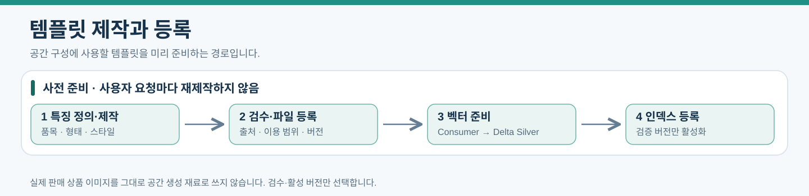
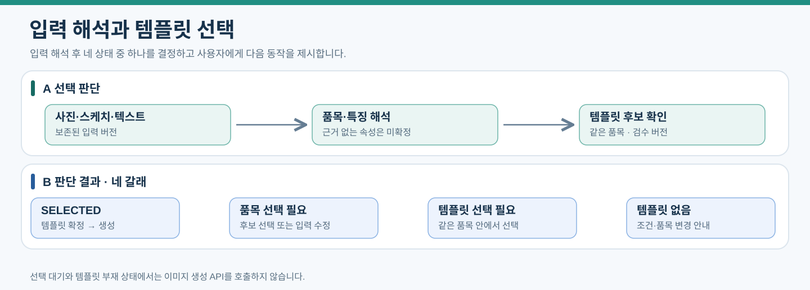

# 템플릿 제작과 벡터화 및 공간 생성

상품 분류별 템플릿을 준비하고 사용자 입력을 해석해 공간 이미지를 생성한다. 2026년 10월 14일 Cloudflare 생성 모델 변경을 반영한 설계다. 기존 도매꾹 이미지는 이용 범위를 확인한 템플릿 제작 참고 자료, 완성된 템플릿은 생성 재료, 내부 저장한 다나와 상품 이미지는 검색·표시 자료로 구분한다. 생성 입력 변경·명시적 다시 생성마다 정상 재생성을 수행하고 동일 요청 재전송과 실패 재시도는 별도로 관리한다.

[문서 안내](index.md) · [데이터 모델](03-data-model.md) · [속성 사전](data-dictionary/07-template-generation.md) · [AI 연결](04-application-ai.md) · [Kafka 계약](05-kafka-jobs.md) · [광고 서버](07-ad-server.md)

## 모델과 실행 위치

| 역할 | 모델 | 결정 상태 |
|---|---|---|
| 템플릿 제작과 공간 이미지 생성 | @cf/black-forest-labs/flux-2-klein-4b | 사용자 선택, 테스트 512×512·계정 호출 확인 필요 |
| 상품·템플릿·물체 영역 임베딩 | gemini-embedding-2 | 원문 계획 유지 |
| 입력 해석과 생성 결과 물체 분석 | gemini-3.5-flash-lite | 초기 추천 모델, 최종 채택은 별도 확정 |
| 생성 모델 대안 | gemini-3.1-flash-lite-image, gemini-nano-banana-2.1 | 비교 참고, 자동 전환하지 않음 |

Cloudflare FLUX.2 klein 4B는 이미지 생성·편집, Gemini Flash-Lite는 입력 해석·물체 분석, Gemini Embedding 2는 벡터 생성을 담당한다. 해석 결과로 템플릿을 선택한 뒤 별도 생성 API를 호출한다. [생성 모델](https://developers.cloudflare.com/workers-ai/models/flux-2-klein-4b/) · [해석 모델](https://ai.google.dev/gemini-api/docs/models/gemini-3.5-flash-lite) · [임베딩 API](https://ai.google.dev/gemini-api/docs/embeddings)

Application(app-01)의 별도 Consumer가 템플릿 제작·벡터화·공간 생성 API를 호출한다. 광고 서버(ad-01)는 유사 상품 검색·추천 순위와 다나와 연결 결정을 담당하고 Spark는 Bronze 보존 및 Delta 벡터·행동 처리를 담당한다. 템플릿 인덱스는 Application에서 사용하고 상품 인덱스와 분리한다. 새 서버·GPU·로컬 모델·MCP는 추가하지 않는다.

## 템플릿 제작과 등록

[PNG로 보기](assets/template-preparation-flow.png)

| 단계 | 담당·산출물 |
|---|---|
| 특징 정의·제작 | 소분류·형태·스타일을 정하고 템플릿 이미지 제작 |
| 검수·파일 등록 | 출처·내용 검수 후 이미지용 저장소에 불변 파일·버전 등록 |
| 벡터 준비·보존 | Consumer의 외부 임베딩 호출 → Spark의 Delta Silver 적재 확인 |
| 인덱스 등록 | Application의 템플릿 검색 인덱스에 검증한 버전 등록 |

초기에는 템플릿을 먼저 제작하는 방법을 기본 제안으로 사용한다. 소분류마다 대표 형태·스타일을 소수 준비하고 이후 확장한다. 대분류당 한 장으로 모든 형태를 대표한다고 가정하지 않는다. 기존 도매꾹 이미지에서 확인한 형태·색상 등 특징을 참고할 수 있으나 원본을 생성 API에 그대로 넣지 않고 제작 지시로 별도 템플릿을 만든다. 원본 전달은 해당 이용 범위를 별도로 확인한 경우에만 적용한다.

templates 한 행은 이미지 한 건의 불변 버전이다. template_key는 같은 템플릿 계열을 묶고 version_no는 수정 순번이다. category_id·attributes_json·asset_id·provenance_json·review_status·active를 기록한다. 이미지는 templates/{template_key}/{version_no}/image.png 같은 버전별 객체 키에 저장하며 파일·특징을 수정하면 새 행과 파일을 만든다. 검수 완료·활성·파일 존재가 확인된 버전만 선택한다.

provenance_json에는 제작 방식, 사용 모델·프롬프트 버전, 제작에 사용한 자료의 출처와 이용 조건, 검수 기록을 남긴다. 템플릿 사용은 원본 상품 이미지를 공간 생성 재료에서 분리하려는 설계 의도이며, 원본의 벡터화나 특징 추출만으로 이용 조건이 해결됐다고 표시하지 않는다.

## 제작 방식 비교와 단계적 도입

| 기준 | 템플릿 먼저 제작 | 상품 벡터 분석 후 제작 |
|---|---|---|
| 과정 | 특징 정의 → 제작 → 검수 → 벡터화 | 원본 벡터화 → 군집화 → 대표 특징 정리 → 제작 → 검수 → 완성본 벡터화 |
| 초기 비용 | 분석 단계가 적어 구현이 단순함 | 군집화·대표 검수·특징 정리 작업 추가 |
| 품질 특성 | 표현을 통제하기 쉽지만 보유 상품에 없는 유형이 생길 수 있음 | 카탈로그의 대표 형태·다양성을 반영할 가능성이 있으나 배경·중복·분류 오류에 영향받음 |
| 적용 시점 | 초기 시제품 | 상품 검색 연결 후 템플릿 보완 |

다나와 상품 이미지 임베딩은 실제 상품 검색에도 필요하므로 두 방식의 공통 비용이다. 도매꾹 이미지 분석 결과를 서비스 상품 인덱스에 혼합하지 않는다. 이미 만든 벡터를 재사용하면 후자의 추가 비용은 분석·검수·추가 제작이다. 대표 벡터를 이미지 생성 API에 직접 넣는 흐름으로 설명하지 않는다. 대표 상품·공통 특징을 찾는 데 사용하고 완성된 템플릿 이미지를 다시 임베딩한다.

1. 지원 소분류의 기본 템플릿을 제작·검수·벡터화한다.
2. 같은 임베딩 모델로 실제 상품 검색을 연결한다.
3. 소분류별 고유 상품 벡터를 군집화한다. FAISS의 검색·군집 기능은 후보 도구다.
4. 각 군집 중심에 가까운 상품 여러 개를 확인하고 대표 형태를 설명한다.
5. 대표 상품과 기존 템플릿을 비교해 가까운 템플릿이 없는 유형을 검토한다.
6. 고유 상품 수·지원 범위·사용자 요청을 함께 보고 추가 템플릿을 제작한다.

군집에는 처음부터 소파·리클라이너 같은 이름이 붙지 않는다. 사람 또는 멀티모달 AI가 대표 이미지를 확인해 설명한다. 상품 중복과 배경 때문에 생긴 군집은 제외한다. 템플릿 부족 여부의 보편적인 유사도 임계치를 임의로 확정하지 않고 검수 사례로 기준을 정한다. 비용 비교는 제작·분석·임베딩·검수·재작업을 구분한다. [FAISS 군집화](https://github.com/facebookresearch/faiss/wiki/K%E2%80%90means-clustering)

## 이미지별 임베딩 계약

기본 단위는 이미지 asset 한 건과 벡터 한 건이다. 상품·템플릿·결과 물체 영역을 구분하고 이미지 단독 임베딩을 초기안으로 사용한다. 템플릿 검색의 텍스트 질의는 같은 모델의 텍스트 임베딩으로 비교할 수 있으며 설명을 이미지 입력에 임의로 혼합하지 않는다.

| 항목 | 규칙 |
|---|---|
| 모델 | gemini-embedding-2 |
| 차원 | 초기 768 제안, 설정과 레코드에 명시 |
| 입력 식별 | embedding_id, asset_id, image_checksum |
| 전처리 | 방향 보정 → 지정 크기·비율 처리 → 임베딩 → 검색용 L2 정규화. 규칙은 preprocessing_version으로 고정 |
| 묶음 요청 | 입력별 독립 Content 또는 개별 Batch 요청을 사용하고 이미지별 결과 수·순서·식별자 연결을 검증 |
| 결과 검증 | 차원 일치, 유한 숫자, 0이 아닌 벡터 길이 확인. 실패 벡터는 인덱스 제외 |
| 재사용 | checksum·모델·전처리·차원이 동일하면 재사용 |
| 인덱스 갱신 | 모델·차원·전처리가 바뀌면 새 버전 구축. 다른 모델의 벡터와 혼합하지 않음 |

Gemini Embedding 2는 한 입력에 여러 이미지·텍스트를 넣으면 하나의 결합 벡터를 만들 수 있다. 서로 다른 상품을 한 결합 입력으로 포장하지 않는다. 각 이미지 요청과 벡터 결과를 대응시키고 응답 수가 맞지 않으면 해당 묶음을 실패로 처리한다. [입력 구성과 결합 규칙](https://ai.google.dev/gemini-api/docs/embeddings#embedding-aggregation)

원본 벡터는 Spark가 Delta Silver에 기록하고 template_embeddings·product_embeddings에는 테이블·버전·행 식별자 참조를 둔다. 템플릿 인덱스는 Application 로컬 디스크·메모리에서 사용하고 scope=TEMPLATES인 search_index_versions로 배포 버전을 관리한다. 복원 파일과 UUID 매핑은 Delta용 저장소 exports/search에 일반 파일로 보관한다. 이는 _delta_log를 가진 Delta 테이블이 아니다.

## 입력 해석과 선택 정책

사진·스케치·선택적 텍스트를 외부 AI에 전달해 품목 후보와 확인 가능한 특징을 얻는다. 텍스트가 없다고 서버가 직접 그림을 이해하는 것으로 설명하지 않는다. 검은 스케치 선을 검은 가구의 요구로 해석하지 않으며 색상·재질의 근거가 없으면 NULL로 둔다. 가구의 실제 치수를 이미지에서 확정하지 않는다.

| 상태 | 사용자 동작과 다음 단계 |
|---|---|
| SELECTED | 품목과 사용할 템플릿을 확정하고 생성 진행 |
| NEEDS_CATEGORY_SELECTION | 품목 후보를 보여주고 사용자가 선택. 원하는 품목이 후보에 없으면 스케치·텍스트 수정 안내 |
| NEEDS_TEMPLATE_SELECTION | 같은 품목 안에서 다른 형태·색상 템플릿 후보와 조건 차이를 표시하고 선택 요청 |
| TEMPLATE_UNAVAILABLE | 해당 품목 템플릿이 없음을 안내하고 조건·품목 변경 선택 제공 |

[PNG로 보기](assets/template-selection-states.png)

다른 품목으로 자동 대체하지 않는다. 선택 대기 중에는 보존된 입력과 후보 결과를 유지하고 생성 API를 호출하지 않는다. 후보 선택·조건 수정도 새 이용 데이터로 접수해 새 입력 버전과 실행을 만들고 이전 대기 실행은 이력으로 남긴다. 새 실행은 이전 후보 결과를 참조·재사용할 수 있으나 확정 조건과 소유자를 검증한다. 사용 템플릿 UUID·버전은 scene_generation_templates에 고정하며 작업 도중 바꾸지 않는다.

## 생성 요청과 두 영역 좌표

Consumer는 입력 해석 후 선택 템플릿 파일을 저장소에서 읽어 사용자 원본 사진·스케치 위치·지시와 함께 생성 API에 전달한다. 저장소 접근 비밀이나 전체 버킷 권한을 모델에 제공하지 않는다. 기본 생성은 원본 공간 사진과 최신 입력·템플릿을 기준으로 수행하고 직전 생성 결과를 계속 편집하는 방식을 초기 기본으로 두지 않는다.

requested_regions_json은 생성 전 배치 의도, scene_objects.bounding_box_json은 생성 결과에서 확인한 실제 물체 영역이다. 둘은 별도 이미지 좌표이며 그대로 복사하지 않는다. 형식은 [x_min, y_min, x_max, y_max], 좌측 위 원점, 오른쪽 x 증가·아래쪽 y 증가, 해당 이미지 기준 0~1로 통일한다. 각 영역에 기준 asset_id와 이미지 가로·세로를 연결한다.

AI 좌표 형식을 내부 형식으로 변환한 뒤 0 ≤ min < max ≤ 1과 유효 이미지 크기를 검사한다. 화면 확대·축소 좌표는 원본 이미지 좌표로 변환한다. 잘못된 좌표는 조용히 잘라 보정하지 않고 재분석 또는 사용자 수정으로 처리한다. 결과 영역을 화면에서 확인·수정할 수 있게 하고 확정 영역을 크롭해 임베딩·상품 검색에 사용한다. 품목·영역 수정은 새 scene_objects 행으로 남기며 기존 추천의 입력은 유지한다.

생성 결과는 result_asset_id로 저장하고 scene_objects.generation_run_id로 실행과 연결한다. 입력 의도 반영·생성 결과 물체/영역은 BRD 시나리오로 검증한다. 사용자 수정·명시적 다시 생성·단계별 실패 복구는 제공한다.

## 원본·결과 비교와 추천 대상 구분

물체 분석 Consumer는 해당 생성 실행에 고정된 원본 공간 사진과 생성 결과를 함께 외부 AI에 전달한다. 스케치·텍스트 요구사항, 사용 템플릿의 품목·slot_key·목표 영역도 비교 근거로 제공한다. 생성 결과 전체의 물체를 검출하되 이번 요청으로 추가·교체한 물체를 기본 추천 대상으로 삼고 원본에 있던 가구를 자동으로 추천 대상에 포함하지 않는다.

| 구분 | 판단 기준 | 화면과 추천 처리 |
|---|---|---|
| 기존 유지 | 원본에 있던 물체가 결과에도 유지됨 | 기존 가구로 표시하고 기본 추천 대상에서 제외 |
| 추가 | 원본에 없던 물체가 요청 품목·배치 의도에 대응해 나타남 | 추가된 가구로 표시하고 사용자가 선택하면 검색 |
| 교체 | 원본 물체가 있던 자리에 요청에 대응하는 다른 물체가 생성됨 | 교체된 가구로 표시하고 사용자가 선택하면 검색 |
| 구분 불확실 | 대응 관계·요청 의도·추가 또는 교체 여부를 판단하기 어려움 | 사용자 확인 대기, 확인 전 검색하지 않음 |

원본과 결과의 영역은 각각의 이미지 기준으로 분석하며 좌표를 그대로 복사하지 않는다. 출력 크기·여백·전처리 변환을 고려하고 목표 영역과의 겹침만으로 추가·교체를 확정하지 않는다. 위치·크기·조명·원근·배경의 변화만으로 기존 물체를 새 가구로 판정하지 않는다. 스케치 없는 텍스트 입력은 요구 품목·조건과 두 이미지의 물체 대응을 사용하며 위치 근거가 부족하면 사용자 확인으로 넘긴다. 원본에서 사라진 물체는 결과에 크롭할 대상이 없으므로 추천 대상이 아니다.

화면은 물체별 구분과 판단 근거를 보여주고 사용자가 잘못된 구분·품목·영역을 확인·수정할 수 있게 한다. 추가·교체 물체도 자동 검색하지 않고 사용자의 물체 선택 후 추천한다. 기존 유지 물체는 기본 선택 대상에서 제외하며 기존 가구 검색을 별도 기능으로 허용할지는 이번 반영 범위에서 확정하지 않는다. 불확실 물체는 사용자가 이번 요청의 추가·교체 대상임을 확인하고 품목·영역을 확정한 뒤 검색할 수 있다.

분석에 사용한 원본·결과의 불변 참조와 checksum, 요청·템플릿 버전, 물체별 구분과 근거, 사용자 확인·수정 이력을 생성 실행·분석 기록·사용자 이벤트에 연결해 보존한다. 사용자 확인을 AI 판정으로 덮어쓰지 않는다. Application은 추천 작업 등록 전에 최신 물체 버전의 구분·확인 여부를 검증하며 기존 유지 또는 확인 전 불확실 물체의 검색 요청을 거절한다. 품목·영역을 수정하면 구분의 근거도 다시 검증하고 불확실하면 재확인을 요구한다. 이번 개정은 동작 계약이며 저장 필드·출력 JSON 및 확인 API의 상세 스키마는 구현 전에 확정한다.

비교 분석 실패 시 원본·생성 결과를 유지하고 물체 분석 단계만 재시도한다. 생성 API를 다시 호출하거나 실패를 추가·교체 판정으로 처리하지 않는다.

## 이용 데이터별 재생성과 단계별 복구

사진·스케치·텍스트·생성 조건 수정과 명시적 다시 생성은 새 input_revisions와 scene_generation_runs를 만든다. 단순 상품 노출·선택·거절·비교/구매 링크 클릭은 user_events에 기록하고 공간 생성을 자동 호출하지 않는다. 품목/영역 수정만으로 재추천할 때는 새 scene_object와 recommendation_run을 만들며 공간 이미지 생성은 사용자가 요청한 경우에만 수행한다.

같은 event_id 재전달은 기존 입력/실행을 반환한다. 같은 ID의 다른 본문은 오류다. 같은 실행의 단계별 재시도는 job/job_attempt를 사용하고 성공 결과를 보존한다. 내부 AI·임베딩 완료 이벤트는 사용자 변경 이벤트가 아니므로 재생성 순환을 만들지 않는다.

projects.latest_generation_run_id는 최신 입력 순번을 검증해 조건부 갱신한다. 늦게 끝난 이전 실행이 최신 결과를 덮어쓰지 않는다. 입력/템플릿 버전을 실행에 고정하며 실패 시 이미 성공한 단계의 파일·벡터를 재사용한다.

## 호출 비용과 재시도

템플릿 제작은 준비 작업으로 수행하고 사용자 요청마다 다시 만들지 않는다. 벡터는 checksum·모델·전처리·차원 기준으로 재사용한다. 생성 입력 변경의 정상 재생성과 같은 입력 실패 재시도의 비용을 별도 합산한다.

외부 호출마다 ai_analysis_runs를 남기고 job_attempt_id·analysis_type·모델·사용량·latency·상태·예상 USD 비용을 기록한다. 이 테이블은 해석뿐 아니라 생성·임베딩 호출에도 사용한다. usage_json에 입력/출력·이미지·추론 사용량, 제공처 요청 ID, 적용 요금 기준일을 기록하고 사용량 불명은 비용 NULL로 표시한다. 추정 비용을 실제 청구 확정 금액이라고 표시하지 않는다.

일시적 서버 오류·timeout·호출 제한은 초기 max_attempts=3(최초 호출 포함 최대 3번) 후보로 지수 백오프와 임의 지연을 사용하고 제공처 Retry-After가 있으면 우선한다. 입력·형식·권한 오류는 자동 반복하지 않는다. 예산 상한 도달은 BUDGET_WAIT로 보존·대기하고 예산 조건 해소 후 같은 실행을 재개한다. 제한값과 예산 금액은 운영 설정에서 확정한다. 호출 성공 여부를 확인하지 못한 장애는 재호출 비용이 발생할 수 있음을 기록하며 전체 exactly-once 비용을 보장하지 않는다.

## Bronze 보존과 AI 시작 계약

입력 접수와 AI 시작은 구분한다. 파일·MySQL 입력 버전이 저장되어도 입력 Bronze 보존 확인 전에는 해석·생성을 시작하지 않는다.

| 단계 | 사용자·운영 상태 |
|---|---|
| 파일과 입력 접수 | 원본 파일·입력 버전 보존, RECEIVED |
| Bronze 확인 대기 | BRONZE_PENDING, 저장 진행 표시 |
| 보존 확인 완료 | checksum·입력 버전 대조, BRONZE_PERSISTED |
| AI 준비 | 같은 버전의 단계 job 등록·커밋 후 요청 발행, AI_PENDING |

이벤트 필드·트랜잭션·확인 유실 복구·중복 방지의 기준은 [Kafka 입력 계약](05-kafka-jobs.md#입력-bronze와-생성-단계-계약)이다. 보존 실패와 AI 실패는 따로 조회하고 완료 단계는 유지한다. 상태 이름은 구현 전 확정할 설계 후보다.

## 포트폴리오 확장과 저장소 경계

생성 어댑터는 asset UUID를 입력받아 이미지용 저장소에서 읽어 API에 전달한다. 초기에는 검수된 템플릿 asset만 허용한다. 사용 권한을 확보한 원본 이미지도 같은 자산 인터페이스에 넣을 수 있는 확장 구조로 설명하되, 실제 배치에서 원본 사용을 허용한 상태로 표시하지 않는다.

| 데이터 | 위치 |
|---|---|
| 템플릿·사용자 원본·스케치·결과·물체 크롭 | Object Storage 이미지용 |
| 입력·템플릿 버전·생성 이력·선택·호출 기록 | MySQL |
| 입력 Bronze·원본 벡터 Silver·반응 Gold | Object Storage Delta용의 Delta 테이블 |
| 템플릿 검색 인덱스 | Application 로컬 디스크·메모리 |
| 상품 검색 인덱스 | 광고 서버 로컬 디스크·메모리 |

생성 API는 이미지 결과를 반환하고 해석·물체 분석은 JSON 결과를 반환한다. 한 API 호출에 두 모델을 섞지 않는다. 임베딩 재사용은 기존 참조를 job 결과에 기록하며 실제 외부 호출이 없으면 새 과금 호출 행을 만들지 않는다.

같은 버전 관계는 AWS 이전에서도 유지한다. 템플릿·입력·벡터 삭제와 백업 보존은 기존 [운영 정책](06-operations-migration.md)을 적용한다.

모델 존재·계정 호출·임베딩 model_id 확인 상태는 [AI 모델 확인](04-application-ai.md#모델환경-확인-상태)을 따른다.

## 생성 API와 해상도 계약

초기 테스트는 provider=cloudflare, model=@cf/black-forest-labs/flux-2-klein-4b, output_width=512, output_height=512로 고정한다. 출력 크기는 환경 설정으로 관리하고 필요하면 1024×1024로 변경한다. 실행 접수 시 scene_generation_runs.models_json과 생성 jobs.input_refs_json에 제공처·모델·출력 크기·prompt_version·전처리 버전을 스냅샷으로 남긴다. 진행 중 실행·재시도는 그 값을 유지하고 설정 변경은 새 실행부터 적용한다. 이전 결과를 확대해 새 생성 결과로 표시하지 않는다.

Cloudflare REST 호출은 multipart/form-data로 prompt, input_image_0~3, width, height를 전달한다. steps는 제공처의 고정 4단계이며 별도 곱셈 과금이나 가변 설정으로 적용하지 않는다. 응답의 image Base64를 검증해 디코딩·실제 파일 형식·실제 가로와 세로를 확인하고 Object Storage의 result_asset_id와 assets.width_px·height_px로 저장한다. 요청 크기와 다르면 계약 오류로 기록하며 조용히 리사이즈해 성공으로 처리하지 않는다. 템플릿 신규 제작도 같은 초기 출력 설정을 사용하고 기존 검수 템플릿을 자동 재제작하지 않는다. [API 및 입력 제한](https://developers.cloudflare.com/changelog/post/2026-01-15-flux-2-klein-4b-workers-ai/)

기본 참조는 공간 사진·선택적 스케치·선택 템플릿이며 최대 4장이다. 스케치가 있으면 기본 3장, 추가 템플릿 1장까지 전달할 수 있다. 확정 자료가 4장을 넘으면 템플릿 선택 조정을 요청하며 임의 누락하지 않는다. 제공처의 입력 이미지 가로·세로 512px 미만 제한을 충족하도록 프로젝트 전처리 기준을 긴 변 480px 이하로 정하고 API용 사본을 만든다. 이 제한은 출력 512 또는 1024와 별개이며 출력만 키워 입력 제한을 해제하지 않는다.

원본 사진·스케치·템플릿은 불변 보존한다. API 사본은 비율을 유지해 축소하고 생성 전 배치 의도를 정사각 출력에 표현할 때 원본 영역을 자르거나 가로·세로를 따로 늘리지 않는다. 필요하면 여백을 사용하고 원본 기준 영역에서 전달 이미지 기준 영역으로의 scale·offset·여백 규칙을 기록한다. 원본 asset·checksum과 전달 사본 asset·checksum·크기·전처리 버전·참조 순서는 jobs.input_refs_json에 남긴다. 원천 requested_regions_json을 전처리 좌표로 덮어쓰지 않는다.

물체 분석과 검색 크롭은 실제 생성 결과 asset의 크기를 기준으로 한다. 1024 전환 이후에도 scene_objects 좌표는 해당 결과의 0~1 정규화 값이며 이전 결과 좌표를 복사하지 않는다. 생성 모델·출력 크기 변경만으로 기존 상품·템플릿 임베딩을 일괄 재생성하지 않는다. 새 생성 결과의 물체 크롭은 기존 gemini-embedding-2·차원·전처리 계약으로 벡터화한다. 이 설정 변경은 Canvas 이벤트 초안의 필드 변경을 포함하지 않는다.

## 생성 무료 한도와 용량 추정

2026년 10월 14일 확인한 [Cloudflare 요금표](https://developers.cloudflare.com/workers-ai/platform/pricing/)는 하루 계정 총 10,000 Neurons를 무료 제공하고 klein 4B의 입력 512×512 타일당 5.37, 출력 타일당 26.05 Neurons로 표시한다. 입력당 1타일, 출력 1장, 다른 Workers AI 사용·재시도 없음의 계산 후보는 다음과 같다. API 사본 축소로 입력당 1타일을 가정하며 실제 대시보드 사용량으로 보정한다.

| 참조 이미지 수 | 출력 | 생성 1회 Neurons | 하루 계산상 최대 |
|---|---|---:|---:|
| 2 | 512×512 | 36.79 | 271회 |
| 3 | 512×512 | 42.16 | 237회 |
| 4 | 512×512 | 47.53 | 210회 |
| 3 | 1024×1024 | 120.31 | 83회 |

기본 3장·512 출력에서 10,000 / (3×5.37 + 26.05)의 정수 부분은 237회다. 상한의 약 20%를 남기는 초기 운영 후보는 하루 180~190회이며 보장 처리량이 아니다. 1024 전환 시 같은 입력의 출력 타일이 4개가 되어 출력 비용이 늘지만 전체 호출 비용이 정확히 4배가 되는 것은 아니다.

한도는 UTC 00:00(한국 09:00)에 초기화하며 템플릿 준비와 사용자 생성이 같은 Cloudflare 계정 할당량을 공유한다. 예상 잔여량을 호출 전 예약해 동시 작업의 초과를 줄이고 실제 사용량 또는 추정량과 대조한다. 미확인 과금 시도는 예약을 즉시 반환해 0으로 처리하지 않는다. 한도 초과는 BUDGET_WAIT로 보존하고 다음 할당량에서 같은 실행을 재개한다. 짧은 동시 호출 제한은 Retry-After로 처리하고 일일 할당량 소진을 무한 재시도하지 않는다. 유료 전환·다른 모델 호출은 자동 수행하지 않는다.

usage_json에 estimated_neurons·측정 사용량의 유무·요금 기준일·해상도·참조 크기·제공처 요청 ID를 기록한다. 예상 Neurons와 실제 청구 USD를 구분하고 무료 할당 적용이 확인된 호출만 비용 0으로 표시한다. 미확인 비용은 기존 규칙대로 NULL이며 Gemini 해석·임베딩의 호출 한도·요금은 별도로 관리한다.

## 공간 대비 크기 적정성

[크기 정책](11-scale-policy.md)을 생성 전 계획과 생성 후 비교에 적용한다. 명시 요구가 없으면 원본 기준 물체의 불확실한 통상 치수 범위·가구 유형·배치 깊이·접점·원근으로 투영 폭/높이의 하한·상한을 정한다. 이미지에서 실제 치수를 확정하지 않는 기존 원칙은 유지한다. 스케치를 반드시 채울 크기로 보지 않으며, 원본 범위와 정사각 여백 변환 범위를 구분해 실행에 고정한다.

결과가 과소·과대·혼합 범위 이탈이거나 원근 근거·배경 유지·대상 대응이 불명확하면 기본 추천 선택을 보류한다. 원본 배경이 바뀐 결과로 크기를 정당화하지 않는다. 구조·주석·크기 검사를 모두 통과해야 한다. 생성 결과는 보존하고 비교 재시도는 생성 미호출, 재생성은 새 요청의 명시적 실행으로 처리한다. 서비스의 단계·저장은 계약이며 로컬 웹 MVP 구현과 구분한다.
