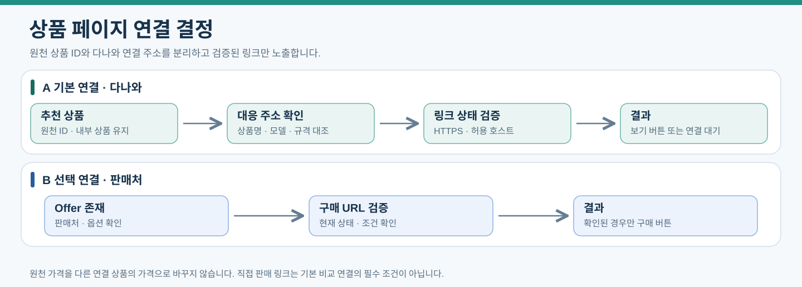

# 상품 추천과 다나와 연결

광고 서버는 준비된 카탈로그에서 유사 상품을 추천하고 사용자가 선택한 상품을 다나와로 연결한다. 이번 서비스 상품의 출처는 다나와이며, 원천 상품번호와 추천 후 이동할 개별 상품 URL은 별도로 관리한다.

[아키텍처](00-architecture.md) · [광고 서버](07-ad-server.md) · [필드](data-dictionary/08-product-links.md)

2026-10-15부터 [직접 추천 계약](12-direct-recommendation.md)을 따른다. 생성 이미지 없이 실제 상품을 추천하며 scikit-learn 모델이 실제 추천 순위를 정하고 링크의 상품 대응·허용 호스트·소유권 검증은 코드가 유지한다. 아래 링크 검증·상품 원천 계약은 유지한다.

## 연결 원칙

| 구분 | 의미 |
|---|---|
| 원천 출처·상품번호 | 확보한 상품정보의 실제 출처와 식별자. source_code·source_product_id에 보존 |
| 내부 상품 | products.id와 안정 product_key로 관리하는 추천 후보 |
| 다나와 연결 | 해당 원천 상품번호와 대응을 확인한 comparison_url. 상품번호와 URL은 별개 |
| 판매 항목 | 확인된 판매처·상품/옵션·가격 조건이 있을 때 offers로 관리 |
| 추천 결과 | 이미지·품목·유사도·연결 가능 여부. 미확인 가격·규격은 미제공 표시 |

이번 서비스 상품은 다나와에서 확보하므로 source_code=danawa와 확인한 다나와 source_product_id를 사용한다. pcode를 확인한 상품에만 해당 식별자를 기록하며 URL에서 임의로 만들지 않는다. 원천 상품 식별자와 개별 상품 페이지 URL은 서로 다른 필드다.

## 사용자 이동

1. Application이 고정 입력 버전의 해석·검증된 추천 맥락을 광고 서버에 전달한다. 생성물 선택·크롭은 요구하지 않는다.
2. 광고 서버가 품목·명시 조건·공간 스타일 관련성·근거 있는 규격 비교·현재 상품 상태로 후보와 scikit-learn 콘텐츠 유사도·가중합 순위를 결정한다. 추정/미확인을 조건 충족이나 실측으로 표시하지 않는다.
3. 화면에 유사 상품 카드와 확인된 다나와 연결 버튼을 표시한다.
4. 클릭 시 Application이 사용자와 추천 항목의 관계를 확인하고 광고 서버에 링크 결정을 요청한다.
5. 광고 서버가 추천 항목·상품·저장된 URL의 대응 관계와 현재 연결 상태를 확인한다.
6. Application이 클릭 이벤트를 기록하고 광고 서버가 승인한 주소로 이동 응답을 보낸다.

[PNG로 보기](assets/product-link-decision.png)

기본 버튼은 ‘다나와에서 보기’다. 다나와 상품 확인·가격비교 후 사용자가 판매처를 선택할 수 있다. 직접 판매 링크가 별도로 확인된 경우 ‘판매처에서 구매’ 버튼을 제공할 수 있으며 기본 연결의 필수 조건은 아니다.

특정 상품의 연결 주소를 확인하지 못하면 ‘연결 준비 중’으로 표시한다. 단순 검색 결과 주소를 특정 상품의 구매 페이지로 표시하지 않는다. 연결 상품이 변경되면 기존 클릭 주소를 조용히 대체하지 않고 새로운 추천 결과를 만든다.

## 상품과 링크의 검증

다나와 원천 상품 ID·상품명·이미지·규격·옵션과 개별 상품 페이지 URL의 대응을 확인한다. 벡터 유사성은 추천 후보의 근거이며 다른 상품의 정보를 연결 상품처럼 표시하지 않는다. LLM이 상품번호·가격·구매 URL을 만들어내도록 하지 않는다.

클라이언트는 URL 대신 recommendation_item_id·link_kind를 보낸다. 광고 서버는 저장된 관계에서 URL을 선택하고 HTTPS·허용 호스트·현재 상품 상태를 검증한다. 임의 next 주소는 받지 않는다. 만료되거나 대응 관계가 깨진 주소는 연결 불가로 처리한다.

## 원천과 서비스 데이터 경계

원천 관측은 MongoDB raw_products에 불변 보존하고 정제 결과는 별도로 관리한다. record_type은 PRODUCT/OFFER, source_record_key는 제공처 안의 안정 키다. collection_run_id·source_record_key·응답 hash로 같은 실행의 중복을 방지한다. 다른 시점의 관측은 보존한다.

원천 저장 후 Kafka에 raw_document_id·실행 ID·hash를 전달한다. 발행 실패는 동일 원천 ID로 복구한다. 정확한 원본 응답이 필요하면 파일과 response_body_hash를 보존하고 추출 payload_hash와 구분한다.

Gold는 상품·확인된 판매 정보를 MySQL에 발행한다. product_key는 다나와와 안정 상품 식별자에 기반한다. 이번 서비스는 다른 원천 상품과의 동일성 매칭을 수행하지 않는다. offer_key에는 안정 판매처·판매 항목·옵션 식별자를 사용하며 배열 위치나 현재 가격을 키로 쓰지 않는다.

products.comparison_url은 확인된 연결 주소이며 필수 원천 주소가 아니다. 추천 당시 주소·링크 종류·확인 시각은 recommendation_items.link_snapshot_json에 고정하고 스키마 버전으로 구조를 검증한다. 직접 판매 조건은 offer_snapshots에 별도로 고정한다.

## 다나와 상품 이미지와 템플릿 자료

파일은 checksum으로 재사용하고 product_images에는 상품별 출처·원천 버전·asset 연결을 남긴다. 같은 이미지가 여러 상품에 연결될 수 있으며 파일 공유가 상품 동일성을 뜻하지 않는다. 저장·표시·분석·외부 전송의 이용 범위는 구분한다.

다나와 상품 이미지는 검증한 바이트를 내부 이미지 저장소에 보존하고 source_url·asset·상품·원천 버전·checksum을 연결한다. 승인된 활성 상품 이미지의 임베딩만 서비스 추천 인덱스에 등록한다. 기존 도매꾹 이미지는 [템플릿 자료](10-domeggook-reuse.md)로만 사용하며 서비스 상품 이미지와 혼합하지 않는다.

## 가격과 이벤트

가격은 확인된 일반가격과 조건부 혜택가격을 구분하고 조회 시각을 표시한다. 배송·설치·옵션 조건이 다르면 동일 조건의 최저가로 비교하지 않는다. 미확인 가격·재고는 NULL/UNKNOWN이다. 클릭 시 현재 조건은 이동한 페이지에서 확인한다.

다나와 이동은 COMPARISON_LINK_CLICKED, 검증된 직접 판매 페이지 이동은 PURCHASE_LINK_CLICKED로 기록한다. 둘 다 구매 완료를 뜻하지 않는다. 광고 서버의 링크 결정 실패는 클릭 성공에 포함하지 않고, 광고 서버의 응답만으로 실제 화면 노출을 집계하지 않는다.

## 완료 기준

템플릿 생성 → 물체 선택 → 광고 서버 추천 → 다나와의 대응 상품 확인까지 이어지는 사례를 검증한다. 동일 파일/다른 상품, 원천 ID/연결 ID 차이, 링크 미확정·만료, 가격 미제공, 중복 요청, 광고 서버 장애를 함께 검수한다.
