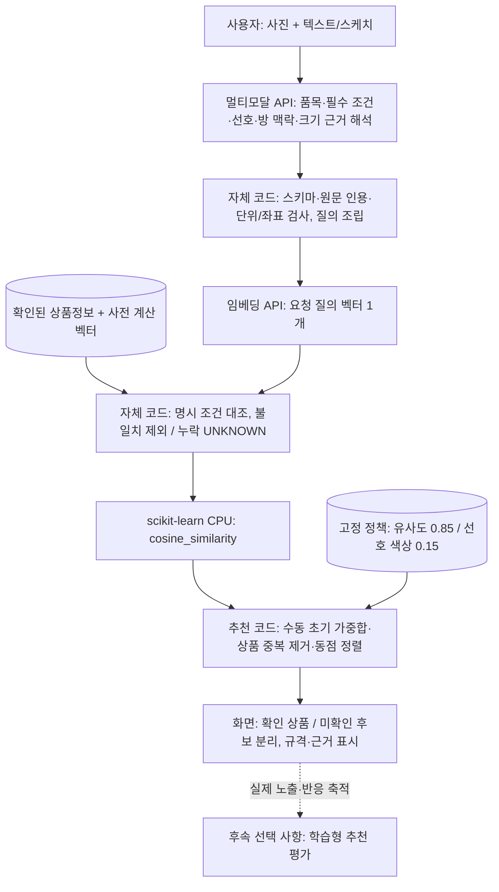
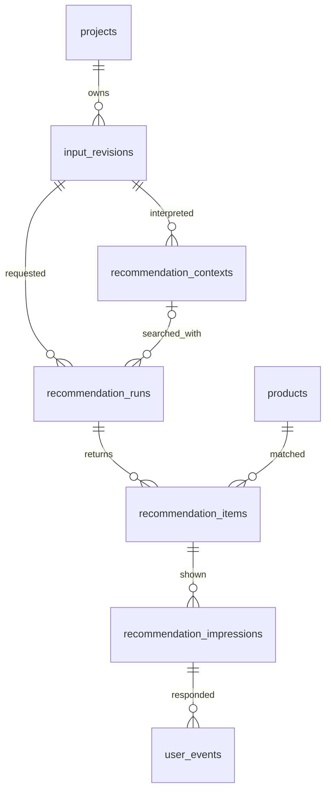

# 이미지 생성 없는 공간 맞춤 상품 추천

2026-10-15 결정, 설계 버전 `direct-recommendation-v3`. 초기 라벨 없는 추천으로 변경했으며 로컬 웹 MVP 구현 범위와 서비스 설계를 구분한다. DB/메시지 마이그레이션·운영 배포 완료 기록이 아니다.

[문서 안내](../README.md) · [BRD](../BRD_3차.md) · [PRD](../PRD_3차_초안.md) · [아키텍처](00-architecture.md)

## 변경 범위와 우선순위

2026-10-16 로컬 MVP 정책 예외: 사용자 요청에 따라 기본 구현은 `weighted-content-v2`로 재질을 검색 참고로 완화한다. 재질 원문을 질의 임베딩에 보존하고, 상품 재질 결측·불일치만으로 제외하거나 UNKNOWN 목록으로 분리하지 않는다. 다른 필수 조건과 색상 가중치는 유지한다. 아래 v1은 이전 정책이며 기존 run의 고정 계약으로만 유지한다. 이 변경은 운영 DB·서비스 API 배포 완료를 뜻하지 않는다. [구현 규칙](../interior-recommender/roles/domain.md)을 따른다.

사진·텍스트·스케치에서 원하는 가구와 공간 맥락을 해석해 실제 상품을 직접 추천한다. 템플릿 선택·공간 이미지 생성·생성 물체 선택/크롭·원본/결과 비교·생성 주석 검사·생성물 크기 검사는 신규 서비스 흐름에서 제외한다. 사진의 기존 가구를 인식하는 것은 공간 분석이며 생성물 검출과 다르다. 입력은 방 사진과 텍스트 또는 스케치이며 별도 품목 선택·실측·영역 지정 절차를 신규 필수로 추가하지 않는다.

현행 요구사항은 BRD·PRD, 단계·AI/코드 책임·논리 데이터 변경은 이 문서를 기준으로 한다. 다른 문서의 ‘이전 설계’ 접힘 영역과 기존 SVG/PNG는 생성 중심 이력이다. 공통 원천 보존·DB·상품·링크·이벤트 계약은 새 흐름과 충돌하지 않는 범위에서 유지한다. 기존 생성 데이터·파일·코드를 삭제하거나 현재 DB에 신규 컬럼이 존재한다고 가정하지 않는다.

## 담당별 추천 흐름

공간·요구사항·크기 분석은 논리 역할 구분이다. 반드시 세 API 호출로 나누지 않고 한 구조화 응답으로 받을 수 있다. 정확도·입력 한도에 따라 단계 분리 여부를 평가한다. 상품 임베딩은 카탈로그 준비/갱신 때 계산하고 매 요청 전체 상품을 다시 임베딩하지 않는다.

| 담당 | 수행 | 수행하지 않음 |
|---|---|---|
| 멀티모달 API | 사진의 색상·재질·공간 관계, 요청 품목·조건·스케치 역할, 배치/크기 추정과 근거·불확실성 해석 | 상품 가격·실측 규격·URL 확정, 설치 가능성 보증 |
| 임베딩 API | 승인된 상품 이미지 및 검색 입력을 호환 벡터로 변환 | 최종 순위·실측 적합성 결정 |
| Application 코드 | 보존·권한·응답 형식/좌표/수치 일관성 검사, 참조 검증·크기 사용 정책·표시 | AI 해석의 시각적 사실 여부를 규칙만으로 재판단 |
| 광고 서버 코드 | 질의 조립·현재 상품 검증·가중합·동점 처리·링크. FAISS는 서비스 확장안 | 필수 조건을 점수만으로 무시하거나 상품 정보 생성 |
| scikit-learn | CPU cosine_similarity로 콘텐츠 유사도 계산. 추천 코드가 고정 가중합으로 실제 순위 결정 | 이미지/스케치 의미 해석·임베딩 생성·설치 가능성 보증 |

## 입력 해석과 자체 코드의 경계

응답의 논리 구획은 `requirements`, `room_context`, `placement`, `size_estimate`다. 이는 새 API/DB를 실제 구현한 필드가 아니라 후속 구현 계약이다. 각 요구조건에 `source`와 입력 인용/영역 참조를 연결하고 미지정 값을 null로 둔다.

| 구획 | 의미와 처리 |
|---|---|
| requirements | 사용자가 요구한 품목·색상·재질·형태·예산·명시 치수·추가 의미 구절. 부정 조건과 누락을 구분한다. |
| room_context | 방에서 관찰한 색상·재질·스타일과 불확실성. 방의 갈색을 ‘갈색 상품만’이라는 필수 조건으로 바꾸지 않는다. |
| placement | 원본 기준 0~1 배치 영역 또는 null, 배치 문장, 배치 표시/상세 형상 구분. 자유 스케치 전체 외곽을 영역으로 단정하지 않는다. |
| size_estimate | 기준 종류·출처·원근/깊이 가정, 축별 범위/단위 또는 null, 불확실성. 사진상 비율과 실제 mm를 별도 저장한다. |

코드는 지원 품목·허용 enum·필수값·좌표의 `0≤min<max≤1`·양수 범위·하한≤상한·단위·참조 존재를 검사한다. 검증 통과는 사진 해석이 사실이라는 뜻이 아니다. 사용자 입력/확인 데이터에 없는 실측값을 AI 자기보고만으로 검증된 값으로 승격하지 않는다. 미지원 속성은 검색으로 몰래 버리지 말고 미확인/미적용 조건으로 표시한다.

## 크기 근거와 사용 정책

| basis | 의미 | 코드 정책 |
|---|---|---|
| VERIFIED_DIMENSION | 저장된 입력 또는 확인된 기준 치수의 참조가 실제로 존재 | 원근/배치 대응·축/단위·오차가 지원되는 축만 범위 비교. 참조가 없으면 미확인으로 하향 |
| TYPICAL_OBJECT_SIZE | 주변 물체의 통상 치수를 가정 | 낮은 근거로 표시. 실제 mm 범위는 추정이며 크기 점수의 약한 참고만 허용 |
| RELATIVE_ONLY | 화면상 비례/점유 관계만 확인 | 상대적 비례 참고, 실제 규격 적합성은 UNKNOWN |
| NONE | 공간 치수 근거 부족 | 크기 필수 필터 미적용, 추천은 제공하되 적합성 UNKNOWN |

확인된 실제 치수 기준이 있어도 카메라·깊이·가림의 정확성을 보증하지 않는다. 폭 근거로 깊이나 높이를 확정하지 않고 지지되지 않는 축은 null로 둔다. AI confidence는 확률/실측 검증을 대신하지 않는다. 기준이 없는 요청에 추가 실측을 강제하지 않고 추천을 계속한다. 스케치의 네모·면적을 실제 치수로 취급하지 않는다.

사용자가 명시한 필수 치수 조건과 AI 공간 추정은 다르다. 확인된 상품 규격으로 명시 조건을 대조하되 상품 규격 누락은 불일치가 아닌 UNKNOWN이다. 필수 조건의 미확인 후보는 충족 목록에 섞지 않고 미확인 결과로 분리하거나 충족 후보 부족으로 안내한다. 낮은 근거의 공간 추정만으로 상품을 강제 제외하지 않는다. 어떤 경우에도 제품 설치 가능·충돌 없음·통행 확보를 보증하지 않는다.

## 검색과 운영 순위

1. 품목·명시 필수 조건을 상품 원장과 대조한다. EQ/NE 속성, LE 예산·축별 mm 상한을 지원하며, 부정 조건을 선호로 바꾸지 않는다. 미지원 조건은 표시하고 충족으로 주장하지 않는다.
2. 해석된 품목·search_terms·분리된 room_context로 텍스트 질의를 조립해 외부 임베딩 API를 호출한다. 배치용 선·방 전체 사진을 상품 형상으로 임베딩하지 않는다. 상품 벡터는 사전 준비한다.
3. scikit-learn cosine_similarity는 질의 하나와 상품 벡터를 비교한다. 로컬 구현은 2,048행 청크로 계산하며 NxN 전체 상품 유사도 행렬을 만들지 않는다. 이미 확인된 불일치 후보의 점수는 반환 순위에 사용하지 않는다.
4. 수동 가중합으로 최종 점수를 계산한다. 선호 색상이 있으면 similarity 0.85와 color-match 0.15, 선호가 없으면 similarity 1.0이다. 결측 색상을 가진 상품만 가중치를 재정규화하지 않는다. 색상 일치가 인테리어 조화 보증은 아니다.
5. 필수 조건 충족 후보와 UNKNOWN 후보는 각각 상위 6개를 반환한다. 같은 상품의 여러 이미지는 최고 점수 하나로 합치며 점수 내림차순→유사도 내림차순→product_id→image_id 오름차순으로 동점을 처리한다. 불일치 후보는 높은 유사도로 복귀하지 않는다.
6. 점수 기여분·조건별 MATCH/DIFFERENT/UNKNOWN·규격/출처·미적용 조건을 표시한다. 상품 가격·규격·URL은 AI가 생성하지 않는다. 링크 검증 통합 전 로컬 MVP는 구매 링크를 제공하지 않는다.

전체 6만 이미지에 사람이 정답을 붙일 필요는 없다. 추천 품질은 별도 요청 표본으로 평가하며 초기 가중치는 검증된 최적값이 아니다. 서비스 확장 시 FAISS로 후보를 줄일 수 있으나 Recall@K 손실과 가중합 최종 품질을 따로 평가한다. 현재 로컬 구현은 FAISS를 사용하지 않는다.

## 이번 scikit-learn과 후속 내재화

초기 추천은 라벨 없이 scikit-learn `cosine_similarity`와 수동 초기 가중치로 수행한다. `weighted-content-v1`은 선호 색상이 있으면 `0.85 × 유사도 + 0.15 × 색상 일치`, 없으면 유사도만 사용한다. 필수 조건 불일치는 제외하고 결측·미지원 필수 조건은 UNKNOWN 목록으로 분리한다. 가중치는 학습값이 아니며 점수는 확률이 아니다. 사람의 6만 이미지 전수 적합/부적합 라벨링·LogisticRegression 학습·직렬화 모델 파일은 초기 실행 조건이 아니다. 반응 자료를 충분히 확보한 뒤 지도학습을 별도 평가한다.

사전 임베딩은 외부 학습 모델의 결과를 사용한다. scikit-learn 도입으로 입력 해석/임베딩 AI가 자체 모델로 바뀌는 것은 아니다. 이번 추천 로직은 CPU에서 직접 실행하지만 ‘자체 학습 모델 내재화 완료’라고 발표하지 않는다.

### 정책·인덱스 고정과 실패 처리

run 접수 시 context_version·ranking_policy 전체 값·index_version·임베딩 모델/차원/전처리를 고정한다. 재시도는 같은 정책과 인덱스를 사용한다. 다른 인덱스로 바꿔 재시도하지 않으며 원본 스냅샷이 없으면 INDEX_NOT_READY, 순위 계산/결과 저장 오류는 RANKING_FAILED로 구분한다. 손상·비호환 자료를 결과 없음으로 숨기지 않는다.

상품 행·벡터 행 대응과 checksum·메타데이터 출처를 준비 단계에서 확인한다. 초기에는 pickle/joblib 모델을 로드하거나 fit하지 않는다. 대형 카탈로그는 float32 NPY mmap으로 재사용하고 반환 이미지의 불변 사본만 실행에 보존한다. 6만×768 float32의 원시 행렬은 약 176MiB이며 실제 프로세스 RAM/시작 비용·CPU/API 지연은 별도 측정한다. JSON/메타데이터·기존 인덱스 로더의 추가 RAM도 포함한다.

| 시점 | 범위 |
|---|---|
| 이번 | 외부 멀티모달/임베딩 + 코드 검증 + scikit-learn 콘텐츠 유사도·수동 가중합 실제 추천 |
| 후속 추천 고도화 | 유효 노출·선택·명시적 거절·평가 표본이 쌓이면 가중치 조정/지도학습과 비교. 미노출·미클릭을 일괄 부적합으로 라벨링하지 않음 |
| 후속 임베딩 내재화 | CPU용 자체 모델을 품질·지연 평가 후 배포하고 전체 상품 벡터/인덱스를 버전 교체 |
| 후속 멀티모달 확장 | 의미·크기 근거 추론의 한국어/시각 품질·CPU 자원 검증 후 결정 |

로컬 구현은 `src/interior_recommender/recommendation.py`와 `src/interior_recommender/web/direct.py`다. `python -m interior_recommender.web` 기본 경로가 직접 추천이며 기존 Canvas의 `POST /api/runs`를 재사용한다. 해석 1회와 질의 임베딩 1회를 기본으로 하며 성공 receipt를 재사용한다. 별도 입력 절차·템플릿 선택·이미지 생성은 없다. 실제 DB·Kafka·Delta Bronze·광고 서버 HTTP·FAISS·상품 링크 검증 API 통합 및 운영 배포는 아직 미구현이다. 논리 서비스 계약을 로컬 파일 구현 완료와 혼동하지 않는다.

## 요청·작업·실패 계약

신규 `POST /api/projects/{id}/recommendations`는 고정 input_revision_id로 직접 추천 run을 접수한다. Application 소유자 검증 → 파일/입력/추천 run·보존 job 저장·커밋 → Bronze 확인 → 해석 → 코드 검증 → 광고 서버 검색 → 결과 저장 순서다. 신규 추천에 generation_run_id·scene_object_id·template_id·생성 크롭을 필수로 요구하지 않는다.

내부 검색 API의 v2 입력 후보는 request_id(추천 run UUID), input_revision_id, context_id, 입력 hash, 조건/맥락/크기 결과의 불변 참조·checksum, 결과 수 상한이다. 광고 서버는 승인 저장소의 참조와 해석/정책 버전을 검증하고 같은 request_id의 다른 입력을 거절한다. 현재 상품 검증·인덱스 버전·ranking_version·가중치 정책·라이브러리 버전·콘텐츠 추천 점수·결과를 응답하며 Application이 추천 이력을 쓴다. 임의 외부 URL이나 외부 텍스트 지시를 실행하지 않는다.

새 v2 메시지는 input_revision_id·recommendation_run_id·input_hash·schema_version·고정 참조를 사용한다. 기존 user.input.received / user.input.bronze.persisted / input.interpretation.requested는 v2 스키마를 정의한 뒤 전환한다. 생성 실행 필수 필드를 조용히 지우거나 기존 토픽에 비호환 본문을 혼합하지 않는다. 생성·생성물 분석·템플릿 임베딩 토픽은 신규 흐름에서 발행하지 않는다.

같은 event_id·본문은 기존 run으로 응답하고 다른 본문은 거절한다. 입력 변경은 새 input_revision, 명시적 재추천은 새 run, 같은 실패의 재시도는 기존 run/입력/정책을 유지한다. 코드 검증·저장 실패는 저장된 AI 원응답으로 복구하고 성공한 임베딩을 재호출하지 않는다. Bronze 미확인 상태에서는 해석을 시작하지 않는다. 형식 오류·모호한 품목·크기 미확인·후보 없음·시스템 장애를 구분한다. 크기 근거 부족만으로 전체 추천을 실패시키지 않는다. 늦은 이전 run이 최신 결과를 덮어쓰지 않는다.

## 논리 데이터와 ERD 변경안

다음은 후속 구현할 스키마 변경안이다. 기존 전체 ERD/필드 사전의 generation_run/scene_object 필수 관계는 신규 v2에 그대로 적용하지 않는다. 실제 ORM·DDL·마이그레이션은 별도 작업이다.

| 엔터티·필드 후보 | 저장 의미 |
|---|---|
| recommendation_contexts.id / input_revision_id | UUID PK와 입력 버전 FK. 입력 해석·코드 검증 결과를 버전별 불변 맥락으로 보존 |
| recommendation_contexts.analysis_refs_json | ai_analysis_runs 참조·모델/프롬프트/스키마·원응답/출력 checksum |
| recommendation_contexts.requirements_json / room_context_json / placement_json / size_estimate_json | 명시 요구·방 관찰·배치·크기 근거를 분리. 원문과 실제 상품 규격을 덮어쓰지 않음 |
| recommendation_contexts.validation_json / policy_version | 오류·참조 대조·축별 크기 사용 정책 및 검증 코드 버전 |
| recommendation_runs.input_revision_id / context_id | 신규 직접 추천 입력과 확정 맥락 FK. 접수 중 context_id는 null 가능하나 SEARCHING 전에는 확정 맥락 필수. 기존 scene_object/generation 연결은 이력에만 보존 |
| recommendation_runs.schema_version / ranking_version / feature_schema_version / index_version_id | API v2 직접 추천·전체 순위 정책/동점·특징·검색 재현 정보 |
| recommendation_runs.ranking_policy_json | 수동 가중치 전체·미선호/결측 처리·MANUAL_INITIAL·라이브러리 버전. 학습 모델 참조는 후속 선택 필드 |
| recommendation_items.ranking_score / score_components_json | 수동 가중합 최종 점수와 유사도/선호 기여분. 학습 모델 예측·확률이 아님 |
| recommendation_runs.candidates_ref_json | 반환 상위 목록만이 아닌 평가 대상 후보·특징 스냅샷의 승인 저장소 참조·checksum |
| recommendation_items.feature_snapshot_json / match_explanation_json | 요청 당시 특징·결측·규격 비교 정책·코드 추천 이유. 이후 행동 라벨은 섞지 않음 |
| projects.latest_recommendation_run_id | 최신 입력 순번·완료 상태 대조 후 조건부 갱신. latest_generation_run_id를 신규 필수로 쓰지 않음 |
| offline_experiment manifest | 입력/후보/특징/라벨 데이터 버전·분할·모델·지표·CPU 자원 기록. 서비스 추천 원장을 수정하지 않음 |

기존 ai_analysis_runs·jobs/job_attempts·입력 자산·상품/벡터/인덱스·노출/행동·링크 스냅샷과 UUID 규칙은 유지한다. 신규 분석 유형은 INPUT_CONTEXT와 QUERY_EMBEDDING 등으로 정의하고 순수 코드 처리 시간을 과금 AI 호출로 기록하지 않는다. 외부 상품 임베딩은 기존 준비 경로를 유지한다. 규격 정제 시 단위·축·옵션/측정 대상이 확인된 값만 비교한다.

## 운영·보존·검증

Application은 외부 해석 API와 입력 검증, 광고 서버는 임베딩 API·CPU 검색·특징 계산·scikit-learn CPU 유사도/가중합 순위를 담당한다. 기존 DB/메시지/저장소 역할과 배치 후보는 유지하되 생성 제공처·템플릿 인덱스는 신규 운영 경로에서 제외한다. 초기에는 학습하지 않으며 유사도와 가중합 계산은 광고 서버 CPU의 제한된 실행 영역에서 수행한다. 후보 수·스레드·프로세스·모델 복제/메모리 상한은 실측 후 확정한다. 이번 단계에서 GPU/추론 서버 증설을 전제하지 않는다.

보관·외부 전송 승인을 학습 승인으로 확대하지 않는다. 사용자 입력의 오프라인 실험 이용 범위·접근·보관/삭제 정책을 별도로 확인하고 승인된 자료만 사용한다. 목적이 종료된 생성 데이터와 기존 MVP는 보존 정책에 따라 처리하며 이 문서만으로 삭제하지 않는다.

인수 검증은 입력 조합별 품목/조건·스케치 역할, 방 맥락의 필수조건 오인 방지, 형식 정상/의미 오류 구분, 거짓 실측 근거·축/단위 누락·규격 누락, 근거 약함에서도 추천 지속, 후보 Recall·가중합 순위/기여분 일치·유효 링크·인덱스 checksum/버전 불일치·재시도 정책 고정, Bronze/중복/단계 복구와 학습 누수·미노출 라벨 제외를 포함한다. 생성 API/생성 토픽/생성물 선택이 신규 추천에 호출·요구되지 않는지도 확인한다.

수십~수백 명의 이용자 수를 동시 AI 작업 수로 간주하지 않는다. 피크 요청률·대기·API 한도·검색/DB/네트워크를 포함한 전체 p50/p95·처리량·RAM을 측정한다. 이미지 생성 제거만으로 전체 p95 15초나 특정 동시 사용자를 보장하지 않는다. 단계별 p95의 합을 전체 p95로 사용하지 않는다.

## 로컬 MVP와 전체 서비스의 차이

로컬 context는 category_code/search_terms/required/preferred_color/room_context/placement/size_estimate로 구현한다. required는 사용자 텍스트의 정확한 source_quote와 양수 숫자·단위 환산을 검사한다. 원문 참조가 의미 해석의 정답을 보증하지 않는다. 지원하지 않는 조건은 unapplied_conditions와 UNKNOWN 목록으로 전달한다.

검증된 실측 참조 저장소가 아직 없으므로 로컬 API는 VERIFIED_DIMENSION을 받지 않는다. TYPICAL_OBJECT_SIZE/RELATIVE_ONLY/NONE만 보존하며 추정폭을 하드 필터나 초기 점수에 사용하지 않는다. 사용자 명시 규격 상한과 원장 규격 비교는 지원한다. 어떤 후보도 실제 공간 설치 적합으로 확정하지 않는다.

로컬 파일 API는 /api/runs와 context/query/ranking 단계다. 전체 서비스의 /api/projects/{id}/recommendations, Bronze 게이트, 데이터베이스 FK·이벤트·현재 링크 검증은 설계 계약으로 남아 있다. 이미지-only 다나와 인덱스는 상품 대응·품목 검증 전 미확인 이미지 후보일 뿐이다. 배치 export로 원장 메타데이터를 연결하며 사용자에게 별도 품목 선택/라벨링을 요구하지 않는다.
