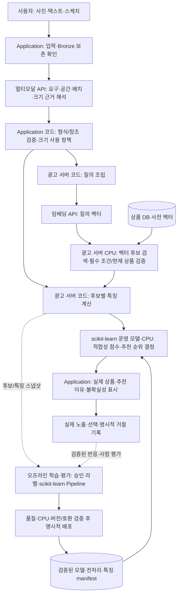
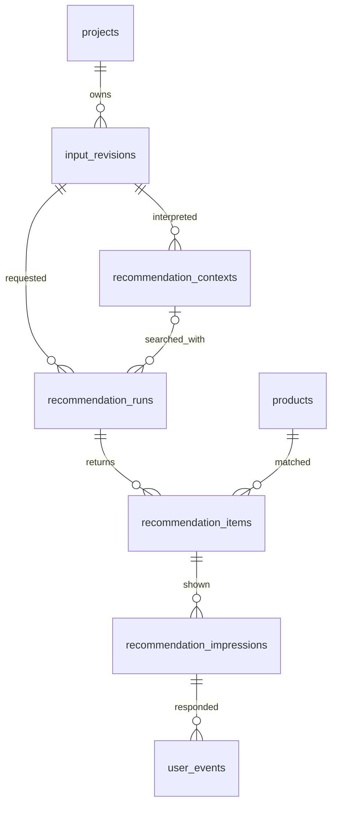

# 이미지 생성 없는 공간 맞춤 상품 추천

2026-10-15 결정, 설계 버전 `direct-recommendation-v2`. 이번 문서는 제품·기술 설계이며 구현·마이그레이션·모델 도입 완료 기록이 아니다. 기존 이미지 생성 MVP의 코드는 이번 문서 작업에서 변경하지 않는다.

[문서 안내](../README.md) · [BRD](../BRD_3차.md) · [PRD](../PRD_3차_초안.md) · [아키텍처](00-architecture.md)

## 변경 범위와 우선순위

사진·텍스트·스케치에서 원하는 가구와 공간 맥락을 해석해 실제 상품을 직접 추천한다. 템플릿 선택·공간 이미지 생성·생성 물체 선택/크롭·원본/결과 비교·생성 주석 검사·생성물 크기 검사는 신규 서비스 흐름에서 제외한다. 사진의 기존 가구를 인식하는 것은 공간 분석이며 생성물 검출과 다르다. 입력은 방 사진과 텍스트 또는 스케치이며 별도 품목 선택·실측·영역 지정 절차를 신규 필수로 추가하지 않는다.

현행 요구사항은 BRD·PRD, 단계·AI/코드 책임·논리 데이터 변경은 이 문서를 기준으로 한다. 다른 문서의 ‘이전 설계’ 접힘 영역과 기존 SVG/PNG는 생성 중심 이력이다. 공통 원천 보존·DB·상품·링크·이벤트 계약은 새 흐름과 충돌하지 않는 범위에서 유지한다. 기존 생성 데이터·파일·코드를 삭제하거나 현재 DB에 신규 컬럼이 존재한다고 가정하지 않는다.

## 담당별 추천 흐름

공간·요구사항·크기 분석은 논리 역할 구분이다. 반드시 세 API 호출로 나누지 않고 한 구조화 응답으로 받을 수 있다. 정확도·입력 한도에 따라 단계 분리 여부를 평가한다. 상품 임베딩은 카탈로그 준비/갱신 때 계산하고 매 요청 전체 상품을 다시 임베딩하지 않는다.

| 담당 | 수행 | 수행하지 않음 |
|---|---|---|
| 멀티모달 API | 사진의 색상·재질·공간 관계, 요청 품목·조건·스케치 역할, 배치/크기 추정과 근거·불확실성 해석 | 상품 가격·실측 규격·URL 확정, 설치 가능성 보증 |
| 임베딩 API | 승인된 상품 이미지 및 검색 입력을 호환 벡터로 변환 | 최종 순위·실측 적합성 결정 |
| Application 코드 | 보존·권한·응답 형식/좌표/수치 일관성 검사, 참조 검증·크기 사용 정책·표시 | AI 해석의 시각적 사실 여부를 규칙만으로 재판단 |
| 광고 서버 코드 | 질의 조립·FAISS·현재 상품 검증·특징 계산·모델 호출·동점 처리·링크 | 필수 조건을 모델 점수만으로 무시하거나 상품 정보 생성 |
| scikit-learn | 오프라인 학습한 Pipeline을 광고 서버 CPU에서 추론해 실제 후보 점수·최종 순위 결정 | 이미지/스케치 의미 해석·임베딩 생성·설치 가능성 보증 |

## 입력 해석과 자체 코드의 경계

응답의 논리 구획은 `requirements`, `room_context`, `placement`, `size_estimate`다. 이는 새 API/DB를 실제 구현한 필드가 아니라 후속 구현 계약이다. 각 요구조건에 `source`와 입력 인용/영역 참조를 연결하고 미지정 값을 null로 둔다.

| 구획 | 의미와 처리 |
|---|---|
| requirements | 사용자가 요구한 품목·색상·재질·형태·예산·명시 치수·추가 의미 구절. 부정 조건과 누락을 구분한다. |
| room_context | 방에서 관찰한 색상·재질·스타일과 불확실성. 방의 갈색을 ‘갈색 상품만’이라는 필수 조건으로 바꾸지 않는다. |
| placement | 원본 기준 0~1 배치 영역 또는 null, 배치 문장, 배치 표시/상세 형상 구분. 자유 스케치 전체 외곽을 영역으로 단정하지 않는다. |
| size_estimate | 기준 종류·출처·원근/깊이 가정, 축별 범위/단위 또는 null, 불확실성. 사진상 비율과 실제 mm를 별도 저장한다. |

코드는 지원 품목·허용 enum·필수값·좌표의 `0≤min<max≤1`·양수 범위·하한≤상한·단위·참조 존재를 검사한다. 검증 통과는 사진 해석이 사실이라는 뜻이 아니다. 사용자 입력/확인 데이터에 없는 실측값을 AI 자기보고만으로 검증된 값으로 승격하지 않는다. 미지원 속성은 검색으로 몰래 버리지 말고 미확인/미적용 조건으로 표시한다.

## 크기 근거와 사용 정책

| basis | 의미 | 코드 정책 |
|---|---|---|
| VERIFIED_DIMENSION | 저장된 입력 또는 확인된 기준 치수의 참조가 실제로 존재 | 원근/배치 대응·축/단위·오차가 지원되는 축만 범위 비교. 참조가 없으면 미확인으로 하향 |
| TYPICAL_OBJECT_SIZE | 주변 물체의 통상 치수를 가정 | 낮은 근거로 표시. 실제 mm 범위는 추정이며 크기 점수의 약한 참고만 허용 |
| RELATIVE_ONLY | 화면상 비례/점유 관계만 확인 | 상대적 비례 참고, 실제 규격 적합성은 UNKNOWN |
| NONE | 공간 치수 근거 부족 | 크기 필수 필터 미적용, 추천은 제공하되 적합성 UNKNOWN |

확인된 실제 치수 기준이 있어도 카메라·깊이·가림의 정확성을 보증하지 않는다. 폭 근거로 깊이나 높이를 확정하지 않고 지지되지 않는 축은 null로 둔다. AI confidence는 확률/실측 검증을 대신하지 않는다. 기준이 없는 요청에 추가 실측을 강제하지 않고 추천을 계속한다. 스케치의 네모·면적을 실제 치수로 취급하지 않는다.

사용자가 명시한 필수 치수 조건과 AI 공간 추정은 다르다. 확인된 상품 규격으로 명시 조건을 대조하되 상품 규격 누락은 불일치가 아닌 UNKNOWN이다. 필수 조건의 미확인 후보는 충족 목록에 섞지 않고 미확인 결과로 분리하거나 충족 후보 부족으로 안내한다. 낮은 근거의 공간 추정만으로 상품을 강제 제외하지 않는다. 어떤 경우에도 제품 설치 가능·충돌 없음·통행 확보를 보증하지 않는다.

## 검색과 운영 순위

1. 품목·승인·현재 상품/이미지 연결·지원 범위를 코드로 확인한다. 검증된 사용자 필수 조건을 적용하고 누락/미지원 값을 구분한다.
2. 코드가 해석된 요구조건과 추가 의미 구절로 질의를 조립한다. 공간 스타일은 명시 요구와 별도 맥락이다. 방 사진 전체나 배치용 선을 원하는 상품 형태로 임베딩하지 않는다.
3. 현행 기본 경로는 해석된 텍스트 질의와 상품 이미지 벡터의 호환 검색이다. 방 맥락을 포함한 질의의 가중·분리 검색은 ranking_version에 고정하고 실제 자료로 평가한다. 상세 스케치 직접 임베딩은 호환성·품질 확인 전 기본 필수 경로로 넣지 않는다.
4. 상위 후보의 상품 UUID·품목·가격/규격 시점·이용 조건·링크를 검증하고 중복 상품을 정리한다. 품목 근거가 없는 시험 카탈로그는 품목 충족 서비스로 표시하지 않는다.
5. 조건 적합성·스타일 관련 특징·지원된 규격 비교·결측 지표를 학습된 scikit-learn Pipeline에 입력해 적합성 점수를 얻고 내림차순 정렬한다. 같은 모델 점수는 검색 유사도 내림차순·상품 UUID 오름차순으로 고정한다. 필수 조건 검증은 모델 앞에서 수행하고 모델 점수로 부적합/미확인을 충족으로 승격하지 않는다. 단순 색상 일치만으로 조화를 보증하지 않는다.
6. 추천 이유는 확인된 조건·크기 근거에서 코드로 조립하고 모델 출력 점수/버전과 구분한다. 모델별 설명 기법을 구현·검증하기 전에는 특정 조건이 순위를 올렸다고 인과적으로 단정하지 않는다. 조건별 MATCH/DIFFERENT/UNKNOWN과 크기 근거를 표시한다. 유사도나 점수를 정확도 백분율로 표시하지 않는다.

후보 검색의 Recall@K와 재정렬의 NDCG@K는 별도로 평가한다. 후보에 없는 상품을 scikit-learn 재정렬이 복구하는 것으로 설명하지 않는다. 가격·재고·URL은 상품 원장만 사용하고 링크 시점에 재검증한다.

## 이번 scikit-learn과 후속 내재화

이번 프로젝트의 실제 추천은 scikit-learn이 결정한다. 벡터 검색은 후보 확보, 자체 코드는 필수 조건 검증·특징 계산, scikit-learn은 후보 점수와 순위다. 오프라인 학습/평가는 배포를 준비하는 경로이며 운영에서 모델을 사용하지 않는다는 뜻이 아니다. 기존 ‘오프라인 전용·규칙 운영·후속에 최초 배포’ 결정은 이 버전에서 폐기한다. 코드·의존성·학습·배포 완료를 문서 수정만으로 주장하지 않는다.

첫 모델 후보는 전처리와 LogisticRegression을 묶은 scikit-learn Pipeline이다. 사람의 요청–후보 적합/부적합 라벨로 학습하고 후보 점수로 재정렬한다. 이는 전용 pairwise/listwise ranker가 아닌 분류 점수 기반 재정렬이며 NDCG@K 등 요청별 순위 지표로 평가한다. 의미가 검증된 사용자 반응은 이후 라벨로 추가한다. 품질/CPU 검증에 따라 다른 scikit-learn 모델을 선택할 수 있다.

입력 특징은 검색 유사도·품목/명시 속성 일치·검증된 방식으로 산출한 스타일 관련 특징·지원된 규격 비교·각 결측 여부다. 계산 기준이 없는 조화 점수를 임의 생성하지 않는다. 근거가 약한 크기는 사용 정책에 따라 마스킹/UNKNOWN으로 표현하며 모델이 추정만으로 크기를 확정하지 못하게 한다. 학습/추론은 같은 특징 이름·순서·타입·전처리·정책 버전을 사용한다.

정답은 사람의 관련성 평가 또는 연결 검증된 실제 노출·선택·명시적 거절로 만든다. 미노출/미클릭을 일괄 부적합으로 취급하지 않는다. 선택/거절은 라벨 후보이며 절대 정답이 아니다. 규칙 점수·임의 라벨만으로 학습한 모델을 검증된 추천으로 표시하지 않는다. 유효 라벨/학습 클래스·표본·품질이 부족하면 학습/출시 준비 미완료로 기록한다.

요청 당시 후보·특징·노출 순서·상품/입력/정책/인덱스 버전을 고정하고 행동은 별도 라벨로 연결한다. 미래 상품/반응을 특징에 넣지 않는다. 동일 입력/상품 변형의 누수·위치 편향·반복 노출을 고려해 시간/그룹 분리하고 전처리도 학습 분할에서만 fit한다. 기존 유사도/규칙 순위는 비교 기준이며 기본 운영 추천기는 아니다.

### 모델 배포와 미준비 처리

모델 manifest에는 artifact ID/버전·checksum·학습 데이터/라벨/분할·특징/정책/전처리 버전·Python/scikit-learn 등 실행 버전·지표·CPU 시간/RAM을 남긴다. 신뢰한 배포 경로의 검증된 artifact만 로드하며 외부 업로드 직렬화 모델을 실행하지 않는다. 모델 파일과 전처리를 함께 검증하고 활성화한다.

광고 서버의 제한된 모델 실행 프로세스가 CPU Pipeline을 재사용한다. 매 요청 학습/fit·파일 재로드·모델 다운로드를 하지 않고 여러 웹 워커의 무제한 복제와 과도한 내부 스레드를 피한다. 요청은 모델/특징/인덱스/정책 버전을 고정하고 같은 run 재시도는 해당 모델을 사용한다. 교체 실패 시 기존 검증된 활성 모델을 유지한다. 고정 모델이 없거나 손상/비호환/추론 오류면 MODEL_NOT_READY 또는 RANKING_FAILED로 구분하고 원본·맥락·후보를 보존한다. 모델 부재를 결과 없음으로 숨기거나 규칙 결과를 모델 추천인 것처럼 반환하지 않는다.

| 시점 | 범위 |
|---|---|
| 이번 | 외부 멀티모달/임베딩 + 자체 검증/검색 + scikit-learn CPU 운영 추천. 학습·평가·버전 배포 포함 |
| 후속 추천 고도화 | 실제 이용 데이터 확대·도메인 특징/모델 개선·재학습/운영 평가 고도화 |
| 후속 임베딩 내재화 | 자체 모델 CPU 배포 및 상품 벡터/인덱스 전체 버전 교체 |
| 후속 멀티모달 확장 | 자체 입력 해석·크기 근거 추론, 한국어/시각 품질·CPU 검증 후 결정 |

이번 범위는 ‘scikit-learn 추천 기능 도입’으로 설명하고 후속 프로젝트의 데이터·모델·운영 고도화 및 추가 내재화와 구분한다. 라이브러리 도입만으로 전체 AI 내재화 완료를 주장하지 않는다. 이미지 생성은 제외한다.

## 요청·작업·실패 계약

신규 `POST /api/projects/{id}/recommendations`는 고정 input_revision_id로 직접 추천 run을 접수한다. Application 소유자 검증 → 파일/입력/추천 run·보존 job 저장·커밋 → Bronze 확인 → 해석 → 코드 검증 → 광고 서버 검색 → 결과 저장 순서다. 신규 추천에 generation_run_id·scene_object_id·template_id·생성 크롭을 필수로 요구하지 않는다.

내부 검색 API의 v2 입력 후보는 request_id(추천 run UUID), input_revision_id, context_id, 입력 hash, 조건/맥락/크기 결과의 불변 참조·checksum, 결과 수 상한이다. 광고 서버는 승인 저장소의 참조와 해석/정책 버전을 검증하고 같은 request_id의 다른 입력을 거절한다. 현재 상품 검증·인덱스 버전·ranking_version·추천 모델 버전·특징 버전·모델 점수·결과를 응답하며 Application이 추천 이력을 쓴다. 임의 외부 URL이나 외부 텍스트 지시를 실행하지 않는다.

새 v2 메시지는 input_revision_id·recommendation_run_id·input_hash·schema_version·고정 참조를 사용한다. 기존 user.input.received / user.input.bronze.persisted / input.interpretation.requested는 v2 스키마를 정의한 뒤 전환한다. 생성 실행 필수 필드를 조용히 지우거나 기존 토픽에 비호환 본문을 혼합하지 않는다. 생성·생성물 분석·템플릿 임베딩 토픽은 신규 흐름에서 발행하지 않는다.

같은 event_id·본문은 기존 run으로 응답하고 다른 본문은 거절한다. 입력 변경은 새 input_revision, 명시적 재추천은 새 run, 같은 실패의 재시도는 기존 run/입력/정책을 유지한다. 코드 검증·저장 실패는 저장된 AI 원응답으로 복구하고 성공한 임베딩을 재호출하지 않는다. Bronze 미확인 상태에서는 해석을 시작하지 않는다. 형식 오류·모호한 품목·크기 미확인·후보 없음·시스템 장애를 구분한다. 크기 근거 부족만으로 전체 추천을 실패시키지 않는다. 늦은 이전 run이 최신 결과를 덮어쓰지 않는다.

## 논리 데이터와 ERD 변경안

다음은 후속 구현할 스키마 변경안이다. 기존 전체 ERD/필드 사전의 generation_run/scene_object 필수 관계는 신규 v2에 그대로 적용하지 않는다. 실제 ORM·DDL·마이그레이션은 별도 작업이다.

| 엔터티·필드 후보 | 저장 의미 |
|---|---|
| recommendation_contexts.id / input_revision_id | UUID PK와 입력 버전 FK. 입력 해석·코드 검증 결과를 버전별 불변 맥락으로 보존 |
| recommendation_contexts.analysis_refs_json | ai_analysis_runs 참조·모델/프롬프트/스키마·원응답/출력 checksum |
| recommendation_contexts.requirements_json / room_context_json / placement_json / size_estimate_json | 명시 요구·방 관찰·배치·크기 근거를 분리. 원문과 실제 상품 규격을 덮어쓰지 않음 |
| recommendation_contexts.validation_json / policy_version | 오류·참조 대조·축별 크기 사용 정책 및 검증 코드 버전 |
| recommendation_runs.input_revision_id / context_id | 신규 직접 추천 입력과 확정 맥락 FK. 접수 중 context_id는 null 가능하나 SEARCHING 전에는 확정 맥락 필수. 기존 scene_object/generation 연결은 이력에만 보존 |
| recommendation_runs.schema_version / ranking_version / feature_schema_version / index_version_id | API v2 직접 추천·전체 순위 정책/동점·특징·검색 재현 정보 |
| recommendation_runs.ranking_model_ref_json | 요청에 고정한 운영 모델 ID/버전·checksum·전처리/실행 버전. 실제 FK/아티팩트 저장 방식은 구현 때 확정 |
| recommendation_items.model_score | 운영 scikit-learn 출력 점수. 유사도·정확도·설치 가능 확률과 별도이며 보정 검증 없이 확률로 표시하지 않음 |
| recommendation_runs.candidates_ref_json | 반환 상위 목록만이 아닌 평가 대상 후보·특징 스냅샷의 승인 저장소 참조·checksum |
| recommendation_items.feature_snapshot_json / match_explanation_json | 요청 당시 특징·결측·규격 비교 정책·코드 추천 이유. 이후 행동 라벨은 섞지 않음 |
| projects.latest_recommendation_run_id | 최신 입력 순번·완료 상태 대조 후 조건부 갱신. latest_generation_run_id를 신규 필수로 쓰지 않음 |
| offline_experiment manifest | 입력/후보/특징/라벨 데이터 버전·분할·모델·지표·CPU 자원 기록. 서비스 추천 원장을 수정하지 않음 |

기존 ai_analysis_runs·jobs/job_attempts·입력 자산·상품/벡터/인덱스·노출/행동·링크 스냅샷과 UUID 규칙은 유지한다. 신규 분석 유형은 INPUT_CONTEXT와 QUERY_EMBEDDING 등으로 정의하고 순수 코드 처리 시간을 과금 AI 호출로 기록하지 않는다. 외부 상품 임베딩은 기존 준비 경로를 유지한다. 규격 정제 시 단위·축·옵션/측정 대상이 확인된 값만 비교한다.

## 운영·보존·검증

Application은 외부 해석 API와 입력 검증, 광고 서버는 임베딩 API·CPU 검색·특징 계산·scikit-learn CPU 추론/순위를 담당한다. 기존 DB/메시지/저장소 역할과 배치 후보는 유지하되 생성 제공처·템플릿 인덱스는 신규 운영 경로에서 제외한다. scikit-learn 학습은 요청과 분리된 CPU 배치, 추론은 광고 서버의 제한된 실행 영역에서 수행한다. 후보 수·스레드·프로세스·모델 복제/메모리 상한은 실측 후 확정한다. 이번 단계에서 GPU/추론 서버 증설을 전제하지 않는다.

보관·외부 전송 승인을 학습 승인으로 확대하지 않는다. 사용자 입력의 오프라인 실험 이용 범위·접근·보관/삭제 정책을 별도로 확인하고 승인된 자료만 사용한다. 목적이 종료된 생성 데이터와 기존 MVP는 보존 정책에 따라 처리하며 이 문서만으로 삭제하지 않는다.

인수 검증은 입력 조합별 품목/조건·스케치 역할, 방 맥락의 필수조건 오인 방지, 형식 정상/의미 오류 구분, 거짓 실측 근거·축/단위 누락·규격 누락, 근거 약함에서도 추천 지속, 후보 Recall·모델 기반 운영 순위·설명 일치·유효 링크·모델 로딩/버전 불일치/교체 실패·재시도 버전 고정, Bronze/중복/단계 복구와 학습 누수·미노출 라벨 제외를 포함한다. 생성 API/생성 토픽/생성물 선택이 신규 추천에 호출·요구되지 않는지도 확인한다.

수십~수백 명의 이용자 수를 동시 AI 작업 수로 간주하지 않는다. 피크 요청률·대기·API 한도·검색/DB/네트워크를 포함한 전체 p50/p95·처리량·RAM을 측정한다. 이미지 생성 제거만으로 전체 p95 15초나 특정 동시 사용자를 보장하지 않는다. 단계별 p95의 합을 전체 p95로 사용하지 않는다.
