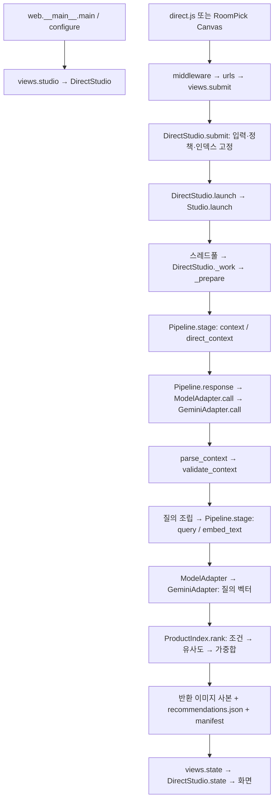
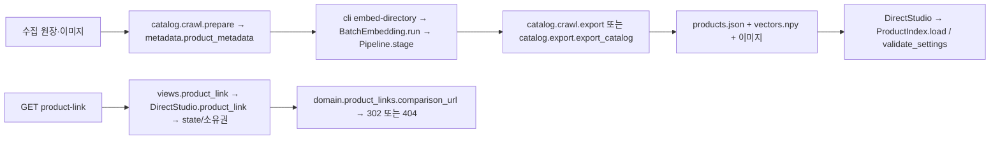

# 역할별 코드 계층과 호출 구조

2026-10-18 선택 생성: 추천 카드 → `POST previews` → `application.preview.selected_source/snapshot` → SQLite 큐/워커 preview 분기 → `preview.prepare` → `DeferredPipeline` → `ModelAdapter.acall(generate)` → Cloudflare/Gemini → receipt·generated.png → 공유 `product-preview.mjs`. 독립 웹은 `DirectStudio.submit_preview/launch`의 풀에서 같은 application을 실행한다. [선택 생성 계약](product-preview.md).

2026-10-18: 신규 기본은 [방 특징 추천](interior-ranking.md)의 v3다. 기존 해석 응답의 `room_profile` → `domain/interior.query_terms` → 질의 임베딩 → `ProductIndex.rank`의 코사인 유사도 + `domain/interior.compatibility` → 설명/점수 보존으로 확장했다. 특징은 인덱스 시작 시 캐시한다. 외부 API 추가 호출과 상품 벡터 재생성은 없다. 아래 v1/v2 설명은 당시 정책이며 MySQL 연결은 여전히 후속 작업이다.

[역할별 라우팅](README.md) · [추천 서비스 설계](../design/12-direct-recommendation.md)

2026-10-16 로컬 구현 기준. 아래 화살표는 런타임 호출이며 프로세스/서버 분리나 엄격한 단방향 import를 뜻하지 않는다.

## 코드 계층

패키지 루트는 `src/interior_recommender/`다.

| 계층 | 실제 경로 | 책임 |
|---|---|---|
| 진입·전송 | `web/__main__.py`, `web/urls.py`, `web/views.py`, `web/middleware.py`, `web/roompick_bridge.py`, `web/ui/` | 실행 설정, HTTP·소유권·CSRF·브리지·화면 |
| 유스케이스 조정 | `application/direct.py` | 입력 접수, 고정 계약, 해석→질의→순위→보존·상태 |
| 추천 규칙 | `domain/recommendation.py`, `domain/product_links.py` | 응답 검증, 조건 대조, 순위·중복 제거, 허용 상품 URL |
| 오프라인 상품 준비 | `catalog/crawl.py`, `catalog/metadata.py`, `catalog/batch_embedding.py`, `catalog/export.py`, `catalog/danawa.py` | 원장 정제·벡터 준비·카탈로그 export/load 보조 |
| 외부 모델 연결 | `adapters/router.py`, `adapters/gemini.py`, `adapters/cloudflare.py` | 제공처 선택·SDK 요청/응답 |
| 공통 실행·저장 계약 | `pipeline.py`, `assets.py`, `schemas.py`, `config.py`, `errors.py`, `services.py` | receipt·stage·checksum·설정·공유 스키마/버전 |
| 기존 생성 처리 | `cli.py`, `web/workflow.py`, `local_processing.py`, `scale.py`, `pipeline.py`의 생성 실행 부분 | 명시적으로 선택한 기존 생성 경로 |

## 온라인 직접 추천

SketchOn 통합에서는 웹 `config.urls → recommendations.views → submissions/queue`가 SQLite 작업을 접수하고, 별도 `run_recommendation_worker → recommendations.worker → DirectStudio.validate_run/prepare`가 실행한다. `DeferredPipeline`은 외부 응답이 필요한 단계에서 워커에 실행을 양보하며 Gemini native async 응답을 기다린 뒤 성공 receipt/stage부터 재개한다. 상태·링크는 `DirectRunReader`로 읽는다. [책임·상태·복구·설정](execution.md)을 따른다. 아래 기존 Mermaid와 `Studio.launch()` 설명은 독립 추천 웹의 호출 구조다. `/interior-recommand/`의 화면·API·asset·링크를 하나의 Django 웹 서버에서 제공하며 백그라운드 추천은 별도 작업 프로세스가 담당한다. 브리지·별도 `web.__main__.configure()`를 사용하지 않는다. 승인된 295개 로컬 상품을 읽고 기존 해석·임베딩·추천 로직을 유지한다. 회원/프로젝트 권한과 새 화면·정적 파일은 `demo_sketchon/recommendations/`가 담당한다. [실행과 경계](../../src/demo_sketchon/docs/ver2/직접추천_통합_실행.md)를 참고한다.

`views.studio()`는 기본 `DirectStudio`를 생성한다. `--legacy-generation`에서만 `Studio`를 선택한다. `--demo`는 `DirectDemoAdapter`의 고정 해석/벡터와 합성 상품을 사용한다.

`POST /api/runs`는 접수·작업 시작 뒤 202를 반환한다. 작업은 `Studio.launch()`의 풀에서 `self._work()`로 동적 디스패치된다. 직접 추천은 `Pipeline.execute()`를 호출하지 않고 `stage()`를 재사용한다. 품목 해석이 ACCEPTED가 아니면 질의/순위로 진행하지 않는다.

정상 신규 요청의 외부 작업은 `direct_context`와 `embed_text` 각 1회다. 성공 stage/receipt가 있으면 재사용하고, 제공처 재시도로 실제 요청 수는 늘 수 있다. 모든 상품 벡터는 요청 전에 준비한다. `ProductIndex.rank()`는 필수 불일치를 제외한 뒤 2,048행 청크로 유사도를 계산한다.

## 상품 준비와 링크 조회

SketchOn 선택 스타일은 새 실행의 `color-first-v2`에서 재질 명칭 대신 색상·톤 질의로 변환하고 원문 색상 조건/선호가 없으면 기존 색상 가중치에 연결한다. 서버에 저장된 선택값만 사용하며 AI 원응답·이전 실행은 보존한다. [실행 담당](roles/application.md)의 매핑과 우선순위를 따른다.

2026-10-16 기본 `weighted-content-v2`에서는 재질을 필수 필터에서 분리한다. `_prepare()`가 재질 원문을 질의 임베딩에 추가하고 `rank()`는 재질 대조를 `preference_checks`에 기록한다. 결측·불일치로 후보를 제외하지 않으며 다른 필수 조건은 유지한다. v1 저장 실행은 당시 고정 정책을 사용한다.

`catalog.export`는 별도 메타데이터와 저장 벡터를 결합하는 경로다. `catalog.crawl.export`는 prepare 결과와 대응하는 벡터를 결합한다. 두 export는 외부 AI를 호출하지 않는다. `--with-links`는 수집 상품번호에 대응하는 URL을 담는 별도 export다. 현재 로컬 상품 링크 검사는 HTTPS·허용 호스트/경로·상품번호 일치·출처/소유권 검사이며 판매처의 실시간 유효성 검증 완료를 뜻하지 않는다.

## 공통 경계와 남은 결합

- `DirectStudio`는 `web.workflow.Studio`의 소유권·상태 기반을 상속한다. SketchOn 워커는 `background_workers=0`으로 기존 풀 생성을 끄고 관리 워커의 공유 풀·async SDK를 사용한다. 파일 이동 후에도 이 의존은 남는다.
- `Pipeline`은 직접 추천과 배치의 stage/receipt 기반이면서 기존 생성 실행도 포함한다. `services.py` 역시 공통 스키마 등록과 생성 프롬프트를 함께 가진다.
- `domain.recommendation`은 공유 `schemas`·`assets`와 NumPy/scikit-learn을 사용하고 `ProductIndex`의 파일 로딩도 포함한다. 순수 도메인 모델과 저장소 포트 분리까지 완료한 구조는 아니다.
- `catalog.danawa`를 상품 준비 계층으로 이동해 새 내부 호출에서 카탈로그가 웹 패키지의 로더를 직접 참조하던 경계를 정리했다.
- DB·Kafka Consumer·Bronze 게이트·광고 서버 HTTP·FAISS는 서비스 설계다. 이 호출도는 해당 운영 구성의 구현 완료를 나타내지 않는다.

## 기존 경로 호환

| 유지한 기존 모듈 | 새 구현 모듈 |
|---|---|
| `interior_recommender.web.direct` | `interior_recommender.application.direct` |
| `interior_recommender.recommendation` | `interior_recommender.domain.recommendation` |
| `interior_recommender.product_links` | `interior_recommender.domain.product_links` |
| `interior_recommender.batch_embedding` | `interior_recommender.catalog.batch_embedding` |
| `interior_recommender.catalog_metadata` | `interior_recommender.catalog.metadata` |
| `interior_recommender.crawl_catalog` | `interior_recommender.catalog.crawl` |
| `interior_recommender.product_catalog` | `interior_recommender.catalog.export` |
| `interior_recommender.web.danawa` | `interior_recommender.catalog.danawa` |

호환 import는 같은 모듈 객체를 반환해 기존 monkeypatch도 실제 구현에 적용된다. `python -m interior_recommender.crawl_catalog`·`product_catalog`는 새 구현의 `main()`으로 위임한다. 기본 sample 경로는 이동 전과 같은 패키지 루트의 `sample/`이다.
