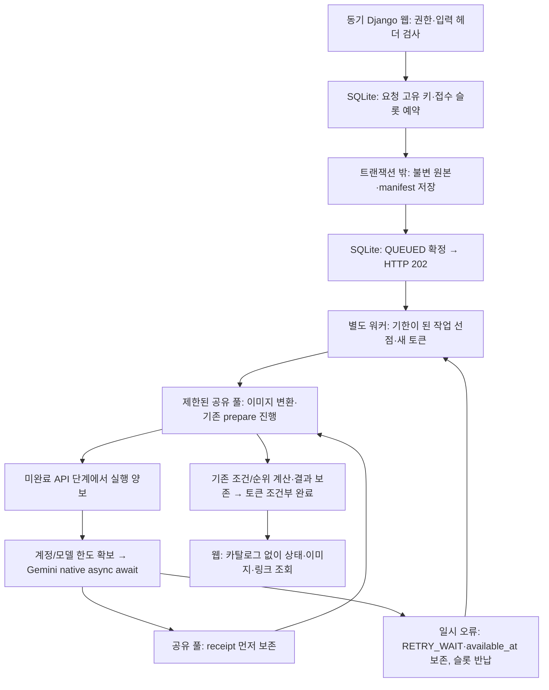

# SketchOn SQLite 작업 실행과 복구

2026-10-18 [선택형 상품 배치 미리보기](product-preview.md): 기존 테이블에서 자식 run을 접수하고 migration 없이 `preview_contract`로 구분한다. `application.preview.validate/prepare`만 실행하며 해석/임베딩/추천 계산은 반복하지 않는다. 제공처와 image_model·`GENERATION_CONCURRENCY=1`·`GENERATION_RPM=2`를 사용한다. 전체 접수/실행 슬롯은 공유한다. 웹·워커를 함께 재시작한다. 아래 해석/임베딩 중심 설명은 추천 작업에 해당한다.

2026-10-18. 현재 범위는 로컬 SQLite와 기존 상품 스냅샷이다. 팀원의 데이터 파이프라인 완료 후 MySQL·Kafka·Bronze·광고 서버를 연결한다. 서비스 논리 스키마와 이 문서의 로컬 작업 원장을 같은 테이블로 간주하지 않는다.

[역할 라우팅](README.md) · [호출 구조](call-structure.md) · [설치·API](../../src/demo_sketchon/docs/ver2/직접추천_통합_실행.md)

## 책임과 실행 흐름

| 책임 | 코드 |
|---|---|
| HTTP·CSRF·회원/프로젝트 권한·형식 오류 | `demo_sketchon/recommendations/views.py` |
| 헤더/화소 검사·요청 hash·원본/manifest 보존 | `recommendations/submissions.py` |
| 영속 원장·전역 접수 상한·선점·lease·토큰·API 할당량 | `recommendations/models.py`, `queue.py` |
| 설정 일치·동시 작업·공유 풀·heartbeat·재시도 스케줄링 | `recommendations/worker.py`, `execution_config.py`, 관리 명령 |
| 입력/정책/인덱스 검증과 해석→질의→추천 조정 | `interior_recommender/application/direct.py::validate_run/prepare` |
| API 요청으로 실행 양보·receipt 복구·시도 상한 | `application/deferred.py::DeferredPipeline` |
| run 파일 보호·상태/링크 읽기 | `application/locks.py`, `application/runs.py` |
| 조건·색상/재질·순위·상품 링크 정책 | 기존 `domain/` |
| SDK·모델/전송 스키마 | `adapters/router.py`, `adapters/gemini.py::acall` |
| 사전 상품/벡터 준비 | 기존 `catalog/`, 온라인 작업과 분리 |



웹은 카탈로그를 로딩하거나 작업 스레드풀을 생성하지 않는다. 이미지 헤더·EXIF 표시 크기·화소 수만 검사한 뒤 원본을 보존하고, 디코딩/PNG 변환은 워커가 한다. 원본은 `inputs/original-*.bin`, 파생 이미지는 `derived/*.png`다. 잘못된 이미지 본문은 접수 후 워커에서 실패할 수도 있다. 입력 hash는 불변 원본·요청·정책/모델/인덱스 계약을 보호한다.

`DirectStudio.prepare()`의 기존 동기 로직을 공유 풀에서 진행한다. 외부 응답이 필요한 단계는 `ProviderCallRequired`로 워커에 요청을 넘긴다. 워커는 SDK의 native async API를 await하고 receipt를 저장한 다음 같은 prepare를 다시 진행한다. 완료 stage는 checksum을 확인해 재사용한다. 해석과 질의 임베딩은 앞 단계 결과에 의존하므로 한 요청 안의 순서는 유지한다.

## 실행 명령

`src/demo_sketchon`에서 설치 환경의 Python으로 실행한다. 기존 웹 서버는 중지하고 새 코드로 다시 시작한다.

```powershell
python manage.py migrate
python manage.py check
python manage.py run_recommendation_worker
```

다른 터미널에서 같은 DB·출력 경로·모델·정책·실행 제한 환경 변수로 `python manage.py runserver 127.0.0.1:8003`을 실행한다. 워커가 카탈로그/벡터 checksum·차원·모델을 확인하고 준비 상태를 등록해야 신규 접수가 가능하다. 워커 부재·준비 중·전체 접수 상한 초과는 `503`과 `Retry-After: 3`으로 응답한다. 같은 요청 ID를 유지해 재전송한다. 잘못된 입력은 `400`, 권한/미존재 응답은 기존 정책을 따른다.

`--once`는 현재 기한이 된 작업을 처리한 뒤 종료한다. 미래 `RETRY_WAIT`까지 기다리는 명령이 아니므로 평상시에는 상시 워커를 실행한다. `--verbosity 2`에서 DB·동기 처리 구간의 시간 로그를 추가한다. SIGINT/SIGTERM은 신규 준비 상태를 해제하고 진행 중 작업을 마친 후 종료한다. 강제 종료는 lease 만료 후 다른 워커가 복구한다.

## 상태와 로컬 원장

| 상태 | 의미·복구 |
|---|---|
| `STAGING` | 접수 슬롯 예약, 파일 저장 중. 동일 요청의 동시 재전송은 503 |
| `STAGING_FAILED` | 원본 저장 실패. 같은 요청 ID/입력으로 재접수 가능 |
| `QUEUED` | 원본과 manifest 보존 완료, 워커 대기 |
| `RUNNING` | 유효한 lease/token으로 워커가 처리 중 |
| `RETRY_WAIT` | `available_at` 이후 선점. worker/API 재시도 대기는 실행 슬롯을 점유하지 않음 |
| `SUCCEEDED` | 작업 실행 완료. 추천 결과의 `COMPLETED/UNVERIFIED_ONLY/NO_RESULTS/AMBIGUOUS` 등과 별개 |
| `FAILED` | 비일시 오류·API 시도/복구 상한. 명시 재시도로 새 retry_generation 부여 |

원장 상세는 `recommendations/migrations/0001_initial.py`를 기준으로 한다.

| 모델 | 주요 필드·규칙 |
|---|---|
| `RecommendationJob` | UUID PK = 로컬 run ID. scope·owner_id·request_id 복합 고유 키, input_hash, status, available_at, lease_token/until, retry_generation, claims/recoveries, 시작/종료·고정 공개 오류 |
| `RecommendationAttempt` | 선점별 execution UUID·토큰·시작/종료·duration_ms·wait_ms. 죽은 시도는 ABANDONED, 실제 duration은 NULL |
| `QueueControl` | 출력 root의 scope별 설정 key·검증된 카탈로그/정책/모델 계약. 짧은 선점 트랜잭션의 공통 조정 행 |
| `WorkerPresence` | 워커별 준비 상태 만료. 같은 설정/인덱스의 여러 프로세스만 함께 실행 가능 |
| `ProviderGate/ProviderPermit` | 같은 SQLite DB 안의 API 계정/모델별 다음 호출 시각·동시 호출 임대 |

API별 과금 호출 시도·latency·receipt는 기존 manifest에 남는다. `RecommendationAttempt`는 워커 실행 시도이므로 API 호출 수로 세지 않는다. 웹은 과거 `job.json` 대신 새 작업의 SQLite 상태를 반환한다.

## 동시성·복구 규칙

- 접수 상한 검사와 고유 요청 등록은 같은 짧은 트랜잭션이다. 파일·API·재시도 대기를 DB 트랜잭션에 넣지 않는다. 동일 ID의 다른 입력은 거절한다.
- STAGING 중 프로세스가 죽으면 만료 후 워커가 manifest·원본 checksum을 검증해 QUEUED로 복구한다. 파일이 불완전하면 STAGING_FAILED로 남긴다.
- 선점·heartbeat·완료에는 token과 만료 조건을 사용한다. 이전 워커의 완료/파일 manifest 저장은 거절한다. heartbeat는 API await 중에도 별도로 진행한다.
- 파일은 run별 OS 잠금 `.worker-lock`으로 보호한다. 이 파일은 런타임 제어 파일이며 삭제하지 않는다. 소유권은 파일 존재/수명이 아니라 OS 잠금으로 판단하고 프로세스 종료 시 해제된다. lease가 만료돼도 이전 프로세스가 파일을 사용하면 새 워커는 잠시 대기한다.
- 모델 재시도는 오류 코드·지수 백오프·jitter·Retry-After를 사용한다. 다음 시각을 DB와 stage에 보존하고 작업을 반납한다. `time.sleep()`으로 작업 스레드를 점유하지 않는다.
- API 시도 상한은 자동 재개·프로세스 재시작을 통틀어 stage별로 센다. 명시 재시도는 새 시도 구간을 허용하지만 성공 stage/receipt와 Retry-After 대기는 유지한다. 정상 호출률 대기를 장애 복구 횟수로 세지 않는다.
- API 계정/모델 gate는 SQLite를 공유하는 모든 워커 사이에서 동시 수와 호출 간격을 조정한다. 다른 DB·별도 배치 프로세스까지 포괄하는 계정 공통 한도는 후속 통합 범위다. 배치는 이 워커에 제출하지 않는다.
- receipt 저장 이전에 프로세스가 죽거나 제공처 응답이 유실되면 외부 중복 호출/과금 가능성이 남는다. exactly-once 과금을 보장하지 않는다.
- 기존 파일 기반 run·event·receipt·벡터는 덮어쓰지 않는다. 이전 event의 동일 요청 재전송은 기존 run으로 연결한다. 과거 완료 결과는 읽기 가능하며 미완료 파일 작업을 신규 원장으로 자동 변환하지 않는다. 입력 수정으로 새 요청을 제출한다.
- 회원 결과 저장은 후보 이미지를 트랜잭션 밖에서 복사하고, 짧은 트랜잭션에서 소유권·버전·중복을 재확인한 뒤 참조를 등록한다. 충돌·DB 실패·중복 반환 시 미채택 후보 파일을 정리한다.

## 설정과 측정

다음은 `RECOMMENDATION_` 접두 환경 변수다. 예: `RECOMMENDATION_MAX_PENDING=8`. 양의 정수이며 heartbeat 간격의 3배보다 lease가 길어야 한다. 값은 측정 시작 후보이고 성능 보장값이 아니다.

| 접미사 | 기본값·적용 범위 |
|---|---|
| `MAX_PENDING` | 8. 같은 출력 root의 STAGING/QUEUED/RUNNING/RETRY_WAIT 합계, 모든 웹/워커 공통 |
| `MAX_INFLIGHT` | 2. 같은 출력 root에서 유효한 RUNNING lease 합계 |
| `SYNC_WORKERS` | 4. 워커 프로세스별 공유 풀. 제출도 semaphore로 제한 |
| `BLAS_THREADS` | 1. 워커 프로세스의 NumPy/scikit-learn 내부 스레드 상한 |
| `LEASE_SECONDS`, `HEARTBEAT_SECONDS` | 90, 10. 실행/호출 임대·생존 확인 |
| `POLL_SECONDS`, `STAGING_SECONDS` | 1, 120. 기한 작업 확인·입력 접수 복구 대기 |
| `MAX_RECOVERIES` | 10. 명시 재시도 구간별 만료 RUNNING 자동 회수 상한 |
| `ANALYSIS_CONCURRENCY`, `ANALYSIS_RPM` | 2, 10. 해석 모델 동시 수·호출 간격 |
| `EMBEDDING_CONCURRENCY`, `EMBEDDING_RPM` | 2, 30. 임베딩 모델 동시 수·호출 간격 |

`RECOMMENDATION_API_ACCOUNT`는 기본 `default`이며 같은 제공처 계정을 쓰는 워커가 같은 값을 사용한다. 별도 계정은 구분한다. 기존 `AI_TIMEOUT_SECONDS`/`AI_MAX_ATTEMPTS`는 run에 고정한다. SDK 자체 재시도는 1회로 두고 앱이 재시도를 기록한다. 모든 프로세스는 같은 로컬 SQLite 파일·출력 root·설정을 사용한다. 서로 다른 설정/인덱스 워커가 준비 계약을 덮어쓰지 못한다.

기본 구조화 로그는 job_id·execution_id·시작/종료·duration_ms·wait_ms를 포함한다. DB/동기 풀의 작업·대기는 상세 로그에서 구분한다. API latency는 manifest attempts, 순위 계산은 ranking_duration_ms에 남긴다. 접수부터 사용자 결과 표시까지 p50/p95·최대 RAM·실제 제공처 호출률은 별도 부하 시험이 필요하다. 단계 p95를 합산하지 않는다.

## 검증과 후속 파이프라인 연결

`python manage.py check`, `python manage.py makemigrations --check --dry-run`, `python manage.py test`, 기존 Node 검사와 엔진 pytest를 사용한다. Django 테스트는 공유 캐시 메모리 DB 대신 프로세스별 격리 SQLite 파일을 쓰고 종료 시 삭제한다. `ROOMPICK_TEST_DB_PATH`로 별도 경로를 지정할 수 있으며 실제 서비스 DB 경로를 지정하지 않는다.

검사 대상은 요청 중복/포화·카탈로그 없는 HTTP·STAGING 복구·만료 lease/늦은 완료·프로세스 강제 종료 후 OS 잠금 해제·재시도 시각/시도 상한·성공 receipt 재사용·비동기 대기 중 동기 풀 사용·API 공통 한도·별도 관리 명령 프로세스 처리·파일 복사 중 버전 충돌이다. 실제 API·운영 부하 시험과 구분한다.

2026-10-18 검증: Django 전체 115개, 엔진 pytest 199개, Node 26개 통과. check·migration 일치·수정 문서의 상대 링크도 확인했다. 기존 테스트의 날짜 고정 범위와 파일 응답 소비를 보정해 파일 SQLite에서도 검증한다. 실제 로컬 SQLite에 신규 실행 테이블 6개를 적용했고 integrity_check=ok, 기존 사용자 테이블 행 수 유지를 확인했다. 실제 AI 호출·벡터 재생성·운영 부하는 수행하지 않았다. Playwright 미설치로 브라우저 회귀는 이번에 재실행하지 않았다.

팀원 파이프라인 연결 시 다음 계약을 먼저 대조한다.

1. 카탈로그 경계: 승인된 Gold 상품/이미지 대응·checksum·임베딩 모델/차원/전처리·인덱스 버전·완료 manifest를 받고 기존 준비 결과의 재사용 범위를 확인한다. 새 스냅샷은 새 요청에 고정한다.
2. 작업 경계: `queue.py`의 접수/선점/heartbeat/완료를 MySQL·Kafka 운영 계약에 연결한다. 기존 로컬 UUID/입력 hash/성공 receipt 대응과 이관 정책을 정하고 자동 새 ID/재과금으로 전환하지 않는다.
3. 입력 보존 경계: 운영은 Bronze 확인 후 해석을 시작한다. 현재 `bronze_verified=false` 로컬 경로를 운영 보존 완료로 취급하지 않는다.
4. 추천 경계: 외부 광고/추천 서버가 질의 임베딩·검색을 맡는 운영 책임과 현재 application의 로컬 호출을 대조한다. HTTP 어댑터를 연결하되 추천 규칙을 웹/queue에 복제하지 않는다.
5. Kafka offset·재할당·누락 발행 복구와 MySQL 동시성 검증을 [작업 설계](../design/05-kafka-jobs.md)에 맞춰 수행한다. 이 로컬 migration을 운영 서비스 스키마 이관 완료로 표시하지 않는다.
