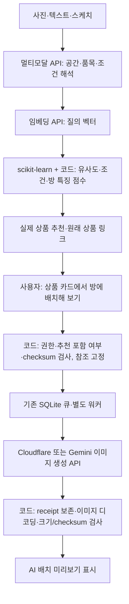

# 추천 상품 배치 미리보기

2026-10-18. 직접 추천 후 사용자가 선택한 상품 한 개를 방에 배치하는 외부 API 기능을 추가한다. 계약은 `product-preview-v1`이다. 추천 점수·상품 링크·상품 임베딩은 기존 결과를 사용하며 생성 결과로 상품을 다시 검색하지 않는다. 서버 GPU나 로컬 생성 모델은 필요하지 않다. 실제 생성 품질·지연·계정 호출 가능 여부는 API 검증 전이다.

## 흐름과 책임



`application/preview.py`가 선택·스냅샷·프롬프트·출력 검증을 담당한다. 웹은 임의 URL을 가져오지 않고 완료 추천의 `image_id`만 받는다. 저장 결과와 등록 이미지의 checksum을 확인한 뒤 방 사진·상품 이미지·선택 스케치를 별도 run의 `inputs/`에 고정한다. 부모 추천과 링크는 보존한다. 독립 웹의 미확인 후보를 선택하더라도 조건 충족으로 승격하지 않는다. SketchOn은 기존처럼 확인 상품만 표시한다.

참조 순서는 방·상품·선택 스케치다. 비율 유지·최대 480px·흰 정사각 여백으로 변환하고 원본 배치 좌표를 여백 기준으로 수치 변환한다. 선택 상품 한 개의 외형을 유지하고 상품 사진의 배경·다른 가구나 스케치 선/글자를 출력하지 않도록 지시한다. 추가 해석/임베딩/생성물 분석 API는 없다. 프롬프트 지시가 상품 동일성·방 구조·실제 크기 보장을 뜻하지 않으며 화면에 AI 시안임을 명시한다.

## HTTP·저장·복구

SketchOn 접두사는 `/interior-recommand/`, 독립 웹은 서버 루트다.

| 요청 | 계약 |
|---|---|
| `POST api/runs/{parent}/previews` | JSON `{"image_id":"추천 결과 ID"}`. 소유권·CSRF 검사 후 자식 `run_id`/job/state_path와 202 반환 |
| `GET api/runs/{preview}` | `flow=product-preview`, 부모 ID·선택 상품·상태·주의 문구·완료 시 result_image |
| `POST api/runs/{preview}/actions/prepare` | JSON `{"retry":true}`. 실패 작업의 고정 입력과 성공 receipt를 유지해 재시도 |
| `GET assets/{preview}/generated.png` | 소유권·등록 이미지 검사 후 반환 |

SketchOn은 기존 `RecommendationJob` 테이블에 자식 작업을 저장한다. 새 migration이나 실제 MySQL 변경은 없다. 워커는 `preview_contract`에 따라 `preview.validate/prepare`를 실행하고 기존 lease·heartbeat·시도 상한·receipt 복구를 따른다. 독립 웹은 기존 제한된 스레드풀에서 같은 application 함수를 실행한다. 추천 접수/조회는 생성을 호출하지 않는다.

동일 부모·상품·입력 checksum·모델/설정·계약 버전은 같은 미리보기로 연결한다. 버튼을 다시 누르면 기존 작업/완료 결과를 반환한다. 제공처 응답을 검증/최종 저장 전에 `receipts/preview.json`에 보존하고 로컬 저장 실패 시 재사용한다. 응답 유실·receipt 기록 전 종료 시 중복 과금 가능성은 남는다. 완료 결과의 의도적 재생성 버튼은 이번 범위에 없다.

## 설정과 구동

`src/interior_recommender/.env`의 기존 설정을 사용한다. 기본은 `AI_IMAGE_PROVIDER=cloudflare`, `AI_IMAGE_MODEL=@cf/black-forest-labs/flux-2-klein-4b`, `AI_OUTPUT_WIDTH=512`, `AI_OUTPUT_HEIGHT=512`다. `CLOUDFLARE_ACCOUNT_ID`와 `CLOUDFLARE_API_TOKEN`을 설정한다. 키는 브라우저/manifest에 기록하지 않는다. Gemini 전환 시 `AI_IMAGE_PROVIDER=gemini`, 계정에서 가능한 이미지 모델 ID, `GEMINI_API_KEY`를 설정한다. 자동 제공처 전환은 없다. [Cloudflare 공식 multipart·참조 이미지 계약](https://developers.cloudflare.com/workers-ai/models/flux-2-klein-4b/).

SketchOn 기본 생성 제한은 `RECOMMENDATION_GENERATION_CONCURRENCY=1`, `RECOMMENDATION_GENERATION_RPM=2`다. 계정/제공처/모델별 gate를 쓰며 전체 접수/실행 상한은 추천과 공유한다. 실제 계정 할당량을 확인한 보장값이 아니다. Cloudflare 3036 오류는 다음 UTC 자정까지 RETRY_WAIT로 보존한다. 웹·워커를 같은 설정으로 재시작한다. 성공 추천·상품 벡터의 재생성은 필요 없다.

저장소 `develop`에서 기존 환경으로 각각 별도 터미널에서 실행한다. 각 명령은 한 줄이다.

```powershell
& '..\.venv\Scripts\python.exe' '.\src\demo_sketchon\manage.py' run_recommendation_worker
```

```powershell
& '..\.venv\Scripts\python.exe' '.\src\demo_sketchon\manage.py' runserver 127.0.0.1:8003
```

기존 추천 화면에서 **이 상품을 방에 배치해 보기**를 누른다. 이때 API 비용이 발생할 수 있다. `INTERIOR_RECOMMENDER_DEMO=1`은 비과금 데모 이미지를 만들고 표시한다. 기존 공간 만들기 크레딧/결과 모델과 별도로 처리한다. 운영 과금 정책·MySQL/Kafka/Bronze 이관은 후속 작업이다.

## 검증

2026-10-18 실행 결과: 엔진 pytest 221개, Django 추천/실행 31개와 신규 제공처 gate 1개, Node 30개 통과. Django check와 수정 Markdown 19개의 로컬 링크도 확인했다. Playwright 미설치로 브라우저 시각 점검은 수행하지 않았고 실제 유료 생성 API·운영 DB 변경은 하지 않았다.

권한·CSRF·추천 포함 여부·checksum·자동 생성 없음·중복 클릭·선택 상품 대응·생성 실패 시 추천 보존·실패 재시도·receipt 이후 저장 실패 복구를 비과금 응답으로 검사한다. 제공처 async 전송/gate도 가상 통신으로 검사한다. 실제 생성 품질·지연·부하·시각적 동일성·운영 배포 완료를 의미하지 않는다.
