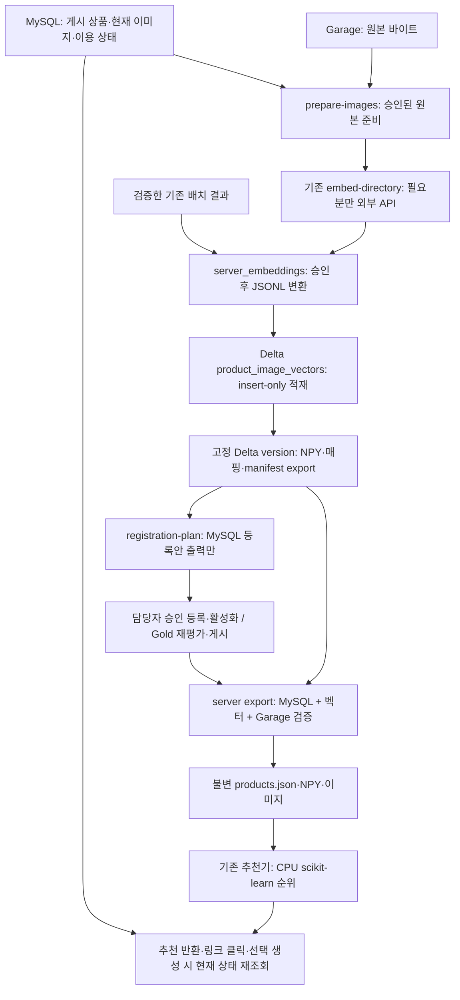

# MySQL·Garage·Delta 추천 연결

2026-10-19. 연결 코드와 Garage 임베딩 실행기를 준비했다. 업무 상품 게시·MySQL 등록/활성화와 임베딩 실행기 배포는 별도 단계다. 기존 로컬 카탈로그와 SketchOn SQLite 작업 원장은 유지한다.

## 확인한 상태와 구현 범위

- Spark 서비스 계정에서 Garage를 조회하고 `s3a://pj3-data/silver/product_image_vectors`를 생성했다. 2026-10-19 03:00 KST 별도 Spark 재조회에서 신규 이미지 1개의 768차원 벡터와 Delta version 1을 검증했다. 실제 API 호출 1회, 신규 적재 1행이다. 기존 검증 Delta를 운영 입력으로 바꾸지 않았다.
- 2026-10-19 02:27 KST, 새 MySQL 어댑터로 TLS 서버 인증과 읽기 전용 트랜잭션을 실제 검증했다. Primary `pj3_products`의 상품·게시·임베딩은 없었고 활성 인덱스는 `INDEX_NOT_READY`였다. 빈 DB에서 실제 추천 성공을 확인한 것은 아니다.
- 기존 full 배치의 완료 벡터 290개를 검증하고 사용자 승인 후 재사용 JSONL로 변환했다(API 0회). smoke 10개는 full에 포함된다. 최초 실행에서 같은 원본 이미지의 PNG 바이트 checksum이 로컬과 서버 간 달라 재사용 검증이 중단됐지만 RGB 픽셀은 같았다. 픽셀 checksum 보강 후 2026-10-19 09:07 KST 계획 검사에서 기존 Delta 192개, 기존 벡터 재사용 후보 66개, 신규 이미지 후보 32,880개를 확인했다. Garage 업로드 중이라 건수는 조회마다 달라진다.
- 신규 1개 검증 후 Spark Master의 별도 `embedding-service`에 임베딩 실행기를 배포했다. 실행 중인 파이프라인·웹 서버를 교체하거나 대량 작업을 자동 시작하지 않았다. 공통 SSH/sudo 자격과 DB 계정은 별개다. 공유 DB 문서에서 확인한 게시 계정은 Spark Master 전용이며 추천 서버 전용 계정이 아니다.

## 데이터 경로



상품 준비는 요청 전에 수행한다. 사용자 요청에서 Spark를 시작하거나 Delta 전체를 읽지 않는다. NPY는 mmap으로 로드하고 기존 2,048행 청크 순위 계산을 유지한다. 이미지 다운로드 전에 MySQL 메타데이터 snapshot을 확정·종료해 긴 이미지 작업 동안 InnoDB 트랜잭션을 유지하지 않는다.

## 코드와 실행 경계

| 구현 | 역할 |
|---|---|
| `interior_recommender.catalog.server` | MySQL 읽기 전용 조회, Garage 원본 체크섬 검증, 이미지 준비·등록안·추천 카탈로그 export, 현재 상태 재검증 |
| `interior_recommender.catalog.server_embeddings` | 배치 manifest/input hash·완료 stage·출력 checksum·원본/전처리 checksum·모델/차원 검사, 승인 후 Delta 입력 변환 |
| `product_pipeline.embedding_table`, `run_embedding_table.py` | 독립 임베딩 테이블 조회/생성, 명시적 import/export CLI |
| `product_pipeline.embedding_vectors` | float32/L2·결정적 ID·내용 hash 검증, 100행 insert-only MERGE, 고정 version NPY export |
| `product_pipeline.garage_embeddings`, `run_garage_embeddings.py` | Garage 원본 검사, 승인한 기존 결과 재사용, 단일 키 REST 임베딩, 성공 응답 보존, 짧은 Spark 배치 적재, 첫 429에서 중단 |
| `ProductIndex.load/rank`, `LiveGuard` | 서버 카탈로그의 현재 상품/이미지/임베딩/활성 인덱스를 재조회. 실패를 추천 없음으로 숨기지 않음 |

Delta 테이블은 기존 Silver 8개 테이블·Gold 고정 입력 집합과 분리한다. 기존 공통 Silver 스키마에 vector 컬럼을 추가하지 않는다. 쓰기는 같은 `pipeline_ops.pipeline_writer_leases`와 **정확히 같은 Silver root URI**를 잠그는 MongoLease를 사용한다. 다른 Driver와 잠금 namespace를 분리해 우회하지 않는다. Spark 종료를 확인하지 못하면 잠금을 자동 회수하지 않는다.

Delta 행은 `embedding_id`, 선택적 `asset_id`, `image_checksum`, `preprocessed_checksum`, `model_version`, `preprocessing_version`, `dimension`, `vector:array<float>`, `status`, `record_hash`, `created_at` 11개 필드다. `created_at`은 이 저장 계약에 결과를 등록한 시각이며 공급자의 실제 추론 완료 시각으로 가장하지 않는다. checksum·차원/배열 길이·READY 제약과 append-only를 사용한다. 유한값/L2·ID/hash 검증과 중복/내용 충돌 검사는 importer가 수행한다. Delta 자체에 UNIQUE/FK가 생긴 것은 아니다.

벡터 ID는 원본 checksum·모델·전처리·차원의 조합이다. MySQL `product_embeddings.id`는 자산별 등록 ID이고 `vector_ref_json.embedding_id`는 Delta 벡터 ID다. 같은 바이트 벡터를 여러 자산에서 참조할 수 있으므로 둘을 같다고 가정하지 않는다. importer는 기존 같은 ID의 다른 벡터를 갱신하지 않는다. 고정 export는 NPY와 mapping 파일의 checksum, Delta 경로/version을 기록한다.

## 접속 설정

선택 의존성은 `src/interior_recommender/requirements-server.lock.txt`에 고정했다. 파이프라인과 동일한 PyMySQL/boto3 버전을 사용한다. 실제 JSON은 Git 밖에 두고 Linux에서는 실행 계정 소유 0600이어야 한다. 공개 형식은 `src/interior_recommender/examples/server-catalog.example.json`이다.

현재 PC에는 기존 공유 정보를 이용한 실제 파일을 **Git 제외된** `src/interior_recommender/sample/server_connection/`에 만들었다. NTFS 권한은 현재 사용자와 SYSTEM으로 제한했다.

- `spark.catalog.json`: Spark Master 실행용. 기존 게시 계정과 서비스의 S3 자격 파일 **경로**를 사용한다. 이 파일에 S3 키나 SSH 비밀번호를 복사하지 않았다. Spark에 복사할 때 실행 계정 소유/0600을 적용해야 하며 이번에는 배포하지 않았다.
- `local-tunnel.catalog.json`, `ca.pem`: 기존 SSH 키의 Spark Master 터널을 통한 로컬 조회용. Garage export는 Spark 쪽 설정을 사용한다.

실제 비밀번호는 공개 문서·예시·로그에 기록하지 않는다. `INTERIOR_CATALOG_SERVER_CONFIG`는 서버 카탈로그의 현재 상태 조회에 쓰는 보호 JSON 경로다. 로컬 sample 카탈로그는 이 설정을 요구하지 않는다.

추천 서버가 MySQL에 직접 접속하려면 해당 출발지에서 접속 가능한 별도 계정이 필요하다. 필요한 권한은 `categories`, `products`, `assets`, `product_images`, `product_embeddings`, `search_index_versions`, `pipeline_publications`, `product_link_observations`의 SELECT다. 코드가 계정·권한·테이블을 생성하지 않는다. Django default SQLite DB를 이 상품 DB로 바꾸거나 공용 상품 DB에 `manage.py migrate`를 실행하지 않는다.

## 실제 운영 전 조건

1. 업무 상품·카테고리·이미지·게시 이력이 MySQL에 있어야 한다. 미게시 원천 Mongo/검증 Delta를 서비스 상품으로 대신 사용하지 않는다.
2. 현재 상품 ACTIVE, 파일 AVAILABLE, 서비스 이미지 active, 범위별 이용 승인과 근거를 확인한다. `OWNER_REVIEW_REQUIRED`는 승인이 아니다. 신규 게시 이미지 inactive를 코드로 활성화하지 않는다.
3. 이미지 준비/벡터 등록은 **EMBEDDING** 범위 승인을 요구한다. 초기 대상에는 `recommendation_ready`를 요구하지 않는다. 해당 값은 임베딩/인덱스가 없으면 false일 수 있다.
4. 추천 노출에는 **RECOMMENDATION** 범위의 현재 이미지 검수와 자산 이용 승인을 모두 요구한다. `scope` 또는 `scopes` + `decision=APPROVED` + `evidence_ref`, 선택적 valid_from/expires_at 형식을 명시적으로 검사한다. 다른 형식은 자동 승인하지 않고 어댑터 계약을 인수해야 한다.
5. 등록안은 `product_embeddings` READY 행과 `search_index_versions` READY 후보를 **출력만** 한다. 실제 등록·scope별 단일 ACTIVE 전환은 별도 승인 작업이다. 이어 Gold의 기존 담당 embeddings 입력에 확인한 참조/활성 인덱스 근거를 공급해 재평가·게시해야 한다. `recommendation_ready`를 임의 UPDATE하지 않는다.
6. 추천 export는 현재 추천 준비·활성·승인과 완료 게시, 활성 인덱스 manifest의 `vector_export_checksum`을 확인한다. 이 checksum은 벡터 export manifest를 `catalog.server.canonical`로 직렬화한 SHA256이다. MySQL의 vector_ref는 논리 table, 물리 path, 고정 version, Delta embedding_id를 포함한다.
7. 반환 후보는 현재 메타데이터 hash·자산/상품/벡터 대응과 활성 인덱스를 다시 확인한다. 달라졌으면 `CURRENT_PRODUCT_OR_INDEX_CHANGED` 등으로 실패하고 새 snapshot을 준비한다. 클릭은 저장 URL로 바로 이동하지 않고 현재 URL·Gold 링크 준비 상태·마지막 COMPARISON 관측의 만료도 확인한다. 실시간 외부 페이지 존재/판매처 구매 검증을 대신한 것은 아니다.
8. 선택형 미리보기는 **GENERATION_REFERENCE** 범위도 별도로 요구한다. 선택 시점과 외부 생성 요청 준비 시점에 현재 상태를 검사한다. 추천 승인으로 생성 이용 범위를 대신하지 않는다.

## 실행 순서

아래 Windows 명령의 기준 위치는 현재 PC의 `develop` 저장소다. 모두 한 줄이며, 데이터 준비·변환·export는 기존 비용 큰 산출물을 먼저 대조하고 사용자 재사용/생성 승인을 받은 뒤에만 실행한다. 아직 업무 데이터가 없어 실제 운영 카탈로그를 만들지는 않았다.

실제 로컬 MySQL 조회는 첫 터미널의 터널을 유지하고 두 번째 터미널에서 실행한다. Spark 전용 계정을 추천 서버 직접 접속 계정으로 바꾸는 명령이 아니다.

```powershell
ssh -N -o ExitOnForwardFailure=yes -L 127.0.0.1:13306:192.168.0.131:3306 pj3-spark-master
```

```powershell
..\.venv\Scripts\python.exe -m interior_recommender.catalog.server check --config .\src\interior_recommender\sample\server_connection\local-tunnel.catalog.json
```

기존 배치 점검은 API 호출/변환이 없다. 실제 재사용 가능 여부는 업무 이미지 원본 checksum과도 대조한다.

```powershell
..\.venv\Scripts\python.exe -m interior_recommender.catalog.server_embeddings inspect --batch-index .\src\interior_recommender\sample\crawl_test\full\embeddings\index.json
```

재사용 승인 후의 변환 예시다. 기존 경로를 덮어쓰지 않는다. 출력 파일의 created_at은 변환 등록 시각이다.

```powershell
..\.venv\Scripts\python.exe -m interior_recommender.catalog.server_embeddings convert --batch-index .\src\interior_recommender\sample\crawl_test\full\embeddings\index.json --output .\src\interior_recommender\sample\server_connection\approved-vectors.jsonl --approved-reuse
```

새 이미지의 경우 `catalog.server prepare-images --config CONFIG --output NEW_DIRECTORY`로 승인 원본을 준비하고 기존 `embed-directory` 명령을 사용한다. WebP도 원본 checksum을 유지한 채 동일 EXIF/RGB/fit1024/PNG/L2 전처리를 지원한다. 임베딩 모델은 `gemini-embedding-2`, 768차원, 기존 전처리 버전을 유지한다. 기존 완료 결과를 다시 호출하지 않도록 먼저 manifest를 비교한다. 무료 계정 한도·다중 프로젝트 우회 정책은 바꾸지 않았다.

Spark 실행은 기존 배포 환경의 `EMBEDDING_SPARK_OPTIONS`, `EMBEDDING_LEASE_MONGO_URI`, Garage profile·보호 자격 파일·CA·고정 JAR을 주입한다. URI/비밀번호를 명령행에 쓰지 않는다. 경로는 사용자 PC가 아니라 실행 서버에서 읽을 수 있어야 한다. 다음은 `src/data_pipeline`에서 실행하는 인자 형식이다.

```bash
python run_embedding_table.py --environment-id pj3-danawa --silver-root s3a://pj3-data/silver --checkpoint-path s3a://pj3-data/checkpoints/product-image-embeddings --import-jsonl /srv/private/approved-vectors.jsonl
```

```bash
python run_embedding_table.py --environment-id pj3-danawa --silver-root s3a://pj3-data/silver --checkpoint-path s3a://pj3-data/checkpoints/product-image-embeddings --delta-version 1 --export-dir /srv/catalog/vector-export-v1
```

`--delta-version 1`은 예시다. 빈 테이블 version 0에서 벡터가 존재한다고 가정하지 않으며 실제 완료 적재의 고정 버전을 지정한다. 출력은 요청한 보존 산출물이며 기존 export를 조용히 갱신하지 않는다.

MySQL 등록안 작성은 DB 쓰기가 아니다.

```bash
python -m interior_recommender.catalog.server registration-plan --config /srv/private/catalog.json --vectors /srv/catalog/vector-export-v1/manifest.json
```

등록·활성화·Gold 재게시 이후에 실제 추천 snapshot을 만든다.

```bash
python -m interior_recommender.catalog.server export --config /srv/private/catalog.json --vectors /srv/catalog/vector-export-v1/manifest.json --output /srv/catalog/product-snapshot-v1
```

카탈로그 파일은 현재 추천 서버/워커에 이미지·NPY와 함께 같은 상대 경로로 배포한다. 기존 `INTERIOR_RECOMMENDER_PRODUCTS` 또는 독립 웹 `--products`에 새 `products.json` 경로를 지정하고 `INTERIOR_CATALOG_SERVER_CONFIG`도 설정한다. 서버 JSON에 이 설정이 없으면 로컬 파일처럼 상태 검사를 생략하지 않고 실패한다. 인덱스는 요청별 고정이고 교체는 웹/워커 설정을 함께 확인해 재시작한다.

## 검증과 남은 경계

### 서버 임베딩 실행기

실행기는 `images/sha256/`의 내용 주소 이미지와 원본 SHA256을 대조한다. MySQL 게시 이전의 벡터 준비에 사용하며 상품 추천·이용 승인·게시 상태를 새로 부여하지 않는다. 기존 JSONL은 모델·768차원·전처리 버전·벡터를 검사한다. 원본 SHA256이 일치하고, 전처리 PNG 바이트 checksum 또는 보강된 RGB 크기/픽셀 checksum이 일치할 때만 재사용한다. PNG 압축 바이트가 플랫폼별로 달라도 동일한 RGB 이미지임을 검사하며, 픽셀 내용이 다르면 중단한다. 같은 Delta 벡터가 있으면 API 호출을 생략한다.

서버 보호 설정은 `garage-embedding-worker-v1`, 모델 `gemini-embedding-2`, 전처리 `exif-rgb-fit1024-png-l2-v1`, 차원 768과 기존 S3/Mongo/JAR/CA 파일 경로를 지정한다. `api_key_file`은 서비스 계정 소유 0600 파일을 가리킨다. 실제 키·비밀번호는 명령행·Git·로그에 넣지 않는다. 실행 디렉터리는 0700이며 Linux CLI는 umask 077을 적용한다.

성공한 API 응답은 Delta 작업 전에 `work/receipts/`에 원자적으로 저장한다. 적재 실패 후 같은 work 디렉터리로 재실행하면 응답을 재사용한다. 기존 full 290개와 새 성공 응답은 유료 호출을 줄이는 재현 입력이므로 삭제하지 않는다. 공급자가 처리한 뒤 응답 수신 전에 연결이 끊기는 경우까지 중복 과금 방지를 보장하지는 않는다.

Spark는 시작 시 고정 버전 재고 검사와 기본 25개 단위 적재에만 사용하고 API 대기 동안 종료한다. 적재에는 기존 Silver root MongoLease를 사용한다. 실행기 work 잠금은 같은 작업의 중복 실행을 차단하며 분산 Delta 쓰기 잠금을 대신하지 않는다. 고정 JAR의 SHA256도 실행 전에 확인한다.

`--max-api-calls 1`은 신규 호출 1회 검증용, 생략 또는 0은 시작 시 확인한 이미지 목록의 완료 또는 첫 429까지 처리한다. 기본 속도는 분당 10회이고 토큰량에 따른 TPM 충족을 보장하지 않는다. 첫 429에서 자동 재시도·키 교체를 하지 않고 앞선 성공분을 적재한 뒤 종료 코드 75를 반환한다. `Retry-After`가 있으면 다음 실행도 해당 시간을 존중한다. 429는 RPM·TPM·RPD 중 하나의 제한일 수 있어 하루 한도 소진으로 단정하지 않는다.

`--plan`은 API 키를 읽거나 API를 호출하지 않고 현재 Delta 완료 수·Garage 원본 수·기존 결과와 원본 체크섬 일치 수를 보여준다. 계획의 일치 수는 전처리 대조 전 후보 수이며 실행 시 최종 확인한다. 업로드 중인 새 이미지는 다음 실행의 목록에서 처리한다. 실행 종료가 MySQL 등록·인덱스 활성화·웹 추천 배포 완료를 의미하지 않는다.

2026-10-19 배포 위치는 Spark Master의 `/var/lib/pj3/product-pipeline/spark/embedding-service`다. 소스 72파일의 개별 SHA256 manifest를 만들고 release `e7117955497d6684d010321d2ed51144980010c9d3d00a4ebfbf07c2a9605c88`에 고정했다. `current`는 해당 release를 가리키며 기존 Spark venv를 사용한다. 이전 release·재사용 JSONL은 보존했다. 별도 패키지 설치·GPU·MySQL 변경은 없었다. 실제 접속 설정과 API 키는 Git에 포함하지 않는다.

API 호출 없는 상태 확인:

```powershell
ssh -t pj3-spark-master 'sudo -u pj3-spark -- /var/lib/pj3/product-pipeline/spark/embedding-service/run --plan'
```

현재 이미지 목록 완료 또는 첫 429까지 실행한다. 성공분과 재사용 입력을 같은 work 디렉터리에서 이어가며, SSH 터미널을 유지한다. 일일 한도 소진까지 자동 재시도하는 명령은 아니다.

```powershell
ssh -t pj3-spark-master 'sudo -u pj3-spark -- /var/lib/pj3/product-pipeline/spark/embedding-service/run --requests-per-minute 10 --commit-every 25'
```

실제 신규 시험 원본 checksum은 `0001f8751b56ab8ec3b1153bd8c6b8a1ec45bb53d25f2b1d3581e202c4c0ea6c`이다. 별도 Spark 재조회에서 행의 ID/hash·차원·L2를 검사했다. 이 시험은 MySQL 상품 대응과 추천 준비 상태를 승인한 시험이 아니다.

합성 데이터로 MySQL session read-only/rollback/TLS 설정, Delta ID/hash·유한값/L2, 이미지 원본 checksum·고정 벡터 참조, 초기 준비의 순환 의존 방지, 승인/만료/철회·인덱스 변경 차단, 기존 CPU 추천 실행과 현재 링크 연결을 검증한다. 실패 build의 mmap도 닫고 임시 디렉터리를 정리한다.

입력 해석/질의 임베딩/선택 생성 제공처는 기존 API를 유지한다. 새 광고 서버 HTTP 서비스 분리, 운영 계정 생성·DB 등록/활성화, Kafka 임베딩 완료 이벤트 자동 연계, 업무 Gold 재평가 입력 공급, 대량 인덱스의 Garage 업로드·배포 자동화, 운영 추천 부하 검증까지 완료한 것은 아니다. 현재 코드는 배치 snapshot 인계와 기존 웹/워커 연결 경로를 준비한 단계다.
