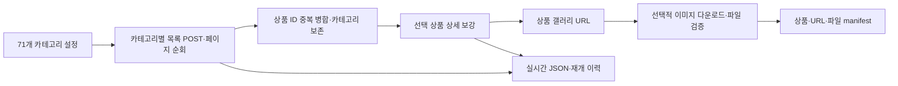

# 다나와 다중 카테고리 수집기

다나와의 상품 목록·상세·상품 갤러리를 수집하고, 원본과 공통 추출 결과를 분리해 저장한다. 현재 출력 버전은 `schema_version=1.2`다. 이 문서는 2026-10-16 코드와 검증 기록을 기준으로 한다.

**문서 전체 안내는 [docs/index.md](docs/index.md)**에 있다. 실제 검증 결과와 표본 범위는 [검증 기록](docs/validation_results.md), 데이터 전달은 [이미지·manifest 전달](docs/image_delivery.md)을 따른다.

## 수집 과정



1. 기본 설정 `config/danawa_categories_71.json`의 71개 카테고리를 읽는다. 개수는 설정 배열로 변경할 수 있다.
2. 캡처한 POST 요청의 `page`를 바꿔 같은 목록 URL로 요청한다. 템플릿에 없는 카테고리는 자신의 HTML에서 분류 인자를 확인한다.
3. `source + product_id`가 같으면 상품 하나로 합치고 발견 카테고리와 각 목록 관측값은 보존한다.
4. 목록 전체 순회 후 고유 상품의 상세 페이지를 순차 요청한다. 식별한 JSON-LD Product와 HTML 규격·판매 제안을 추출한다.
5. `#basicThumbSlideArea img`, `#baseImage`에서 상품 갤러리를 관측한다. 상세설명 이미지와 목록 썸네일은 다운로드 대상에서 제외한다. **사진은 1~4장으로 제한하지 않는다.**
6. `--download-images`가 있으면 사진 파일을 내려받아 해시·이미지 형식을 검증하고 상품·카테고리별 파일 경로를 기록한다.

목록만 `--workers`로 병렬 처리한다. 같은 카테고리의 페이지는 순서대로 진행하며 상세와 사진 다운로드는 순차 처리한다. 상세·다운로드 성공은 이용 조건 검수나 추천 승인을 뜻하지 않는다.

## 설치와 실행

명령은 `src/Commerce_crawler` 디렉터리를 기준으로 한다. Python 3.10 이상과 `requirements-collector.txt`가 필요하다. 프로젝트 루트의 기존 가상환경을 사용한다면 먼저 활성화하거나 그 Python의 전체 경로로 아래 명령을 실행한다. Windows 가상환경은 Linux 서버에 복사하지 않고 서버에서 재생성한다.

```powershell
# 새 환경이 필요한 경우에만 이 폴더에 생성
python -m venv .venv
.\.venv\Scripts\Activate.ps1
python -m pip install -r requirements-collector.txt

# 외부 요청 없이 인자·테스트 확인
python run_collector.py --help
python -m unittest discover -s tests -p 'test_*.py' -v
```

실제 목록·상세·이미지를 수집하는 명령:

```powershell
python run_collector.py --workers 3 --listing-interval 0 --interval 1 --download-images
```

`run_collector.cmd`도 같은 인자를 Python 진입점으로 전달한다. 이미 실행 중인 프로세스는 파일을 수정해도 자동 갱신되지 않는다.

### 목록 POST 템플릿 준비

실제 요청 헤더와 카테고리 본문은 Git 제외 파일 `config/danawa_pagination.local.json`에서 읽는다. 브라우저에서 성공한 목록 요청의 **Request Headers**와 전체 Payload를 기준으로 준비한다. `config/danawa_pagination.example.json`과 `config/danawa_pagination_5.json`은 구조·관측값 참고용이며 유효한 실제 Next-Action을 대신하지 않는다.

기존 local 파일을 예제로 덮어쓰지 않는다. 쿠키·Authorization은 커밋하거나 공유하지 않는다. Next-Action은 사이트 배포에 따라 바뀔 수 있다. 요청·응답 형식과 분류 인자는 [페이지 순회 문서](docs/pagination_and_gallery.md)를 따른다.

## 현재 기본값과 범위 조절

| 설정 | 기본값·의미 |
|---|---|
| 카테고리 | 71개 전체, `limit=null`, `max_pages=null`, `start_page=1` |
| 전체 상품·요청·이미지 요청 한도 | 없음. CLI 한도에 0을 줘도 무제한 |
| `--workers` | 2. 예제에서는 목록 작업자 3개를 명시 |
| `--listing-interval` | 0초. 전체 목록 작업자가 공유하는 시작 간격 |
| `--interval` | 1초. 상세·사진 요청 시작 간격 |
| `--timeout` | 요청당 20초 |

빈 상품 응답·반복 상품 페이지·설정 한도·오류로 순회가 끝난다. 반복 페이지 종료는 사이트의 모든 상품을 확보했다는 증거가 아니다. 403/429는 새 수집 요청을 중단한다. 자동 재시도·Retry-After 대기 후 재요청·명시적 CAPTCHA 탐지·차단 우회는 구현하지 않았다.

카테고리마다 다르게 제한하려면 별도 JSON 설정을 만든다. 아래는 **한 항목 예시**이며 전체 실행 배열에는 원하는 카테고리를 모두 넣는다.

```json
[{"category_id":"15241194","category_name":"침대","limit":5,"start_page":1,"max_pages":1}]
```

```powershell
python run_collector.py --categories config/my_categories.json --workers 3 --download-images --new-run
```

`config/my_categories.json`은 예시 경로이므로 사용자가 먼저 생성해야 한다. `--max-pages 1`은 모든 카테고리의 페이지 한도를 일괄 지정하지만 상품 수를 5개로 제한하지는 않는다. 기존 5개 카테고리용 설정은 `config/danawa_categories.json`이며 기본 실행 파일과 구분한다.

## 저장 결과와 manifest

기본 작업 경로는 `data/danawa/<job_id>/`다.

| 경로 | 용도 |
|---|---|
| `product_raw/`, `products/` | 처리 후 갱신되는 상품별 원본·정규화 JSON |
| `details/<product_id>/<수집 시각>.json.gz` | 상세 응답 HTML 전체(gzip, 로컬 재추출 근거). 응답마다 파일 하나. `product_raw` payload에는 넣지 않으며 적재 대상이 아님 |
| `run_config.json`, `checkpoint_events.jsonl`, `checkpoint_state.json` | 설정·복구용 이력·진행 요약 |
| `product_raw.jsonl`, `products.jsonl`, `run_report.json` | 종료·Ctrl+C·내보내기 시점의 통합 결과 |
| `media/products_with_local_images.jsonl` | **상품·이미지 연결 manifest**. 별도 `manifest.jsonl` 파일은 만들지 않음 |
| `media/image_downloads.jsonl`, `media/download_report.json` | URL별 다운로드 이력·결과 집계 |
| `media/images/<sha256>.<ext>` | 해시 기준 이미지 캐시 |
| `media/categories/<category_id>/danawa/<product_id>/…` | 상품별 이름을 가진 카테고리 경로 |

원본과 정규화 결과는 `source + product_id`, `job_id`, `payload_hash/raw_payload_hash`로 연결한다. POST 상품 객체는 원본의 `payload.listings[].api_product`에 보존한다. API 원본 필드와 수집기가 만든 메타데이터·가공 필드는 구분한다. [필드 명세](docs/data_fields.md)

사진 파일은 하드링크 생성이 가능하면 캐시와 공유하고, 실패하면 복사한다. 일반 NAS 전송이 관계를 보존한다고 가정하지 않는다. 경로는 manifest가 있는 `media/`를 기준으로 한다.

### 상세 HTML 보관 정책

`details/`가 있는 수집 실행 디렉터리는 **완료·적재 확인된 최근 2회 수집분**까지 보관한다. 수집기 자체는 지우지 않으며, 정리는 `product_collector.prune`이 맡는다. 운영에서는 NiFi VM이 수집기를 실행하므로 NiFi VM의 실행 루트가 대상이고, 주간 작업이 적재 확인 뒤 `--apply`로 실행한다.

```bash
python -m product_collector.prune --output <수집기 --output 경로>            # 삭제 대상만 출력
python -m product_collector.prune --output <수집기 --output 경로> --apply    # 실제 삭제
```

삭제 대상은 다음 조건을 모두 만족하는 실행 중 최근 2회(`--keep`)를 제외한 것이다. 하나라도 빠지면 지우지 않고 보고서의 `kept`에 사유를 남긴다.

- `run_config.json`과 `checkpoint_state.json`이 있고 상태가 `completed`
- 적재기가 Mongo·Garage 저장을 확인한 뒤 실행 디렉터리에 남긴 `pipeline_loaded.json`의 `job_id`가 `run_config.json`·`checkpoint_state.json`의 `job_id`와 같음(비어 있으면 미확인). 적재기가 이 파일을 쓰기 전까지는 아무것도 지우지 않는다
- `active_run.json`이 가리키는 진행 중 실행이 아니고, 다른 실행 루트에서 `--resume-from`으로 재개 중이어서 실행의 `writer.lock`이 잡혀 있지도 않음(`in_use`)
- 남는 실행(내보낸 스냅샷·재추출 결과)의 `run_report.detail_evidence_dirs`가 가리키지 않음. 같은 실행 루트 안의 참조만 확인한다

수집 중에는 수집기와 같은 `.collection.lock`을 잡지 못해 거부된다. 삭제는 `.deleting-<이름>`으로 이름을 바꾼 뒤 지우고, 중간에 멈춘 삭제는 다음 `--apply`에서 마저 지운다. 정렬 기준은 `checkpoint_state.json`의 `updated_at`(완료 시각)이다. 삭제한 수집분은 재수집 없이 재추출할 수 없다.

이미 MongoDB에 적재된 원천 문서(0.3 이하 수집분, payload에 HTML 포함)의 정리는 별도 결정 사항이다.

## 중단·재개·내보내기

`Ctrl+C` 후 저장 완료와 프로세스 종료를 기다린다. 동일 설정으로 다시 실행하면 미완료 작업을 자동 선택하며, 특정 작업은 다음처럼 지정한다.

```powershell
python run_collector.py --resume-from "data/danawa/<job_id>" --workers 3 --download-images
python run_collector.py --export-from "data/danawa/<job_id>"
```

`<job_id>`는 실제 ID로 바꾼다. 재개에는 `--new-run`을 붙이지 않는다. 성공한 페이지·상세·검증된 사진 파일은 재사용하고 실패·미처리 구간을 다시 처리한다. 저장 직전 강제 종료한 요청은 반복될 수 있다. 완료 작업의 이미지 실패를 다시 처리하려면 작업 ID를 명시하거나 [이미지 단독 실행](docs/image_localization.md)을 사용한다.

동일 출력 루트의 수집 단계에는 OS 잠금이 있다. **`--new-run`만으로 동시 실행할 수 없다.** 별도 수집은 `--output data/danawa_sample`처럼 출력 루트도 나눈다. 같은 이미지 출력·공유 캐시에 여러 다운로드 프로세스를 동시에 실행하지 않는다.

재개 준비는 이력 복원 비율·경과 시간을 출력하고 저장 완료한 상품 파일의 전체 재검사를 생략한다. 외부 삭제·손상이 의심되면 `--repair-files`로 전체 검사한다. `checkpoint_state.json`의 running만으로 프로세스 생존을 판단하지 않는다. [저장·잠금·복구 상세](docs/checkpoint.md)

정상 완료는 종료 코드 0, 부분 결과·입력 오류는 2다. 수집 중 Ctrl+C를 처리한 종료는 130이며 준비 중 중단·예상하지 못한 오류는 별도 예외로 끝날 수 있다. completed는 모든 필드 확보나 추천 승인을 뜻하지 않는다.

## 검증과 현재 한계

2026-10-16 커밋 `51b98b9`의 코드로 오프라인 **91개 통과, 실제 요청 테스트 7개 제외**를 확인했다. 과거 시점의 테스트 수와 실제 사이트 실험은 [검증 기록](docs/validation_results.md)에서 구분한다.

- 별도 소량 배치: 300개 상품, API 관측 객체 350개. 이미지 URL 678개 중 파일 다운로드 664개 성공·14개 실패.
- NAS 복사본: 같은 300개와 이미지 경로 1,426개를 검사해 원문 연결·파일 해시·용량·해상도·형식 오류 없음. 다운로드 실패 14개가 해결됐다는 뜻은 아니다.
- 대량 작업의 고유 목록 상품 65,498개는 진행 중 관측 수다. 전체 상세·사진·추천 검수가 끝난 수로 해석하지 않는다.

이 디렉터리는 다나와 파일 수집기를 담당한다. MongoDB·Object Storage·Kafka·Spark·MySQL·NiFi 처리는 별도 [데이터 파이프라인](../data_pipeline/README.md)이 담당하며, [연결 경계](docs/pipeline_integration.md)를 참고한다. [이미지 재개 개선과 검증 결과](docs/image_resume_optimization.md)에 이력 확인·중복 방지·실패 재시도 방식을 기록했다.

코드·설정·테스트·공식 문서는 Git으로 관리하고 이미지·원본·체크포인트·로컬 헤더는 제외한다. 협업은 [팀 가이드](../../docs/guides/GITHUB_GUIDE.md)를 따른다.
