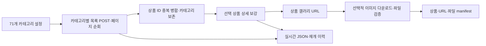

# 다나와 다중 카테고리 수집기

다나와의 상품 목록·상세·상품 갤러리를 수집하고, 원본과 공통 추출 결과를 분리해 저장한다. 현재 출력 버전은 `schema_version=1.2`다. 이 문서는 2026-10-16 코드와 검증 기록을 기준으로 한다.

**문서 전체 안내는 [docs/index.md](docs/index.md)**에 있다. 실제 검증 결과와 표본 범위는 [검증 기록](docs/validation_results.md), 데이터 전달은 [이미지·manifest 전달](docs/image_delivery.md)을 따른다.

## 수집 과정



1. 기본 설정 `config/danawa_categories_71.json`의 71개 카테고리를 읽는다. 개수는 설정 배열로 변경할 수 있다.
2. 캡처한 POST 요청의 `page`를 바꿔 같은 목록 URL로 요청한다. 템플릿에 없는 카테고리는 자신의 HTML에서 분류 인자를 확인한다.
3. `source + product_id`가 같으면 상품 하나로 합치고 발견 카테고리와 각 목록 관측값은 보존한다.
4. 목록 전체 순회 후 고유 상품의 상세 페이지를 순차 요청한다. 식별한 JSON-LD Product와 HTML 규격·판매 제안을 추출한다.
5. `#basicThumbSlideArea img`, `#baseImage`에서 상품 갤러리를 관측한다. 상세설명 이미지와 목록 썸네일은 다운로드 대상에서 제외한다. **사진은 1~4장으로 제한하지 않는다.**
6. `--download-images`가 있으면 사진 파일을 내려받아 해시·이미지 형식을 검증하고 상품·카테고리별 파일 경로를 기록한다. 기본(`--image-overlap on`)은 상세가 끝난 상품부터 사진을 받아 상세 수집과 겹쳐 돈다.

목록만 `--workers`로 병렬 처리한다. 같은 카테고리의 페이지는 순서대로 진행한다. 상세는 순차 요청하고, 사진도 순차 요청하되 상세와 동시에 진행할 수 있다(아래 "상세와 사진 겹쳐 돌리기"). 상세·다운로드 성공은 이용 조건 검수나 추천 승인을 뜻하지 않는다.

## 설치와 실행

명령은 `src/commerce_crawler` 디렉터리를 기준으로 한다. Python 3.10 이상과 `requirements-collector.txt`가 필요하다. 프로젝트 루트의 기존 가상환경을 사용한다면 먼저 활성화하거나 그 Python의 전체 경로로 아래 명령을 실행한다. Windows 가상환경은 Linux 서버에 복사하지 않고 서버에서 재생성한다.

```powershell
# 새 환경이 필요한 경우에만 이 폴더에 생성
python -m venv .venv
.\.venv\Scripts\Activate.ps1
python -m pip install -r requirements-collector.txt

# 외부 요청 없이 인자·테스트 확인
python run_collector.py --help
python -m unittest discover -s tests -p 'test_*.py' -v
```

실제 목록·상세·이미지를 수집하는 명령:

```powershell
python run_collector.py --workers 3 --listing-interval 0 --interval 1 --download-images
```

`run_collector.cmd`도 같은 인자를 Python 진입점으로 전달한다. 이미 실행 중인 프로세스는 파일을 수정해도 자동 갱신되지 않는다.

### 목록 POST 템플릿 준비

실제 요청 헤더와 카테고리 본문은 Git 제외 파일 `config/danawa_pagination.local.json`에서 읽는다. 브라우저에서 성공한 목록 요청의 **Request Headers**와 전체 Payload를 기준으로 준비한다. `config/danawa_pagination.example.json`과 `config/danawa_pagination_5.json`은 구조·관측값 참고용이며 유효한 실제 Next-Action을 대신하지 않는다.

기존 local 파일을 예제로 덮어쓰지 않는다. 쿠키·Authorization은 커밋하거나 공유하지 않는다. Next-Action은 사이트 배포에 따라 바뀔 수 있다. 요청·응답 형식과 분류 인자는 [페이지 순회 문서](docs/pagination_and_gallery.md)를 따른다.

## 현재 기본값과 범위 조절

| 설정 | 기본값·의미 |
|---|---|
| 카테고리 | 71개 전체, `limit=null`, `max_pages=null`, `start_page=1` |
| 전체 상품·요청·이미지 요청 한도 | 없음. CLI 한도에 0을 줘도 무제한 |
| `--workers` | 2. 예제에서는 목록 작업자 3개를 명시 |
| `--listing-interval` | 0초. 전체 목록 작업자가 공유하는 시작 간격 |
| `--interval` | 1초. 상세·사진 요청 시작 간격 |
| `--timeout` | 요청당 20초 |

빈 상품 응답·반복 상품 페이지·설정 한도·오류로 순회가 끝난다. 반복 페이지 종료는 사이트의 모든 상품을 확보했다는 증거가 아니다. 403/429는 새 수집 요청을 중단한다. 자동 재시도·Retry-After 대기 후 재요청·명시적 CAPTCHA 탐지·차단 우회는 구현하지 않았다.

카테고리마다 다르게 제한하려면 별도 JSON 설정을 만든다. 아래는 **한 항목 예시**이며 전체 실행 배열에는 원하는 카테고리를 모두 넣는다.

```json
[{"category_id":"15241194","category_name":"침대","limit":5,"start_page":1,"max_pages":1}]
```

```powershell
python run_collector.py --categories config/my_categories.json --workers 3 --download-images --new-run
```

`config/my_categories.json`은 예시 경로이므로 사용자가 먼저 생성해야 한다. `--max-pages 1`은 모든 카테고리의 페이지 한도를 일괄 지정하지만 상품 수를 5개로 제한하지는 않는다. 기존 5개 카테고리용 설정은 `config/danawa_categories.json`이며 기본 실행 파일과 구분한다.

## 저장 결과와 manifest

기본 작업 경로는 `data/danawa/<job_id>/`다.

| 경로 | 용도 |
|---|---|
| `product_raw/`, `products/` | 처리 후 갱신되는 상품별 원본·정규화 JSON |
| `details/<product_id>/<수집 시각>.json.gz` | 상세 응답 HTML 전체(gzip, 로컬 재추출 근거). 응답마다 파일 하나. `product_raw` payload에는 넣지 않으며 적재 대상이 아님 |
| `run_config.json`, `checkpoint_events.jsonl`, `checkpoint_state.json` | 설정·복구용 이력·진행 요약 |
| `product_raw.jsonl`, `products.jsonl`, `run_report.json` | 종료·Ctrl+C·내보내기 시점의 통합 결과 |
| `media/products_with_local_images.jsonl` | **상품·이미지 연결 manifest**. 별도 `manifest.jsonl` 파일은 만들지 않음 |
| `media/image_downloads.jsonl`, `media/download_report.json` | URL별 다운로드 이력·결과 집계 |
| `media/images/<sha256>.<ext>` | 이번 실행에서 받은 사진(해시 이름). 저장소에 이미 있는 사진(`stored`)은 받지 않음 |
| `media/image_settings.json` | 이미지 단계 고정 설정(재개 시 확인) |
| `../_image_index/image_downloads.jsonl` | 출력 루트 공용 URL별 다운로드 이력. 사진 파일 없음, prune 대상 아님 |
| `media/categories/<category_id>/danawa/<product_id>/…` | 상품별 이름을 가진 카테고리 경로 |

원본과 정규화 결과는 `source + product_id`, `job_id`, `payload_hash/raw_payload_hash`로 연결한다. POST 상품 객체는 원본의 `payload.listings[].api_product`에 보존한다. API 원본 필드와 수집기가 만든 메타데이터·가공 필드는 구분한다. [필드 명세](docs/data_fields.md)

사진 파일은 하드링크 생성이 가능하면 캐시와 공유하고, 실패하면 복사한다. 일반 NAS 전송이 관계를 보존한다고 가정하지 않는다. 경로는 manifest가 있는 `media/`를 기준으로 한다.

### 사진 재다운로드 방지

메인 수집기는 출력 루트의 `_image_index/image_downloads.jsonl`에 URL별 마지막 다운로드 기록(sha256·bytes·width·height·format·extension)과 실패 기록을 남긴다. 사진 파일은 이 폴더에 두지 않는다. 처음 만들 때는 출력 루트의 이전 실행(partial 포함) `media/image_downloads.jsonl` 성공 기록을 가져온다.

- **`--image-store-config <파일>`:** 이미지 버킷 읽기 전용 접속 설정이다. 서버 적재가 v2 `ingest-*`로 전환된 뒤에만 켠다(v1 적재는 stored를 이미지 없음으로 처리). 설정이 없으면 재개한 실행에서도 stored를 만들지 않고 다시 받는다. 이력에 성공 기록이 있는 URL은 파이프라인 객체 키 `images/sha256/<앞 2자>/<sha256>.<extension>`에 HEAD를 보낸다. 크기와 `sha256` 메타데이터가 같으면 다운로드하지 않고 이미지 항목을 `status: "stored"`로 기록한다. stored 항목에는 메타데이터만 있고 `local_path`·`filename`·`category_paths`는 비어 있다. 최종 무결성은 파이프라인 적재가 객체 전체 sha256으로 확인한다.
- 객체가 없거나 값이 다르거나 HEAD가 실패하면 지금처럼 받는다. HEAD 오류가 연속 20회면 그 실행에서는 저장소 확인을 멈춘다. 설정이 없으면 모두 받는다.
- 설정 파일은 Git 밖에 두고(권한 600) `key=value`로 쓴다. 필수 `endpoint`(https), `bucket`, `accessKey`, `secretKey`, 선택 `caBundle`, `region`(기본 us-east-1). boto3가 필요하다.
- **실패 재시도:** 같은 실행 안에서, 본 다운로드가 정상으로 끝난 뒤 최종 manifest를 쓰기 전에 이번 실행 폴더의 일시 실패(타임아웃·연결 오류·DNS·5xx)를 60초, 300초 뒤 최대 2회 다시 시도한다. URL별 시도 수는 `media/image_retry.json`에 남아 재개해도 2회를 넘지 않는다. 중단·차단(403/429)·예산 소진 때는 재시도하지 않는다. 그 뒤에도 남은 일시 실패는 다음 실행에서 다시 시도한다. 404 등 클라이언트 오류와 이미지가 아닌 응답이 연속 3회면 `gave_up`으로 두고 `--retry-failed`를 줄 때만 다시 시도한다. 실패해도 이전 성공 기록(`last_success`)은 유지한다.
- **사진 실패 판정:** 이미지 단계는 입력 상품의 고유 사진 URL 전체 대비 일시 실패·내부 오류·차단 실패가 1% 이하면 completed다(URL 50개 미만이면 하나라도 남으면 partial). 사이트에 없는 사진(403·408·429를 뺀 4xx, 이미지 아님, 크기 상한 초과)은 판정에서 빼고, 5%를 넘으면 `image_permanent_failures` 경보를 남긴다. 준비 미완료, 403/429 차단, 예산 때문에 남은 URL, 중단은 비율과 관계없이 partial이다. 사진 목록이 없는 상품은 완료를 막지 않고 품질 관문(`no_images`)이 판정한다. 결과는 `run_report.image_download.failures`·`alerts`·`retry`에 남는다.
- **확인되지 않은 stored:** 저장소 확인을 켠 실행에서, HEAD가 오류였고 이전 성공 기록이 있는 사진이 재시도 뒤에도 일시 실패하면 manifest에만 `stored`와 `storage_unverified: true`, 원래 실패 사유를 쓴다. 공유 이력에는 실패로 남는다. 적재가 실제 객체를 확인하고, 없으면 그 슬롯만 실패로 처리한다.
- **재시도 규칙 버전:** `RETRY_POLICY_VERSION`은 2다. 버전 1로 시작한 실행은 재개를 거부하므로(종료 코드 3) `python -m product_collector.abandon`으로 포기하고 새로 시작한다.
- **`_v`만 다른 주소(키 규칙 버전 2):** 다나와는 사진을 다시 게시할 때 주소의 `_v`를 바꾸고, 같은 사진을 다른 JPEG 바이트로 다시 인코딩하기도 한다. 저장소 설정이 있으면 `img.danuri.io/catalog-image/<3>/<3>/<3>/<32hex>.<ext>` 사진은 `_v`를 뺀 경로·쿼리(shrink 등)가 같을 때 같은 사진으로 본다. URL로 이력을 못 찾으면 이 키로 가장 최근에 실제로 받은 기록을 찾고, 그 객체가 저장소에 있으면 다시 받지 않고 `stored`로 기록한다. 처음 받은 바이트(sha256)를 유지한다. 이미지 항목의 `url`은 이번에 관측한 주소 그대로다. 어떤 기록과 맞췄는지(`matched_url`, `identity`)는 실행 journal(`media/image_downloads.jsonl`)에만 남기고 manifest와 공유 이력에는 쓰지 않는다. 다른 호스트·형태의 주소는 URL 전체가 키다.
- **교체 감시 표본:** 이렇게 맞춘 사진 중 매 실행 `--image-replacement-sample`장(기본 1,000)을 새 주소로 다시 받는다. 절반은 마지막 확인이 오래된 순, 절반은 무작위다. 같은 바이트이거나 재인코딩(같은 형식·픽셀 크기, 32×32 회색조 평균 차 2/255 이하)이면 옛 sha256을 유지하고 확인 시각(`confirmed_at`)만 공유 이력에 갱신한다. 다른 사진이면 이번 실행의 다운로드(새 sha256)로 기록하고, 확인한 표본의 1%를 넘으면 `image_replaced_at_same_path` 경보를 남긴다. 표본 다운로드가 실패해도 그 사진은 stored로 남고 사진 실패율에 들어가지 않는다(403/429는 다른 다운로드처럼 멈춘다). 표본 대상과 판정은 `media/image_replacement.json`에 남아 재개해도 같은 표본을 이어 간다. 결과는 `download_report.json`의 `stored_by_identity`, `replacement_check`에 남는다.
- 이력 경로, 저장소(endpoint·bucket, 키 제외), 재시도 규칙 버전은 `media/image_settings.json`에 고정된다. 저장소 설정이 있으면 키 규칙 버전(`image_key_version`)과 표본 크기(`replacement_sample`)도 고정된다. 다른 설정으로는 재개하지 않는다. 결과 건수는 `media/download_report.json`(`stored`, `store_checks`, `store_missing`, `store_mismatch`, `store_errors`)과 `run_report.image_download`에 남는다.

### 상세와 사진 겹쳐 돌리기

`--image-overlap on`(기본)은 사진 전용 작업 스레드 하나가 상세가 끝난 상품의 갤러리를 받는다. 상세(`prod.danawa.com`)와 사진은 각자 `--interval` 간격을 지키므로 두 요청이 동시에 나갈 수 있다. `off`는 상세 전체를 끝낸 뒤 사진 전체를 받는 이전 순서이며 결과와 요청 순서가 이전과 바이트까지 같다.

- 상품은 `products.jsonl` 순서로 넘어가고(재개 때 건너뛴 상품 포함, 상품마다 한 번), 사진 요청 순서도 그 순서다. 대기열은 상품 1만 개까지이고 사진이 밀리면 상세가 기다린다.
- 차단(403/429)과 요청 상한은 상세·사진이 따로다. 사진이 막혀도 상세는 계속하고, 그 뒤의 사진은 판정만 하고 다운로드 대상만 `stopped_after_block`·`budget_exhausted`로 둔다.
- manifest(`products_with_local_images.jsonl`)는 모든 상품을 넘긴 뒤 한 번 쓴다. 넘긴 상품을 직렬화한 해시가 내보낸 `products.jsonl`과 같을 때만 게시한다.
- 상세 단계 중에 중단(Ctrl+C·오류)되면 진행 중 요청 하나만 끝내고 멈춘다. 이때 manifest를 쓰지 않고 `download_report.json`에 `finished_at`이 없다(`phase: overlap_interrupted`). 재개하면 받은 사진은 이력으로 재사용한다.
- 차이: 상세 단계 중 일시 오류로 실패한 사진은 같은 실행을 재개해도 다시 요청하지 않는다(그 실행은 partial, 다음 실행에서 받는다). 이미지 이력 파일의 줄 순서는 `off`와 다르다(URL별 마지막 기록은 같다).
- 차단이 늘면 `--image-overlap off`로 되돌린다.

### 상세 HTML 보관 정책

`details/`가 있는 수집 실행 디렉터리는 **완료·적재 확인된 최근 2회 수집분**까지 보관한다. 수집기 자체는 지우지 않으며, 정리는 `product_collector.prune`이 맡는다. 운영 자동 실행에서는 [서버 실행기](#서버-실행기)가 매 주기 `prune --apply`를 돈다. 수동으로 돌릴 때는 적재 확인 뒤 `--apply`로 실행한다.

```bash
python -m product_collector.prune --output <수집기 --output 경로>            # 삭제 대상만 출력
python -m product_collector.prune --output <수집기 --output 경로> --apply    # 실제 삭제
```

삭제 대상은 다음 조건을 모두 만족하는 실행 중 최근 2회(`--keep`)를 제외한 것이다. 하나라도 빠지면 지우지 않고 보고서의 `kept`에 사유를 남긴다.

- `run_config.json`과 `checkpoint_state.json`이 있고 상태가 `completed`
- 적재기가 운영 원본 DB 적재 성공 뒤 실행 디렉터리에 남긴 `pipeline_loaded.json`이 확인됨: `schema_version` 1, 정해진 필드(`job_id`, `snapshot_id`, `ingestion_run_id`, `target`, `loaded_at`, `result`, `products`, `raw_confirmed`, `failed`, `image_relations_unavailable`, `gallery_missing`)가 모두 있고, `job_id`가 `run_config.json`·`checkpoint_state.json`과 같고, `target`이 `production`, `failed`가 0, `raw_confirmed`가 `products`와 같음. 하나라도 아니면 `not_loaded`로 남긴다. 적재기가 이 파일을 쓰기 전까지는 아무것도 지우지 않는다
- 표시의 `inputs`(적재기가 봉인한 원본 파일별 sha256: `product_raw.jsonl`, `products.jsonl`, `run_report.json`, 있으면 `gallery_report.json`, 사진 운영이면 `media/products_with_local_images.jsonl`)가 지금 파일과 같음. 적재 뒤 수동 재개·사진 재시도로 원본이 바뀌었거나 `inputs`가 없으면 `loaded_inputs_changed`로 남기고 사진도 지우지 않는다. 사진 바이트는 `inputs`가 아니라 사진 정리 뒤에도 대조는 그대로다
- `active_run.json`이 가리키는 진행 중 실행이 아니고, 다른 실행 루트에서 `--resume-from`으로 재개 중이어서 실행의 `writer.lock`이 잡혀 있지도 않음(`in_use`)
- 남는 실행(내보낸 스냅샷·재추출 결과)의 `run_report.detail_evidence_dirs`가 가리키지 않음. 같은 실행 루트 안의 참조만 확인한다

재개하지 않을 실행은 포기로 표시할 수 있다. 상태가 `abandoned`가 되고 활성 실행에서 빠지므로 다음 수집은 새 실행으로 시작한다. 완료된 실행이나 수집 중인 실행은 거부하고, 포기한 실행은 `--resume-from`으로도 재개하지 않는다.

```bash
python -m product_collector.abandon --output <수집기 --output 경로> [--run <실행 폴더>] [--reason "템플릿 본문 변경"]
```

`--prune-abandoned`를 주면 `abandoned`·`partial` 실행 중 가장 최근 완료·적재 실행보다 먼저 갱신된 것도 지운다(활성·잠금·참조 확인은 같다). 기본은 끔이다. 적재 인계 계약(`pipeline_loaded.json`)이 정해지기 전까지 옵션 없이 돌리면 지금처럼 완료·적재 실행만 대상이다.

남기는 최근 적재 실행도 사진 바이트는 지운다. 적재 때 사진이 Object Storage에 올라가 있기 때문이다. 지우는 것은 `media/images/`와 `media/categories/`(같은 바이트의 하드링크)뿐이고, 체크포인트·jsonl·상품별 파일·`details/`·`media/`의 manifest·보고서·이력은 남긴다. 지우기 전에 `media/images_pruned.json`(지운 시각, 폴더, 파일 수, 바이트)을 남기므로 중간에 멈춘 삭제는 다음 `--apply`가 마저 지운다. 이 표시가 있으면 `verify_assets`는 manifest와 상품 연결만 검사하고 파일은 검사하지 않으며(`images_pruned: true`), 그 실행은 `--resume-from`으로 재개하거나 이미지 단계를 다시 돌릴 수 없다(종료 코드 3). 잠금·활성 실행·참조 조건은 실행 삭제와 같고, 보고서의 `images_pruned`(실행, 폴더, 파일 수, 바이트)·`images_prunable`(미리보기)·`images_kept`(사유)에 남는다. 공용 이력(`_image_index`)은 로컬 경로를 갖지 않으므로 다음 실행은 저장소 확인 또는 재다운로드로 처리한다.

수집 중에는 수집기와 같은 `.collection.lock`을 잡지 못해 거부된다. 삭제는 `.deleting-<이름>`으로 이름을 바꾼 뒤 지우고, 중간에 멈춘 삭제는 다음 `--apply`에서 마저 지운다. 정렬 기준은 `checkpoint_state.json`의 `updated_at`(완료 시각)이다. 삭제한 수집분은 재수집 없이 재추출할 수 없다.

이미 MongoDB에 적재된 원천 문서(0.3 이하 수집분, payload에 HTML 포함)의 정리는 별도 결정 사항이다.

## 실행 결과와 품질 관문

실행 결과(`run_report.result`)는 하나의 값이다. `checkpoint_state.json`의 상태, 종료 코드(completed만 0, 아래 표), prune이 모두 이 값을 본다. 적재 대상은 `completed`뿐이다.

| 값 | 뜻 |
|---|---|
| `completed` | 목록·상세·(요청 시) 이미지가 모두 끝났고, 상세 실패가 상한 안이며, enforce 모드에서 품질 관문도 통과 |
| `partial` | 목록 오류, 요청 한도, 미요청 카테고리가 있거나, 상세 실패가 상한을 넘거나, 이미지 다운로드·검증이 완료되지 않음 |
| `quality_failed` | 완결은 됐지만 enforce 모드에서 품질 상한을 넘음 |

`--download-images`를 쓰면 이미지 단계까지 끝난 뒤 결과를 확정한다. 그 전까지 상태는 `running`이다.

상세 실패(request_failed·unrecognized·identity_mismatch)는 상품 하나로 실행 전체를 막지 않고 비율로 판정한다. 분모는 상세를 요청한 상품이다. 상한은 `quality.FAILURE_LIMITS`(요청 실패 1%, 인식 실패 1%, 다른 상품 페이지 0.5%)이고 warn 모드에서도 적용된다. 상세를 요청한 상품이 50건 미만이면 하나만 실패해도 partial이다. 결과는 `run_report.detail_failures`(건수, 상한, `failed_product_ids`)에 남는다.

**적재 계약:** completed 실행에도 상세가 실패한 상품이 상한 안에서 들어 있다. 그런 상품은 `detail_status`가 ok가 아니고 상세 필드가 비어 있다. 적재·게시 쪽은 `detail_status`가 `ok`(또는 `not_needed`)가 아닌 상품을 빼거나 상세 미확보로 표시해야 한다. 현재 파이프라인 Silver는 `detail_status == "ok"`일 때만 상세를 성공으로 본다. 다만 이런 상품을 게시에서 제외하는 규칙은 아직 없다.

품질 관문(`product_collector/quality.py`)은 사이트 구조 변경을 실행 종료 시점에 잡는다. 추가 요청 없이 이미 추출한 값으로 `run_report.quality`를 남긴다.

- 구조 신호 비율의 분모는 페이지를 받은 상세(ok·unrecognized·identity_mismatch)다.
- 상세 구조 신호: 정규화 이미지 없음, 이름·값이 있는 규격 없음, 가격 있는 판매 제안 없음. 갤러리 장수 중앙값도 기록한다.
- 목록 신호: POST 응답 상품 중 상품 코드나 이름이 없어 버린 비율(필터링 전 응답 기준)
- 페이지를 받은 상세가 50건 미만이면 구조 신호 비율은 기록만 하고 판정하지 않는다. 카테고리별로 20건 이상이면 구조·상세 실패 상한으로 경보를 남긴다. 반복 페이지로 끝난 카테고리와 첫 페이지가 빈 카테고리도 경보다.
- 상한은 `quality.LIMITS`에 있다. 정상 실행으로 보정하기 전의 값이다.

`--quality-gate warn`(기본)은 기록과 출력만 한다. `enforce`는 상한을 넘은 completed 실행을 `quality_failed`로 바꾼다. `off`는 기록하지 않는다. partial은 품질과 무관하게 partial로 남는다.

구조 변경으로 실패했을 때의 복구 순서는 다음과 같다.

1. 원래 실행을 재개해 수집을 마친다.
2. 파서를 고친다.
3. `--reprocess-from <실행>`으로 저장된 `details/`에서 전체를 다시 추출한다. 새 결과에 같은 관문을 다시 적용한다.
4. 그 결과만 넘긴다.

다른 상품의 페이지를 받은 상품이나 버려진 목록 상품은 재추출로 복구할 수 없으므로 재수집한다.

## 상세 재수집 (`--detail-refresh`)

기본값 `all`은 지금처럼 모든 상세를 요청한다. `changed`는 바뀐 상품만 상세를 요청하고, 나머지는 직전 실행의 상세를 그대로 쓴다. 서비스는 목록 최저가만 표시하므로, 재사용한 상세의 판매처별 가격이 이전 수집 시점 값이어도 허용한다.

```bash
python run_collector.py --detail-refresh changed --refresh-sample 1000
```

- **지문:** 모든 실행이 상품마다 목록 응답(`api_product`)의 안정 필드로 `listing_fingerprint`를 남긴다. 안정 필드는 상품 코드, 이름·제조사·브랜드·모델, 제조사 코드, 규격 요약(pc·mobile), 대표 이미지 주소의 경로(`?` 뒤 `_v` 등은 썸네일 재생성 시각이라 뺀다, 지문 v2), 분류 코드, 날짜, 판매 상태다. 가격, 판매처 수, 순위는 넣지 않는다. 여러 카테고리 목록에 나온 상품은 모든 목록 값을 함께 해시한다. HTML 목록 상품은 지문이 없어 항상 요청한다.
- **기준 실행:** 같은 `--output` 아래에서 가장 최근에 completed로 끝난, 상세를 수집한 실행이다. 처음 시작할 때 실행 폴더의 `detail_reuse.json`에 고정하므로, 재개해도 기준이 바뀌지 않는다. 기준이 없으면 모든 상세를 요청한다.
- **이전 실행:** 기준 실행에 아예 없는 상품(인기순 상위 구간을 들고 난 상품)은 남아 있는 다른 completed 실행(최신순, 최대 4개)에서 같은 조건으로 찾는다. 기준 실행이 표본·지문 변경·원문 손상으로 거절한 상품은 이전 실행으로 넘어가지 않는다. 탐색할 실행 목록과 재사용 후보 수도 `detail_reuse.json`에 고정한다. `detail_reused_from.job_id`는 상세를 준 실행이다.
- **재사용 조건:** 아래를 모두 만족해야 한다.
  - 기준 실행에서 상세가 `ok`이고 갤러리가 1장 이상
  - `extractor_version`과 지문이 같음
  - 이번 실행의 표본에 들지 않음
  - 그 응답의 gzip 원문을 열어 상품 ID·주소를 확인함

  원문이 없거나 손상됐으면 그 상품만 요청한다.
- **원문 근거:** 재사용한 상세의 gzip 원문은 이번 실행 `details/`에 하드링크한다(불가하면 복사). 실행마다 재추출 근거가 완결되므로 기준 실행을 prune해도 `--reprocess-from`이 동작한다.
- **표본:** 바뀌지 않았어도 매 실행 약 `--refresh-sample`건(기본 1,000)을 다시 요청한다. 확률의 분모는 시작 때 고정한 재사용 후보 수(기준 실행과 이전 실행 상품)다. 상품 ID와 job_id의 해시로 뽑으므로 재개해도 같은 상품이 뽑힌다. 이 표본으로 품질 관문이 이번 사이트 상태를 판단하고, 목록에 드러나지 않는 상세 변경도 일부 잡는다.
- **품질 관문:** 재사용 상품(`detail_reused_from`이 있는 상품)은 상세 실패율과 구조 신호 계산에서 뺀다. 재추출은 모든 상세를 다시 추출하므로 전체를 평가한다.
- **기록:** 기준 job_id, 표본 크기, 재사용·표본 건수는 `run_report.detail_reuse`에, 재사용 건수는 `run_report.quality.reused_details`에 남긴다. `detail_reuse.funnel`은 상세가 필요한 상품을 기준 실행에 있음 → 이전 실행에서 찾음 → 조건 통과(`unchanged`) → 표본 → 실제 재사용(이전 실행에서 온 것 따로)으로 센다.
- **관측 색인과 all 모드 집계:** 상세를 수집하는 실행은 모드와 상관없이 출력 루트 `_detail_index/seen.jsonl`(source·상품 ID별 마지막 목록 관측 시각, 마지막 ok 상세 시각과 지문, 바이트 없음)을 수집 잠금 안에서 갱신한다. `detail_reuse.new_products`는 기준 실행에 없던 상품을 처음 봄 / 전에 목록에서 봄(경과 주 구간) / 그때 ok 상세가 있었음 / 지문까지 같음으로 나눈다. 같은 실행을 다시 반영해도 그 실행 전 값으로 센다. all 모드는 아무것도 재사용하지 않지만 같은 집계를 남겨, changed로 바꿨을 때 줄어들 요청과 공용 상세 저장소(설계 2단계)의 효과를 서버 실행에서 미리 본다. 모드와 표본 크기는 실행 설정에 고정되므로, 다른 값으로는 재개하지 않는다.
- **한계:**
  - 목록에 드러나지 않는 상세 변경은 표본에 걸릴 때까지 반영되지 않는다.
  - 파이프라인은 상품행 관측 시각을 이름 후보 시각으로 정한다. 그래서 재사용한 상세 값이 이번 실행에 관측한 것처럼 기록될 수 있다.
  - 재사용한 상세의 갤러리 URL도 과거 값이다. 사진은 [사진 재다운로드 방지](#사진-재다운로드-방지) 규칙을 따른다.

## 중단·재개·내보내기

`Ctrl+C` 후 저장 완료와 프로세스 종료를 기다린다. 동일 설정으로 다시 실행하면 미완료 작업을 자동 선택하며, 특정 작업은 다음처럼 지정한다.

```powershell
python run_collector.py --resume-from "data/danawa/<job_id>" --workers 3 --download-images
python run_collector.py --export-from "data/danawa/<job_id>"
```

`<job_id>`는 실제 ID로 바꾼다. 재개에는 `--new-run`을 붙이지 않는다. 성공한 페이지·상세·검증된 사진 파일은 재사용하고 실패·미처리 구간을 다시 처리한다. 저장 직전 강제 종료한 요청은 반복될 수 있다. 완료 작업의 이미지 실패를 다시 처리하려면 작업 ID를 명시하거나 [이미지 단독 실행](docs/image_localization.md)을 사용한다.

동일 출력 루트의 수집 단계에는 OS 잠금이 있다. **`--new-run`만으로 동시 실행할 수 없다.** 별도 수집은 `--output data/danawa_sample`처럼 출력 루트도 나눈다. 같은 이미지 출력·공유 캐시에 여러 다운로드 프로세스를 동시에 실행하지 않는다.

재개 준비는 이력 복원 비율·경과 시간을 출력하고 저장 완료한 상품 파일의 전체 재검사를 생략한다. 외부 삭제·손상이 의심되면 `--repair-files`로 전체 검사한다. `checkpoint_state.json`의 running만으로 프로세스 생존을 판단하지 않는다. [저장·잠금·복구 상세](docs/checkpoint.md)

종료 코드는 서버 실행기가 다음 동작을 정하는 계약이다.

| 코드 | 뜻 | 상태 |
|---|---|---|
| 0 | completed | `checkpoint_state.json` completed |
| 1 | 수집 중 예외 | failed. 보고서 `result`가 있으면 `failed`로 바뀐다 |
| 2 | partial 또는 quality_failed(`run_report.result`로 구분) | 같은 값 |
| 3 | 시작 전 실패: 명령행·설정 오류, 재개 설정 불일치, 다른 프로세스가 수집 중, 포기한 실행 재개 | 실행 상태를 바꾸지 않음 |
| 130 | Ctrl+C 또는 SIGTERM 중단 | interrupted. 보고서 `result`가 있으면 `interrupted`로 바뀐다 |

어느 경우든 마지막 표준 출력 줄은 JSON(`result`, `exit_code`, 있으면 `output`·`job_id`·`error`)이다. 준비 중 Ctrl+C·강제 종료처럼 이 줄이 없으면 실행기는 `checkpoint_state.json`의 상태가 running으로 남은 것으로 판단한다. 사진 단계가 403/429로 멈추면 `run_report.image_download.stop_reason`에 `http_403`·`http_429`가 남는다. 이전 시도의 목록 실패(요청 실패·해석 실패·형식 불일치 빈 응답)가 재개 뒤에도 남은 카테고리는 partial이다. 형식 불일치 빈 응답 카테고리는 재개할 때 그 페이지를 다시 요청한다. completed는 모든 필드 확보나 추천 승인을 뜻하지 않는다.

목록 템플릿(Next-Action)이 아직 동작하는지 요청 1회로 확인할 수 있다. 실행 폴더를 만들지 않는다.

```bash
python run_collector.py --check-pagination --pagination-template config/danawa_pagination.local.json
```

종료 코드 0 정상, 4 차단(403/429), 5 통신 실패, 6 응답 해석 실패(템플릿 만료 의심), 3 템플릿 없음·형식 오류이고, 결과 JSON 한 줄(`status`, `category_id`, `http_status`, `products`, `error`)을 출력한다. 헤더 값은 출력하지 않는다.

## 서버 실행기

수집 VM(nifi-01)에서는 NiFi가 60분마다 실행기를 깨운다(`/opt/pj3/danawa-collector/collector_launcher.py;tick`). 실행기는 몇 초 안에 할 일 하나를 정하고 끝난다. 새 실행 시작·재개는 분리된 감독 프로세스(`supervise`)가 맡아 수집기를 돌리고 결과를 판정한다. 규칙의 근거는 상위 저장소 `crawler-optimization/operations.md`(정책 4)와 `launcher.md`다.

- **판단 로직:** `product_collector/launcher.py`. **고정 진입점:** `deploy/collector_launcher.py`(설치 스크립트가 서버 위치로 복사. 제어 파일의 `source` 릴리스를 불러 쓰므로 릴리스가 바뀌어도 그대로다).
- **제어 파일:** `<root>/config/collector-control.json`, contract_version 2. 예시는 `deploy/collector-control.example.json`(비밀값 없음). 버전 1은 거부한다(종료 3).
  - 실행에 고정: `categories`, `output`, `detail_refresh`, `refresh_sample`, `image_store_config`(null이면 끔), `quality_gate`. 진행 중인 실행이 있는데 바뀌면 운영자 대기.
  - 재개에 바로 적용: `workers`, `listing_interval`, `interval`, `image_overlap`.
  - 그 밖: `enabled`, `source`, `source_commit`, `python`, `pagination_template`, `prune_keep`, `prune_abandoned`, `handoff_since`, `schedule`(`period_days`·`rest_hours`·`max_run_days`), `disk`(`new_run_free_gb`·`resume_free_gb`), `backoff_hours`(`blocked` 목록·`retry`).

```bash
python -m product_collector.launcher --control <제어 파일> tick      # NiFi가 부름
python -m product_collector.launcher --control <제어 파일> status    # 현재 상태(네트워크 요청 없음)
python -m product_collector.launcher --control <제어 파일> release [--start-now]  # 운영자 대기 해제
python -m product_collector.launcher --control <제어 파일> stop      # 수집을 interrupted로 멈춤. HOLD와 함께
python -m product_collector.launcher --control <제어 파일> --check   # 설치 확인
```

tick 한 번의 순서: 완료됐는데 인계되지 않은 실행의 인계 파일 생성 → 인계 지연 경보 → 감독이 살아 있으면 `RUNNING`(감독 없이 수집 잠금만 잡혀 있으면 `ORPHAN_RUNNING`, 아무것도 건드리지 않음) → prune → `HOLD` 파일이 있으면 멈춤 → 감독이 판정 전에 죽은 시도를 로그·파일로 판정 → 결정(재개·새 실행·대기·운영자 대기) → 시작 전 점검(템플릿, 이미지 저장소 설정 권한, 디스크, `--check-pagination` 1회) → 감독 시작.

- **새 실행:** 진행 중인 실행이 없고, 마지막 completed 실행 시작 + 7일과 그 완료 + 24시간이 모두 지났을 때. `release --start-now`는 이 조건을 한 번 건너뛴다.
- **결과별 다음 동작:** interrupted는 다음 tick 재개. crashed(결과 줄 없음)·failed는 1시간 뒤 재개, 같은 원인이 연속 2회면 운영자 대기. 403/429 차단은 6시간 → 24시간 뒤 재개, 연속 3회면 운영자 대기. 목록 통신 오류·상세 실패율은 1시간 뒤 1회 재개. 템플릿 만료 의심, 사진 partial, quality_failed, 예산, 시작 거부(종료 3), 분류 안 됨은 바로 운영자 대기. 시작 후 10일이 지나도 운영자 대기(`release`가 3일 연장).
- **인계:** completed 실행이 조건(checkpoint·report completed, `writer.lock` 해제, 사진 manifest와 `download_report.finished_at`, 운영자 대기·포기 아님, 상한 없는 운영 수집)을 모두 만족하면 `<output>/handoff/<job_id>.json`을 한 번만 만든다(임시 파일 fsync 뒤 `os.link`). 인계 파일이 있고 적재 표시(`pipeline_loaded.json`)가 없는 실행은 `abandon`이 거부하고 `prune --prune-abandoned`도 지우지 않는다(`handoff_pending`). 인계 파일의 `run_dir`는 절대경로, `media_manifest`는 `run_dir` 기준 상대경로다. 인계 단계의 실패 기록(`handoff/<job_id>.failed`)이 있으면 `handoff_failed`, prune이 `loaded_inputs_changed`로 남긴 실행이 있으면 같은 이름의 경보를 `last.json`에 남긴다.
- **상태 파일:** `<root>/launcher/state.json`(시도·백오프·운영자 대기·시작/완료 시각), `last.json`(마지막 결정, 모니터링용), 시도별 수집기 로그 `<root>/logs/<job_id|new>/<시각>-<시도>.log`.
- **종료 코드(tick):** 0 판단 완료(대기·운영자 대기 포함, `last.json`의 `status`로 구분), 1 실행기 예외, 3 제어 파일·설치 오류. 모든 명령은 마지막 줄에 JSON 한 줄을 낸다.
- **멈추기:** NiFi 서비스는 정지·재시작 때 감독과 수집기에 SIGTERM을 보낸다. 수집기는 SIGTERM을 Ctrl+C처럼 처리해 interrupted로 저장하고, 다음 tick이 재개한다. 사람이 멈출 때는 `HOLD` 파일을 두고 `stop`을 쓴다.

## 검증과 현재 한계

2026-10-16 커밋 `51b98b9`의 코드로 오프라인 **91개 통과, 실제 요청 테스트 7개 제외**를 확인했다. 과거 시점의 테스트 수와 실제 사이트 실험은 [검증 기록](docs/validation_results.md)에서 구분한다.

- 별도 소량 배치: 300개 상품, API 관측 객체 350개. 이미지 URL 678개 중 파일 다운로드 664개 성공·14개 실패.
- NAS 복사본: 같은 300개와 이미지 경로 1,426개를 검사해 원문 연결·파일 해시·용량·해상도·형식 오류 없음. 다운로드 실패 14개가 해결됐다는 뜻은 아니다.
- 대량 작업의 고유 목록 상품 65,498개는 진행 중 관측 수다. 전체 상세·사진·추천 검수가 끝난 수로 해석하지 않는다.

이 디렉터리는 다나와 파일 수집기를 담당한다. MongoDB·Object Storage·Kafka·Spark·MySQL·NiFi 처리는 별도 [데이터 파이프라인](../data_pipeline/README.md)이 담당하며, [연결 경계](docs/pipeline_integration.md)를 참고한다. [이미지 재개 개선과 검증 결과](docs/image_resume_optimization.md)에 이력 확인·중복 방지·실패 재시도 방식을 기록했다.

코드·설정·테스트·공식 문서는 Git으로 관리하고 이미지·원본·체크포인트·로컬 헤더는 제외한다. 협업은 [팀 가이드](../../docs/guides/GITHUB_GUIDE.md)를 따른다.
