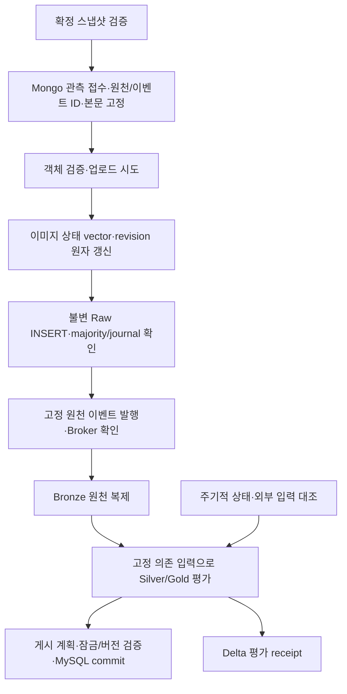

# 파이프라인 보강 계약 v1.1

기준 차이: 이 계약의 20대/pj3-* 배치는 당시 작업 폴더의 제안이며 분리 당시 dev의 19대 문서를 수정한 것은 아니다. 배포 시에는 현재 상위 인프라 문서와 담당자가 확정한 환경 설정을 따른다. 실제 구현·검증·남은 인수는 [실서버 검증](service_validation_20261018.md)에 모았다.

이 문서는 세부 설계 계약이다. 단계별 실행 방법은 [문서 안내](README.md), 현재 검증 상태는 실서버 검증 문서를 따른다. 계약의 존재가 전체 운영 인수 완료를 뜻하지 않는다.

2026-10-16. 현재 [인프라 문서](../../../docs/design/01-infrastructure.md)의 20대 구성과 논리 서버명을 기준으로 기존 네 파이프라인 문서를 교차 검토한 보강 설계다. 초기 인수 범위인 FULL_EXPORT 스냅샷·이미지 저장·Mongo 접수/Raw 저장·Kafka 발행/복구 코드를 작성하고 로컬/대역 검증했다. 실제 DB·인프라·운영 데이터는 변경하지 않았다. 전체 계약의 구현 완료를 뜻하지 않으며 [실행 기록](execution.md)에 첫 구현의 제약과 남은 인수를 구분했다.

## 1. 기준과 변경 판정

상위 공통 계약은 [데이터 모델](../../../docs/design/03-data-model.md), [Kafka](../../../docs/design/05-kafka-jobs.md), [상품 파이프라인](../../../docs/design/02-data-pipeline.md), [직접 추천](../../../docs/design/12-direct-recommendation.md)을 따른다. 이 문서의 보강 규칙은 [데이터 계약 v1](data_contract_v1.md)의 기존 식별자·불변 원칙을 유지하면서 미정 처리 절차를 구체화한다. 세부 보강 규칙의 기준 문서는 이 문서이고 다른 문서는 참조·요약한다. 상위 설계/실제 DDL과 합의가 필요한 서비스 변경은 실행 차단 조건을 별도로 표시한다.

| 검토 항목 | 판정 | 최소 보강 |
|---|---|---|
| 전체 흐름도에서 관측 접수 누락 | 흐름도 명세 누락 | 실제 접수 계약은 존재. 흐름도와 실패 순서를 일치시킴 |
| 이벤트 예시 필드와 본문 계약 차이 | 명세/예시 불일치 | observation_key·document_hash를 포함한 단일 스키마 |
| 업로드 성공 후 품질 대기 해소 | 명세 누락 | 상태 revision·의미 fingerprint·주기 대조·평가 receipt |
| 매핑·검수·규칙 변경 재처리 | 명세 누락 | 의존 입력 고정·선택 재평가·전체 대조 |
| 이미지 4장 후 과거 2장 도착 | 잠재 위험 | 출처 순서 근거·게시 비교/잠금. 장수·도착 시각으로 최신 판정 금지 |
| Raw별 가격 snapshot 증가 | 정책 선택 | 원천 증거 이력 유지, 서비스 가격 이력의 별도 효과 키 제안 |
| Raw ID를 포함한 source_version | 보수적인 기존 계약 | 유지. 파일·관측·연결·검수 승인 재사용을 분리 |
| LIVE 다중 연결 후보 | 명세 위험 | 같은 원천 wrapper는 수렴, 다른 wrapper는 임의 최신 선택 금지 |
| 같은 관측의 새 스냅샷 재접수 | 이미 명시됨 | 최초 envelope·ID 재사용을 인수 시험으로 검증 |
| 오류 문자열 제외 범위 | 구분 필요 | 이미지 운영 오류는 제외되지만 raw.detail_error는 원문 해시에 포함 |
| 19대·이전 서버명 | 상위 변경 미반영 | 20대·pj3-* 반영, 객체 저장소 개별 배정 미확정 유지 |

정합성 대조표 자체를 상위 계약의 독립 증거로 사용하지 않는다. 실제 상위 문서의 절을 읽고 대조하며 이후 변경 때 기준 hash·검토일을 갱신한다.

## 2. 인프라와 책임

| 역할 | 기준 논리 서버 | 파이프라인 책임 |
|---|---|---|
| 상품 준비 | pj3-nifi | Python 적재·인계 실행 인터페이스, 일정·중복 실행 계약 |
| Spark | pj3-spark-master, pj3-spark-worker01~03 | Bronze/Silver/Gold·단일 테이블 작성자·게시 |
| MongoDB | pj3-mongo01~03 | rs-products·primary/majority·journal, 불변 원천·보조 운영 원장 |
| Kafka | pj3-kafka01~03 | 원천 ID 전달, RF3/minISR2/acks all 시험 조건 |
| MySQL | pj3-mysql01~03 | 현재 Primary의 상품 게시·실행 이력. 초기 노드명이 영구 Primary라는 뜻 아님 |
| 파일 | pj3-object01, pj3-object02 | 이미지용과 Delta용을 구분하되 어느 노드가 어느 역할인지는 배포 설정으로 확인 |
| 서비스 | pj3-webapp, pj3-ad-server | 서비스·추천·검수 원장 소유. 파이프라인이 API·임베딩·모델을 구현하지 않음 |
| 모니터링 | pj3-monitor | 파이프라인 로그·적체·실패 건수의 관측 인터페이스. 모니터링 서버 구축 제외 |

bastion을 포함한 전체 20대 구성을 유지한다. 이미지/Delta 저장 VM 두 대를 S3로 대체하는 AWS 안은 상위 문서의 EC2 18대 기준을 따르며 실제 설치 완료로 표현하지 않는다. pj3-object01을 이미지용으로 임의 확정하거나 VM·담당자를 추가 배정하지 않는다. endpoint·bucket role·인증·네트워크·실제 버전은 환경 manifest와 preflight 입력이다.

## 3. 정상·복구 실행 순서

접수 원장의 majority·journal 확인 전 객체 업로드·Raw INSERT·발행은 시작하지 않는다. 접수 고유 키 경쟁에서 확정된 Raw ID·event ID·envelope를 재사용한다. Raw INSERT 성공만으로 Broker 전달·이미지 성공·추천 승인까지 완료됐다고 집계하지 않는다.

| 장애 위치 | 복구 |
|---|---|
| 접수 확인 미수신 | 같은 observation_key를 primary/majority로 조회. 같은 ID·본문 접수인지 확인한 뒤 진행 |
| 접수 후 업로드 실패 | 기존 ID와 예정 키 유지, 이미지 상태를 미확보로 기록. 부분 실패 Raw 보존·발행 가능 |
| 객체 저장 후 상태 갱신 전 종료 | 객체 checksum 대조 후 상태 갱신. 덮어쓰기/중복 다운로드 없이 복구 |
| Raw INSERT 응답 유실 | 같은 _id·document_hash·본문·보존 수준 대조. 미확인은 발행 보류 |
| Raw 확인 후 발행 전 종료 | 접수 원장의 고정 이벤트 본문만 재발행 |
| Broker 확인 후 상태 저장 실패 | EVENT_UNKNOWN으로 재대조·동일 event 재발행. 중복 전달 허용 |
| 이미지 업로드 나중 성공 | 같은 관측의 image_state_revision 변경. 5절의 대조 평가로 품질 대기 해소 |

lease/fencing token은 원장의 조건부 갱신을 보호한다. S3나 Kafka까지 해당 token이 검증해 준다고 가정하지 않는다. 객체의 내용 주소·충돌 거절, 불변 Raw·고정 event ID·Consumer 멱등성으로 외부 늦은 결과를 견딘다. lease를 잃은 작업자는 새 외부 작업을 시작하지 않고 이전 결과의 확인만 새 소유자가 수행한다.

## 4. 이벤트 계약의 단일 기준

신규 상품 원천 이벤트는 integration_design의 예시와 같은 `event_type=product.raw.collected`, envelope schema_version=1을 사용한다. 원천 envelope schema_version은 payload 안의 별도 값이다. 다음은 신규 구현이 만족할 필수 계약이며 기존 운영 v1의 호환성이 확인되지 않으면 같은 토픽에 그대로 배포하지 않는다.

| 위치 | 필수 필드·형식 |
|---|---|
| envelope | event_id: UUID 문자열, event_type: 위 상수, schema_version: 정수 1, occurred_at: UTC ISO8601, correlation_id: 수집 실행 문자열 |
| payload | raw_document_id: 24자리 ObjectId 문자열, source_code: danawa, source_product_id: 확인한 문자열, record_type: PRODUCT, source_record_key: 문자열 |
| payload | collection_run_id: 문자열, collected_at: UTC ISO8601, payload_hash: collector 해시, schema_version: 원천 포장 버전 문자열 |
| payload | observation_key: SHA256 문자열, document_hash: 확정 envelope 해시 |
| Kafka key | UTF-8 source_record_key |

event_id·occurred_at·correlation_id·본문·Raw ID·키는 최초 접수 후 불변이다. attempt·재발행 시각·이미지 업로드 상태를 이벤트에 매번 추가하지 않는다. 같은 Raw ID의 다른 document_hash·같은 event_id의 다른 본문은 DATA_CONFLICT로 격리하고 정상 원천을 UPDATE하지 않는다. body/hash 대조는 BSON 날짜·ObjectId를 계약 v1의 전송 표현으로 변환한 뒤 한다.

지원하지 않는 schema·깨진 본문·해시 충돌은 poison record다. Kafka 토픽/partition/offset·원문 바이트/보관 참조·hash·오류·시각을 영속 격리한 뒤에만 해당 메시지의 복구 가능한 처리 상태로 인정한다. 격리 쓰기 실패면 offset 완료 금지다. 같은 offset·hash 재전달은 기존 격리 증거로 수렴하고 원장 오류를 무한 재시도로 숨기지 않는다. 새로운 DLQ 브로커/플랫폼은 도입하지 않는다. 격리 파일/운영 이력의 권한·보관은 기존 실행 저장소를 사용한다. 일반 Consumer의 연속 offset 규칙과 Spark checkpoint/foreachBatch 성공 판정을 혼합하지 않는다.

격리 manifest의 키는 H({topic: string, partition: int, offset: int64, value_sha256: string})이며 원천 event ID를 읽지 못해도 결정적으로 계산한다. 원문은 권한 제한 파일/객체에 두고 manifest에는 schema·오류 코드·보관 참조·hash를 기록한다. 같은 위치의 다른 value hash는 별도 충돌 조사 대상이다. 지원하지 않는 신규 schema를 운영자 판단 없이 폐기하지 않고 격리 후 재처리 범위를 기록한다.

## 5. 상태 변경과 재평가: B안 우선

| 방식 | 장점 | 비용·한계 | 결정 |
|---|---|---|---|
| A: 이미지 상태 이벤트만 | 낮은 전달 지연, 변경량 중심 | 신규 스키마·발행 복구·Consumer 필요. 누락 대조가 없으면 이벤트 유실 구간 위험 | 단독 채택 안 함 |
| B: Mongo 상태·의존 입력 주기 대조 | 기존 DB/Spark 활용, 이벤트 누락에 의존하지 않음 | 주기 지연·스캔 I/O. 검증한 상태 버전·receipt 필요 | 초기 기준 |
| C: 이벤트+상태 대조 | 빠른 반응과 사후 복구 | 두 발견 경로·중복·배포/운영 비용 | 측정한 지연/스캔 비용이 기준을 넘을 때 확장 |

B는 새 Raw 관측이나 원천 이벤트를 만들지 않고도 업로드 성공을 재평가한다. C로 확장하더라도 이벤트는 재평가 힌트이고 상태 대조·입력 fingerprint·receipt는 유지한다. 새로운 상태 토픽은 첫 인수 범위에 추가하지 않는다.

### 5.1 Mongo 이미지 상태 원자성

다음은 ingestion_observations의 **신규 변경 가능 운영 필드**다. raw_products에는 넣거나 갱신하지 않는다.

| 필드 | 형식·규칙 |
|---|---|
| image_state_revision | int64, 0에서 시작. 의미 있는 vector 변경 때만 +1 |
| image_state_vector | image_slot·checksum·bucket/key·availability(UNCONFIRMED/AVAILABLE/FAILED/MISSING)·검증 방법/정책 버전의 정렬된 작은 목록 |
| image_state_fingerprint | H(vector의 의미 투영). 오류 문자열·attempt·검증 시각만 바뀌면 동일 |
| image_state_checked_at | UTC datetime, 진단/검증 freshness. revision 순서를 대체하지 않음 |

vector·fingerprint·revision은 lease token+기대 revision 조건의 **단일 Mongo 문서 원자 갱신**으로 저장한다. image_state_vector가 이미지 사용 가능성의 기준이며 ingestion_images는 상세 시도·URL·오류 이력이다. 두 문서를 같은 순간에 갱신해야 한다고 가정하지 않는다. 상세 이력만 쓰고 죽으면 기존 vector는 UNCONFIRMED로 남으며 복구 작업이 실제 객체를 다시 검증해 vector를 확정한다. vector를 먼저 갱신한 뒤 상세 이력을 쓰다 실패해도 사용 가능성은 확정 vector로 판단하고 시도 이력 보완을 남긴다.

서로 다른 문서에 이미지를 기록하고 header revision만 별도 증가시키는 방식은 변경 누락 위험 때문에 사용하지 않는다. vector BSON 상한은 접수 preflight로 검사하고 초과 시 상태를 잘라내지 않고 격리한다. 분할 vector 계약은 향후 버전이다. revision은 rollback/재사용하지 않으며 복원 시 vector/hash/revision을 함께 대조한다. 동일 revision의 다른 fingerprint는 충돌이다.

AVAILABLE은 마지막 확인 상태이며 영구 파일 존재 보장이 아니다. 새 게시 전 대상 객체 검증과 운영 무결성 대조 작업이 파일 유실을 발견하면 MISSING으로 revision을 갱신한다. 외부 객체의 검사/게시 사이 삭제를 DB 트랜잭션으로 막을 수 있다고 주장하지 않는다. 실제 서비스는 자체 현재 상태·권한 검사 경계를 유지한다.

### 5.2 평가 입력과 완료 증거

Spark 상품 ETL이 재평가를 소유한다. NiFi는 실행 기회만 제공한다. 검수/매핑 원장 편집·승인·링크 현재 상태 판단은 기존 담당 소유다.

`processing_input_fingerprint=H({stage, raw_document_id, document_hash, image_state_revision, image_state_fingerprint, gallery_selection_evidence_hash, mapping_snapshot_hash, review_snapshot_hash, link_validation_snapshot_hash, normalizer_version, quality_policy_version, gold_policy_version, contract_version})`로 정의한다. 단계에서 사용하지 않는 입력도 명시 null로 직렬화한다. 각각의 snapshot은 행 내용·멤버십·NULL/부재·기준 시점·만료 상태를 포함해 고정한다. 처리 시각 자체를 넣어 매번 다른 fingerprint를 만들지 않는다. 승인 만료·링크 검증 유효기간 경과는 명시적 상태 전이로 반영한다.

mapping/review/link hash는 **해당 관측·상품·이미지·scope에 영향을 주는 행의 투영**이다. 전체 원장 snapshot ID는 재현 근거로 보존하되 무관한 행 하나의 변경이 모든 관측 fingerprint를 바꾸지 않게 한다. read/captured_at은 의미 hash에서 제외하고 유효기간 경계의 effective status 변화만 반영한다. 같은 배치에서는 원장을 한 번 동결해 관련 투영을 재사용하며 상품마다 전체 테이블을 다시 읽지 않는다. 영향을 판별할 근거가 부족한 규칙 변경은 안전하게 지정 전체 범위를 재평가한다.

신규 Delta `silver/pipeline_evaluations/`는 stage+raw_document_id+processing_input_fingerprint 고유 평가 receipt다. status=OUTPUT_COMMITTED 또는 QUALITY_WAIT, 고정 입력 참조, output key/hash·테이블별 Delta version·평가 완료 시각을 기록한다. QUALITY_WAIT도 그 입력 버전에 대한 평가 완료이며 이후 입력이 바뀌면 새 fingerprint로 재평가한다. 인프라 실패·존재해야 할 Raw 미확인은 receipt 성공으로 남기지 않고 RETRY_WAIT다. MySQL 게시 완료는 기존 publishing_runs와 DB commit 증거로 별도 관리한다.

이는 논리 고유 키로 단일 작성자 MERGE·중복 검사로 보장하며 Delta에 자동 UNIQUE 제약이 있다고 가정하지 않는다. 주기 대조의 epoch·다음 관측 key·정상 완료 범위는 기존 정규화 checkpoint 안의 별도 발견 진행 metadata로 저장한다. 발견 metadata 유실은 전체 투영 순회를 다시 시작할 수 있고 receipt로 중복을 제거한다. 새로운 발견 cursor를 처리 완료 receipt로 간주하지 않는다.

출력 테이블을 evaluation key로 멱등 반영·Delta commit한 **뒤** receipt를 마지막에 쓴다. 다중 Delta 테이블 전체 트랜잭션을 가정하지 않는다. 출력 후 receipt 저장 전 종료는 같은 키로 재반영 후 receipt 복구다. receipt가 가리키는 출력/버전이 없거나 hash가 다르면 완료로 건너뛰지 않는다. 같은 테이블의 기존 단일 Driver가 Kafka 신규 입력과 재평가 배치를 함께 처리하며 독립 Driver를 새로 추가하지 않는다.

### 5.3 발견·처리·재시작

1. 단일 ETL 실행이 RAW_CONFIRMED 관측과 변경 가능한 이미지 vector를 primary/majority로 순회한다. observation_key 순서의 작은 페이지로 순환 대조한다. updated_at 시각 필터만으로 발견하지 않아 clock skew·과거 행 수정·동일 시각 변경을 놓치지 않는다.
2. 매핑/검수/링크 입력을 짧은 일관 읽기 또는 담당자가 제공한 불변 export로 동결한다. 관련 원장 버전이 없으면 내용 hash와 실제 포함 행 목록을 보존한다. 임의 snapshot 버전을 발급해 담당 승인으로 표시하지 않는다.
3. fingerprint를 계산해 완료 receipt가 같은 출력으로 존재하면 skip한다. 없으면 재평가한다. 신규 Raw가 아니라 상태·규칙만 바뀐 경우 Bronze는 재작성하지 않는다.
4. 이미지 vector를 읽은 뒤 revision/hash를 다시 확인해 중간 변경이면 이번 평가를 재시도한다. 출력은 사용한 고정 입력으로 식별하고 이후 변경은 다음 평가가 처리한다. 게시 직전에는 7절의 현재성 검사를 추가한다.
5. 발견 cursor를 이동했다는 이유만으로 평가 완료를 기록하지 않는다. 재시작은 마지막 안전 페이지/epoch를 반복할 수 있고 receipt 고유 키로 중복 제거한다. 이전 순회 위치보다 앞에서 바뀐 행은 다음 전체 순회가 발견한다.

기본 발견 기회는 배치 프로필의 5분 간격이며 한 순회가 끝나기 전에 무제한 새 순회를 쌓지 않는다. 이는 65,498건 전체를 5분 안에 검증한다는 성능 보장이 아니다. 초기에는 상태/ID 투영과 vector만 비교하고 매번 Raw HTML·모든 이미지 바이트를 재조회하지 않는다. 실제 object 재검증은 새 게시·검증 만료/오류·별도 한도 있는 무결성 작업에서 수행한다. 스캔 지연·I/O·미평가 backlog를 측정한 뒤 범위 인덱스/이벤트 힌트를 검토한다.

| 변경 | 영향 대상·처리 |
|---|---|
| 이미지 업로드 성공/유실 | 해당 observation_key와 관련 상품 재평가, Raw/이벤트 ID 유지 |
| 카테고리 매핑 | 원천 categories에 해당 source/category가 있는 관측. Silver 원천 분류 역색인+전체 순회 대조 |
| 이용 승인/철회/만료 | product·image source_version·scope·permission hash의 관련 연결, 원장 읽기 전용 |
| 링크 검증 변경 | 해당 원천 상품·URL·검증 버전. 사이트 재요청은 담당 서비스 |
| 정규화/품질/Gold 정책 변경 | 변경 범위를 입증하면 선택 처리, 영향 범위 불명확하면 지정 전체 범위 재평가 |
| Bronze 유실/원천 변환 오류 | 원천 ID·document_hash로 Bronze 복구. Raw 불변 원문은 수정 금지 |

원천/관계 역색인의 새 변경·삭제 누락도 주기 전체 순회에서 검출해야 한다. 신규 규칙 버전이 바뀌어도 기존 결과를 덮어쓴 뒤 시험하지 않고, 고정 입력/버전의 결과로 수량·품질 대조 후 게시한다. 단계별 checkpoint를 유지하고 재평가를 위해 Kafka/Spark checkpoint를 삭제하지 않는다.

## 6. 관측 동일성·LIVE 연결·이미지 순서

### 6.1 기존 관측 키 보존

observation_key·H·Raw ID·event ID·document_hash 규칙은 v1을 유지한다. 이미지의 운영 오류·경로·업로드 결과는 gallery hash에 들어가지 않지만 raw.detail_error 등 원문 wrapper는 source_observation_hash에 포함된다. raw의 오류 문자열 변경으로 새 관측이 되는 것은 보수적 원문 보존 정책이다. 모든 오류가 관측 키에서 제외된다고 표현하지 않는다. 이를 바꾸려면 observation-key-v2와 별도 변환/중복 대조가 필요하므로 첫 인수에서는 변경하지 않는다.

같은 key의 새 snapshot은 최초 envelope·Raw ID·event ID를 재사용한다. source pointer·capture 순서·새 input snapshot·연결 증거는 운영 manifest에 별도로 추가하고 불변 Raw/event를 UPDATE하지 않는다. 같은 원천의 배치/LIVE 수렴은 raw wrapper·갤러리 의미 투영이 정확히 같을 때만 보장한다. 같은 상품이라는 이유로 서로 다른 관측을 합치지 않는다.

### 6.2 다중 연결 후보

LIVE media 연결은 값/갤러리/실행을 대조한 후보를 source_observation_hash로 그룹화한다. 후보 seq가 여럿이어도 wrapper hash가 같으면 같은 원천 내용 그룹으로 수렴하고 모든 근거 seq를 보존한다. 서로 다른 wrapper 그룹이 둘 이상이면 최신 seq를 임의 선택하지 않고 LINK_AMBIGUOUS로 이미지 인계를 보류한다. metadata 원천 인계는 계속할 수 있다.

source가 진행 중이고 대응 후보가 아직 없으면 WAIT_SOURCE_MATCH, 종료 범위까지 확인해도 없으면 MEDIA_SOURCE_MISMATCH다. 정확한 원래 media 생성 commit은 현재 출력만으로 입증할 수 없으므로 linkage_method=HASH_AND_GALLERY_EQUIVALENCE이며 EXACT_COMMIT으로 표시하지 않는다. 대응 raw/media가 명시적으로 고정된 FULL_EXPORT가 나중에 오면 그 입력의 명시적 결합 근거를 보존하고 관측 키로 재대조한다. 이를 과거 다운로드 commit의 복원으로 주장하지 않는다.

근본적인 provenance 강화는 수집기 담당의 최소 확장인 media 생성 기준 source_observation_hash·commit seq·gallery snapshot ID를 출력하는 것이다. 크롤러 변경은 이번 범위에 넣지 않는다. 필수 근거가 없는 이미지 연결을 강제로 게시하지 않는 것이 현재 입력의 안전한 한계다.

### 6.3 순서 근거

| 값 | 역할·금지 |
|---|---|
| observation_key | 동일성. 크기/사전순으로 최신 판정 금지 |
| source_version | 원천 관측별 이미지 연결 추적. hash 문자열로 순서 판정 금지 |
| journal seq | 같은 수집 run의 metadata commit 순서. 다른 run·이미지 생성 순서로 확대 금지 |
| media content hash | 내용 동일성. 버전 시간순 아님 |
| image_state_revision | 같은 관측의 업로드 사용 가능 상태 순서. 다른 관측의 원천 최신성 아님 |
| 관측한 media의 capture_order | 같은 검증된 source subscription에서 읽어 동결한 순서. 네트워크 수신 순서와 다름 |

LIVE 단일 어댑터는 원본 위치의 atomic media manifest를 순차 읽고 동결한 순서에 subscription_id·source generation·capture_order(int64)를 부여한다. 기존 ingestion_snapshots의 SUBSCRIPTION_CONTROL record에 마지막 순서·전임 capture hash·lease token을 보존하고 capture manifest에 연결한다. 재시작 때 같은 capture hash는 같은 order를 재사용한다. source 교체·generation 역전·전임 chain 불일치면 활성 비교를 중단한다. 원격 전송 후 받는 쪽에서 도착 순서로 번호를 새로 매기지 않는다.

DB 장애 중 spool 캡처는 가능하지만 순서 증거가 확정되지 않은 묶음은 ORDER_UNVERIFIED다. 단일 producer의 내구성 있는 전임 hash chain을 복구·접수한 뒤 비교에 사용한다. 여러 producer/호스트가 독립적으로 만든 order를 합치지 않는다. source에서 관측하지 못하고 덮어써진 중간 manifest까지 보존했다고 주장하지 않는다.

같은 검증된 metadata 관측·subscription에서 order 4가 먼저 전달되고 order 2가 나중에 오면 order 2는 이력만 보존한다. 확보 이미지 수는 비교 기준이 아니다. 서로 다른 metadata 관측은 실제 상세 관측 시각·검증된 metadata seq로 비교하되 cross-run 시각 충돌은 UNKNOWN으로 남긴다. 이미지 단독 변경의 순서 근거가 없거나 legacy FULL_EXPORT가 새 활성 연결과 비교 불가능하면 ORDER_UNKNOWN으로 품질 대기한다. 초기 활성값이 없는 단일 확정 배치의 명시적 bootstrap 선택은 가능하지만 이후 배치를 자동으로 최신이라고 취급하지 않는다.

실제 제공처가 이미지를 제거한 경우는 **완전한 원천 갤러리 목록**이라는 확인 근거와 더 최신인 source 시점이 있어야 삭제/비활성화를 제안한다. 다운로드 실패·부분 manifest·빈 parser 결과·장수 감소만으로 제거를 판정하지 않는다. 현재 자료에서 완전성/제거 근거가 없으면 REMOVAL_UNVERIFIED로 두고 자동 비활성화하지 않는다. 승인 철회/만료는 원천 제거와 별도 서비스 검수 정책으로 처리한다.

## 7. MySQL 최신성 보호와 권한

Gold 게시 후보는 immutable publication plan에 product_key·선택 raw ID·source/gallery 순서 증거·processing fingerprint·Delta versions·예상 기존 active 연결 집합 hash를 고정한다. 동시 게시를 제어할 상품별 pipeline publishing guard(상품 키 고유, publication_revision int64·마지막 plan key)를 **신규 논리 DDL 요구사항**으로 둔다. 이는 서비스 제품 ID/추천/승인 상태가 아니라 파이프라인 게시 순서의 제어 메타데이터다. 실제 테이블/기존 publishing_runs 활용 가능성은 DDL preflight에서 확인하며 중복 엔터티를 자동 생성하지 않는다.

트랜잭션 절차:

1. 현재 MySQL Primary에서 상품별 guard를 SELECT FOR UPDATE하고 기존 product·해당 이미지 연결을 잠근다. bootstrap guard 동시 생성은 고유 키 경쟁으로 기존 행을 재조회한다.
2. plan의 예상 publication_revision·active 연결 hash를 현재 값과 대조한다. 다르면 rollback 후 재평가한다. revision 일치만으로 새 데이터임을 인정하지 않고 6절의 source/gallery 순서 비교도 수행한다.
3. 사용한 category mapping·review·scope·만료·링크 검증 입력을 다시 읽어 snapshot fingerprint를 대조한다. 동일 DB 원장의 관련 행과 부재 범위를 보호하는 인덱스/격리 수준·locking read를 실제 DDL에서 검증한다. 필요한 범위 잠금/담당 원장의 원자 버전 guard가 없으면 활성 전환을 차단하고 staging까지만 남긴다. pipeline이 검수 원장을 UPDATE하거나 승인하지 않는다.
4. 더 최신이며 품질/검수 조건을 통과한 후보만 product_images 신규 연결과 기존 active 전환을 같은 트랜잭션에서 반영한다. 동일 입력은 기존 UUID를 재사용한다. 순서 불명확·과거 후보는 현재 active를 바꾸지 않는다.
5. guard publication_revision+1·plan key·publishing_run 결과와 상품/판매 변경을 함께 commit한다. 결과 응답 유실은 plan key로 재조회한다.

scope 철회·만료는 파이프라인 다음 배치를 기다리는 동안 허용된 서비스 상태로 간주하지 않는다. 실제 서비스의 현재 권한/링크 검증은 해당 담당의 책임이며 pipeline은 철회 이벤트/원장 변경을 재평가 입력으로 처리한다. 객체 저장소·Mongo·MySQL 전체를 하나의 트랜잭션으로 잠그는 설계는 도입하지 않는다. 최종 외부 상태의 snapshot과 이후 변경은 다음 대조/서비스 검증으로 처리한다.

이 guard·잠금/권한·활성 연결 고유 제약은 Gold/MySQL 단계의 DDL 합의/검증 항목이다. 첫 인수 단계에 서비스 DDL을 구현하거나 수정하지 않는다. 조건이 충족되지 않으면 서비스 게시 완료를 표시하지 않는다.

## 8. 가격 이력·이미지 연결과 승인 재사용

### 가격: 원천 증거와 서비스 효과 분리

기존 raw_document_id 포함 snapshot-v1 키는 원천 증거별 이력을 정확히 보존한다. 같은 가격을 독립 관측한 사실까지 지우지 않는 장점이 있고, 이미지 확보가 늘 때 동일 판매 시각의 snapshot이 반복되는 단점이 있다. 따라서 Raw/Gold 원천 증거 키는 유지하고 MySQL의 가격 변화/시점 이력 키를 다음과 같이 분리하는 **price-history-v2 변경안**을 정의한다.

`price_effect_key=H({offer_key, 실제 가격 observed_at, price_amount, currency, price_basis, option fingerprint, discount/member/coupon 조건, 배송/설치/세금 조건, condition_schema_version})`다. 관측 시각이 다른 같은 가격은 별도 시점 이력이다. 조건이 미확정이면 서로 같은 조건이라고 병합하지 않고 source evidence key로 구분·품질 대기한다. 실제 차이가 있는 조건을 누락된 필드로 합쳐서는 안 된다.

Gold offer_history는 source evidence key·raw ID·raw payload hash·실제 가격 시각·price_effect_key를 모두 보존한다. MySQL offer_snapshots.snapshot_key를 `price-effect-v2:<hash>`로 사용할 때는 같은 효과의 여러 Raw를 Gold의 evidence 관계로 역추적하고 대표 raw 참조는 최초 확인 근거로 고정한다. 단일 latest_raw 필드만 바꿔 과거 근거를 유실하지 않는다. MySQL 별도 다대다 증거 테이블은 필요성이 입증되기 전 추가하지 않는다.

**기존 snapshot_key 의미 변경이므로 자동 전환 금지**다. 실제 DDL/서비스 조회가 원천별 행을 요구하면 v1 원장을 유지하고 별도 읽기 집계로 가격 변화 뷰를 제공한다. Gold/MySQL 인수 전에 price-history-v2 또는 v1+집계 중 선택을 서비스 계약으로 확정해야 하며 미확정이면 서비스 가격 게시를 차단한다. 기존 Raw·snapshot UUID를 재발급/삭제하는 마이그레이션은 첫 인수 범위가 아니다.

### 이미지: 세 버전과 승인 분리

파일 버전은 검증한 checksum, 관측 버전은 raw ID/source_version, 상품 이미지 연결 버전은 product_images UUID+슬롯+원천/자산 관계다. 현재 source_version 계산의 raw ID는 유지한다. 같은 bytes면 객체/assets는 공유하지만 새 Raw 연결은 새 product_images 버전일 수 있다.

신규 연결을 자동 승인하거나 이전 usage_review_json을 복사하지 않는다. 과거 승인 재사용은 서비스 담당이 같은 상품·scope·정확한 checksum·URL/슬롯·권리 근거·유효기간·변경 없는 목적에 대해 허용한다는 **명시 규칙과 새 연결에 대한 감사 근거**를 제공할 때만 가능하다. 원천 버전을 특정한 승인은 새 버전에 자동 확장하지 않는다. pipeline은 그 검수 결과를 읽고 새 source_version·permission_snapshot_hash를 대조한다. 근거 없으면 PENDING, 생성 이용 초기 DENIED를 유지한다.

따라서 파일 dedup을 위해 source_version에서 raw ID를 제거하지 않는다. 연결 증가량·검수 재사용 비용을 측정한 뒤 별도 버전 계약 변경을 검토한다. 불변 Raw의 asset_id=null을 서비스 UUID로 사후 갱신하지 않는다.

## 9. 변경 목록·우선순위·인수

| 대상 | 유지/추가/수정 | 도입 단계·필요성 |
|---|---|---|
| observation_key/Raw/event ID/H | 유지 | P0: 첫 인수의 동일성·재실행 근거 |
| 접수 순서·이벤트 예시 | 수정 | P0: 구현 지침 일치 |
| image_state_vector/revision/fingerprint | 추가: 기존 Mongo 운영 원장 필드 | P0: 원천 불변 유지하며 복구 완료를 나중에 발견할 근거 |
| ingestion_images 상세 시도 | 유지·기준 명확화 | P0: vector와 다중 문서 원자성 가정 제거 |
| processing_input_fingerprint·Delta 평가 receipt | 추가 | P1: Silver/Gold 입력 변화 재평가·누락 복구 |
| 원천 분류/관계 역색인 | 추가: ETL 파생 입력 | P1: 영향 범위 선택. 전체 순회가 누락 복구 |
| 상품 게시 guard·조건부 active 전환 | 추가: 논리 DDL 합의 필요 | P1: Gold/MySQL 인수 전 경쟁·최신성 보호 |
| 가격 효과 키 v2 | 수정안, 서비스 합의 후 활성화 | P1: 가격 시점 이력과 Raw 증거 분리. 기존 v1+집계 대안 |
| source_version·검수 쓰기 권한 | 유지 | P1: 승인 자동 승격·기존 관계 손실 방지 |
| LIVE 후보 그룹·capture 순서 증거 | 수정/추가 | P2: LIVE 활성화 전. FULL_EXPORT 우선 |
| 새 이미지 상태 Kafka 토픽 | 초기 도입 안 함 | P2 이후 B 대조의 실측 비용/지연으로 C 확장 판단 |
| 새 DB/브로커/독립 Delta Driver | 도입 안 함 | 기존 구성 내에서 처리 |

| 시험 | 기대 완료 조건 |
|---|---|
| 접수 후 업로드 실패, Raw 저장/발행 전후 종료 | 동일 원천/event ID·고정 본문·복구 가능한 영속 상태 |
| 객체 저장 후 vector 갱신 전 종료 | 원격 재대조 후 단일 revision 전이, Raw 불변 |
| image FAILED→AVAILABLE, 원천 이벤트 없음 | 다음 B 순회에서 새 fingerprint 평가·품질 대기 해소 |
| 순회 cursor 이전 위치의 변경·재시작 | 다음 전체 순회가 발견, 완료 receipt 없이는 skip 금지 |
| 출력 commit 후 receipt 저장 실패 | 같은 evaluation key 재처리·출력 중복 없음 |
| 매핑 추가/삭제·승인 철회/만료·규칙 변경 | 해당 관계/범위 새 평가, 원장 UPDATE·새 Raw 생성 없음 |
| LIVE 4장 order 먼저, 과거 2장 늦게 도착 | 과거 이력만 보존, active 역전 없음 |
| 순서 불명·동일 갤러리의 다른 wrapper 후보 | LINK_AMBIGUOUS/ORDER_UNKNOWN·게시 대기 |
| 실제 제거 증거 vs 다운로드/파서 실패 | 완전성·최신 근거가 있는 제거만 전환, 나머지는 대기 |
| 동시 게시·서비스 검수 변경 | guard/CAS/필요 범위 잠금 검증, 오래된 plan rollback |
| 이미지 보강 Raw만 추가, 같은 가격 시각/조건 | Raw 증거 모두 보존, 선택한 가격 정책에 따른 효과 행 dedup |
| 동일 파일의 새 원천 연결 | asset 재사용·관계 이력 유지·승인 자동 복사 없음 |
| poison record·격리 저장 실패 | 영속 격리 전 offset 완료 금지, 재전달 수렴 |
| Raw/vector/manifest BSON 초과·디스크 한도 | 잘라내기 없이 격리/중지, 원본·복구 근거 보존 |
| VM/AWS 이전 | 주소/credential 교체, 원천/운영/관계 ID·revision·receipt 보존 |

65,498상품의 성능은 미측정이다. 256분할은 고정 성능 요구가 아니라 외부 병합 구현 기본값이며 소량/중량 표본에서 메모리·I/O·파일 수를 비교해 변경 가능하다. 각 단계가 전체 이미지를 복제하면 용량이 늘므로 checksum 객체·snapshot 보관 정책과 별도 data volume 여유를 측정한다. 이미지 확장자는 검증한 실제 형식으로 정규화하고 같은 checksum의 불일치 형식은 충돌로 검사한다. 운영 원장의 필수 인덱스는 observation_key 고유·stage/next_retry_at·단일 관측 조회이며 주기 대조는 projection을 사용한다. 과도한 인덱스/lease 갱신 부하는 측정 후 조정한다.

처리량·지연·용량 수치를 검증 완료로 기록하지 않는다. 첫 인수는 image revision 기록까지 갖추고 Spark 재평가·서비스 가격/DDL·LIVE를 한 번에 구현하지 않는다. 관련 DDL·검수/매핑/링크 입력·저장소 배정은 담당 계약/시험 환경이 준비돼야 후속 인수할 수 있다. 담당자가 지정되지 않은 업무는 임의 배정하지 않는다.

## 10. 이번 검토의 근거와 한계

상위 설계는 검토 시점 작업 파일을 기준으로 읽었다. HEAD에 포함되지 않은 상위 문서 변경도 현재 기준으로 반영했다. 설치·성능·실제 DDL은 확인한 것으로 간주하지 않는다.

| 상위 파일 | 검토 기준 SHA256 |
|---|---|
| 01-infrastructure.md | 4f294436141aa0996a132c3617b011554614a0f9d662f8a87d0ffa9a33fb97e3 |
| 02-data-pipeline.md | cd8c50e251cdb60f398157225f6ff379655191923df25406af9f099b73cdae59 |
| 03-data-model.md | 973c2c1f4d956efaac06404d0b41111332b3a802228e27184a920ca067c557ce |
| 05-kafka-jobs.md | bb4688ed0cb7f363c6946d98c08e10f883f9ce162fa424a2ad9ba9840e4afb0a |
| 12-direct-recommendation.md | 2630ba79764bd0b9f3492574dadc0c609c6ba28fcc65bb76e8b30b71217c9362 |

현재 작업 트리에서 크롤러 소스 일부는 sparse checkout의 skip-worktree 항목이다. 체크아웃을 바꾸지 않고 Git revision `67e837db4114ef8955a12c0b466f6f4aba50bd8f` 저장본을 대조했다. core.py blob=7b2354fe5bcfeeabafd4c0ff3146553893ff9183, checkpoint.py=bc9bea0a6565a6397ffe958148814349d9c9459b, media.py=9f6ad7ce8c2250e9cd8025dfd0cdb38e473456a1, __main__.py=537f1eaf6b7214f61b23f510346e284655de2c35다. 기존 체크포인트의 fsync→상품 반영→state commit 순서와 수집 후 이미지 단계·25 URL manifest 저장을 확인했다.

문서의 크롤러 상대 링크는 저장소 경로 기준이며 sparse 작업 폴더에 파일이 없으면 로컬 클릭이 열리지 않을 수 있다. Git 저장본 확인을 로컬 파일 존재·실제 크롤링 실행·LIVE 복구 시험으로 바꾸어 설명하지 않는다. 실제 구현 착수 시 지원 수집기 revision/형식과 작업 문서를 다시 확인한다.
