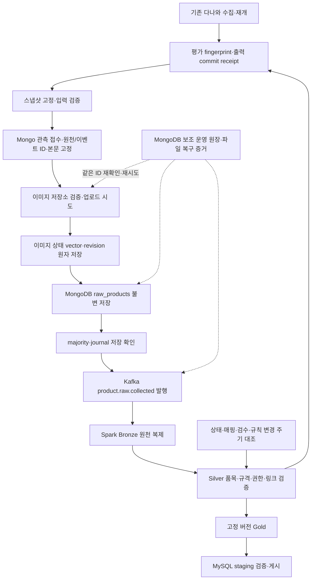

# 다나와 수집 데이터 파이프라인 통합 설계

2026-10-16 기준 **전체 구현 기준안**이다. FULL_EXPORT 스냅샷·이미지 객체 저장·MongoDB 접수/불변 원천·Kafka 발행/복구와 후속 상품 Bronze 코드를 작성하고 로컬 검증했다. 실제 서버 종단 쓰기/장애 인수, Silver/Gold·MySQL 연계, LIVE·예약 실행은 남아 있다. 구현 범위·제약·검증 근거는 [첫 단계 실행 기록](execution.md)과 [Bronze 실행 기록](bronze_execution.md), 관측 버전·운영 원장·서비스 키는 [데이터·복구 계약 v1](data_contract_v1.md)을 따른다.

현재 인프라 기준의 접수·이벤트·재평가·최신성 보강은 [보강 계약 v1.1](design_amendment_v1_1.md)을 따른다. 이 문서는 전체 흐름을 요약하고 세부 새 필드/상태/게시 규칙을 중복 정의하지 않는다.

## 1. 기준 문서와 적용 우선순위

- [현행 파이프라인](../../../docs/design/02-data-pipeline.md): 상품 원천 → Bronze → Silver → Gold → 서비스 원장.
- [데이터 모델](../../../docs/design/03-data-model.md), [원천 속성 사전](../../../docs/design/data-dictionary/01-raw-delta.md): 불변 원천·상품·판매·이미지 식별과 시점.
- [Kafka·복구 계약](../../../docs/design/05-kafka-jobs.md): DB 저장 확인 후 발행, 동일 이벤트 재전달, 업무 기록 기반 복구.
- [인프라](../../../docs/design/01-infrastructure.md): MongoDB 3노드 Replica Set, 환경별 연결, 이미지·Delta 저장소 분리.
- [직접 추천](../../../docs/design/12-direct-recommendation.md): 현행 추천 경로. 과거 생성·템플릿의 필수 관계를 신규 처리에 도입하지 않는다.
- [상품 연결](../../../docs/design/09-product-links.md), [운영](../../../docs/design/06-operations-migration.md): 출처·권한·링크·복구·로그.

상위 설계의 상품·저장·복구 공통 계약을 적용한다. 과거 내용을 접은 영역에도 유지되는 공통 계약이 있으므로 모두 폐기하지 않는다. 신규 추천은 현행 직접 추천 변경안을 따른다. 충돌·미정 사항은 이 문서에 제안으로 남기며 공통 설계 문서를 조용히 변경하지 않는다.

## 2. 실제 구현과 신규 책임

코드 근거: [수집·원천 해시](https://github.com/encore-ai-campus/mlo-01-p3-team3/blob/67e837db4114ef8955a12c0b466f6f4aba50bd8f/Commerce_crawler/product_collector/core.py), [다나와 추출·정규화](https://github.com/encore-ai-campus/mlo-01-p3-team3/blob/67e837db4114ef8955a12c0b466f6f4aba50bd8f/Commerce_crawler/product_collector/danawa.py), [체크포인트](https://github.com/encore-ai-campus/mlo-01-p3-team3/blob/67e837db4114ef8955a12c0b466f6f4aba50bd8f/Commerce_crawler/product_collector/checkpoint.py), [이미지 manifest](https://github.com/encore-ai-campus/mlo-01-p3-team3/blob/67e837db4114ef8955a12c0b466f6f4aba50bd8f/Commerce_crawler/product_collector/media.py), [이미지 검증](https://github.com/encore-ai-campus/mlo-01-p3-team3/blob/67e837db4114ef8955a12c0b466f6f4aba50bd8f/Commerce_crawler/product_collector/validation.py), [저장 유틸리티](https://github.com/encore-ai-campus/mlo-01-p3-team3/blob/67e837db4114ef8955a12c0b466f6f4aba50bd8f/Commerce_crawler/product_collector/storage.py), [수집 의존성](https://github.com/encore-ai-campus/mlo-01-p3-team3/blob/67e837db4114ef8955a12c0b466f6f4aba50bd8f/Commerce_crawler/requirements-collector.txt), [기존 테스트](https://github.com/encore-ai-campus/mlo-01-p3-team3/tree/67e837db4114ef8955a12c0b466f6f4aba50bd8f/Commerce_crawler/tests).

| 구성 | 현재 확인한 동작 | 통합 시 추가할 책임 |
|---|---|---|
| 수집기 | 다나와 목록·상세·갤러리 추출, 상품 중복 병합 | 현행 기능 유지. 다른 쇼핑몰 수집 추가 없음 |
| 수집 체크포인트 | JSONL 이력, 개별 JSON, 원천·가공 통합 파일, 재개·export | 수집 진행만 관리 |
| 이미지 수집 | 원본 URL·상품·로컬 파일·해시·메타데이터 연결 | 기존 manifest를 적재 입력으로 사용 |
| 신규 스냅샷 단계 | FULL_EXPORT 구현·로컬 검증 | 일관된 입력 시점 고정·해시·건수·이미지 검증 |
| 신규 적재 단계 | 어댑터 구현·대역 검증, 실제 서버 인수 대기 | 이미지 업로드, 불변 원천 적재, 처리 상태, 재실행 |
| 신규 발행·복구 단계 | 어댑터 구현·대역 검증, 실제 서버 인수 대기 | 저장 확인, Kafka 전달 확인, 미발행 재대조 |
| Spark·게시 | 상품 Bronze 구현·로컬 검증, 실제 서버 인수 대기. Silver 이후 미구현 | Bronze 복제, Silver 품질, Gold·MySQL 반영 |
| NiFi·예약 실행 | 이 수집기에 미구현 | 승인된 실행 명령 호출·일정·실패 감시 |

현재 파일의 products는 추출·정규화 중간 결과다. MySQL products나 완성된 Silver와 같은 데이터셋이 아니다. PyMongo가 개발 가상환경에 설치된 것과 파이프라인 구현 완료도 구분한다.

이번 설계·후속 개발 범위는 **파일 입력 이후의 데이터 파이프라인**이다. 수집기 실행·파서 수정, 인프라 설치, 사용자/추천 API, 운영 화면, 이용 승인·카테고리 매핑 원장 편집, 외부 임베딩 호출·모델 학습·추론·FAISS 인덱스 활성화는 각 담당 범위다. 파이프라인은 고정된 계약과 검수 결과를 입력으로 읽고, 미제공이면 품질 대기·게시 차단을 수행한다. 책임별 읽기/쓰기 경계는 [계약 v1](data_contract_v1.md)의 0절에 따른다.

## 3. 목표 구조와 처리 순서



일부 이미지 실패만으로 상품 원천을 폐기하지 않는다. 새 바이트 확보는 새 관측, 같은 바이트의 업로드 재시도는 운영 상태 변경이다. 원천 image_refs는 로컬 검증 결과와 예정 객체 키를 고정한다. 원격 사용 가능 상태의 기준은 ingestion_observations의 단일 image_state_vector/revision/fingerprint이며 ingestion_images는 상세 이력이다. 객체 키만으로 성공을 판단하지 않는다. 업로드 복구·매핑/검수/규칙 변경은 새 Raw 없이 주기 상태 대조로 재평가한다. 세부 계약은 보강안 v1.1을 따른다.

기존 수집기는 사이트 요청·추출을, 별도 Python 파이프라인은 저장된 파일의 적재·발행·변환을 소유한다. NiFi는 파이프라인 실행·발견·일정만 담당하고 상품 변환·재시도 원장을 중복 구현하지 않는다. 운영 실행 주체는 NiFi 한 곳으로 두고 OS 예약 작업의 중복 실행을 막는다. NiFi 설치·인프라 운영은 배포 담당이며 파이프라인은 호출 인터페이스·종료 상태를 제공한다.

## 4. 입력 스냅샷과 일관성

입력은 두 모드로 구분한다. FULL_EXPORT는 완료·중단 후 export된 묶음이고, LIVE_DELTA는 [수집 중 증분 인계 계약](live_handoff_v1.md)에 따라 commit 이하의 frozen raw/normalized pair를 별도 불변 스냅샷으로 동결한 변경 묶음이다. 두 모드 모두 진행 중인 개별 product_raw/products 폴더를 그대로 순회하며 적재하지 않는다. 최초 구현·인수는 FULL_EXPORT부터, LIVE는 별도 계약 테스트 후 활성화한다.

스냅샷 생성 절차 제안:

1. 수집 실행·export 경로와 이미지 manifest를 지정한다. 원본 파일을 이동·수정하지 않는다.
2. 수집기 잠금과 export의 상태를 확인한다. 기존 export 함수가 활성 수집과의 일관된 읽기를 모두 보장한다고 가정하지 않는다. 초기에는 수집 중단 또는 완료 후 export를 사용한다.
3. 원천·가공·이미지 manifest의 상품 집합, source/product_id, job_id, raw_payload_hash, 관측 시각·카테고리를 대조한다.
4. 확정할 JSONL을 별도 임시 경로로 복사하고, 이미지 바이트를 검증해 스냅샷 전용 보관본 또는 버전이 고정된 객체로 확보한다. 변경 가능한 원본에 대한 하드링크만으로 불변성을 보장하지 않는다.
5. 복사 전후 입력 해시와 결과 해시를 대조한다. 파일 변경·집합 불일치·끊긴 JSONL은 실패로 남기고 재시도한다.
6. 파일 목록·해시·건수·원천 실행·형식 버전을 가진 manifest를 마지막에 확정한다. 미완성 임시 경로는 적재 대상에서 제외한다.

이미지 manifest가 다른 상세 보강 실행에서 생성됐다면 원래 export와 임의로 합치지 않는다. 실제로 대응하는 raw/products export를 준비하거나 별도 관측으로 등록한다.

LIVE_DELTA는 크롤러 checkpoint_state.commit을 읽기 상한으로 삼고 journal의 seq·envelope hash·raw/normalized 쌍을 검증한다. 새 파일은 파이프라인 소유 경로에만 쓰며 크롤러 잠금을 획득하거나 강제 해제하지 않는다. source_metadata를 먼저 인계하고 현재 수집 순서상 뒤에서 시작하는 이미지 단계의 확보 버전을 추가 인계한다. 최초 journal 검증 이후 offset에서 이어 읽으며 매번 전체 이력을 재생하지 않는다. 상세 cursor·완료·backpressure·원격 전송 규칙은 증분 인계 계약을 따른다.

## 5. 원천 필드 매핑

목표 컬렉션은 공통 설계의 raw_products다. 아래는 **초기 적재 제안**이며 구현된 스키마가 아니다.

| 현재 출처 | 목표 필드·형식 | 변환·결측·검증 |
|---|---|---|
| source | source_code / 문자열 | danawa만 허용 |
| product_id | source_product_id / 문자열 | 확인한 다나와 상품 ID. 누락은 격리하며 추정하지 않음 |
| job_id | collection_run_id / 문자열 | 기존 수집 ID 유지. 신규 적재 실행 ID와 구분 |
| collected_at | collected_at / UTC BSON datetime | 시간대 있는 값을 UTC 변환. 적재 시각으로 교체하지 않음 |
| payload.detail.url 또는 확인한 목록 관측 url | source_url / 문자열·null | 실제 관측한 주소만 사용. 상품·판매 링크와 의미 구분 |
| payload | payload / 문서 | listings·detail 표현 유지. 정규화·발행 상태로 변경하지 않음 |
| payload_hash | payload_hash / 문자열 | 기존 core.payload_hash 재계산 대조. 알고리즘 버전도 별도 보존 |
| schema_version | 원본 형식 메타데이터 | 원본 1.2 등 보존. 새 적재 envelope의 schema_version과 구분 |
| extractor_version | collector_version·parser_version | 현재 원본 값 보존. 수집·파서 버전이 따로 기록돼 있지 않음을 명시 |
| 원본 wrapper의 categories·detail_status·detail_error 등 | collector_metadata / 문서 | payload를 제외한 원본 wrapper 전체 보존. 계약 v1의 확장 필드 |
| 현재 없음 | _id / ObjectId | 관측 접수 시 한 번 발급·영속화. 재시도 때 보존 |
| 현재 없음 | record_type / 문자열 | 현재 wrapper는 PRODUCT. 판매 내용을 담았다는 이유로 OFFER를 임의 분리하지 않음 |
| source + record_type + product_id | source_record_key / 문자열 | 예: danawa:PRODUCT:5097200. 관측 ID와 다름 |
| 정확한 응답 바이트 보존 근거 없음 | response_body_hash / null | 저장 HTML·추출 JSON 해시를 HTTP 원본 응답 해시로 표시하지 않음 |
| 별도 원본 응답 객체 없음 | raw_object_key / null | 스냅샷 JSON 경로를 원본 HTTP 응답 경로로 가장하지 않음 |
| images 배열과 다운로드 manifest | image_refs / 배열 | 원본 URL·순서·역할·checksum·객체 참조·확보 상태 |
| products의 가격·규격·provenance·field_status | 별도 변환 입력·검증 근거 | Mongo payload를 정규화 결과로 교체하지 않음. Silver 완료로 취급하지 않음 |

BSON 직렬화 크기가 16 MiB 이상이면 v1은 RAW_TOO_LARGE로 격리하고 원본 스냅샷을 보존한다. 묵시적 잘라내기는 금지한다. 객체 참조로 큰 원문을 처리하는 envelope v2는 별도 계약으로 도입한다. 기존 자료의 response_body_hash는 null로 두고 LEGACY_EXTRACTED_ONLY를 명시한다. 세부 보존·시각 규칙은 계약 v1을 따른다.

### 가격·URL·규격·분류의 후속 매핑

| 입력 | Silver·Gold 대상 | 규칙·한계 |
|---|---|---|
| 목록 최저가·가격 문자열 | 집계 가격·price_basis | 특정 판매자의 실제 판매 가격과 혼동하지 않음 |
| seller_offers·옵션·배송·회원 조건 | offers·offer_snapshots 후보 | 확인된 판매 ID·조건만 사용. 안정적 판매 ID가 없으면 품질 대기 |
| product_url | comparison_url 후보 | 다나와 개별 비교 주소. purchase_url로 복사하지 않음 |
| 확인된 판매자 링크 | purchase_url 후보 | 판매·옵션 대응과 링크 상태 검증 후 반영 |
| categories | 원천 분류 + 서비스 category_id | 카테고리 매핑 버전 필요. 첫 분류를 임의 대표 서비스 분류로 확정하지 않음 |
| specifications·spec_text·크기 원문 | dimensions_original·mm 규격 | 축·측정 대상·옵션·단위가 확인된 값만 변환. 미제공은 NULL |
| 이미지·출처·검수 근거 | product_images·assets·이용 정책 | 동일 파일 재사용과 상품별 승인·연결을 구분 |
| 확인한 source·product_id | product_key | 상위 모델의 danawa:<product_id> 사용. 이름·브랜드·모델·이미지 유사성으로 다른 ID를 합치지 않음 |

도매꾹 상품과 다나와 상품을 일치시키는 작업은 이번 통합 범위가 아니다. AI 추정 크기·가격·재질을 원천 실측 사실로 보충하지 않는다.

## 6. 이미지 저장과 연결

현재 근거는 products_with_local_images.jsonl의 images 배열이다. 대표·다른 각도의 같은 상품 갤러리를 연결하며 상세 설명 이미지는 포함하지 않는다. 장수는 1~4장으로 제한하지 않는다.

| 현재 이미지 필드 | 저장할 의미 |
|---|---|
| source·product_id, 상품 wrapper | 상품 출처·원천 상품·관측 관계 |
| url·observed_url·origin·selector | 확보 URL과 추출 근거. 관측 주소도 있으면 유지 |
| order·role | 표시 순서·대표/갤러리 역할 |
| sha256·bytes·format·extension·width·height | 실제 바이트 검증·저장 메타데이터 |
| local_path·filename·category_paths | 로컬 추적 근거. 서버 접근 주소로 그대로 쓰지 않음 |
| status·error | 성공·미시도·실패 구분. 인증정보가 섞이지 않도록 오류 정제 |
| 새 bucket·object_key | 이미지 저장소 위치. 구현 시 설정·키 계약 확정 |
| asset_id | 서비스 assets 등록 뒤 확정. 등록 전은 null |

저장 키는 images/sha256/<앞 두 자리>/<전체 SHA256>.<확인한 확장자> 형태를 제안한다. 버킷은 환경 설정으로 분리한다. 같은 바이트는 한 번 보관하되 각 상품의 URL·순서·관측·출처 관계는 각각 보존한다. SHA256 동일성과 상품 동일성은 다르다.

업로드 전에 로컬 파일의 해시·실제 이미지 형식·크기·해상도·상품 연결을 검사한다. 기존 객체는 키만 믿지 말고 저장소가 제공하는 검증 가능한 checksum 또는 실제 바이트 해시로 재사용 여부를 확인한다. ETag를 항상 SHA256으로 취급하지 않는다.

파일 누락·변조는 검증 실패, 원래 다운로드 실패는 확보 실패로 구분한다. 일시적 업로드 오류는 재시도하고, 예산 소진 시 부분 실패로 확정할 수 있다. 원천 저장 전에 확보 상태를 고정한 뒤 원문을 사후 수정하지 않는다. 객체 저장 성공 후 DB 실패로 남은 미참조 객체는 보관 기간을 둔 대조 작업으로 정리하며 즉시 삭제하지 않는다.

로컬 하드링크는 전송 대상의 저장소 링크가 아니다. NAS/WebDAV로 복사됐다고 동일 물리 바이트 공유가 보장되지 않는다. 객체 저장소에서는 checksum 기반 객체 재사용과 상품별 참조로 연결한다. 파일 확보는 서비스 노출·학습·외부 임베딩 사용 승인과 별개다.

## 7. 식별자·멱등성·불변성

| 식별자 | 역할·재시도 규칙 |
|---|---|
| source_record_key | 제공처 안의 상품/판매 항목 키. 반복 수집에도 동일할 수 있음 |
| collection_run_id | 기존 수집 실행. 같은 실행을 재개할 때 유지 |
| snapshot_id | 확정 입력 manifest의 버전. 같은 내용 재접수 판별 근거 |
| observation_key | 수집 실행·상품·원천 wrapper 해시·갤러리 확보 해시를 구분하는 적재 키. 계약 v1 계산 규칙 적용 |
| raw_document_id | MongoDB 원천 ObjectId. 관측 접수 기록에 한 번 저장 |
| ingestion_run_id | 적재 명령 실행 시도. 원천 ID 대체용이 아님 |
| event_id | 같은 원천 이벤트 재발행에서 유지 |
| asset_id | MySQL 이미지 자산 ID. 원천·상품 ID와 구분 |

접수 기록을 외부 쓰기 전에 영속화하고 이후 동일 관측은 같은 raw_document_id·event_id로 재처리한다. 동일 ID에 다른 본문이 들어오면 덮어쓰지 않고 충돌로 격리한다.

payload_hash는 시각·카테고리를 일부 제외하는 현재 추출 내용 해시다. 이것 하나로 관측을 식별하지 않는다. 관측 키에는 collection_run_id·source_record_key·원천 wrapper 전체 해시·갤러리 확보 해시를 포함한다. 동일 원문의 업로드 재시도는 기존 관측을 유지하며, 상세·카테고리·관측 시각·확보 이미지 바이트 변경은 새 관측으로 보존한다. 직렬화와 제외 필드는 계약 v1에서 고정한다.

MongoDB는 _id와 observation_key에 고유 제약을 둔다. source_product_id 단독 고유 인덱스는 두지 않는다. 수집 실행·시각·출처/상품 조회 인덱스는 실제 조회 계획에 맞춘다. 신규 관측은 INSERT하고 기존 불변 원문을 Upsert로 갱신하지 않는다.

수집 메타데이터, payload, image_refs는 원천 관측에 고정한다. 발행 성공·시도 횟수·오류·재시도 시각은 MongoDB 보조 운영 원장에 둔다. 다른 호스트로 옮길 때 Mongo 원장·원천·접수 manifest·객체를 같은 범위로 백업·복원해 ID와 발행 이력을 보존한다. 로컬 파일만 복사한 것을 운영 상태 이전으로 간주하지 않는다.

## 8. 상태·실패·복구 계약

아래 상태명과 운영 기록 저장 방식은 구현 제안이다. 기존 수집 checkpoint_state의 상태명과 혼합하지 않는다.

| 단계 | 성공 기준 | 실패·재개 동작 |
|---|---|---|
| SNAPSHOT_READY | 원천·가공·이미지 버전 대조, manifest 확정 | 불일치면 외부 적재 전 중단 |
| OBSERVATION_REGISTERED | 관측 키·원천 ID·이벤트 ID·입력 hash 영속화 | 같은 접수 재사용, 본문 충돌 격리 |
| IMAGES_RESOLVED | 각 이미지의 저장 성공 또는 부분 실패 확정 | 성공 checksum 재사용, 실패만 재시도 |
| RAW_CONFIRMED | MongoDB majority·journal 보존 확인 | timeout은 UNKNOWN, 같은 ID로 재대조 |
| EVENT_PENDING / EVENT_UNKNOWN | 발행 전 또는 전달 결과 미확인 | 같은 이벤트 ID·고정 본문으로 재발행 |
| EVENT_CONFIRMED | Broker 전달 확인 | 재수집 없이 완료. 소비 단계 성공과는 별개 |
| BRONZE_CONFIRMED | 원천 ID로 MERGE·Delta commit 확인 | 중복 이벤트는 같은 원천으로 대조 |
| SILVER / GOLD / PUBLISHED | 품질 검증·고정 버전·게시 성공 | 단계별 입력/코드 버전과 checkpoint로 재처리 |

MongoDB 저장과 Kafka 발행은 분산 트랜잭션이 아니다. 저장 직후 프로세스가 종료되면 접수 manifest와 DB를 대조해 미발행 건을 복구한다. DB timeout 뒤에는 같은 _id의 내용·보존 수준을 확인하기 전 Kafka 성공 이벤트를 발행하지 않는다.

Kafka 발행 성공 뒤 응답이 유실되면 중복 전달될 수 있다. event_id·원천 ID를 유지하고 소비자가 멱등 처리한다. exactly-once 외부 적재를 보장한다고 표현하지 않는다. 보관 기간이 지나면 접수 범위·Mongo 원천·Bronze 반영을 대조해 필요한 이벤트를 재구성한다.

운영 기준 원장은 MongoDB의 ingestion_observations·ingestion_snapshots·ingestion_attempts·ingestion_images로 구분한다. 기존 raw_products는 불변으로 유지한다. 파일 manifest·JSONL은 입력 증거·전송·복구 보조 자료로 사용하며 운영 원장을 대체하지 않는다. SQLite는 도입하지 않는다. 접수 고유 제약·원자적 lease·fencing token으로 중복 작업을 제어하고, 다중 호스트 활성화 전 경쟁·장애 테스트를 통과해야 한다. 서비스 작업·게시·검수 원장은 계속 MySQL 책임이다.

### Kafka 이벤트 예시

아래는 공통 계약에 맞춘 제안 예시이며 현재 발행되는 메시지가 아니다. 외부 envelope와 payload의 schema_version은 각각 이벤트·원천 포장 버전이다.

필수 필드·불변 본문·충돌/호환성의 기준은 [보강 계약 4절](design_amendment_v1_1.md#4-이벤트-계약의-단일-기준)이다. 아래 hash는 형식 설명용 가상 값이다.

```json
{
  "event_id": "6fe2ed38-f2a3-4e72-9918-188617445129",
  "event_type": "product.raw.collected",
  "schema_version": 1,
  "occurred_at": "2026-10-16T01:00:00Z",
  "correlation_id": "collection-run-example",
  "payload": {
    "raw_document_id": "507f1f77bcf86cd799439011",
    "source_code": "danawa",
    "source_product_id": "5097200",
    "record_type": "PRODUCT",
    "source_record_key": "danawa:PRODUCT:5097200",
    "collection_run_id": "collection-run-example",
    "collected_at": "2026-10-15T08:00:00Z",
    "payload_hash": "<preserved-collector-payload-sha256>",
    "schema_version": "danawa-ingest-1",
    "observation_key": "aaaaaaaaaaaaaaaaaaaaaaaaaaaaaaaaaaaaaaaaaaaaaaaaaaaaaaaaaaaaaaaa",
    "document_hash": "bbbbbbbbbbbbbbbbbbbbbbbbbbbbbbbbbbbbbbbbbbbbbbbbbbbbbbbbbbbbbbbb"
  }
}
```

message key는 source_record_key다. 같은 key의 파티션 순서를 원천/이미지 최신성의 증명으로 확대하지 않는다. 새 스키마는 Producer/Consumer 계약 시험 뒤 배포하며 기존 운영 v1과의 호환성이 확인되지 않으면 같은 토픽에 혼합하지 않는다. occurred_at·본문·event ID는 최초 접수 후 재발행에서도 고정한다.

## 9. Spark·서비스 연결 경계

| 단계 | 구현·검증 기준 | 실행 조건 |
|---|---|---|
| Bronze | primary·majority 읽기, 원문·해시 복제, raw_document_id 멱등 MERGE | 경로·호환 런타임은 필수 배포 설정. 미준비 시 실행 차단 |
| Silver | 원천 분류·가격 조건·단위·옵션·출처·이미지 검증, quality_issues 분리 | 미매핑·분류 충돌·불명확 규격·판매 ID 누락은 품질 대기 |
| Gold | danawa:<id> 상품 키, 안정 판매 tuple 키, 관측별 이력·현재 연결 | 계약 v1의 시각 충돌·업무 키·이용 승인 규칙 |
| MySQL | Delta 버전 고정 → staging → 검증 → UUID·업무 키 기반 반영 | 실제 DDL preflight·현재 Primary 접속 필수. 불일치 시 게시 차단 |
| 추천으로 인계 | 검증한 카탈로그·이미지 참조·고정 데이터 버전을 담당 서비스에 제공 | 임베딩 호출·현재 링크 재검증·인덱스·실제 추천은 광고 서버 담당 |

각 작업은 독립된 영속 checkpoint를 사용한다. 같은 Delta 테이블의 독립 Driver 동시 쓰기는 초기안에서 허용하지 않는다. MySQL 신규 행에만 UUID4를 발급하고 재반영에서 기존 PK·FK를 보존한다. 사용자·추천·검수 원장을 상품 게시로 덮어쓰지 않는다.

규격 누락은 불일치가 아닌 UNKNOWN이다. 승인·필수 품목·이미지 연결·가격/링크 상태를 통과하지 않은 자료를 추천 가능한 서비스 상품으로 표시하지 않는다. 생성 API·템플릿 처리는 신규 추천 선행 조건으로 넣지 않는다.

## 10. 자동화·설정·배포

초기 실행 단위는 “확정 스냅샷 하나”를 제안한다. 이후 새 스냅샷 발견·멱등 접수·부분 실패 재개를 예약 실행한다. 실행 주기와 소량 배치 크기는 측정 후 결정한다.

설정 후보는 입력/스냅샷/상태 루트, MongoDB DB·컬렉션·Replica Set 이름, 이미지 endpoint·bucket·prefix, Kafka topic·bootstrap, timeout·재시도 상한·배치 상한이다. 비밀 URI·비밀번호·인증서는 저장소 밖 환경별 설정으로 주입하며 로그에 출력하지 않는다. 설정 fingerprint에 접속 대상·계약 버전을 포함해 다른 환경으로 잘못 재개하는 것을 막는다.

MongoDB 운영 계약은 3노드 Replica Set, writeConcern={w: majority, j: true}, primary·majority 조회다. URI에는 실제 멤버와 replicaSet 설정이 필요하다. 파일·객체 저장소·DB·Kafka는 별도 성공 확인과 복구 경계를 갖는다.

2026-10-16 이전 검증 기록에서 개발 PC는 MongoDB 8.3.7 standalone, Python 3.13.14, PyMongo 4.18.3이었다. 이는 당시 읽기 전용 확인이며 이번 문서 작업에서 다시 접속한 결과가 아니다. standalone은 운영 복제 계약 검증 환경으로 간주하지 않는다. [기존 검증 범위](https://github.com/encore-ai-campus/mlo-01-p3-team3/blob/67e837db4114ef8955a12c0b466f6f4aba50bd8f/Commerce_crawler/docs/validation_results.md)를 따른다.

수집 의존성과 신규 적재 의존성은 분리하고 실제 선택한 Mongo/Kafka/S3 클라이언트 버전을 설치 파일에 기록한다. 이번 문서 작업은 패키지를 설치·변경하지 않는다. VM/EC2에서 새 가상환경을 만들고 C:/Z: 경로나 Windows .venv를 그대로 복사하지 않는다. endpoint·버킷·영속 볼륨·인증·네트워크 해석은 배포 환경에서 확인한다.

일시적 네트워크·선출·발행 미확인은 계약 v1의 상한 있는 지수 백오프·jitter와 RETRY_WAIT로 처리한다. 기본 재시도는 첫 시도 포함 3회이며 Retry-After가 제공되면 우선한다. 스키마 오류·본문 충돌·인증 실패·파일 변조는 격리·운영 오류로 남긴다. 기존 크롤러의 403/429 중단을 Retry-After·CAPTCHA·반복 오류 정책까지 구현된 것으로 표현하지 않는다.

모든 실행 시도에 execution_id, ingestion_run_id, collection_run_id, snapshot_id, 관측/원천/event ID, stage, attempt, status, duration_ms를 구조화 로그로 연결한다. duration_ms는 단조 시계로 측정한다. 원천 수·이미지 성공 관계 수·고유 파일 수·발행 확인 수·Bronze 수·품질 대기·Gold 추천 가능 수를 각각 집계한다.

### 운영 절차 제안

1. 사전 검증으로 설정·원천/이미지 무결성·예상 건수·실행 계획을 확인한다. 이 모드는 외부 쓰기를 하지 않는다.
2. 승인한 소량 스냅샷으로 이미지·DB 적재를 검증하고, 같은 입력을 재실행해 ID·건수를 대조한다.
3. Kafka 발행·중단 복구·Bronze 수량 대조 후 범위를 확대한다.
4. 실패 시 원본을 재수집하지 않고 실패 단계와 기존 ID로 재개한다.
5. 재시도 로그와 잔여 건을 확인하고 원천·상태·객체·Delta checkpoint를 함께 백업한다.
6. 스케줄링은 수동 복구가 검증된 뒤 도입한다. 실제 실행 명령은 구현된 CLI에 맞춰 문서화한다.

## 11. 인수 검증 계획

이 표는 **앞으로 수행할 테스트**다. 이번 문서 작성으로 통과한 시스템 테스트가 아니다.

| 시나리오 | 기대 결과 | 확인 방법 |
|---|---|---|
| 소량 정상 입력 | 원천·이미지·이벤트·Bronze 관계 유지 | 단계별 수량, ID, checksum 대조 |
| 동일 입력 재실행 | 원천·객체·이벤트 ID 유지, 중복 원천 없음 | 첫/두 번째 manifest·DB 건수·ID 비교 |
| 같은 상품의 새 수집 | 새 관측 보존, 상품 키 유지 | collection_run_id·관측 ID 비교 |
| 재개 중 상세·이미지 보강 | 계약 v1에 따른 새 확보 관측·업로드 재시도 구분, 원문 덮어쓰기 없음 | 변경 전후 원천·해시·이력 대조 |
| 일부 이미지 실패 | 원천 보존·실패 사유, 추천 승인은 별도 | image_refs·품질 상태 확인 |
| 누락·변조·잘못된 상품 이미지 | 검증 실패·격리, 잘못된 객체 참조 없음 | 파일/해시/상품 연결 오류 주입 |
| 진행 중 파일 변경 | 일관성 실패로 적재 전 중단 | export/manifest 변경 주입 |
| DB 저장 결과 미확인 | 같은 원천 ID로 대조, 확인 전 발행 없음 | 저장 후 timeout 장애 주입 |
| DB 확인 후 발행 전 종료 | 기존 원천으로 발행 복구 | 프로세스 종료 지점 테스트 |
| Kafka 확인 응답 유실·중복 | 같은 event_id, Bronze 한 원천으로 수렴 | 중복 전달·응답 유실 테스트 |
| 동일 ID의 다른 본문 | 충돌 격리·기존 원문 유지 | 고정 ID 충돌 입력 |
| Replica Set 장애 | 계약에 따른 확인·대기·재개 | 시험 환경 한 노드/과반수 장애 |
| VM/EC2 이전 | 기존 ID·상태 보존, 경로·접속 설정 교체 | 별도 시험 환경 복원 |
| Gold·MySQL 재반영 | 기존 UUID 유지, 과거 가격의 역전 방지 | 고정 버전 게시·재게시 비교 |
| Kafka 보관 기간 이후 복구 | 원천·업무 이력에서 재구성 | 지정 범위 Mongo/manifest/Bronze 대조 |

단위 테스트는 저장소·Kafka 대역으로 실패 순서를 검증한다. 실제 Replica Set·객체 저장소·Kafka·Delta 통합 테스트는 별도 시험 환경에서 수행한다. 대역 통과를 운영 복제·장애 전환·성능 검증으로 일반화하지 않는다.

## 12. 구체화한 결정과 개발 순서

| 번호 | 항목 | v1 설계 기준 |
|---|---|---|
| D1 | 첫 구현 범위 | 스냅샷·이미지·MongoDB·Kafka 복구가 첫 인수 단위, Spark 이후 별도 인수 |
| D2 | 원천 envelope·크기 초과 | collector_metadata·lineage·해시 계약, BSON 16 MiB 이상 격리·스냅샷 보존 |
| D3 | 관측 버전 | wrapper 전체+갤러리 확보 해시. 업로드 재시도는 새 관측 아님 |
| D4 | 운영 상태·동시성 | MongoDB 보조 운영 원장, 파일은 복구 증거. 고유 키·lease·fencing token |
| D5 | 최초 입력 | 소량 300개 실행의 대응 raw/products/media에서 3상품 시험 복사본 |
| D6 | 시험 인프라·클라이언트 | 필수 환경 manifest·호환 버전 preflight. 미준비 시 외부 실행 차단 |
| D7 | 배치·재시도·예약 | 동시성 1·배치 100·최초 포함 3회. NiFi 5분 기본 후보는 측정 후 활성화 |
| D8 | 정제·게시 | v1.1의 의존 입력 재평가·게시 guard/잠금·가격 정책 합의, 미확인 자료는 품질 대기 |
| D9 | 보관·복구 | v1 자동 삭제 비활성. 원천·접수 원장·객체·checkpoint 백업/복원 대조 |

기본 동일성은 [데이터 계약](data_contract_v1.md), 새 상태/재평가/순서/게시 세부 규칙은 [보강 계약 v1.1](design_amendment_v1_1.md), 상위 대응·범위는 [대조표](architecture_alignment.md)를 따른다. 실제 주소·배포 버전·서비스 매핑/검수 데이터는 임의로 만들 값이 아니며 단계별 실행 조건이다.

개발 착수 논의 후 순서:

1. 입력 스냅샷·검증 전용 모드·관측 ID·MongoDB 접수 원장 계약 테스트.
2. 이미지 저장소 어댑터·checksum·상품별 참조·부분 실패 복구.
3. MongoDB INSERT·고유 제약·majority 확인·멱등 재적재.
4. Kafka 고정 이벤트·Broker 확인·미발행 재대조·복구.
5. 시험 인프라 통합 검증과 예약 실행.
6. 담당 계약 확정 후 Spark Bronze → Silver → Gold·MySQL 순차 인수.

기존 수집 요청·잠금·재개 로직은 유지하고 신규 단계를 분리한다. 이번 보완은 설계 계약을 구체화한 문서 작업이며 실제 개발·인프라 변경·DB 적재·발행은 진행하지 않았다. 개발 범위와 시점은 별도로 논의한다.
