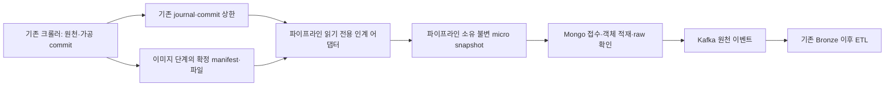

# 수집 중 증분 인계 계약 v1

구현 상태(2026-10-16 갱신): LIVE 캡처·drain·이미지 후속·원격 ready 전송 코드를 추가하고 로컬 회귀/저장 journal 소량 시험을 수행했다. 실제 실행·한계는 [LIVE 실행 문서](live_execution.md), 항목별 인수 상태는 [이슈 충족표](issue13_acceptance.md)를 따른다. 아래는 설계 계약이며 모든 실제 서버 인수 조건이 완료됐다는 의미는 아니다.

2026-10-16. [데이터 계약 v1](data_contract_v1.md)을 확장하는 **설계 문서**다. 실행 중 수집기·기존 파일·코드를 변경하지 않았다. 여기서 실시간은 저장 확정한 변경을 짧은 간격으로 인계하는 마이크로배치를 뜻하며 지연 상한을 보장하는 표현이 아니다.

다중 후보·순서·게시 보호의 보강 기준은 [v1.1 계약 6~7절](design_amendment_v1_1.md)이다. observation_key는 유지하며 source seq·manifest hash·capture 순서·업로드 state revision을 동일한 순서 값으로 취급하지 않는다.

## 1. 현재 구현에서 가능한 범위

근거: [체크포인트](https://github.com/encore-ai-campus/mlo-01-p3-team3/blob/67e837db4114ef8955a12c0b466f6f4aba50bd8f/Commerce_crawler/product_collector/checkpoint.py)의 save/state, [수집 CLI](https://github.com/encore-ai-campus/mlo-01-p3-team3/blob/67e837db4114ef8955a12c0b466f6f4aba50bd8f/Commerce_crawler/product_collector/__main__.py)의 수집 후 이미지 단계, [이미지 처리](https://github.com/encore-ai-campus/mlo-01-p3-team3/blob/67e837db4114ef8955a12c0b466f6f4aba50bd8f/Commerce_crawler/product_collector/media.py)의 checkpoint/finally, [파일 저장](https://github.com/encore-ai-campus/mlo-01-p3-team3/blob/67e837db4114ef8955a12c0b466f6f4aba50bd8f/Commerce_crawler/product_collector/storage.py)의 원자적 파일 교체.

| 단계 | 현재 동작 | 인계 시점 |
|---|---|---|
| 목록·상세 | checkpoint_events에 같은 event.records 안의 raw/normalized를 동결, flush+fsync 후 상품 파일 반영, 마지막에 checkpoint_state.commit 갱신 | commit 이하의 검증된 이력 레코드를 수집 종료 전에 인계 가능 |
| 이미지 | 전체 목록·상세 단계 후 다운로드 시작. URL별 이력과 25 URL마다 상품 manifest, finally에서 최종 manifest 저장 | 이미지 단계가 시작된 뒤 확정 manifest의 상품별 확보 버전을 추가 인계 |
| gallery_assets·offline reprocess | 별도 raw/products export. 같은 checkpoint journal이 항상 있지 않음 | v1 실시간 어댑터 지원 대상으로 추정하지 않고 기존 확정 배치 인계 사용 |

현재는 상품별 상세 완료 직후 이미지까지 바로 다운로드하는 실행 흐름이 아니다. 원천 증분 인계를 추가해도 이 순서는 바뀌지 않는다. 목록부터 이미지까지 상품별 즉시 처리는 수집기 담당의 별도 변경·인수가 필요하다.

## 2. 책임 분리와 구성

| 담당 | 책임 | 금지/제외 |
|---|---|---|
| 수집기 | 기존 네트워크 요청·파싱·수집 commit·이미지 다운로드 | 인계 어댑터 때문에 DB/Kafka 로직을 수집기에 추가하지 않음 |
| 파이프라인 인계 어댑터 | source를 읽기 전용으로 읽고 확정 범위를 동결, 이미지 검사, 인계 cursor·불변 파일 생성 | 수집 writer.lock 획득·강제 해제, raw/products 수정, HTTP 재수집 안 함 |
| 파이프라인 적재·발행 | 접수 고유 키·원장·업로드·원천 저장 확인·이벤트·복구 | source commit/cursor를 수집 체크포인트에 쓰지 않음 |
| NiFi/배포 | 단일 실행 주체·프로세스 재시작·권한·전송 endpoint | 어댑터와 별도 상품별 재시도 원장을 중복 소유하지 않음 |

범위는 파이프라인 안의 read-only 연동 어댑터와 downstream이다. 수집기의 사이트 동작·기존 재개 방식은 유지한다. 어댑터가 수집기 비공개 함수에 의존하지 않도록 checkpoint format=jsonl-v1·해시 규칙을 지원 계약으로 명시하고 저장 표본으로 호환 테스트한다. 지원하지 않는 형식은 실행을 거절한다.

## 3. 원천 commit 읽기 계약

1. 명시한 source run 경로의 run_config.job_id·storage 형식과 checkpoint_state.job_id를 확인한다. raw의 job_id도 동일해야 한다. active_run의 변경을 따라 다른 실행으로 자동 이동하지 않는다.
2. checkpoint_state를 한 번 읽어 고정 상한 C를 얻는다. 상품 폴더의 현재 내용이나 journal의 파일 끝을 확정 상한으로 사용하지 않는다.
3. 마지막 검증 offset부터 journal을 순차 읽는다. envelope의 event.seq가 직전+1인지 확인하고 현재 checkpoint.encoded와 동일한 직렬화 SHA256으로 envelope.sha256을 검증한다. pipeline H와 기존 journal 해시는 다른 규칙이다.
4. seq<=C만 처리한다. 같은 event.records에 있는 raw와 normalized가 인계 쌍이다. 최신 개별 JSON·products.jsonl과 섞지 않는다. event에 상품 변경이 없어도 seq 이력 검증과 cursor는 진행한다.
5. 임시 micro snapshot에 해당 변경 쌍을 복사·fsync·파일 hash 대조하고 manifest를 마지막에 확정한다. source pointer는 job_id·journal seq·record index·envelope hash를 포함한다.
6. 새로운 C가 보이더라도 이미 고정한 범위는 바꾸지 않는다. 다음 반복에서 이어 읽는다. 원천 이력을 다시 전체 로드하거나 생성 중인 tail을 해석하려고 반복 요청하지 않는다.

실행 중 tail은 아직 끝나지 않은 JSON일 수 있다. C를 넘는 미확정 tail은 대기한다. C 이하의 누락 seq·유효 envelope의 해시 오류·본문 오류는 무시하지 않고 SOURCE_COMMIT_INVALID로 해당 source를 중단한다. 기존 writer의 강제 종료 뒤 남은 비JSON 조각이 줄바꿈으로 분리된 경우, 다음 유효 envelope가 기대 seq이고 C까지 연속성·해시를 확인할 때만 과거 미확정 조각으로 분류해 위치·해시를 기록한다. 필요한 seq를 건너뛰어 복구한 것으로 표시하지 않는다.

한 event가 배치 상한보다 크면 records를 나눌 수 있으나 원래 event hash를 먼저 검증하고 모든 record index를 보존한다. 같은 상품의 중간 변경을 임의로 최신 하나로 압축하지 않는다. 동일 관측 여부는 아래 observation_key로 결정하며 다른 확정 관측은 각각 보존한다. event seq는 commit 순서이지 가격 관측 시각이 아니다.

cursor의 byte offset은 다음 읽을 envelope 시작 위치다. envelope 일부 records만 동결했다면 offset은 그 envelope 시작에 그대로 두고 pending_seq·envelope_hash·next_record_index를 저장한다. 마지막 record까지 완료한 뒤에만 다음 envelope 위치로 이동한다. records가 없는 event도 검증한 envelope 위치·해시를 control receipt로 남긴 후 진행한다. 이 규칙으로 한 event를 여러 chunk로 나누다 종료돼도 앞부분 중복은 고유 키로 제거하고 뒷부분을 잃지 않는다.

## 4. 세 가지 진도와 ack

| 진도 | 영속 증거 | 의미 |
|---|---|---|
| source_committed | 크롤러의 C | 수집기 저장 확정. 파이프라인 전달 성공과 무관 |
| capture_cursor | 파이프라인의 확정 micro snapshot+source pointer+hash | source 변경을 잃지 않고 보관한 위치 |
| ingestion_receipt | Mongo 접수 manifest·observation_key·raw ID·event 상태 | 대상 환경에서 접수·원천 저장·발행한 단계 |

capture_cursor는 파일·manifest가 모두 확정되고 부모 디렉터리 내구성이 지원·검증된 저장소에서 보관이 확인된 뒤에만 전진한다. Windows/특정 파일시스템에서 전원 장애까지의 디렉터리 영속성을 보장할 수 없으면 그 한계를 기록하고 재시작 때 source pointer부터 재대조한다. 단순 rename만으로 모든 저장소의 crash durability를 보장한다고 표현하지 않는다.

Mongo에 아직 연결하지 못해도 내구성 있는 spool에 캡처할 수 있다. 이는 접수 성공이 아니라 CAPTURED_WAITING_INGEST다. 이후 Mongo 고유 키 접수로 확정한다. cursor보다 앞서야 할 snapshot이 없거나 hash가 다르면 성공으로 건너뛰지 않는다. source가 남아 있으면 마지막 정상 위치부터 다시 동결하고 observation_key로 중복을 제거한다. source·snapshot 모두 없으면 RECOVERY_EVIDENCE_MISSING이다.

한 원천 pointer에서 외부 적재가 끝날 때까지 source를 잠그지 않는다. 반대로 Kafka 발행 완료를 capture_cursor로만 판단하지 않는다. 여러 worker가 같은 인계 범위를 읽더라도 Mongo 접수·lease·고유 키가 최종 중복을 제어한다. 최초 운영은 source별 인계 어댑터 하나로 제한한다.

## 5. micro snapshot과 전송 규격

각 snapshot은 kind=LIVE_DELTA, 전체 배치 snapshot은 kind=FULL_EXPORT다. LIVE_DELTA의 product_count는 이번 변경 수이지 전체 수집 상품 수가 아니다. changed records의 쌍만으로 raw/products 집합을 대조하고 서로 다른 event에서 발생한 같은 상품의 관측은 소스 pointer별로 보존한다. 같은 상품의 여러 버전은 관측별 파일/분할 JSONL로 구분한다. 기존 한 상품당 한 행인 FULL_EXPORT 검증기를 그대로 적용해 중간 버전을 삭제하지 않는다.

| manifest 필드 | 계약 |
|---|---|
| handoff_schema_version | 1 |
| kind·phase | LIVE_DELTA, SOURCE_METADATA 또는 GALLERY_ACQUISITION |
| collection_run_id·source_format | 명시 job_id, jsonl-v1 또는 지원하는 media manifest 형식 |
| source_range | from/to seq·record index·envelope hash, 또는 media manifest content hash |
| records | 변경 raw/normalized 참조·해시·source pointer·원천 관측 해시 |
| image_files | 확보 파일의 snapshot 상대 경로·SHA256·메타데이터. 미확보는 별도 상태 |
| files | 인계 chunk 상대 경로·SHA256·바이트 수·행 수 |
| snapshot_id | kind/phase/소스 범위/안정 파일 manifest에 pipeline H 적용. 생성 시각·호스트 절대 경로 제외 |
| captured_at·producer_version | 진단·계보. ID 계산에서 제외 |

상품 관측 ID는 data_contract_v1의 observation_key를 그대로 사용한다. snapshot_id·transport·source seq를 관측 키에 새로 넣지 않는다. 같은 raw+갤러리 버전을 배치·실시간 양쪽으로 받아도 같은 관측으로 접수한다. seq는 전달 계보이며 상품의 원천 ID가 아니다.

로컬 인계는 임시 디렉터리→파일·hash 검증→완료 manifest→확정 이름으로 교체한다. 어댑터와 적재기가 다른 PC/VM에 있으면 pipeline 소유 spool을 전달하고 source 공유 폴더 직접 접근에 의존하지 않는다. S3 호환 전송은 content-addressed chunk를 먼저 업로드·확인하고 ready manifest를 마지막에 공개한다. S3 rename이나 여러 객체 동시 commit을 가정하지 않는다. 동일 키의 다른 hash는 충돌로 거절한다. 같은 내용 중복 전송은 허용한다.

수신자는 ready manifest·모든 chunk·이미지 hash가 확인돼야 적재한다. 복사 중 파일·임시 경로·watcher 알림만으로 적재하지 않는다. manifest의 경로는 상대 경로로 제한해 루트 밖 참조를 거절한다. 파일 시스템 watcher와 원격 목록 조회는 발견 힌트일 뿐이며 주기적 manifest 대조와 Mongo receipt 조회로 누락·중복을 복구한다. 원격 bucket/namespace·접근 권한은 배포 설정이며 인프라 구축은 별도 담당이다.

## 6. 원천 먼저, 이미지 확보 버전은 나중에

SOURCE_METADATA 인계는 frozen raw/normalized에 존재하는 갤러리 URL·순서·역할을 보존한다. 아직 다운로드하지 않은 이미지는 acquisition_state=UNAVAILABLE, 파일 메타데이터·asset/object key는 null이다. 이미지 배열이 비어 있는 목록 단계 관측도 원천으로 보존할 수 있으나 gallery_missing/detail_pending 품질 상태를 남긴다. 수집 중 상세 미완료를 오류 종료나 추천 가능으로 처리하지 않는다.

이미지 단계가 시작되면 어댑터는 products_with_local_images manifest가 원자 교체된 버전을 **읽은 바이트 그대로 동결**한다. report·URL별 image_downloads 이력만으로 상품별 매핑을 추측하지 않는다. 동결한 manifest와 대응하는 journal raw/normalized를 다음 기준으로 연결한다.

- source/product_id/job_id·raw_payload_hash·categories·collected_at·detail_status와 가공 필드의 비다운로드 투영을 대조한다.
- 갤러리 URL·observed_url·order·role·origin·selector·resolution_status가 원래 normalized의 images와 대응해야 한다.
- 현재 media에는 생성 기준 seq가 없다. C 이하의 대응 후보를 source_observation_hash로 그룹화하고 한 wrapper 그룹만 있을 때 HASH_AND_GALLERY_EQUIVALENCE로 연결하며 근거 seq를 모두 보존한다. 다른 wrapper 그룹이 둘 이상이면 LINK_AMBIGUOUS로 보류하고 최신 seq를 임의 선택하지 않는다. 정확한 다운로드 commit을 복원했다고 표시하지 않는다.
- 다운로드 성공 파일은 복사한 바이트를 실제 이미지로 검증하고 manifest SHA256·크기·형식·해상도·상품 연결을 대조한다. 이동·유실·변조는 실패 상태다. 원본 hardlink를 snapshot 불변 파일로 간주하지 않는다.
- 가공 필드·갤러리의 비교 규칙은 스키마 1.2에 고정하고 미지원 형식은 거절한다. 비교에서 제외하는 다운로드 전용 필드는 images 내의 다운로드 메타데이터와 top-level image_download_status뿐이다. 임의의 나머지 필드를 삭제해 억지로 일치시키지 않는다.

원격 복사·state 가시성 지연으로 media가 source C보다 먼저 보일 수 있다. source가 진행 중이면 WAIT_SOURCE_MATCH로 두고 다음 C에서 재대조한다. 종료 범위까지 확인했는데도 대응이 없거나 상품/갤러리 충돌이 명확하면 MEDIA_SOURCE_MISMATCH로 확정한다. 실패 버전을 폐기하지 않고 manifest hash·사유·재대조 이력을 보존한다. 기존 media에는 원본 seq가 없으므로 원래 다운로드 당시의 정확한 commit을 복원했다고 표현하지 않는다.

상품의 이미지 4장 중 2장만 확보됐으면 그 확보 버전을 먼저 보낼 수 있다. 다음 manifest에서 4장으로 늘면 새 gallery_acquisition_hash·새 관측을 보존한다. 파일명·절대 경로·진행률·오류 문자열만 달라지면 같은 관측으로 수렴한다. 이미 검증한 같은 파일의 원격 업로드 재시도는 새 관측을 만들지 않는다. 과거 raw.image_refs는 UPDATE하지 않는다.

2장·4장이라는 수나 hash 자체로 최신성을 판단하지 않는다. 같은 source subscription의 원본 읽기/동결 capture_order·generation·전임 hash chain을 보존해 원격 역순 도착을 처리한다. 다른 run/비교 불가능한 legacy 입력은 ORDER_UNKNOWN으로 게시 대기한다. 실제 이미지 제거는 완전한 원천 목록·최신 시각 증거가 필요하고 부분 다운로드·파서 실패와 구분한다. 순서 제어 기록은 ingestion_snapshots의 control/manifest로 관리하며 Raw/event 본문을 갱신하지 않는다. 세부 규칙은 보강 계약을 따른다.

raw/normalized를 동일하게 다시 보내며 새 이미지 확보 해시만 추가하는 것이 GALLERY_ACQUISITION이다. source_metadata 관측과 같은 상품·수집 실행·source_observation_hash로 연관시키되 서로 다른 raw ID를 갖는다. 새 raw에 실제 최초 source 시각을 유지하고 이미지 다운로드 시각을 가격 시각으로 쓰지 않는다. Gold는 같은 상품으로 묶되 원문·이미지 연결 버전을 보존한다.

기존 media manifest는 25 URL마다 확정되므로 이미지 하나마다 즉시 인계되는 것은 아니다. 더 짧은 이미지 지연을 원하면 수집기 담당이 상품 단위 ready 기록·기준 seq·파일 검증 manifest를 제공하는 producer 확장을 별도 구현해야 한다. 이를 파이프라인이 사이트에 직접 요청해서 보완하지 않는다.

## 7. 지연·부하·중단 계약

| 설정 | LIVE 초기 기준안 |
|---|---|
| source 발견 | 실행 중 source journal/state를 2초 간격 확인. 파일 변경 없으면 읽기 offset 유지 |
| flush | 변경 관측 100개 또는 첫 대기 변경 이후 10초 중 먼저 도달. 상태만 바뀐 빈 commit은 불필요한 원천 발행 없이 cursor 기록 |
| chunk 크기 | 목표 32 MiB 이하로 분할, 단일 큰 원문은 별도 chunk·한도 검증. raw BSON 초과는 기존 격리 규칙 |
| media 발견 | 이미지 manifest 변경 hash를 확인해 상품별 의미 변경만 인계. 현재 25 URL 저장 주기가 추가 지연 |
| NiFi | LIVE 어댑터 단일 장기 프로세스의 실행/상태 확인. 기존 배치용 5분 발견과 같은 source에 중복 활성화하지 않음 |
| 재시도 | 기존 3회·next_retry_at·Retry-After·lease 계약 유지 |
| 대기열 | 메모리 큐 최대 100개 미처리 관측. spool은 배포에서 용량 한도·최소 여유 공간을 반드시 설정 |
| 한도 초과 | 어댑터 새 캡처 중지·BACKPRESSURE 상태, 기존 적재 재개. source는 계속 수집할 수 있으며 자동 종료·삭제하지 않음 |
| 보관 | 운영 v1 자동 삭제 없음. quota 초과 전에 운영 알림. ack 없이 source/spool 정리 금지 |

10초 flush는 탐지·동결 기준이며 이미지 다운로드·네트워크·DB/Kafka 적체·lease·실패 복구 시간을 포함하는 종단 SLA가 아니다. 파이프라인 지연은 captured_at−source commit 관측 시각, 원천 확인·이벤트 확인 시각 등으로 구분하고 clock skew 영향을 명시한다. source 상태 파일 시각을 실제 응답 시각으로 사용하지 않는다.

spool 부족으로 capture_cursor가 멈추면 마지막 정상 범위에서 이어 읽는다. 수집기와 파이프라인이 다른 호스트이고 source 보관 기간이 유한하면 source 보관 담당과 최대 중단 기간·삭제 조건을 합의해야 한다. 파이프라인이 이를 보장할 수 없으면 LIVE 활성화를 거절한다. backlog 확인 없이 journal rotation·수집 실행 삭제를 자동 허용하지 않는다.

어댑터 종료는 source를 종료하지 않는다. graceful stop은 확정 완료 chunk와 cursor만 보존하고 임시 작업은 재시작 때 검증/재생성한다. 강제 종료·DB 장애·원격 응답 유실은 같은 source pointer·관측 키로 재시도한다. 다른 run_config.job_id·journal 잘림·기존 prefix 변경·seq 역전은 SOURCE_IDENTITY_CHANGED로 중단한다. 새 실행은 별도 subscription으로 등록한다.

재개 cursor는 run ID·상대 journal 경로·byte offset·직전 seq/record index·envelope hash·검증 prefix hash·snapshot 참조를 갖는다. 활성 중에는 이미 검증한 append-only prefix를 다시 전체 해시하지 않고 연속 seq를 검사한다. 재시작·rotation·호스트 이전 때 이전 검증 prefix를 스트리밍 대조해 원본 교체를 감지한다. 최초 도입 시 기존 journal은 한 번 스트리밍 검증하며 스냅샷/접수 원장을 다시 만들지 않으면 과거 범위를 임의 skip하지 않는다.

## 8. 완료와 정산

checkpoint_state.status=completed는 원천 목록·상세 단계 완료이지 이미지 단계까지 완료됐다는 뜻이 아니다. stage watermark를 별도로 둔다.

| milestone | 확인 근거 |
|---|---|
| SOURCE_DRAINED | 원천 종료 상태와 고정 최종 C까지 모든 pointer 동결·검증 완료. interrupted/partial은 같은 이유를 기록하며 성공 종료로 바꾸지 않음 |
| MEDIA_FINAL_SEEN | media 최종 download_report.finished_at·result와 확정 manifest를 대조. finally 종료는 성공뿐 아니라 중단도 포함 |
| HANDOFF_DRAINED | 해당 source 범위·확보 버전의 모든 snapshot에 접수 receipt 존재, 미접수 없음 |
| INGEST_DRAINED | RAW_CONFIRMED·EVENT_CONFIRMED 또는 명시 격리/실패 건수 대조 완료 |
| DATA_PUBLISHED | 별도 Bronze/품질/Gold·MySQL 인수. LIVE capture 종료와 무관 |

이미지 실행 여부가 확인되지 않으면 MEDIA_NOT_CONFIGURED/UNKNOWN으로 남기며 완료라고 추정하지 않는다. media report가 partial이면 잔여 이미지 실패·미시도 건수를 보존한다. 목록 전용 실행은 SOURCE_ONLY로 명시해 이미지 포함 전체 성공과 구분한다.

정산은 고유 상품 수, 확정 원천 관측 수, 처리한 pointer 수, 이미지 관계 성공 수, 고유 이미지 바이트 수, 원천 DB 수, 확인 이벤트 수, 품질 대기·격리·게시 수를 분리한다. 한 상품의 중간 관측·이미지 보강 관측이 여러 개라는 이유로 상품 수를 늘리지 않는다. 최종 export를 별도 FULL_EXPORT로 받아 누락 관측을 대조하되 기존 원천 ID를 새로 발급하지 않는다.

## 9. 필수 인수 시험

| 상황 | 기대 결과 |
|---|---|
| journal append 중·상품 파일 한쪽만 교체 | C 이하 frozen pair만 전달, 미확정 tail·개별 JSON 읽기 제외 |
| event fsync 후 state 갱신 전 종료 | 재개 전 commit 상한 밖은 보류, 수집 복구가 state를 확정한 뒤 처리 |
| byte tail/과거 미완성 조각·해시 오류·seq 누락 | 미확정 조각과 실제 committed 손상을 구분, 손상을 조용히 건너뛰지 않음 |
| snapshot 확정 전/후 cursor 저장 중 종료 | 이전 cursor로 재생 가능, 같은 observation_key·raw/event ID 유지 |
| DB/Kafka 장애·중복 인계·원격 chunk 일부 유실 | 캡처/접수/전달 상태 분리, 미완성 ready 거절·고정 ID 복구 |
| media 0→2→4장, 다운로드/업로드 실패 | 새로운 로컬 확보만 새 관측, 업로드 재시도는 운영 상태 변경 |
| stale media·같은 payload_hash의 다른 wrapper | frozen projection·실제 source seq 대조, 임의 결합 금지 |
| final source 뒤 media 진행·finally 중단 | source 완료와 media 완료 분리, partial 잔여 보존 |
| spool/메모리 한도·장기 적체 | 유한 큐·BACKPRESSURE·cursor 정지, source 자동 삭제/중단 없음 |
| Linux/Windows 파일 교체·VM/AWS 원격 전송 | ready/chunk 검증·상대 경로·ID 보존, 저장소 내구성 한계 명시 |
| LIVE 이후 같은 내용 FULL_EXPORT 적재 | source seq/snapshot이 달라도 기존 관측 키 재사용 |
| source run 교체·journal truncate/rotation | 기존 cursor로 묵시 재개 금지, 정체성 검증·별도 등록 |

위 항목 중 로컬 회귀·저장 이력 시험은 구현 후 수행했다. 실제 동시 수집기·Linux/VM/AWS·원격 서버·종단 지연 인수는 아직 수행하지 않았다. 완료 근거와 미수행 범위는 이슈 충족표를 따른다.
