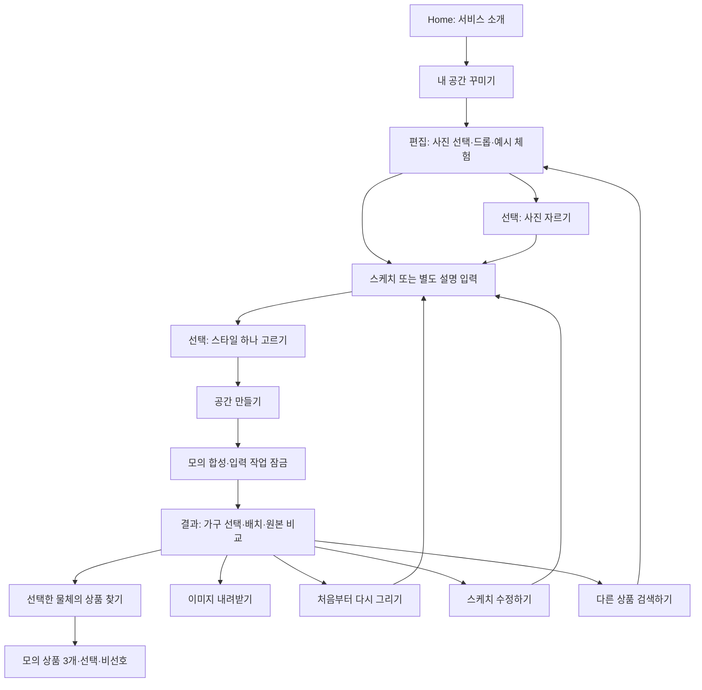
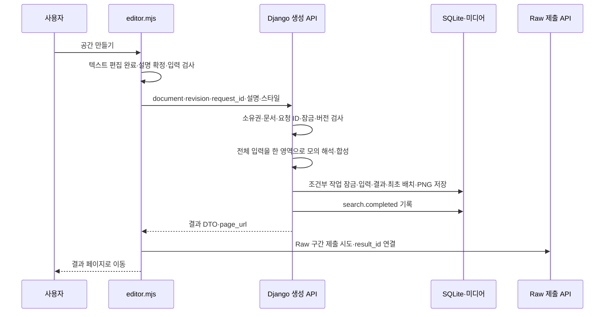
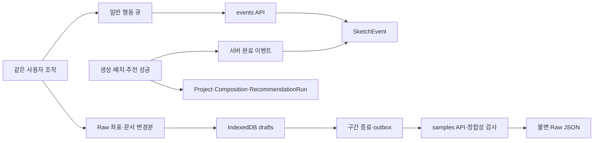

# 스케치·온 SketchOn — 이용·처리 Flow ver2

기준일: 2026-10-16 · 경로: `C:\mlo-01-p3-team3\src\demo_sketchon`

이 문서는 사용자의 이용 흐름과 서버·데이터 처리 흐름을 연결한다. 현재 구현은 Django·Canvas·Pillow의 모의 처리이며 실제 AI·광고 서버·검색 인덱스·AWS 파이프라인이 동작하는 구조도로 해석하지 않는다.

## 1. 사용자가 보는 전체 흐름

사진은 필요하지만 그림은 필수가 아니다. 별도 설명만 있어도 진행할 수 있고 스타일만 고른 것으로는 생성 조건을 충족하지 않는다. 그림·도형·글자를 여러 개 넣어도 현재 데모에서는 전체를 한 상품 입력으로 묶는다. 사용자가 생성 전에 가구 품목을 고르는 UI는 없다.

## 2. 방문과 작업이 생기는 순서

1. `GET /`에서 Django 세션에 sketch_owner가 없으면 익명 방문 ID를 만든다. Home 방문용 Project와 `home.viewed` 이벤트를 만든다.
2. 시작 링크 클릭은 Home 작업에 `button.clicked(button=start-sketch)`를 비동기로 연결한다. 이벤트 전송을 기다리게 하여 화면 이동을 막지는 않는다.
3. `GET /editor/`는 새 빈 Project를 만들고 `page.viewed(page=editor)`를 기록한다. `/editor/<project_id>/`는 같은 소유자의 기존 작업을 읽는다.
4. 사진 업로드는 `/api/projects/`에 multipart POST로 새 작업을 만든다. 방문 ID는 같고 사진을 담은 Project ID는 새로 생긴다.
5. 잠긴 Project 편집 URL은 결과 페이지로 보낸다. 같은 방문자의 프로젝트가 여러 개라는 이유만으로 방문 ID가 여러 사람이라는 뜻은 아니다.

Home 새로고침·사진 교체·자르기·재시작에서 작업 수가 늘어날 수 있다. 방문자 수·작업 수·완료 결과 수·Raw 구간 수는 별도 지표다. 동일 브라우저 쿠키가 유지되는 동안 이어지는 식별이며 다른 기기·시크릿 창·쿠키 삭제 후 동일인 연결은 지원하지 않는다.

## 3. 사진과 편집 처리

| 사용자 동작 | 브라우저 | 서버·저장 결과 |
| --- | --- | --- |
| 파일 선택·드롭 | 10MiB 안내, 선택/드롭 이벤트 | 파일 내용·해상도 검증, 원본 바이트·체크섬·파생 JPEG·Project 저장 |
| 예시 공간 체험 | 예시 이미지를 파일로 읽어 같은 업로드 경로 사용 | 별도 실제 사용자 사진과 구분된 수집 계약이 자동 생기는 것은 아님 |
| 사진 자르기 | 남길 사각형과 확인, 기존 스케치 비움 안내 | 편집용 사진 crop, 같은 방문자의 새 Project; 원본 참조·설명·스타일 유지 |
| 펜·지우개 | 화면용 점 처리와 별도 Raw 점 기록 | 행동은 큐로 전송; Raw는 구간 종료 후 제출 |
| 텍스트·도형·채우기 | 문서 요소와 픽셀 마스크·연결 관계 변경 | 행동 이벤트 및 Raw document_patch에 반영 |
| 설명·스타일 | 통합 이력·현재 요청 입력 변경 | 행동 이벤트로 전송, 생성 시 generation_context에도 고정 |
| 실행 취소·다시 실행 | 사진·스케치·설명·스타일을 최근 20단계로 복원 | 사진 작업 전환 시 Raw 구간 분리; 서버 버전 충돌이면 현재 상태 보존 |

사진은 폭 100%로 표시하고 높이는 사진 비율로 정한다. 편집용 사진과 합성 PNG 픽셀 크기는 같다. 원본 파일이 2,048px보다 커도 이를 화면에서 원본 해상도 그대로 편집한다고 설명하지 않는다.

편집 상태의 메모리/sessionStorage 보관과 서버 Project 저장을 구분한다. 서버 작업 저장 API는 revision 비교를 하며, 현재 브라우저의 모든 편집이 매 입력마다 Project.document에 자동 저장되는 구조라고 가정하지 않는다.

## 4. 공간 생성: 버튼에서 결과 화면까지

현재 신규 생성 URL은 `POST /api/projects/<id>/scene-generations/`이며 기존 `/search/`와 같은 모의 처리 함수에 연결된다. 브라우저가 QUEUED/RUNNING 등의 작업 계약을 다룰 수 있어도 현재 서비스에 실제 분산 생성 워커·지속 작업 큐가 붙었다는 뜻은 아니다.

같은 request_id와 같은 입력을 재전송하면 기존 결과를 재사용한다. 같은 ID에 다른 문서·설명·버전을 넣으면 거절한다. 결과 생성은 revision과 locked 조건을 확인한 뒤 Project를 잠그고 Composition을 저장한다. UI 잠금뿐 아니라 서버 API에서도 잠금·버전을 검사한다.

생성 중에는 입력을 제한하고 진행 상태를 표시한다. 실패하면 편집을 다시 허용하고 오류를 보여준다. 생성 성공과 Raw 성공은 별도 요청이므로 **결과 페이지가 열렸다고 Raw가 반드시 도착했다고 판단하지 않는다.** Raw 실패는 기존 생성·편집을 실패시키지 않도록 보관·재전송한다.

## 5. 결과 배치·검색 품목·추천

| 단계 | 처리와 저장 | 바뀌지 않는 것 |
| --- | --- | --- |
| 결과 화면 열기 | 현재 배치·물체 목록 표시, result.viewed 기록 | 생성 당시 input_document |
| 가구 이동·모서리/키보드 크기 조절 | placements API로 version 비교, 새 PNG·배치 저장, result.adjusted | 원래 입력 스케치 |
| 가로·세로(%) 입력 | 입력 완료 시 같은 배치 저장 경로·Undo/Redo 사용 | 실제 상품 cm 규격을 추정하지 않음 |
| 배치 실행 취소·다시 실행 | 성공한 저장만 이력 반영; 실패 시 기존 스택·저장 상태 유지 | 익명 방문 ID |
| 처음 배치로 | initial_placements 기준 복원 | 기존 결과의 과거 생성 순간을 새로 복원하지 않음 |
| 원본 비교 | 가구 레이어를 감추고 편집용 공간 사진 표시 | 배치 삭제나 결과 PNG 변경 아님 |
| 품목·가구 배치 수정 열기 | 실제 생성 가구 자동 선택 | 독립 주황색 검색 영역은 만들지 않음 |
| 품목 적용 | 바뀐 품목만 SceneObjectRevision에 저장 | 생성 가구를 새 품목으로 다시 합성하지 않음 |
| 선택한 물체의 상품 찾기 | 현재 물체·버전·검색 조건으로 추천 실행 | 원본 사진·입력 문서 |

배치 저장은 같은 version으로 두 번 덮어쓰는 것을 막는다. 저장 중 다운로드와 관련 조작을 제한하며 실패 시 마지막 서버 저장 배치로 복원한다. 사용자가 요청한 품목과 화면에서 움직이는 가구는 같은 선택 대상에 연결된다.

### 추천 요청 내부 흐름

1. 선택한 물체의 scene_object_id와 결과 UUID, request_id, 필요한 확인값을 Application의 추천 API로 보낸다. 브라우저가 광고 서버에 직접 연결하지 않는다.
2. 서버가 소유권·현재 물체·결과 버전·입력 해시를 확인하고 RecommendationRun을 만든다.
3. DB 트랜잭션에서 실행 임대를 확보한 뒤 제공자 호출은 트랜잭션 밖에서 한다. 현재 제공자는 로컬 DemoRecommendationProvider다.
4. 정상 응답을 검증하고 같은 lease_token·기한 조건을 만족할 때만 SUCCEEDED로 반영한다. 늦은 과거 실행이 새로운 실행 결과를 덮어쓰지 못하게 한다.
5. 화면의 기존 세 슬롯에 모의 상품을 표시한다. 선택 물체가 달라졌거나 결과 버전이 바뀐 뒤 도착한 응답은 현재 선택에 붙이지 않는다.
6. 일시 오류는 같은 요청 식별자로 재시도하고, 종료된 실패 상태나 입력 변경은 프런트 규칙에 따라 새 요청으로 시작한다. 추천 실패 시 생성 결과는 유지한다.

상품 카드가 화면에 들어오면 PRODUCT_IMPRESSION, 선택·비선호는 PRODUCT_SELECTED/PRODUCT_REJECTED를 전용 endpoint로 전송한다. 서버는 반응 전에 빠진 impression을 보충할 수 있다. 현재 판매 링크는 비활성이며 실제 판매사이트 방문 흐름은 검증하지 않았다.

## 6. 다운로드와 재시작

이미지 내려받기는 마지막으로 저장한 합성 PNG를 `sketchon-result.png`로 받는다. 클릭 이벤트는 다운로드 실행 의도이며 사용자 파일시스템의 저장 완료를 확인하는 이벤트가 아니다. 작업 JSON 버튼은 제거했고 개발자용 data API만 남아 있다.

| 버튼·mode | 사진 | 스케치 | 설명·스타일 | ID |
| --- | --- | --- | --- | --- |
| 처음부터 다시 그리기 / blank | 유지 | 비움 | 비움 | 새 Project, 같은 owner |
| 스케치 수정하기 / sketch | 유지 | 생성 당시 input_document 복원 | 생성 당시 generation_context 복원 | 새 Project, 같은 owner |
| 다른 상품 검색하기 / new | 비움 | 비움 | 비움 | 새 Project, 같은 owner |

이전 결과는 남겨 둔다. 결과에서 움직인 배치를 원래 스케치 좌표로 역변환하지 않는다. 새 편집의 Undo/Redo는 새로 시작한다. 사진 자르기·재시작·새로고침 때문에 새 방문 ID를 부여하지 않는다.

## 7. 데이터 수집은 별도의 병렬 흐름

일반 행동 큐는 약 1.5초, Raw 초안 보관은 약 1초, Raw 재전송은 약 5초 주기다. 상품 반응은 별도 내구 큐와 약 2초 주기를 사용한다. 모두 같은 방식의 큐가 아니므로 한 경로의 성공을 다른 경로의 성공으로 해석하지 않는다.

## 8. 실패·복구와 현재 한계

| 상황 | 현재 대응 | 확인 위치 |
| --- | --- | --- |
| 사진 크기·형식·픽셀 초과 | 안내 후 입력 거절 | 화면 오류·API 응답 |
| 다른 탭 버전 충돌 | 저장 거절, 현재 편집·저장 배치 보호 | 409·revision/version |
| 이벤트 중 잘못된 한 건 | 영구 거절 분리 후 다른 건 전송 | localStorage rejected·DB |
| Raw 4xx | failed로 분리, outbox 원본 유지 | IndexedDB failed/outbox |
| 일시 네트워크·저장 실패 | 서버 확인 전 대기 기록 유지·재시도 | pending·outbox·서버 로그 |
| 일반 LAN HTTP의 Raw 초안 복구 | Web Locks 부재 시 작성 중 초안을 자동 확정하지 않음 | drafts·수집 상태 안내 |
| 수집 한도 도달 | limited 구간 제출 후 원본 수집 중단, 편집은 계속 | capture_status·화면 안내 |
| 쿠키 삭제·다른 기기 | 기존 익명 방문자 연결 불가 | 새 세션 |

소유권·CSRF·조건부 갱신·추천 임대는 구현됐지만 SQLite·Django 개발 서버의 작은 동시 요청 회귀 검사를 대규모 운영 처리량으로 확대 해석하지 않는다. 실제 AI 생성, 상품·광고 API, Kafka/Spark, AWS 이관, 계정별 이력과 보관 정책은 아직 별도 설계·구현 범위다.

근거: [URL](../../sketch/urls.py), [주요 views](../../sketch/views.py), [플랫폼 API](../../sketch/platform_views.py), [편집 코드](../../sketch/static/sketch/editor.mjs), [결과 코드](../../sketch/static/sketch/result.mjs), [Raw 수집기](../../sketch/static/sketch/collector.mjs).
